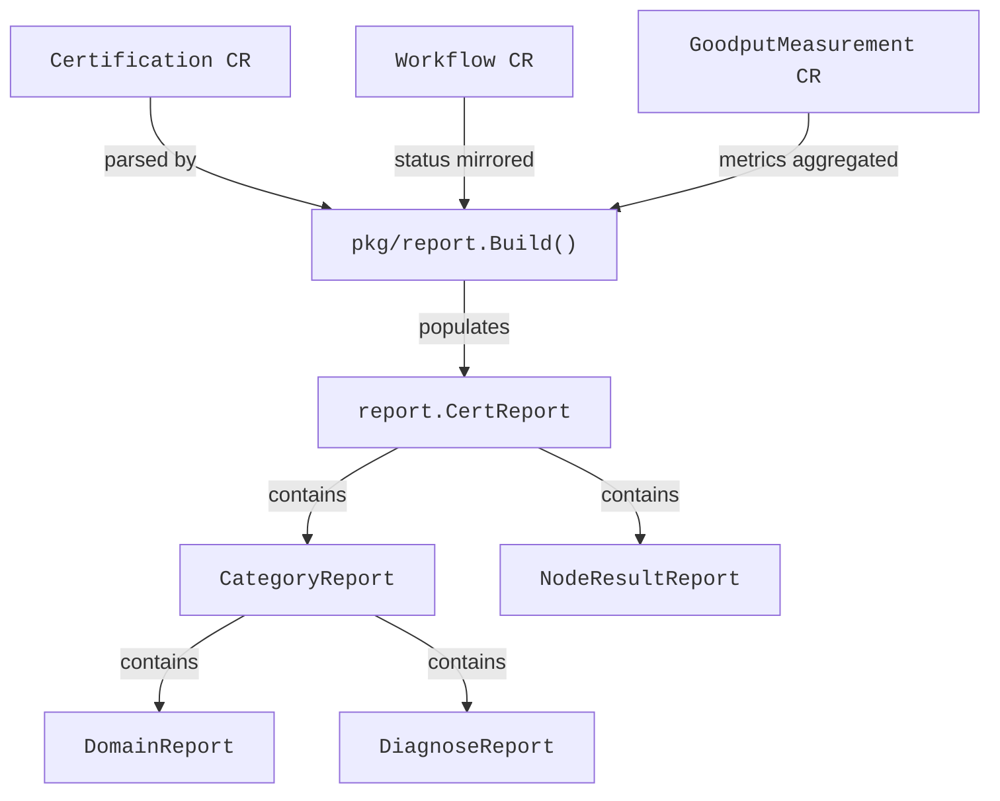
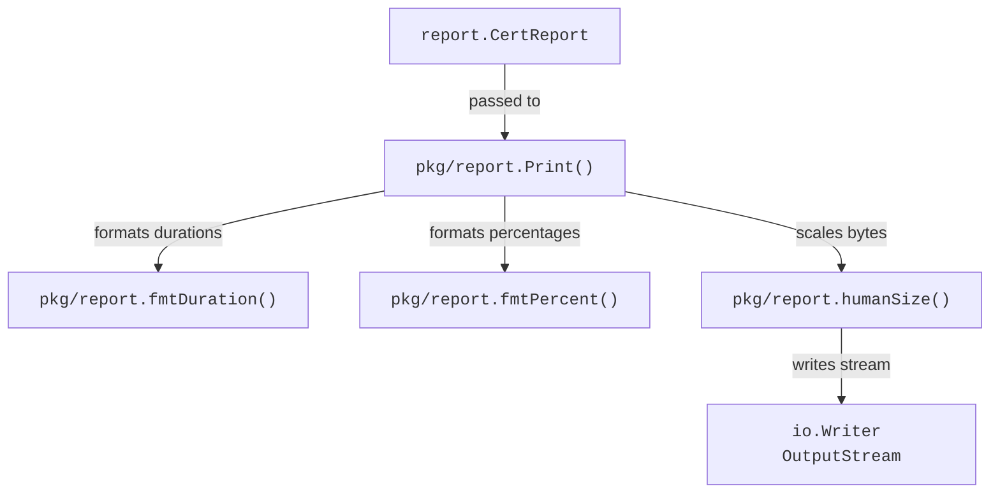
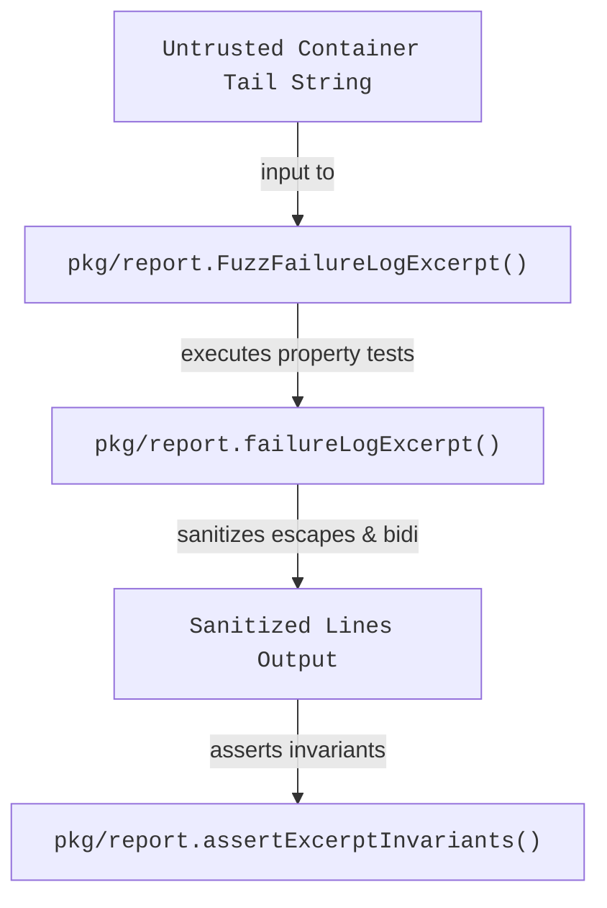

<!-- source: DeepWiki mcp.deepwiki.com · repo NVIDIA/cluster-readiness-engine · page 5.3 Reporting · fetched 2026-10-26 -->

# Reporting

Relevant source files

The following files were used as context for generating this wiki page:

- [.github/dependabot.yml](.github/dependabot.yml)
- [.github/workflows/fern-docs-ci.yml](.github/workflows/fern-docs-ci.yml)
- [.github/workflows/fern-docs-preview-comment.yml](.github/workflows/fern-docs-preview-comment.yml)
- [.github/workflows/publish-fern-docs.yml](.github/workflows/publish-fern-docs.yml)
- [docs/designs/071-threshold-reason-propagation.md](docs/designs/071-threshold-reason-propagation.md)
- [fern/fern.config.json](fern/fern.config.json)
- [fern/package-lock.json](fern/package-lock.json)
- [fern/package.json](fern/package.json)
- [pkg/report/build_excluded_test.go](pkg/report/build_excluded_test.go)
- [pkg/report/build_failed_groups_test.go](pkg/report/build_failed_groups_test.go)
- [pkg/report/fuzz_test.go](pkg/report/fuzz_test.go)
- [pkg/report/report.go](pkg/report/report.go)
- [pkg/report/report_test.go](pkg/report/report_test.go)
- [pkg/report/testdata/build-excluded-report/nodes-excluded-run-is-incomplete/expected.txt](pkg/report/testdata/build-excluded-report/nodes-excluded-run-is-incomplete/expected.txt)
- [pkg/report/testdata/build-excluded-report/nodes-excluded-run-is-incomplete/input_client_objects.yaml](pkg/report/testdata/build-excluded-report/nodes-excluded-run-is-incomplete/input_client_objects.yaml)
- [pkg/report/testdata/build-failed-groups/execution-failed-precedence/expected.txt](pkg/report/testdata/build-failed-groups/execution-failed-precedence/expected.txt)
- [pkg/report/testdata/build-failed-groups/execution-failed-precedence/input_client_objects.yaml](pkg/report/testdata/build-failed-groups/execution-failed-precedence/input_client_objects.yaml)
- [pkg/report/testdata/build-failed-groups/hardware-failed/expected.txt](pkg/report/testdata/build-failed-groups/hardware-failed/expected.txt)
- [pkg/report/testdata/build-failed-groups/hardware-failed/input_client_objects.yaml](pkg/report/testdata/build-failed-groups/hardware-failed/input_client_objects.yaml)
- [pkg/report/testdata/build-failed-groups/job-deleted-configmap-fallback/expected.txt](pkg/report/testdata/build-failed-groups/job-deleted-configmap-fallback/expected.txt)
- [pkg/report/testdata/build-failed-groups/job-deleted-configmap-fallback/input_client_objects.yaml](pkg/report/testdata/build-failed-groups/job-deleted-configmap-fallback/input_client_objects.yaml)
- [pkg/report/testdata/build-failed-groups/no-failure-data/expected.txt](pkg/report/testdata/build-failed-groups/no-failure-data/expected.txt)

## Purpose and Scope

The `pkg/report` package provides domain and clique-level aggregation, box-drawing CLI rendering, failure group analysis, log excerpt extraction, and terminal escape sanitization for NVIDIA Cluster Readiness Engine (NVCRE) certifications. It translates low-level Kubernetes resources (`Certification`, `Workflow`, `Job`, `GoodputMeasurement`, and `BandwidthMeasurement`) into structured data models and formatted human-readable terminal output.

---

## 1. Report Data Models and Aggregation

The reporting engine centers around `CertReport`, a top-level aggregation struct defined in `pkg/report/report.go` that aggregates results across all certification categories, nodes, and test domains.

*Figure 5.3.1: Data aggregation flow from Kubernetes custom resources to `CertReport`.*  
Sources: [pkg/report/report.go:53-147](), [pkg/report/build_excluded_test.go:53-53]()

`CertReport` aggregates cluster metadata, node exclusion states, per-category statuses, and overall pass/fail results [pkg/report/report.go:53-68]():

* `CertReport`: Holds `Title`, `Name`, `Platform`, `GPU`, `TotalNodes`, `ExcludedNodes`, `ExclusionReason`, `Categories`, `FailedNodes`, `Result`, and `NodeResults`.
* `CategoryReport`: Represents individual domains (`domain`, `variant`, `status`, `failureReason`, `runtime`, `testScale`, `nodesPerJob`, `jobs`, `mnnvl`), along with `FailedGroups`, `Cliques`, `Domains`, `Bandwidth`, `GroupBandwidth`, `Diagnose`, and `Iterations` [pkg/report/report.go:79-103]().
* `DomainReport`: Captures averaged training performance per topology domain (`Name`, `NodeCount`, `Goodput`, `TFLOPs`, `StepTime`) [pkg/report/report.go:141-147]().
* `DiagnoseReport`: Manages state and outcomes for adaptive fault isolation screening, bisection, and confirmation test passes [pkg/report/report.go:113-128]().

Sources: [pkg/report/report.go:53-147](), [pkg/report/build_excluded_test.go:53-53]()

---

## 2. Box-Drawing CLI Output and Formatting

The CLI output engine transforms `CertReport` instances into hierarchical tables and summary blocks utilizing Unicode box-drawing characters and text alignment utilities.

*Figure 5.3.2: CLI reporting formatting and output pipeline.*  
Sources: [pkg/report/report_test.go:56-168](), [pkg/report/build_excluded_test.go:56-56]()

Key formatting helpers include:
* `humanSize(bytes int64) string`: Converts byte counts into human-readable storage units (`KB`, `MB`, `GB`, `TB`) [pkg/report/report_test.go:69-69]().
* `fmtDuration(secs float64) string`: Translates floating-point seconds into compact duration strings (`120s` -> `2m 0s`) [pkg/report/report_test.go:156-156]().
* `fmtPercent(val float64) string`: Formats ratios into percentage strings with two decimal points (e.g., `0.92` -> `0.92 (92%)`) [pkg/report/report_test.go:138-141]().
* `Print(w io.Writer, report CertReport)`: Renders the report layout containing execution headers, metrics tables, failure group breakdowns, and final status banners [pkg/report/build_excluded_test.go:56-56]().

Sources: [pkg/report/report_test.go:56-168](), [pkg/report/build_excluded_test.go:56-56]()

---

## 3. Failure Attribution, Groups, and Log Excerpts

When a workload or workflow iteration fails, `pkg/report` extracts failure logs and aggregates faulty node sets into structured failure groups (`FailedGroupReport`).

* **Node Exclusions**: When nodes are skipped due to hardware topology mismatches or architectural filters, they are tracked in `ExcludedNodes` alongside an `ExclusionReason` [pkg/report/report.go:59-63](). A run containing exclusions reports `INCOMPLETE` rather than `PASSED` to ensure skipped verification targets remain transparent [pkg/report/build_excluded_test.go:19-23]().
* **Failure Log Excerpts**: Container stdout/stderr tails are processed by `failureLogExcerpt(tail string)` to extract relevant error lines while stripping redundant container orchestration noise [pkg/report/fuzz_test.go:17-37]().

Sources: [pkg/report/report.go:59-63](), [pkg/report/fuzz_test.go:17-37](), [pkg/report/build_excluded_test.go:19-23]()

---

## 4. Terminal Escape Sanitization, Safety, and Fuzzing

Because failure logs originate from untrusted user-supplied training and benchmark containers, log data can contain ANSI escape sequences, malicious control characters, invalid UTF-8 byte sequences, or bidirectional override vectors intended to obscure terminal output.

*Figure 5.3.4: Fuzz testing and sanitization pipeline for untrusted log excerpts.*  
Sources: [pkg/report/fuzz_test.go:24-40]()

`pkg/report` applies rigorous safety checks backed by Go native fuzzing (`FuzzFailureLogExcerpt`):
* **ANSI Escape Sanitization**: Strips or normalizes unsafe terminal control sequences to prevent terminal injection attacks.
* **Bi-directional Override Protection**: Neutralizes bidi override characters (e.g., `\u202e` right-to-left override and `\u2069` pop isolate) which can spoof error messages or tracebacks [pkg/report/fuzz_test.go:29-29]().
* **UTF-8 Enforcement**: Validates and cleans invalid multi-byte sequences (`\xff\xfe`) to guarantee stream decodability [pkg/report/fuzz_test.go:30-30]().
* **Fuzz Test Suite**: `FuzzFailureLogExcerpt` continuously subjects `failureLogExcerpt` to malformed strings, excessive lengths, control characters, and boundary inputs, asserting rendering invariants under all conditions [pkg/report/fuzz_test.go:24-40]().

Sources: [pkg/report/fuzz_test.go:24-40]()

---

