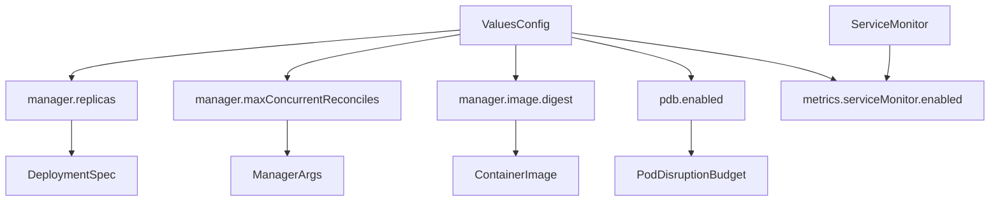
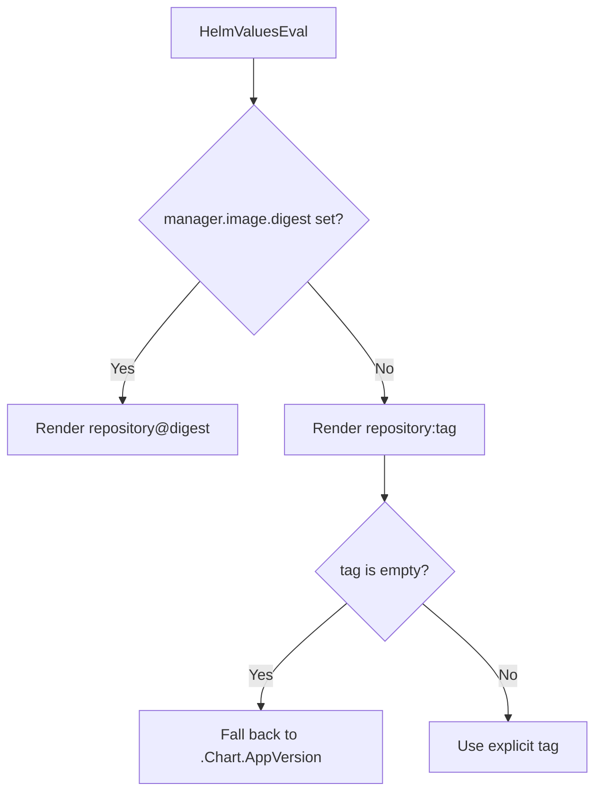

<!-- source: DeepWiki mcp.deepwiki.com · repo NVIDIA/cluster-readiness-engine · page 6.1 Helm Chart · fetched 2026-10-26 -->

# Helm Chart

Relevant source files

The following files were used as context for generating this wiki page:

- [.github/workflows/docs-verify.yml](.github/workflows/docs-verify.yml)
- [api/v1alpha1/workflow_types.go](api/v1alpha1/workflow_types.go)
- [docs/index.yml](docs/index.yml)
- [docs/operations/deployment.md](docs/operations/deployment.md)
- [helm/cluster-readiness-engine/crds/nvcre.nvidia.com_certifications.yaml](helm/cluster-readiness-engine/crds/nvcre.nvidia.com_certifications.yaml)
- [helm/cluster-readiness-engine/crds/nvcre.nvidia.com_workflows.yaml](helm/cluster-readiness-engine/crds/nvcre.nvidia.com_workflows.yaml)
- [helm/cluster-readiness-engine/crds/nvcre.nvidia.com_workloadruns.yaml](helm/cluster-readiness-engine/crds/nvcre.nvidia.com_workloadruns.yaml)
- [helm/cluster-readiness-engine/templates/deployment.yaml](helm/cluster-readiness-engine/templates/deployment.yaml)
- [helm/cluster-readiness-engine/templates/metrics-monitor.yaml](helm/cluster-readiness-engine/templates/metrics-monitor.yaml)
- [helm/cluster-readiness-engine/templates/pdb.yaml](helm/cluster-readiness-engine/templates/pdb.yaml)
- [helm/cluster-readiness-engine/values.yaml](helm/cluster-readiness-engine/values.yaml)
- [test/helm/pdb_test.go](test/helm/pdb_test.go)
- [test/helm/render_test.go](test/helm/render_test.go)

The `helm/cluster-readiness-engine` Helm chart provides a robust GitOps-compatible packaging path for deploying the NVIDIA Cluster Readiness Engine (NVCRE) controller manager, RBAC permissions, service accounts, custom resource definitions (CRDs), high-availability PodDisruptionBudgets (PDBs), and Prometheus monitoring integration into a Kubernetes cluster.

Sources: [docs/operations/deployment.md:55-73](), [helm/cluster-readiness-engine/values.yaml:1-51]()

---

## Values Configuration and Schema

The chart behavior is parameterized through `helm/cluster-readiness-engine/values.yaml`. Key configuration blocks include replica counts, concurrency settings for reconcilers, image management (repository, tag, and cryptographic digest pinning), resource allocation, affinity rules, PDB controls, and metrics monitoring toggles.

Sources: [helm/cluster-readiness-engine/values.yaml:6-51]()

---

## Deployment Template and Digest Pinning

The manager Deployment template (`helm/cluster-readiness-engine/templates/deployment.yaml`) instantiates the controller container with strict security hardening (`allowPrivilegeEscalation: false`, `readOnlyRootFilesystem: true`, `runAsNonRoot: true`) and forwards command-line arguments derived from values:

- `--metrics-bind-address` [helm/cluster-readiness-engine/templates/deployment.yaml:43-43]()
- `--leader-elect` [helm/cluster-readiness-engine/templates/deployment.yaml:44-44]()
- `--health-probe-bind-address` [helm/cluster-readiness-engine/templates/deployment.yaml:45-45]()
- `--max-concurrent-reconciles` [helm/cluster-readiness-engine/templates/deployment.yaml:46-46]()
- `--measurement-max-concurrent-reconciles` [helm/cluster-readiness-engine/templates/deployment.yaml:47-47]()

### Image Digest Pinning Logic

To ensure deterministic deployments and secure supply-chain practices, the chart evaluates image references with strict precedence rules: a cryptographic digest (`manager.image.digest`) always wins over an explicit tag (`manager.image.tag`), producing a digest-addressed image reference (`repository@sha256:...`) which references the exact verified binary bytes [helm/cluster-readiness-engine/templates/deployment.yaml:56-60]().

Sources: [helm/cluster-readiness-engine/templates/deployment.yaml:1-98](), [docs/operations/deployment.md:74-89]()

---

## PodDisruptionBudget (PDB) and High Availability

The chart supports optional deployment-level protection via a PodDisruptionBudget template (`helm/cluster-readiness-engine/templates/pdb.yaml`), enabled by setting `pdb.enabled=true` [helm/cluster-readiness-engine/values.yaml:39-45](). When activated, it safeguards single or multi-replica manager deployments from voluntary evictions during node drains by enforcing `minAvailable` constraints that match the controller deployment's selector labels.

Sources: [helm/cluster-readiness-engine/templates/pdb.yaml:1-18](), [helm/cluster-readiness-engine/values.yaml:39-45]()

---

## Monitoring and ServiceMonitor Integration

When `metrics.serviceMonitor.enabled` is set to `true`, the chart renders a Prometheus Operator `ServiceMonitor` resource (`monitoring.coreos.com/v1`) targeting the manager's secure metrics port (`https`) with bearer token authentication and TLS verification bypass for internal cluster scraping [helm/cluster-readiness-engine/templates/metrics-monitor.yaml:1-27]().

Sources: [helm/cluster-readiness-engine/templates/metrics-monitor.yaml:1-27](), [helm/cluster-readiness-engine/values.yaml:46-51]()

---

## Chart Rendering Tests and Verification Suite

The correctness of Helm templates is continuously verified via Go-based integration tests located in `test/helm/`. 

- `TestHelmTemplateRendersConcurrencyArgs`: Ensures concurrency flags match input values [test/helm/render_test.go:32-65]().
- `TestHelmTemplatePinsImageByDigest`: Validates digest vs tag resolution rules [test/helm/render_test.go:193-224]().
- `TestHelmTemplateControllerPDB`: Asserts PDB generation, `minAvailable` variations, and selector parity with the manager Deployment [test/helm/pdb_test.go:20-115]().
- `TestHelmTemplateDefaultControllerAntiAffinity`: Checks default `podAntiAffinity` configuration on single or multi-replica deployments [test/helm/pdb_test.go:117-147]().

Sources: [test/helm/render_test.go:32-65](), [test/helm/render_test.go:193-224](), [test/helm/pdb_test.go:20-115]()

---

