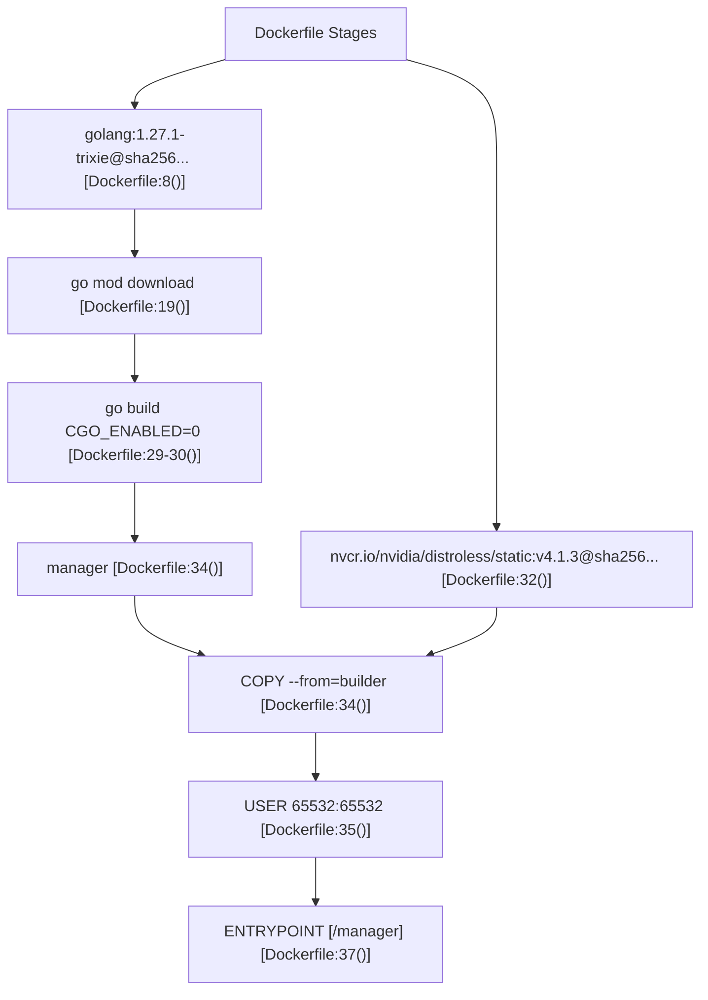
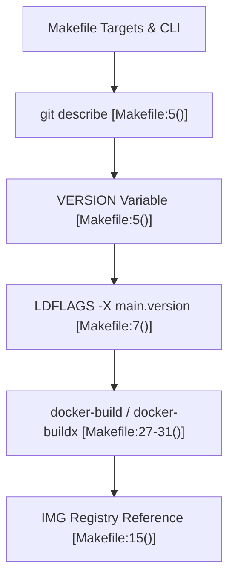
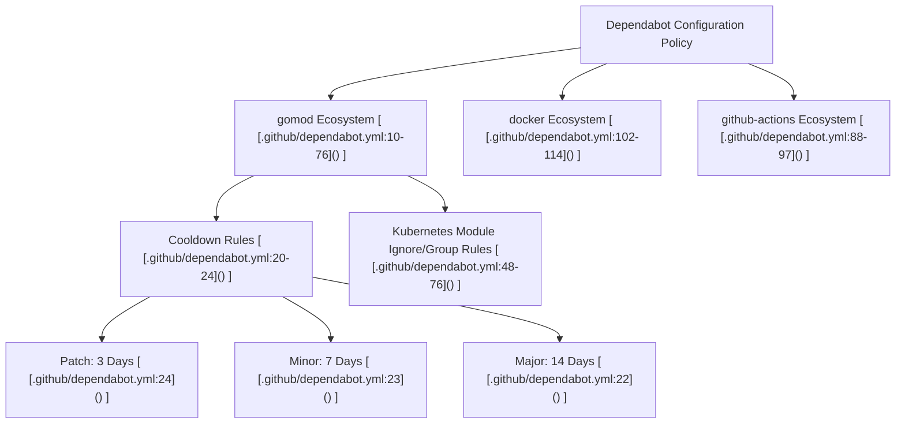

<!-- source: DeepWiki mcp.deepwiki.com · repo NVIDIA/cluster-readiness-engine · page 6.2 Container Image and Build · fetched 2026-10-26 -->

# Container Image and Build

Relevant source files

The following files were used as context for generating this wiki page:

- [.github/dependabot.yml](.github/dependabot.yml)
- [.github/workflows/build-image.yml](.github/workflows/build-image.yml)
- [.github/workflows/ci.yml](.github/workflows/ci.yml)
- [.github/workflows/codeql.yml](.github/workflows/codeql.yml)
- [.github/workflows/container-build.yml](.github/workflows/container-build.yml)
- [.github/workflows/fern-docs-ci.yml](.github/workflows/fern-docs-ci.yml)
- [.github/workflows/fern-docs-preview-comment.yml](.github/workflows/fern-docs-preview-comment.yml)
- [.github/workflows/govulncheck.yml](.github/workflows/govulncheck.yml)
- [.github/workflows/publish-fern-docs.yml](.github/workflows/publish-fern-docs.yml)
- [.github/workflows/publish.yml](.github/workflows/publish.yml)
- [.github/workflows/release.yml](.github/workflows/release.yml)
- [.github/workflows/scorecard.yml](.github/workflows/scorecard.yml)
- [.golangci.yml](.golangci.yml)
- [Dockerfile](Dockerfile)
- [Makefile](Makefile)
- [fern/fern.config.json](fern/fern.config.json)
- [fern/package-lock.json](fern/package-lock.json)
- [fern/package.json](fern/package.json)
- [go.mod](go.mod)
- [go.sum](go.sum)
- [hack/verify-doc-links.sh](hack/verify-doc-links.sh)
- [helm/cluster-readiness-engine/templates/manager-role.yaml](helm/cluster-readiness-engine/templates/manager-role.yaml)
- [installer](installer)
- [pkg/report/fuzz_test.go](pkg/report/fuzz_test.go)
- [pkg/report/report_test.go](pkg/report/report_test.go)

This page details the multi-stage distroless container image packaging, build automation via Makefiles, version stamping mechanisms, and dependency management policies implemented for the NVIDIA Cluster Readiness Engine (NVCRE).

---

## 1. Multi-Stage Distroless Dockerfile Architecture

The NVCRE controller image is built using a secure multi-stage `Dockerfile` designed to minimize the attack surface by excluding package managers, shells, and unnecessary utilities from the runtime environment.

- **Builder Stage**: Uses a digest-pinned Golang Trixie image (`public.ecr.aws/docker/library/golang:1.27.1-trixie@sha256:433790e515d27dc6003e847e644cc0af956985cf315c1c58a3b73ee2dd305183`) [Dockerfile:8()]. It isolates module downloading (`go mod download`) before copying the full source tree to optimize container layer caching [Dockerfile:14-22()].
- **Compilation Flags**: Builds a statically linked binary with CGO disabled (`CGO_ENABLED=0`), stripping debugging symbols (`-s -w`), and injecting the build version via linker flags (`-X main.version=${VERSION}`) [Dockerfile:29-30()].
- **Runtime Stage**: Uses a secure NVIDIA-maintained static distroless base image (`nvcr.io/nvidia/distroless/static:v4.1.3@sha256:ec947edce045116008a8aeab38c5da643fbf110990b133bad200dbf5e4b6e296`) [Dockerfile:32()]. The compiled `manager` binary is copied into the root directory [Dockerfile:34()], and execution context drops privileges to a non-root user (`65532:65532`) [Dockerfile:35()].

*Figure 1: Container Image Multi-Stage Build Pipeline.*

Sources: `[Dockerfile:1-37]()`

---

##  2. Makefile Build and Buildx Targets

The project root `Makefile` provides orchestration for compilation, version discovery, and container image generation using `docker` or compatible OCI CLI tools [Makefile:5-31()].

- **Version Resolution**: Dynamic version stamping is derived from git tags using `git describe --tags --always --dirty`, falling back to `"dev"` if unavailable [Makefile:5()].
- **Linker Flags**: Sets `LDFLAGS` to inject the version string into the main package variable `main.version` [Makefile:7()].
- **Image Parameters**: Configures `IMAGE_REGISTRY`, `IMAGE_REPOSITORY`, and `IMAGE_TAG` to construct the fully qualified image reference `IMG` [Makefile:11-15()].

*Figure 2: Build Parameter Flow and Makefile Targets.*

Sources: `[Makefile:1-31](), [.github/workflows/container-build.yml:54-57]()`

---

## 3. Version Stamping and Release Pipelines

Versioning and provenance are strictly enforced across CI/CD workflows (`publish.yml` and `release.yml`). 

- **Development Builds**: Triggered on pushes to `main`, computing tags like `main-<sha>` via `[ .github/workflows/publish.yml:53-61 ]()` and constructing multi-architecture manifests using BuildKit integration (`[ .github/workflows/container-build.yml:37-39 ]()`).
- **Release Builds**: Triggered on semantic version tags (`v*`), executing authoritative image compilation, SBOM generation via CycloneDX, and Sigstore-based keyless attestation (`[ .github/workflows/release.yml:68-128 ]()`).

Sources: `[.github/workflows/release.yml:68-128](), [.github/workflows/publish.yml:53-72]()`

---

## 4. Go Module Dependency Policy via Dependabot

Dependency hygiene and supply-chain security are automated through `.github/dependabot.yml`, which manages Go modules, GitHub Actions, Docker base images, and NPM dependencies on a weekly cadence [ [.github/dependabot.yml:8-130]() ].

- **Ecosystems**: Managed across `gomod`, `github-actions`, `docker`, and `npm` (for Fern docs) [ [.github/dependabot.yml:10, 88, 102, 119]() ].
- **Cooldown Periods**: Mitigates supply-chain poisonings by enforcing adoption delays based on semantic version impact:
  - Patch updates: 3 days (`semver-patch-days: 3`) [ [.github/dependabot.yml:24]() ]
  - Minor updates: 7 days (`semver-minor-days: 7`) [ [.github/dependabot.yml:23]() ]
  - Major updates: 14 days (`semver-major-days: 14`) [ [.github/dependabot.yml:22]() ]
- **Kubernetes Module Grouping**: Groups `k8s.io/*` and `sigs.k8s.io/*` dependencies into consolidated PRs while ignoring breaking minor/major version bumps on core Kubernetes APIs (`k8s.io/api`, `k8s.io/client-go`, etc.) to maintain compatibility with Kubeflow Trainer integrations [ [.github/dependabot.yml:48-76]() ].

*Figure 3: Dependabot Policy and Cooldown Topology.*

Sources: `[.github/dependabot.yml:1-130]()`

---

