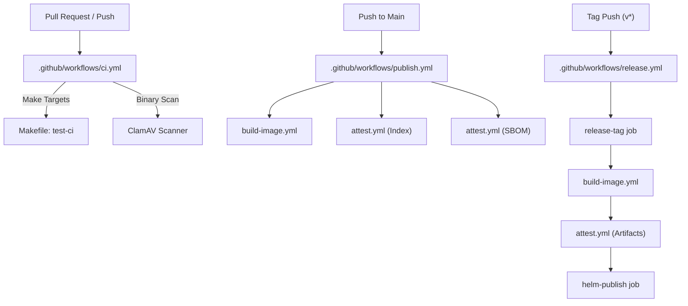
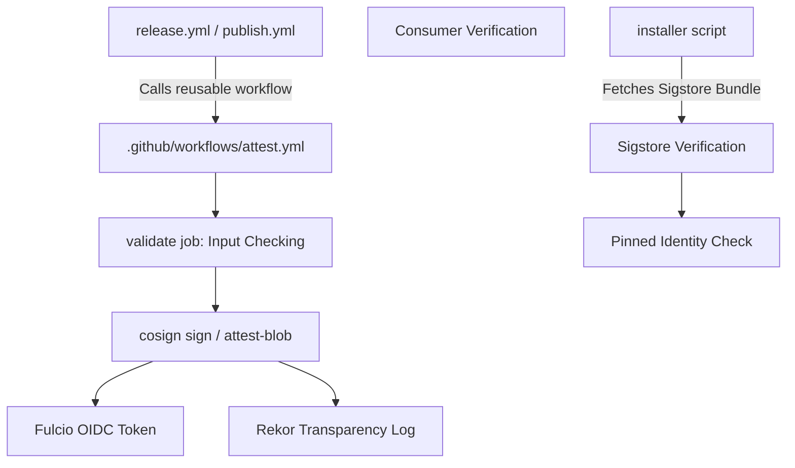
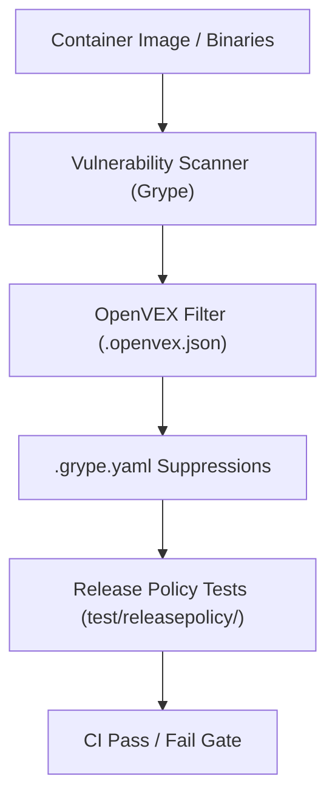

<!-- source: DeepWiki mcp.deepwiki.com · repo NVIDIA/cluster-readiness-engine · page 7 Supply Chain Security and Release Engineering · fetched 2026-10-26 -->

# Supply Chain Security and Release Engineering

Relevant source files

The following files were used as context for generating this wiki page:

- [.github/workflows/attest.yml](.github/workflows/attest.yml)
- [.github/workflows/build-image.yml](.github/workflows/build-image.yml)
- [.github/workflows/ci.yml](.github/workflows/ci.yml)
- [.github/workflows/codeql.yml](.github/workflows/codeql.yml)
- [.github/workflows/container-build.yml](.github/workflows/container-build.yml)
- [.github/workflows/govulncheck.yml](.github/workflows/govulncheck.yml)
- [.github/workflows/publish.yml](.github/workflows/publish.yml)
- [.github/workflows/release.yml](.github/workflows/release.yml)
- [.github/workflows/scorecard.yml](.github/workflows/scorecard.yml)
- [Makefile](Makefile)
- [docs/designs/074-supply-chain-attestation.md](docs/designs/074-supply-chain-attestation.md)
- [hack/verify-doc-links.sh](hack/verify-doc-links.sh)
- [helm/cluster-readiness-engine/templates/manager-role.yaml](helm/cluster-readiness-engine/templates/manager-role.yaml)
- [installer](installer)
- [test/docspolicy/cited_gate_tests_test.go](test/docspolicy/cited_gate_tests_test.go)
- [test/docspolicy/verification_page_test.go](test/docspolicy/verification_page_test.go)
- [test/releasepolicy/attest_boundary_test.go](test/releasepolicy/attest_boundary_test.go)
- [test/releasepolicy/attest_guards_test.go](test/releasepolicy/attest_guards_test.go)
- [test/releasepolicy/gate_absence_test.go](test/releasepolicy/gate_absence_test.go)
- [test/releasepolicy/installer_draft_guard_test.go](test/releasepolicy/installer_draft_guard_test.go)
- [test/releasepolicy/predicate_parse_test.go](test/releasepolicy/predicate_parse_test.go)
- [test/releasepolicy/shell_scope_test.go](test/releasepolicy/shell_scope_test.go)
- [test/releasepolicy/workflow_graph_test.go](test/releasepolicy/workflow_graph_test.go)

## Purpose and Scope
This page provides a high-level overview of the release engineering pipelines, artifact signing and attestation mechanisms, and vulnerability management processes implemented in the NVIDIA Cluster Readiness Engine (NVCRE). NVCRE deploys with high-privilege `cluster-admin`-adjacent permissions on GPU clusters, making strict supply chain integrity, verifiable provenance, and automated vulnerability scanning critical components of the system [docs/designs/074-supply-chain-attestation.md:7-10](). 

This page serves as a parent overview. Detailed technical specifications, workflow configurations, and verification implementations are covered in the following child pages:
- [CI/CD Workflows](#7.1) — Details on GitHub Actions pipelines (`ci.yml`, `verify.yml`, `publish.yml`, `release.yml`, `build-image.yml`) and Makefile test gates.
- [Attestation and Artifact Verification](#7.2) — Details on the reusable attestation workflow (`attest.yml`), keyless `cosign` signing, SLSA provenance, CycloneDX SBOMs, and the `installer` draft guard.
- [Vulnerability Management and OpenVEX](#7.3) — Details on container and binary scanning, `.grype.yaml` suppressions, `.openvex.json` reachability evidence, and release policy enforcement tests.

---

## CI/CD Pipelines and Automation
NVCRE relies on modular GitHub Actions workflows and local `Makefile` targets to automate continuous integration, test gating, container builds, and releases. 

Pull requests and pushes to `main` trigger [` .github/workflows/ci.yml `](), which executes linting, unit/integration testing via `make test-ci`, malware scanning on built binaries using ClamAV, and performance regression tracking [ .github/workflows/ci.yml:23-172](). Development images and tagged releases are managed through separate, highly decoupled pipelines (`publish.yml` for `main` branch commits and `release.yml` for versioned git tags) to prevent race conditions during publishing [`.github/workflows/publish.yml:6-12](), [`.github/workflows/release.yml:25-30`]().

*Sources: [.github/workflows/ci.yml:23-172](), [.github/workflows/publish.yml:6-12](), [.github/workflows/release.yml:25-181](), [Makefile:78-102]()*

For details on individual pipeline definitions, concurrency controls, and build runner allocations, see [CI/CD Workflows](#7.1).

---

## Attestation, Signing, and Artifact Verification
To ensure that operators can cryptographically verify every component before cluster deployment, NVCRE enforces an end-to-end supply chain security contract (ADR-074) [docs/designs/074-supply-chain-attestation.md:25-40](). All signing operations are centralized into a single reusable workflow, [` .github/workflows/attest.yml `](), which eliminates fragmented identity configurations and guarantees that all assets share a single pinned OIDC issuer and workflow identity [`.github/workflows/attest.yml:4-19](), [docs/designs/074-supply-chain-attestation.md:50-58]().

Artifacts such as the container manager image index, per-platform manifest SBOMs (CycloneDX), Helm charts, `nvcrectl` binaries, and the root `installer` script are bound to cryptographic signatures and SLSA Build Level 2 provenance statements [docs/designs/074-supply-chain-attestation.md:29-39]().

*Sources: [.github/workflows/attest.yml:4-141](), [installer:28-34](), [docs/designs/074-supply-chain-attestation.md:25-58]()*

For details on keyless `cosign` signing, SLSA provenance structures, SBOM attachments, and verification admission policies, see [Attestation and Artifact Verification](#7.2).

---

## Vulnerability Management and OpenVEX
Vulnerability management in NVCRE is enforced continuously across container builds and release validation gates. Automated tools inspect container images and binaries for Common Vulnerabilities and Exposures (CVEs), utilizing Grype-based scanning workflows and Go vulnerability checks (`govulncheck.yml`).

To handle false positives or unexploitable vulnerabilities without disabling scan gates, NVCRE incorporates OpenVEX metadata (`.openvex.json`). This provides machine-readable reachability evidence proving whether specific components or dependency codepaths are active in the controller runtime. Release policy tests (`test/releasepolicy/*`) parse and validate these suppressions and attestations during CI execution to prevent regressions [test/releasepolicy/attest_guards_test.go:4-25]().

*Sources: [.github/workflows/govulncheck.yml](), [test/releasepolicy/attest_guards_test.go:4-25]()*

For details on vulnerability filtering, VEX reachability statements, and release policy validation tests, see [Vulnerability Management and OpenVEX](#7.3).

---

