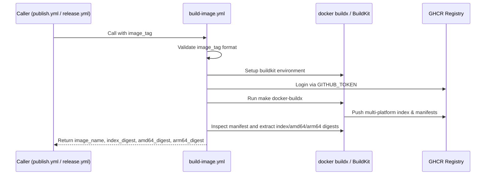

<!-- source: DeepWiki mcp.deepwiki.com · repo NVIDIA/cluster-readiness-engine · page 7.1 CI/CD Workflows · fetched 2026-10-26 -->

# CI/CD Workflows

<details>
<summary>Relevant source files</summary>

The following files were used as context for generating this wiki page:

- [.github/actions/install-uat-tools/action.yml](.github/actions/install-uat-tools/action.yml)
- [.github/workflows/build-image.yml](.github/workflows/build-image.yml)
- [.github/workflows/ci.yml](.github/workflows/ci.yml)
- [.github/workflows/codeql.yml](.github/workflows/codeql.yml)
- [.github/workflows/container-build.yml](.github/workflows/container-build.yml)
- [.github/workflows/e2e-uat.yml](.github/workflows/e2e-uat.yml)
- [.github/workflows/govulncheck.yml](.github/workflows/govulncheck.yml)
- [.github/workflows/prune-images.yml](.github/workflows/prune-images.yml)
- [.github/workflows/publish.yml](.github/workflows/publish.yml)
- [.github/workflows/release.yml](.github/workflows/release.yml)
- [.github/workflows/scorecard.yml](.github/workflows/scorecard.yml)
- [.github/workflows/verify.yml](.github/workflows/verify.yml)
- [.gitignore](.gitignore)
- [Makefile](Makefile)
- [api/v1alpha1/zz_generated.deepcopy.go](api/v1alpha1/zz_generated.deepcopy.go)
- [cmd/manager/main_test.go](cmd/manager/main_test.go)
- [cmd/manager/testdata/concurrency-flag-defaults/default/expected.json](cmd/manager/testdata/concurrency-flag-defaults/default/expected.json)
- [cmd/manager/testdata/concurrency-flag-defaults/default/input.yaml](cmd/manager/testdata/concurrency-flag-defaults/default/input.yaml)
- [cmd/manager/testdata/concurrency-validate/core-negative/error](cmd/manager/testdata/concurrency-validate/core-negative/error)
- [cmd/manager/testdata/concurrency-validate/core-negative/input.yaml](cmd/manager/testdata/concurrency-validate/core-negative/input.yaml)
- [hack/boilerplate.go.txt](hack/boilerplate.go.txt)
- [hack/verify-doc-links.sh](hack/verify-doc-links.sh)
- [helm/cluster-readiness-engine/templates/manager-role.yaml](helm/cluster-readiness-engine/templates/manager-role.yaml)
- [installer](installer)
- [pkg/platform/runtime_test.go](pkg/platform/runtime_test.go)

</details>


## Purpose and Scope
This page details the continuous integration (CI), verification, artifact publication, release orchestration, and validation pipelines for the NVIDIA Cluster Readiness Engine (`cluster-readiness-engine`). It covers the GitHub Actions workflow definitions (`ci.yml`, `verify.yml`, `publish.yml`, `release.yml`, `build-image.yml`, `e2e-uat.yml`, `prune-images.yml`) and the underlying project `Makefile` automation targets that enforce quality gates and supply chain integrity.

Sources: [.github/workflows/ci.yml:1-22](), [.github/workflows/verify.yml:1-15](), [.github/workflows/publish.yml:1-28](), [.github/workflows/release.yml:1-24](), [.github/workflows/build-image.yml:1-20]()

---

## 1. Core CI Pipelines (`ci.yml`)
The continuous integration pipeline is defined in [.github/workflows/ci.yml]() and executes on every push to `main`, pull requests matching `pull-request/[0-9]+`, and release tags `v*` [.github/workflows/ci.yml:6-14](). Concurrency groups cancel in-progress runs on non-main branches [.github/workflows/ci.yml:18-20]().

The pipeline contains five primary jobs:
1. **`lint`**: Runs code linters via `make lint` on `linux-amd64-cpu16` runners [.github/workflows/ci.yml:23-38]().
2. **`build`**: Compiles the manager binary via `make build` and the `nvcrectl` CLI via `make build-nvcrectl` [.github/workflows/ci.yml:39-57](). It executes a security malware scan on the built binaries using ClamAV (`clamscan`) [.github/workflows/ci.yml:58-79]().
3. **`test`**: Executes unit and integration test suites via `make test-ci`, incorporating `gotestsum` for JUnit XML generation and `gocover-cobertura` for code coverage collection [.github/workflows/ci.yml:80-117]().
4. **`benchmark`**: Tracks performance metrics by running benchmarks under `pkg/orchestration/` and comparing them against the merge-base using `benchstat` on pull requests [.github/workflows/ci.yml:123-172]().

```mermaid
graph TD
    Trigger["Push / PR / Tag"] --> Lint["ci.yml:lint (make lint)"]
    Trigger --> Build["ci.yml:build (make build)"]
    Trigger --> Test["ci.yml:test (make test-ci)"]
    Build --> Scan["ClamAV Malware Scan (/scan)"]
    Test --> Artifacts["Upload Test & Coverage Artifacts"]
    
    subclass CodeEntitySpace
        Lint
        Build
        Test
        Scan
    end
```
*Figure 1: Core CI execution flow mapping workflow jobs to compilation and scanning steps.*

Sources: [.github/workflows/ci.yml:1-172](), [Makefile:74-102]()

---

## 2. Verification and Policy Gates (`verify.yml`)
The verification pipeline [.github/workflows/verify.yml:1-43]() enforces strict correctness guarantees over generated code, module dependency structures, and license compliance.

It executes the following tasks:
* **`make verify`**: Validates that generated files (CRDs, DeepCopy methods), `go.mod`/`go.sum` states, and license headers are up to date and correctly committed.
* **Dependency License Scan**: Invokes `go-licenses` to verify that all transitive dependencies conform to permitted licensing terms (disallowing `forbidden` and `restricted` licenses) [.github/workflows/verify.yml:42-43]().

Sources: [.github/workflows/verify.yml:1-43]()

---

## 3. Container Image Building and Reusable Workflows (`build-image.yml`)
To prevent race conditions between publishing images and creating releases, container image compilation is centralized into the reusable workflow [.github/workflows/build-image.yml:1-270](). 

### Architecture and Data Flow
`build-image.yml` operates as a reusable workflow called by both `publish.yml` and `release.yml`. It handles:
* **Tag Validation**: Ensures `image_tag` strictly adheres to semantic versioning or `main-<sha>` formats [.github/workflows/build-image.yml:79-93]().
* **Docker Buildx Integration**: Configures buildkit and pushes multi-platform images (e.g., `linux/amd64`, `linux/arm64`) to `ghcr.io/nvidia/cluster-readiness-engine/manager` via `make docker-buildx` [.github/workflows/build-image.yml:101-127]().
* **Per-Platform Manifest Inspection**: Uses `docker buildx imagetools inspect` and `jq` to extract individual manifest digests for `linux/amd64` and `linux/arm64`, and generates CycloneDX SBOMs [.github/workflows/build-image.yml:137-162]().


*Figure 2: Sequence flow for the reusable container image build workflow.*

Sources: [.github/workflows/build-image.yml:1-162](), [.github/workflows/publish.yml:63-89](), [.github/workflows/release.yml:68-91]()

---

## 4. Publishing and Release Pipelines (`publish.yml` & `release.yml`)

### Development Publishing (`publish.yml`)
Triggered on pushes to the `main` branch, [.github/workflows/publish.yml:1-183]() computes development tags (`main-<sha>`), invokes `build-image.yml`, and triggers attestation jobs (`attest.yml`) for the index and per-platform SBOMs [.github/workflows/publish.yml:49-132](). A final gating job (`attested`) verifies that all signing and attestation steps completed successfully without skipping [.github/workflows/publish.yml:136-176]().

### Release Management (`release.yml`)
Triggered when tagging with `v*` or via `workflow_dispatch`, [.github/workflows/release.yml:1-181]() resolves release tags, builds official images via `build-image.yml`, attaches Sigstore signatures and SLSA provenance via `attest.yml`, verifies full attestation, and subsequently publishes the Helm chart and GitHub Release [.github/workflows/release.yml:30-181]().

Sources: [.github/workflows/publish.yml:1-183](), [.github/workflows/release.yml:1-181]()

---

## 5. Makefile CI Targets and Gates
The project `Makefile` exposes standardized targets utilized by local developers and CI workflows alike.

| Makefile Target | Description | Corresponding Workflow / Tool |
|-----------------|-------------|---------------------------------|
| `make build` | Compiles the controller manager binary into `bin/manager` [Makefile:41-42]() | `ci.yml` (`build`) |
| `make build-nvcrectl` | Compiles the CLI binary into `bin/nvcrectl` | `ci.yml` (`build`) |
| `make test` / `make test-ci` | Executes unit and integration tests with envtest assets [Makefile:83-102]() | `ci.yml` (`test`) |
| `make verify` | Verifies generated files, `go.mod`, and formatting | `verify.yml` |
| `make lint` | Runs code linters (golangci-lint) | `ci.yml` (`lint`) |
| `make docker-buildx` | Builds multi-platform container images via BuildKit | `build-image.yml`, `publish.yml`, `release.yml` |
| `make test-uat` | Executes end-to-end UAT suites using Kind + KWOK + Tilt [Makefile:136-141]() | `e2e-uat.yml` |

Sources: [Makefile:1-155](), [.github/workflows/ci.yml:23-117](), [.github/workflows/verify.yml:34-36]()

---

