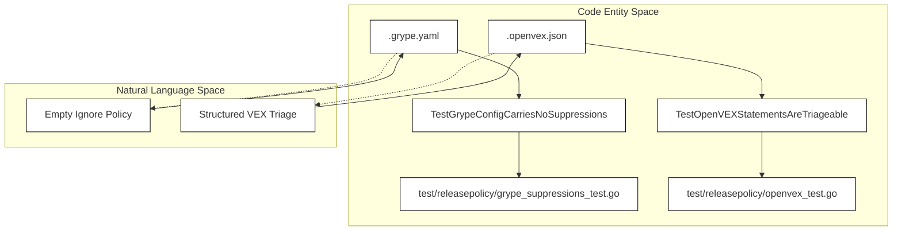
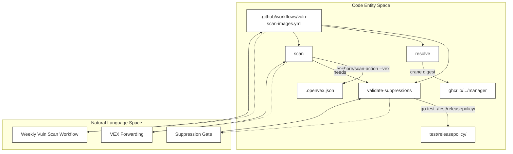

<!-- source: DeepWiki mcp.deepwiki.com · repo NVIDIA/cluster-readiness-engine · page 7.3 Vulnerability Management and OpenVEX · fetched 2026-10-26 -->

# Vulnerability Management and OpenVEX

<details>
<summary>Relevant source files</summary>

The following files were used as context for generating this wiki page:

- [.claude/skills/cre-test/SKILL.md](.claude/skills/cre-test/SKILL.md)
- [.claude/skills/managing-openvex/SKILL.md](.claude/skills/managing-openvex/SKILL.md)
- [.github/workflows/attest-selftest.yml](.github/workflows/attest-selftest.yml)
- [.github/workflows/vuln-scan-images.yml](.github/workflows/vuln-scan-images.yml)
- [.grype.yaml](.grype.yaml)
- [.openvex.json](.openvex.json)
- [AGENTS.md](AGENTS.md)
- [CLAUDE.md](CLAUDE.md)
- [CONTRIBUTING.md](CONTRIBUTING.md)
- [docs/cli-reference/overview.md](docs/cli-reference/overview.md)
- [docs/getting-started/first-certification.md](docs/getting-started/first-certification.md)
- [docs/getting-started/install.md](docs/getting-started/install.md)
- [test/releasepolicy/grype_suppressions_test.go](test/releasepolicy/grype_suppressions_test.go)
- [test/releasepolicy/openvex_test.go](test/releasepolicy/openvex_test.go)
- [test/releasepolicy/vuln_scan_resolve_test.go](test/releasepolicy/vuln_scan_resolve_test.go)

</details>


## Purpose and Scope

This page documents the vulnerability management architecture, container image scanning pipelines, OpenVEX-based reachability evidence tracking, and release policy test enforcement in the NVIDIA Cluster Readiness Engine (NVCRE) codebase. NVCRE enforces a strict separation of concerns for vulnerability suppression: `.grype.yaml` is prohibited from carrying ignore rules `[.grype.yaml:7-15](), [test/releasepolicy/grype_suppressions_test.go:23-71]()`, all suppression and impact analysis must reside in `.openvex.json` [to maintain auditability and structured triage [.claude/skills/managing-openvex/SKILL.md:6-17]()], and weekly scans validate suppressions against strict re-affirmation schedules [.github/workflows/vuln-scan-images.yml:43-75]() via automated Go tests in `test/releasepolicy/`.

---

## 1. Grype Configuration and Suppression Policy

The project uses Grype for container image vulnerability scanning `[.github/workflows/vuln-scan-images.yml:4-5]()`. However, Grype configuration (`.grype.yaml`) is strictly locked down to prevent undocumented or weakly-justified suppressions `[.grype.yaml:7-15](), [test/releasepolicy/grype_suppressions_test.go:23-39]()`. 

By design, `.grype.yaml` must have an empty `ignore` list `[.grype.yaml:26-26]()`. Allowing ignore rules directly in `.grype.yaml` would bypass the metadata requirements (such as product PURLs, subcomponent scopes, justification enums, and re-affirmation dates) enforced for OpenVEX statements `[test/releasepolicy/grype_suppressions_test.go:23-39]()`.

The unit test `TestGrypeConfigCarriesNoSuppressions` in `test/releasepolicy/grype_suppressions_test.go` parses `.grype.yaml` and fails if any ignore rules are present or if unapproved top-level keys are added `[test/releasepolicy/grype_suppressions_test.go:45-71]`:

```go
func TestGrypeConfigCarriesNoSuppressions(t *testing.T) {
	raw, err := os.ReadFile(grypeConfig)
    ...
	if ignore, ok := doc["ignore"].([]any); ok && len(ignore) > 0 {
		t.Errorf("%s carries %d ignore rule(s); suppressions belong in %s...", ...)
	}
}
```


*Figure 1: Architecture bridging Grype configuration validation to release policy test code entities.*

Sources: `[.grype.yaml:1-26]()`, `[test/releasepolicy/grype_suppressions_test.go:23-71]()`, `[.claude/skills/managing-openvex/SKILL.md:6-25]()`

---

## 2. Weekly Container Image Vulnerability Scan Workflow

Published container images (specifically `ghcr.io/nvidia/cluster-readiness-engine/manager`) undergo automated weekly vulnerability scans managed by GitHub Actions in `.github/workflows/vuln-scan-images.yml` `[.github/workflows/vuln-scan-images.yml:4-38]()`. 

Unlike source code scans that use `govulncheck` or CodeQL, image scans evaluate the compiled OCI container image, including base layers, OS packages, and bundled dependencies `[.github/workflows/vuln-scan-images.yml:4-10]()`.

### Workflow Job Topology

The scan workflow is structured into coordinated jobs with strict ordering and dependency checks:

1. `validate-suppressions`: Executes `go test ./test/releasepolicy/` to verify that all `.openvex.json` statements are well-formed, have valid subcomponent PURLs, and have not exceeded their re-affirmation windows `[.github/workflows/vuln-scan-images.yml:55-75]()`.
2. `resolve`: Resolves multi-platform registry digests using `crane` to target exact manifest hashes for scanning `[.github/workflows/vuln-scan-images.yml:78-150]()`.
3. `scan`: Consumes resolved digests, checks out the repository to read `.openvex.json` `[.claude/skills/managing-openvex/SKILL.md:11-16]()`, and invokes Grype via `anchore/scan-action` with the `--vex .openvex.json` parameter `[test/releasepolicy/grype_suppressions_test.go:147-171]()`.


*Figure 2: Workflow execution graph and dependency flow for image vulnerability scanning.*

Sources: `[.github/workflows/vuln-scan-images.yml:19-175]()`, `[test/releasepolicy/grype_suppressions_test.go:91-171]()`, `[.claude/skills/managing-openvex/SKILL.md:11-45]()`

---

## 3. OpenVEX Reachability Evidence (`.openvex.json`)

When third-party vulnerabilities cannot be immediately resolved via package upgrades, reachability evidence and justification must be documented in `.openvex.json` `[.claude/skills/managing-openvex/SKILL.md:51-68]()`.

### Invariants and Schema Rules

To ensure suppressions do not become silent no-ops or stale bypasses, OpenVEX statements must adhere to strict non-negotiable invariants enforced by tests:

* **Product PURL**: `products[].purl` must be set explicitly to `pkg:oci/manager` (derived from the OCI repository basename recognized by Grype) `[.claude/skills/managing-openvex/SKILL.md:96-109]()`.
* **Subcomponent Scope**: Each product entry must define `subcomponents` targeting the specific affected package (e.g., `pkg:golang/google.golang.org/grpc@v1.83.0`) `[.claude/skills/managing-openvex/SKILL.md:112-125]()`. Omitting subcomponents causes the statement to suppress the advisory across the entire container image `[.claude/skills/managing-openvex/SKILL.md:126-132]()`.
* **Vulnerability Identifier**: `vulnerability.name` must match Grype's primary identifier (typically the GHSA rather than CVE when both exist, because Grype indexes by GHSA primary IDs) `[.claude/skills/managing-openvex/SKILL.md:138-145]()`.
* **Justification & Re-affirmation**: Statements must include a valid OpenVEX v0.2.0 justification enum and be re-affirmed within 180 days (`[.grype.yaml:16-24]()`, `[.claude/skills/managing-openvex/SKILL.md:6-21]`).

Sources: `[.grype.yaml:16-24]()`, `[.claude/skills/managing-openvex/SKILL.md:6-145]()`

---

## 4. Release Policy Tests and Enforcement

Release policy tests located under `test/releasepolicy/` enforce the integrity of vulnerability management configurations across CI pipelines `[.github/workflows/vuln-scan-images.yml:55-75]`, `[test/releasepolicy/grype_suppressions_test.go:1-171]()`.

### Key Policy Test Functions

* `TestGrypeConfigCarriesNoSuppressions`: Asserts that `.grype.yaml` contains no `ignore` rules or unauthorized exclusion keys `[test/releasepolicy/grype_suppressions_test.go:45-71]()`.
* `TestScanWaitsForSuppressionValidation`: Inspects `.github/workflows/vuln-scan-images.yml` to verify that the `scan` job declares a dependency on `validate-suppressions`, ensuring that stale or malformed VEX statements fail the build prior to scanning `[test/releasepolicy/grype_suppressions_test.go:91-115]()`.
* `TestVulnScanPassesTheVexDocument`: Verifies that the Anchore scan step explicitly passes `vex: .openvex.json` and leaves `config:` unset so that auto-detection functions correctly without suppressing `.grype.yaml` parsing `[test/releasepolicy/grype_suppressions_test.go:147-171]()`.

Sources: `[.github/workflows/vuln-scan-images.yml:55-75]`, `[test/releasepolicy/grype_suppressions_test.go:1-171]()`

---

