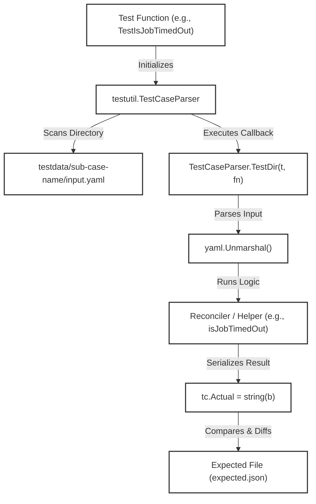
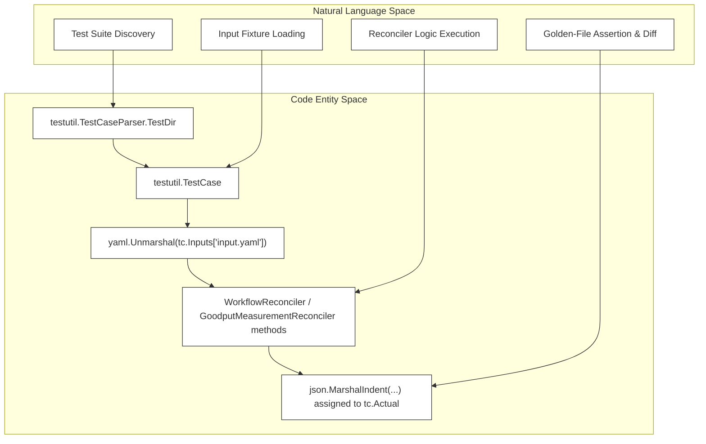

<!-- source: DeepWiki mcp.deepwiki.com · repo NVIDIA/cluster-readiness-engine · page 8.1 Golden-File Unit Tests and testutil.TestCaseParser · fetched 2026-10-26 -->

# Golden-File Unit Tests and testutil.TestCaseParser

Relevant source files

The following files were used as context for generating this wiki page:

- [pkg/controller/certification_create_rejected_test.go](pkg/controller/certification_create_rejected_test.go)
- [pkg/controller/certification_workflow_lookup_test.go](pkg/controller/certification_workflow_lookup_test.go)
- [pkg/controller/goodput_final_sample_test.go](pkg/controller/goodput_final_sample_test.go)
- [pkg/controller/group_completion_persist_test.go](pkg/controller/group_completion_persist_test.go)
- [pkg/controller/job_timeout_test.go](pkg/controller/job_timeout_test.go)
- [pkg/controller/job_workload_lookup_test.go](pkg/controller/job_workload_lookup_test.go)
- [pkg/controller/status.go](pkg/controller/status.go)
- [pkg/controller/status_transition_test.go](pkg/controller/status_transition_test.go)
- [pkg/controller/testconsts_test.go](pkg/controller/testconsts_test.go)
- [pkg/controller/testdata/group-completion-persist/both-jobs-succeeded/expected.json](pkg/controller/testdata/group-completion-persist/both-jobs-succeeded/expected.json)
- [pkg/controller/testdata/group-completion-persist/both-jobs-succeeded/input.yaml](pkg/controller/testdata/group-completion-persist/both-jobs-succeeded/input.yaml)
- [pkg/controller/testdata/job-create-adopt-workload/clean-create/input.yaml](pkg/controller/testdata/job-create-adopt-workload/clean-create/input.yaml)

The purpose and scope of this page is to detail the golden-file unit testing infrastructure used across the NVIDIA Cluster Readiness Engine (`NVCRE`) codebase. Specifically, it examines `pkg/testutil.TestCaseParser`, how test cases are structured using `testdata/input.yaml` paired with `expected.json` or `expected.txt` files, conventions across `pkg/*` packages, determinism/fuzz safeguards, and how goldens are updated.

---

## Architecture and Data Flow of testutil.TestCaseParser

Golden-file testing in NVCRE decouples complex algorithmic logic, state machine evaluations, and reconciler decisions from live Kubernetes API servers by reading declarative inputs and comparing actual serialized outputs against checked-in expected files. 

The core driver for this pattern is `testutil.TestCaseParser`, which scans a specified subdirectory under a test package's `testdata/` tree, discovers test cases, unmarshals inputs, executes a test callback, and diffs the results.

Sources: [pkg/controller/goodput_final_sample_test.go:47-51](), [pkg/controller/job_timeout_test.go:24-29](), [pkg/controller/status_transition_test.go:102-107]()

---

## Natural Language Space to Code Entity Space: TestCaseParser Lifecycle

To bridge the conceptual design of golden-file testing with actual codebase entities, the following diagram maps system operations to concrete Go structs and functions in `pkg/testutil` and test suites.

Sources: [pkg/controller/goodput_final_sample_test.go:48-69](), [pkg/controller/job_timeout_test.go:25-38](), [pkg/controller/group_completion_persist_test.go:28-41]()

---

## Conventions Across `pkg/*` Test Suites

Packages across `pkg/controller`, `pkg/goodput`, `pkg/nccl`, and `pkg/report` follow rigorous conventions when implementing golden-file tests:

1. **Test Subdirectory Allocation**: Each test function instantiates a `testutil.TestCaseParser` pointing to a dedicated subdirectory corresponding to the tested unit, such as `"job-timed-out"`, `"condition-flip"`, `"group-completion-persist"`, or `"certification-workflow-lookup"`.
2. **Expected Suffixes**: Depending on the output format, `ExpectedSuffix` is set to either `testutil.SuffixJSON` or `testutil.SuffixTXT`.
3. **Relative and Deterministic Inputs**: Time-based inputs (such as durations or timestamps) use relative offsets like `"ago"` or explicit anchor dates to prevent wall-clock flake.
4. **Byte-Level or JSON-Indent Marshaling**: Actual outputs are consistently serialized via `json.MarshalIndent(..., "", "  ")` to guarantee stable diffing across platforms and Go runtime versions.

Sources: [pkg/controller/goodput_final_sample_test.go:48-51](), [pkg/controller/job_timeout_test.go:25-28](), [pkg/controller/status_transition_test.go:103-106](), [pkg/controller/job_timeout_test.go:18-23]()

---

## Fuzz Tests and Updating Goldens

Golden files serve as the ground truth for unit test assertions. When internal data structures, JSON keys, or decision logic evolve:

- **Fuzzing and Edge Cases**: Tests such as `TestJobPhaseWritePreservesConcurrentTerminalDecision` and `TestIsJobTimedOut` explicitly exercise overlapping concurrency states, conflict retries, and malformed inputs to ensure parsers and reconcilers handle invalid payloads deterministically without panicking.
- **Updating Golden Files**: When a deliberate change to behavior or output structure is introduced, test suites can update their goldens. Because `TestCaseParser` manages expected file comparisons, running the test suite under specific environment flags or utilizing standard test update routines overwrites the stale `expected.json` or `expected.txt` artifacts with the new `tc.Actual` outputs.

Sources: [pkg/controller/status_transition_test.go:33-40](), [pkg/controller/job_timeout_test.go:18-24]()

---

