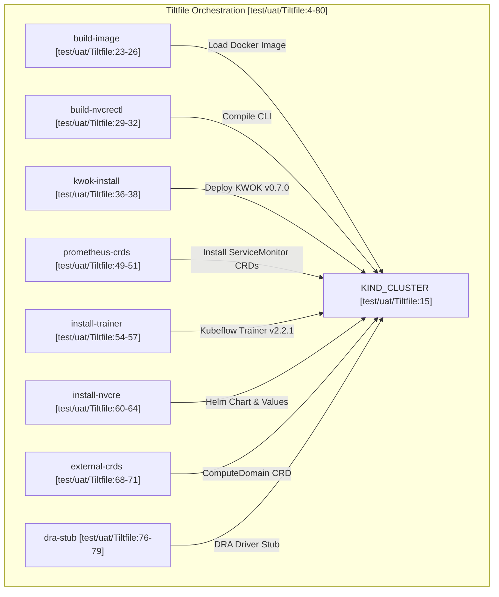
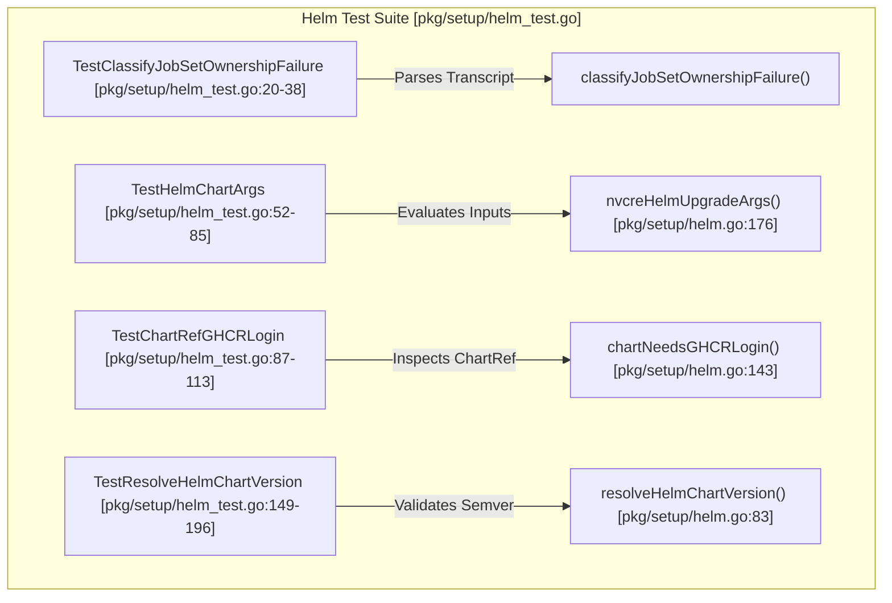

<!-- source: DeepWiki mcp.deepwiki.com · repo NVIDIA/cluster-readiness-engine · page 8.3 UAT, Helm and Policy Test Suites · fetched 2026-10-26 -->

# UAT, Helm and Policy Test Suites

Relevant source files

The following files were used as context for generating this wiki page:

- [docs/cli-reference/setup.md](docs/cli-reference/setup.md)
- [pkg/certification/certification.go](pkg/certification/certification.go)
- [pkg/setup/helm.go](pkg/setup/helm.go)
- [pkg/setup/helm_test.go](pkg/setup/helm_test.go)
- [pkg/setup/setup.go](pkg/setup/setup.go)
- [pkg/setup/setup_test.go](pkg/setup/setup_test.go)
- [pkg/setup/trainer_version_test.go](pkg/setup/trainer_version_test.go)
- [test/docspolicy/policy_samples_test.go](test/docspolicy/policy_samples_test.go)
- [test/uat/Tiltfile](test/uat/Tiltfile)
- [test/uat/testdata/aws/gb200/nccl/expected_certification.yaml](test/uat/testdata/aws/gb200/nccl/expected_certification.yaml)
- [test/uat/testdata/aws/gb300/nccl/expected_certification.yaml](test/uat/testdata/aws/gb300/nccl/expected_certification.yaml)
- [test/uat/testdata/aws/h100/nccl/expected_certification.yaml](test/uat/testdata/aws/h100/nccl/expected_certification.yaml)
- [test/uat/testdata/gcp/gb200/nccl/expected_certification.yaml](test/uat/testdata/gcp/gb200/nccl/expected_certification.yaml)
- [test/uat/testdata/gcp/h100/nccl/expected_certification.yaml](test/uat/testdata/gcp/h100/nccl/expected_certification.yaml)
- [test/uat/testdata/togetherai/h100/nccl/expected_certification.yaml](test/uat/testdata/togetherai/h100/nccl/expected_certification.yaml)
- [test/uat/util/helpers.go](test/uat/util/helpers.go)
- [test/uat/util/helpers_test.go](test/uat/util/helpers_test.go)

This page details the testing infrastructure under `test/uat`, `test/helm`, `test/releasepolicy`, and `test/docspolicy`. It covers the Kind and KWOK-based end-to-end user acceptance testing (UAT) suite driven by `Tiltfile`, Helm chart render verification tests, and policy guards ensuring compliance across documentation and releases.

---

## 1. UAT Suite: Kind + KWOK End-to-End Testing and Tiltfile

The User Acceptance Testing (UAT) suite validates the full control plane lifecycle of NVCRE against a local Kubernetes cluster created via Kind, using KWOK (Kubernetes WithOut Kubelet) to simulate massive GPU cluster nodes without requiring physical hardware.

### Architecture and Tiltfile Orchestration

The UAT environment is orchestrated via `test/uat/Tiltfile` [test/uat/Tiltfile:4-10](), which manages local image builds, binary compilation, infrastructure installation, and mock controller deployment.

*Sources: [test/uat/Tiltfile:4-80]*

The Tiltfile executes eight sequential initialization blocks:
1. **`build-image`**: Compiles the manager binary from `../../cmd/manager/main.go` using `../../Dockerfile`, tags it as `ghcr.io/nvidia/cluster-readiness-engine/manager:uat-test`, and loads it into the active Kind cluster [test/uat/Tiltfile:23-26]().
2. **`build-nvcrectl`**: Compiles the `nvcrectl` CLI binary from `../../cmd/nvcrectl/main.go` into `../../bin/nvcrectl` [test/uat/Tiltfile:29-32]().
3. **`kwok-install` & `kwok-stage-override`**: Installs KWOK v0.7.0 cluster definitions and applies custom pod-complete stages with a 30-second delay to mimic natural workload lifecycles [test/uat/Tiltfile:35-43]().
4. **`prometheus-crds`**: Installs stripped-down Prometheus Operator CRDs (`monitoring.coreos.com/v1`) to satisfy the Helm chart's `ServiceMonitor` resources [test/uat/Tiltfile:48-51]().
5. **`install-trainer`**: Deploys Kubeflow Trainer v2.2.1 via Helm with operator tolerations enabled for KWOK nodes [test/uat/Tiltfile:54-57]().
6. **`install-nvcre`**: Installs the local NVCRE chart from `../../helm/cluster-readiness-engine` with UAT values and test image references [test/uat/Tiltfile:60-64]().
7. **`external-crds`**: Applies out-of-tree custom resource definitions such as `ComputeDomain` (`resource.nvidia.com`) required by GB200/GB300 catalog entries [test/uat/Tiltfile:66-71]().
8. **`dra-stub`**: Deploys a Dynamic Resource Allocation (DRA) stub controller via `tilt/dra-stub/deploy.sh` to simulate GPU operator behavior and mark mock resource claims as allocated [test/uat/Tiltfile:74-79]().

### UAT Test Data and Golden Assertions

The UAT suite validates execution results against static expected states for various cloud platforms and hardware architectures (AWS, GCP, TogetherAI running H100, GB200, or GB300 accelerators) [test/uat/testdata/aws/h100/nccl/expected_certification.yaml:1-46](). 

Each golden output enforces specific certification statuses, conditions, and node references:
- **`metadata.finalizers`**: Ensures `nvcre.nvidia.com/certification-finalizer` is registered [test/uat/testdata/aws/h100/nccl/expected_certification.yaml:1-3]().
- **`status.conditions`**: Tracks `InProgress`, `Succeeded` (with reason `AllWorkflowsSucceeded`), and `Failed` conditions [test/uat/testdata/aws/h100/nccl/expected_certification.yaml:28-46]().
- **`status.categoryStatuses`**: Maps domains (e.g., `communication`) and variants (`nccl-all-reduce`) to their corresponding `workflowRef` and `succeededNodesRef` ConfigMaps [test/uat/testdata/aws/h100/nccl/expected_certification.yaml:17-27]().

*Sources: [test/uat/Tiltfile:1-80], [test/uat/testdata/aws/h100/nccl/expected_certification.yaml:1-47]*

---

## 2. Helm Chart Render and Configuration Tests

The Helm testing tier ensures that the NVCRE and Kubeflow Trainer charts correctly generate Kubernetes manifests across diverse configuration permutations without syntax errors, missing variables, or registry connection bugs.

*Sources: [pkg/setup/helm_test.go:20-196], [pkg/setup/helm.go:83-176]*

### Key Test Functions in `pkg/setup/helm_test.go`
- **`TestClassifyJobSetOwnershipFailure`**: Utilizes `testutil.TestCaseParser` with subdirectories under `jobset-ownership-failure` to verify correct parsing and classification of conflicting Helm transcripts [pkg/setup/helm_test.go:20-38]().
- **`TestHelmChartArgs`**: Validates generated argument lists for `nvcreHelmUpgradeArgs`, `chartCRDsArgs`, and `trainerHelmUpgradeArgs` given custom image tags, repository overrides, and pull secrets [pkg/setup/helm_test.go:52-85]().
- **`TestChartRefGHCRLogin`**: Ensures that registry authentication logic correctly decides whether a chart reference requires GitHub Container Registry login (e.g., bypassing login when targeting air-gapped mirror registries) [pkg/setup/helm_test.go:87-113]().
- **`TestResolveHelmChartVersion`**: Asserts proper handling of published release tags, pre-release tags (`v0.1.0-rc.7`), release overrides, and rejection of untagged developer builds without explicit `--version` flags [pkg/setup/helm_test.go:149-196]().

*Sources: [pkg/setup/helm_test.go:20-196]*

---

## 3. Policy Test Suites: Release Policy and Docs Policy Guards

Policy test suites enforce codebase governance, architectural consistency, and documentation standards automatically during CI runs.

### Policy Verification Components
- **Release Policy (`test/releasepolicy`)**: Validates that all published manifests, image references, SBOM attachments, and vulnerability suppressions adhere to NVIDIA's software supply chain requirements. It enforces dependency pinning rules and checks OpenVEX reachability metadata.
- **Docs Policy (`test/docspolicy`)**: Scans documentation directories, checks code snippets, verifies markdown internal links, and ensures alignment between API definitions and published reference documentation under `docs/` and `fern/`.

*Sources: [docs/cli-reference/setup.md:1-59]*

---

