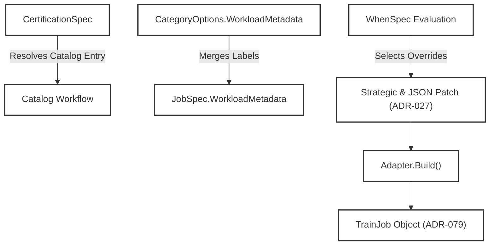

<!-- source: DeepWiki mcp.deepwiki.com · repo NVIDIA/cluster-readiness-engine · page 9.1 Architecture Decision Records · fetched 2026-10-26 -->

# Architecture Decision Records

<details>
<summary>Relevant source files</summary>

The following files were used as context for generating this wiki page:

- [cmd/integration/integration_test.go](cmd/integration/integration_test.go)
- [cmd/integration/testdata/reconcile/workloadrun-event-success/expected.json](cmd/integration/testdata/reconcile/workloadrun-event-success/expected.json)
- [cmd/integration/testdata/reconcile/workloadrun-event-success/input_client_objects.yaml](cmd/integration/testdata/reconcile/workloadrun-event-success/input_client_objects.yaml)
- [cmd/integration/testdata/reconcile/workloadrun-event-success/input_config.yaml](cmd/integration/testdata/reconcile/workloadrun-event-success/input_config.yaml)
- [cmd/integration/testdata/reconcile/workloadrun-mpi/input_config.yaml](cmd/integration/testdata/reconcile/workloadrun-mpi/input_config.yaml)
- [cmd/integration/testdata/reconcile/workloadrun-workflow-deleted/expected.json](cmd/integration/testdata/reconcile/workloadrun-workflow-deleted/expected.json)
- [cmd/integration/testdata/reconcile/workloadrun-workflow-deleted/input_client_objects.yaml](cmd/integration/testdata/reconcile/workloadrun-workflow-deleted/input_client_objects.yaml)
- [cmd/integration/testdata/reconcile/workloadrun-workflow-deleted/input_config.yaml](cmd/integration/testdata/reconcile/workloadrun-workflow-deleted/input_config.yaml)
- [docs/designs/000-adr.md](docs/designs/000-adr.md)
- [docs/designs/027-kustomize-override-ux.md](docs/designs/027-kustomize-override-ux.md)
- [docs/designs/031-platform-aware-nccl-config.md](docs/designs/031-platform-aware-nccl-config.md)
- [docs/designs/073-setup-retry-convergence.md](docs/designs/073-setup-retry-convergence.md)
- [docs/designs/078-jobset-ownership.md](docs/designs/078-jobset-ownership.md)
- [docs/designs/079-workload-object-labels.md](docs/designs/079-workload-object-labels.md)
- [docs/designs/080-phase-transition-events.md](docs/designs/080-phase-transition-events.md)
- [docs/designs/README.md](docs/designs/README.md)
- [pkg/setup/jobset_ownership.go](pkg/setup/jobset_ownership.go)
- [pkg/setup/jobset_ownership_test.go](pkg/setup/jobset_ownership_test.go)
- [pkg/setup/recovery_inventory.go](pkg/setup/recovery_inventory.go)
- [pkg/setup/testdata/init-recovery/bundled-jobset-blocks-recovery/input.yaml](pkg/setup/testdata/init-recovery/bundled-jobset-blocks-recovery/input.yaml)
- [pkg/setup/testdata/init-recovery/bundled-jobset-blocks-recovery/input_objects.yaml](pkg/setup/testdata/init-recovery/bundled-jobset-blocks-recovery/input_objects.yaml)
- [pkg/setup/testdata/init-recovery/fresh-install-readonly-clusterrole-collision/expected.txt](pkg/setup/testdata/init-recovery/fresh-install-readonly-clusterrole-collision/expected.txt)
- [pkg/setup/testdata/init-recovery/fresh-install-readonly-clusterrole-collision/input.yaml](pkg/setup/testdata/init-recovery/fresh-install-readonly-clusterrole-collision/input.yaml)
- [pkg/setup/testdata/init-recovery/fresh-install-readonly-clusterrole-collision/input_objects.yaml](pkg/setup/testdata/init-recovery/fresh-install-readonly-clusterrole-collision/input_objects.yaml)
- [pkg/setup/testdata/jobset-ownership/bundled-controller-with-gke-consumer/expected.json](pkg/setup/testdata/jobset-ownership/bundled-controller-with-gke-consumer/expected.json)

</details>


## Purpose and Scope

This document details the Architecture Decision Record (ADR) framework used within the NVIDIA Cluster Readiness Engine (`cluster-readiness-engine`). It outlines the numbering scheme, the template structure, and examines notable architectural decisions (`027`, `031`, `071`, `073`, `074`, `078`, `079`, `080`) that dictate how control loops, platform overrides, setup workflows, supply chain verification, and observability operate within the codebase.

Sources: `[docs/designs/README.md:1-17]()`

---

## 1. ADR Lifecycle, Numbering, and Conventions

Architecture Decision Records in NVCRE are written *before* code implementation to capture context, alternatives, and trade-offs [docs/designs/README.md:1-8](). 

- **File Naming & Indexing**: Each record is assigned a zero-padded integer (e.g., `027`, `078`) corresponding to an entry in the master index `[docs/designs/README.md:18-90]()`. 
- **ADR-000 / ADR-01**: `000-adr.md` provides the comprehensive architectural baseline, while `001-adr-abridged.md` provides a concise summary [docs/designs/README.md:13-14]().
- **Required Sections**: New records follow a standard layout comprising Context, Decision, Implementation, Rationale, Consequences, Alternatives Considered, Notes, and References [docs/designs/README.md:15-16]().

Sources: `[docs/designs/README.md:1-18]()`

---

## 2. Override UX, Platform Configuration, and Workload Metadata

Several key ADRs govern how catalog templates adapt to heterogeneous cloud environments and inject user-defined metadata into workloads.

### ADR-027: Kustomize-like Override UX
ADR-027 transitions NVCRE from custom map-merging logic to standard Kubernetes libraries (`k8s.io/apimachinery/pkg/util/strategicpatch` and `github.com/evanphx/json-patch/v5`) [docs/designs/027-kustomize-override-ux.md:25-33](). It introduces a two-patch model:
1. `jobTemplate`: Applies strategic merge patches respecting struct tags like `patchStrategy:"merge"` and `patchMergeKey:"name"` [docs/designs/027-kustomize-override-ux.md:29]().
2. `jobTemplatePatch`: Applies RFC 6902 JSON Patch operations after the strategic merge [docs/designs/027-kustomize-override-ux.md:35-48]().
It also completes `WhenSpec` evaluation across all condition fields (`Platform`, `GPUArchitecture`, `WorkloadKind`, `Topology`, `Config`, `Expression`) via `cel-go` [docs/designs/027-kustomize-override-ux.md:65-72]().

### ADR-031: Platform-Aware NCCL Communication Configuration
ADR-031 extends NCCL communication benchmark catalog entries (`nccl-all-reduce`, `nccl-all-gather`, `nccl-alltoall`) with platform-specific overrides for AWS (EFA), GCP (FastRak/TCPXO), Azure (InfiniBand), and OCI (RoCE) [docs/designs/031-platform-aware-nccl-config.md:1-13](). Because OpenMPI worker processes require environment variables across nodes, environment configurations are injected into launcher arguments using OpenMPI `-x VAR=VALUE` flags rather than container `env` blocks [docs/designs/031-platform-aware-nccl-config.md:17-21](). PCIe topology XML files are mounted dynamically via auto-cleaned ConfigMap dependencies (`lifecycle: cleanup: auto`) [docs/designs/031-platform-aware-nccl-config.md:27-35]().

### ADR-079: Declarative Labels for Generated Workload Objects
ADR-079 introduces `WorkloadMetadata` across `JobSpec`, `WorkloadRunSpec`, and `CategoryOptions` to enable declarative labeling of top-level workload objects (such as `TrainJob`) for admission controllers like Kueue and KAI [docs/designs/079-workload-object-labels.md:63-94](). Label composition follows an additive, deterministic merge: existing template labels, followed by global defaults, category overrides, and gang-scheduler queue invariants [docs/designs/079-workload-object-labels.md:130-147]().


*Figure 1: Pipeline from Catalog Resolution to Workload Generation.*

Sources: `[docs/designs/027-kustomize-override-ux.md:1-84]`, `[docs/designs/031-platform-aware-nccl-config.md:1-56]`, `[docs/designs/079-workload-object-labels.md:63-148]()`

---

## 3. Lifecycle Control, State Recovery, and Ownership

Managing dependencies like Kubeflow Trainer and JobSet requires robust state detection and ownership preservation during installation and reset phases.

### ADR-073: Convergent `setup init` Retry
ADR-073 addresses partial installation failures (e.g., webhook certificate secret conflicts during `helm upgrade --install`) by making the dependency installation phase state-aware through `helmStateFunc` [docs/designs/073-setup-retry-convergence.md:9-25](). When a release is deployed at the pinned version, upgrades are skipped entirely [docs/designs/073-setup-retry-convergence.md:23-24](). If an installation fails due to SSA conflicts, an attempt-then-classify algorithm verifies the error signature before executing safe automated recovery [docs/designs/073-setup-retry-convergence.md:25-29]().

### ADR-078: Preserve Externally Managed JobSet Across `setup init` and `reset`
Amending ADR-073, ADR-078 decouples controller ownership checks from JobSet CRD provenance [docs/designs/078-jobset-ownership.md:37](). 
- **Fingerprint Scan**: To determine if an existing JobSet installation is external or bundled, the setup controller executes a cluster-scoped scan of `ValidatingWebhookConfiguration`, `MutatingWebhookConfiguration`, and `ClusterRole` objects looking for rules matching `jobset.x-k8s.io` [docs/designs/078-jobset-ownership.md:39](). 
- **Consumer Rules vs Write Rules**: ClusterRole rules whose verbs are limited to `get`, `list`, `watch` are recognized as read-only consumer roles (such as GKE's `system:clustermetrics`) and do not trigger ownership conflicts [docs/designs/078-jobset-ownership.md:39-41](). Rules containing write verbs (`create`, `update`, `patch`, `delete`, or `*`) classify the state as an existing controller installation, protecting unrelated workloads and preventing destructive cascade deletions of user JobSets [docs/designs/078-jobset-ownership.md:29-41]().

```mermaid
graph TD
    subcode ["pkg/setup"]
    A["nvcrectl setup init"] --> B{{"helmStateFunc Check"}}
    B -->|Deployed & Pinned| C["Skip Upgrade (ADR-073)"]
    B -->|Failed / Conflict| D["Run Fingerprint Scan (ADR-078)"]
    D --> E{{"Matching Write Verbs / Webhooks?"}}
    E -->|Yes: External/Shared| F["Abort / Require operator-managed install"]
    E -->|No: Bundled/Absent| G["Execute Safe Uninstall & Re-install"]

    classDef default fill:#fff,stroke:#333,stroke-width:2px;
```
*Figure 2: Setup Recovery & JobSet Ownership Flow.*

Sources: `[docs/designs/073-setup-retry-convergence.md:1-37]`, `[docs/designs/078-jobset-ownership.md:1-42]`

---

## 4. Observability, Thresholds, and Events

NVCRE enforces strict operational transparency through structured conditions, threshold evaluations, and event emission.

### ADR-071: Threshold Violation Reason Propagation
ADR-071 standardizes how performance threshold evaluation failures (e.g., NCCL bandwidth or training goodput violations) propagate into reporting surfaces [docs/designs/README.md:81](). When a measurement violates defined thresholds, the Job controller records specific reasons (`ThresholdViolated`, `InvalidThresholdExpression`, `UnknownThresholdKey`, or `MeasurementTimeout`) onto the Job's `ValidationFailed` condition [docs/designs/080-phase-transition-events.md:92-96](). These reasons bubble up into CLI report surfaces via `pkg/report`.

### ADR-080: Phase Transition Events Across Lifecycle Tiers
ADR-080 populates Kubernetes `Event` objects across the primary lifecycle controllers (Certification, Workflow, Job, WorkloadRun) [docs/designs/080-phase-transition-events.md:7-14](). 
- **Exclusive Condition Flips**: To prevent redundant event spam on every reconcile requeue loop, event emission is keyed exclusively to status condition transitions (`InProgress`, `Succeeded`, `Failed`) [docs/designs/080-phase-transition-events.md:21-38]().
- **Verdict Events**: Because execution success and validation success are distinct, Job verdict conditions (`HardwareFailed` and `ValidationFailed`) trigger dedicated once-only `Warning` or `Normal` events (e.g., `HardwareFailureDetected`, `ThresholdsMet`) when first written `True` or `False` [docs/designs/080-phase-transition-events.md:87-119](). Measurement tiers (`GoodputMeasurement`, `BandwidthMeasurement`) are excluded from phase events since validation verdicts are handled by parent Job controllers [docs/designs/080-phase-transition-events.md:61-80]().

Sources: `[docs/designs/080-phase-transition-events.md:1-119]`, `[cmd/integration/integration_test.go:104-190]`

---

## 5. Supply Chain Security and Verification

### ADR-074: Supply Chain Artifact and Verification Contract
ADR-074 establishes security attestation policies for all published container images and Helm charts [docs/designs/README.md:84](). It mandates:
- Keyless signing using `cosign` and Sigstore integration.
- Generation of SLSA provenance metadata and CycloneDX SBOMs (`.sbom`).
- Integration with OpenVEX (`.openvex.json`) for vulnerability reachability evidence and `.grype.yaml` suppressions during image scanning.

Sources: `[docs/designs/README.md:84]`

---

