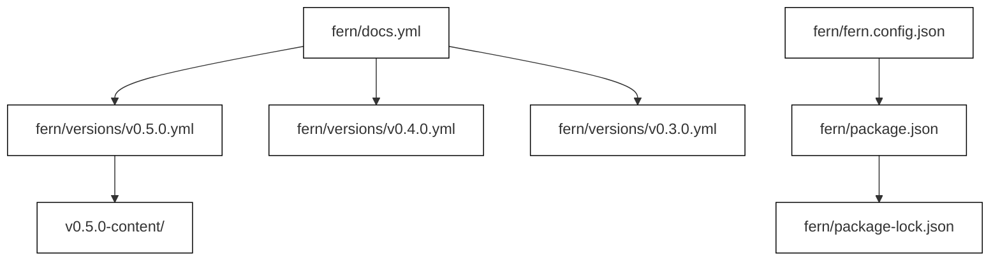
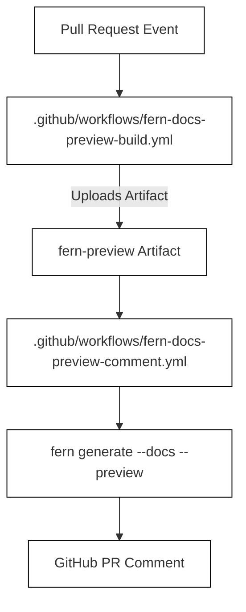

<!-- source: DeepWiki mcp.deepwiki.com · repo NVIDIA/cluster-readiness-engine · page 9.2 Fern Docs Site Pipeline · fetched 2026-10-26 -->

# Fern Docs Site Pipeline

Relevant source files

The following files were used as context for generating this wiki page:

- [.github/dependabot.yml](.github/dependabot.yml)
- [.github/workflows/fern-docs-ci.yml](.github/workflows/fern-docs-ci.yml)
- [.github/workflows/fern-docs-preflight.yml](.github/workflows/fern-docs-preflight.yml)
- [.github/workflows/fern-docs-preview-build.yml](.github/workflows/fern-docs-preview-build.yml)
- [.github/workflows/fern-docs-preview-comment.yml](.github/workflows/fern-docs-preview-comment.yml)
- [.github/workflows/publish-fern-docs.yml](.github/workflows/publish-fern-docs.yml)
- [docs/concepts/platform-detection.md](docs/concepts/platform-detection.md)
- [fern/.gitignore](fern/.gitignore)
- [fern/docs.yml](fern/docs.yml)
- [fern/fern.config.json](fern/fern.config.json)
- [fern/package-lock.json](fern/package-lock.json)
- [fern/package.json](fern/package.json)
- [fern/versions/v0.3.0.yml](fern/versions/v0.3.0.yml)
- [fern/versions/v0.4.0.yml](fern/versions/v0.4.0.yml)
- [fern/versions/v0.5.0.yml](fern/versions/v0.5.0.yml)
- [hack/fern-freeze-versions.sh](hack/fern-freeze-versions.sh)
- [pkg/report/fuzz_test.go](pkg/report/fuzz_test.go)
- [pkg/report/report_test.go](pkg/report/report_test.go)
- [test/docspolicy/docs_gate_test.go](test/docspolicy/docs_gate_test.go)

This page documents the technical implementation and operational lifecycle of the NVIDIA Cluster Readiness Engine (NVCRE) documentation pipeline, powered by Fern (`fern-api`). It covers the configuration architecture, versioned navigation structures, continuous integration validation checks, pull request preview workflows, publishing automation, version freezing mechanisms, and policy gate verifications.

---

## 1. Configuration Architecture and Versioned Navigation

The documentation site configuration is anchored by `fern/docs.yml` [fern/docs.yml:1-38], which defines the multi-source instance properties, global themes, custom domains, and version mappings. The underlying Fern CLI version is strictly pinned via `fern/package.json` and `fern/package-lock.json` [fern/package-lock.json:1-201], with `fern/fern.config.json` configured to resolve the organization (`nvidia`) and inherit the pinned package version [fern/fern.config.json:1-5].

Versioned navigation is decoupled from the main docs tree. Each released version maintains its own navigation YAML file under `fern/versions/` (e.g., `fern/versions/v0.5.0.yml` [fern/versions/v0.5.0.yml:1-105]), mapping sidebar sections and pages directly to extracted snapshot paths such as `v0.5.0-content/`.

*Diagram 1: Natural Language Space to Code Entity Space — Navigation and Configuration Layout.*

Sources: `fern/docs.yml`, `fern/versions/v0.5.0.yml`, `fern/fern.config.json`, `fern/package.json`, `fern/package-lock.json`

---

## 2. Documentation CI Pipelines and Preview Workflows

Documentation validation and preview generation are split across specialized GitHub Actions workflows [.github/workflows/fern-docs-ci.yml:1-163, .github/workflows/fern-docs-preview-build.yml:1-133].

### CI Validation Workflow (`fern-docs-ci.yml`)
The CI workflow detects if pull requests touch `docs/` or `fern/` paths [.github/workflows/fern-docs-ci.yml:16-95]. When triggered, it performs:
1. **Node Setup**: Configures Node.js and restores the npm cache using `fern/package-lock.json` [.github/workflows/fern-docs-ci.yml:109-114].
2. **Dependency Installation**: Runs `npm ci` inside `./fern` to enforce strict lockfile compliance [.github/workflows/fern-docs-ci.yml:119-121].
3. **MDX Safety Checks**: Scans for non-self-closing `` tags, enforcing MDX requirements [.github/workflows/fern-docs-ci.yml:132-140].
4. **Version Content Freezing**: Executes `./hack/fern-freeze-versions.sh` to materialize historical version directories required by `docs.yml` [.github/workflows/fern-docs-ci.yml:147-148].
5. **Fern Quality Gates**: Executes `fern check`, `fern docs md check`, and `fern docs broken-links` via `npx --no-install` [.github/workflows/fern-docs-ci.yml:152-162].

### Two-Part Preview Workflows
To prevent secret leakage to untrusted pull requests, previews are segregated into a build-side workflow (`fern-docs-preview-build.yml`) and a comment-side workflow (`fern-docs-preview-comment.yml`):
* **Build Workflow**: Collects `fern/`, `docs/`, and PR metadata, runs version freezing, and uploads a `fern-preview` artifact with a 1-day retention [.github/workflows/fern-docs-preview-build.yml:96-133].
* **Comment Workflow**: Triggered via `workflow_run`, this workflow downloads the artifact, checks out the trusted CLI manifest from `main`, installs dependencies, and executes `fern generate --docs --preview --id "$HEAD_REF"` using the organization secret `DOCS_FERN_TOKEN` [.github/workflows/fern-docs-preview-comment.yml:32-159].

*Diagram 2: Natural Language Space to Code Entity Space — Preview Workflow Orchestration.*

Sources: `.github/workflows/fern-docs-ci.yml`, `.github/workflows/fern-docs-preview-build.yml`, `.github/workflows/fern-docs-preview-comment.yml`

---

## 3. Version Freezing and Registry Management Script

When a release tag is pushed or a manual dispatch occurs, `.github/workflows/publish-fern-docs.yml` automates the release and registry update [.github/workflows/publish-fern-docs.yml:1-178]:
1. **Tag Resolution**: Resolves the target semver tag (e.g., `v0.5.0`) [.github/workflows/publish-fern-docs.yml:96-130].
2. **Version Registration**: If the release is stable, it executes `hack/fern-freeze-versions.sh` or equivalent extraction logic via `git archive` to generate `fern/versions/${TAG_VERSION}.yml` [.github/workflows/publish-fern-docs.yml:131-147].
3. **Semver Sorting & Pruning**: Updates `fern/docs.yml`, sorts versions in descending semver order using `yq`, and prunes older versions beyond `MAX_VERSIONS` (configured to `3`) [.github/workflows/publish-fern-docs.yml:148-178].

Sources: `.github/workflows/publish-fern-docs.yml`, `hack/fern-freeze-versions.sh`

---

## 4. Documentation Link Verification and Gate Checks

Documentation integrity is strictly enforced programmatically through test suites under `test/docspolicy/` [test/docspolicy/docs_gate_test.go]. The test suite verifies:
* All internal Markdown and MDX links resolve to valid targets within the workspace.
* Catalog references and CRD property paths match current Go API definitions in `api/v1alpha1/`.
* Gate validation tests block PR merges if documentation structures or version pointers diverge from schema requirements.

Sources: `test/docspolicy/docs_gate_test.go`, `.github/workflows/fern-docs-ci.yml`

---

