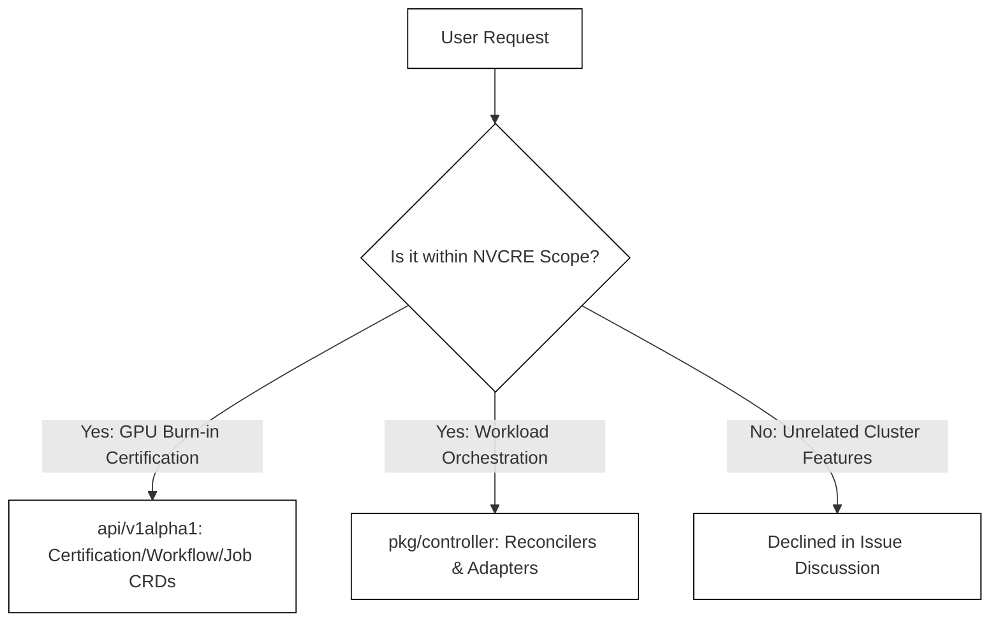
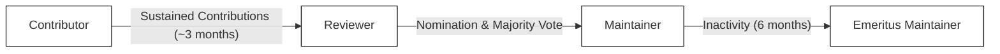
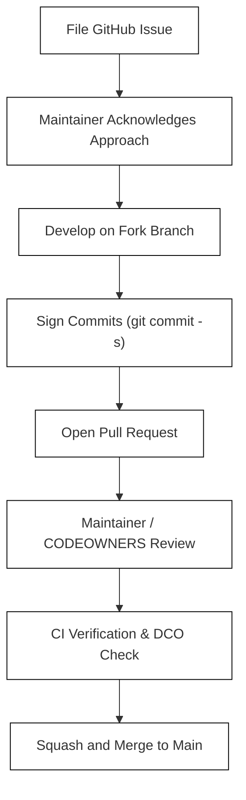

<!-- source: DeepWiki mcp.deepwiki.com · repo NVIDIA/cluster-readiness-engine · page 9.3 Project Governance and Contributor Process · fetched 2026-10-26 -->

# Project Governance and Contributor Process

<details>
<summary>Relevant source files</summary>

The following files were used as context for generating this wiki page:

- [.claude/skills/cre-test/SKILL.md](.claude/skills/cre-test/SKILL.md)
- [.claude/skills/managing-openvex/SKILL.md](.claude/skills/managing-openvex/SKILL.md)
- [.github/CODEOWNERS](.github/CODEOWNERS)
- [.github/ISSUE_TEMPLATE/bug_report.yml](.github/ISSUE_TEMPLATE/bug_report.yml)
- [.github/ISSUE_TEMPLATE/config.yml](.github/ISSUE_TEMPLATE/config.yml)
- [.github/ISSUE_TEMPLATE/documentation_request.yml](.github/ISSUE_TEMPLATE/documentation_request.yml)
- [.github/ISSUE_TEMPLATE/documentation_update.yml](.github/ISSUE_TEMPLATE/documentation_update.yml)
- [.github/ISSUE_TEMPLATE/feature_request.yml](.github/ISSUE_TEMPLATE/feature_request.yml)
- [.github/PULL_REQUEST_TEMPLATE.md](.github/PULL_REQUEST_TEMPLATE.md)
- [.github/copy-pr-bot.yaml](.github/copy-pr-bot.yaml)
- [.github/dco.yml](.github/dco.yml)
- [.github/workflows/attest-selftest.yml](.github/workflows/attest-selftest.yml)
- [AGENTS.md](AGENTS.md)
- [CLAUDE.md](CLAUDE.md)
- [CODE_OF_CONDUCT.md](CODE_OF_CONDUCT.md)
- [CONTRIBUTING.md](CONTRIBUTING.md)
- [GOVERNANCE.md](GOVERNANCE.md)
- [MAINTAINERS.md](MAINTAINERS.md)
- [NOTICE](NOTICE)
- [docs/cli-reference/overview.md](docs/cli-reference/overview.md)
- [docs/getting-started/first-certification.md](docs/getting-started/first-certification.md)
- [docs/getting-started/install.md](docs/getting-started/install.md)

</details>


## Purpose and Scope

This wiki page details the project governance model, maintainer structure, code ownership rules, issue/PR management, Developer Certificate of Origin (DCO) enforcement, automated review configurations, and agent-assisted developer workflows for the NVIDIA Cluster Readiness Engine (NVCRE) project. It bridges the administrative structures defined in repository governance documents to concrete code entities, automation hooks, and contributor workflows.

Sources: `GOVERNANCE.md:1-8`, `MAINTAINERS.md:1-10`, `CONTRIBUTING.md:1-24`

---

## Project Charter and Scope

The NVCRE project charter defines the boundaries of what is in-scope for contributions and maintainer reviews. NVCRE is strictly focused on Kubernetes-native GPU cluster burn-in certification, executing cataloged training and communication workloads, measuring goodput and network bandwidth, and attributing hardware faults to specific nodes [GOVERNANCE.md:5-8].


*Figure 1: Scope decision tree mapping contributor requests to code entity boundaries.*

Sources: `GOVERNANCE.md:5-8`

---

## Governance Hierarchy and Roles

Project responsibilities are divided into three tiers: Contributors, Reviewers, and Maintainers [GOVERNANCE.md:9-28].

| Role | Definition | Path to Role / Maintenance | Code / Process Reference |
| :--- | :--- | :--- | :--- |
| **Contributor** | Anyone filing issues, fixing docs, or submitting pull requests. | Open participation; follows contribution rules. | `CONTRIBUTING.md:1-24` |
| **Reviewer** | Contributor with a track record of quality reviews in specific areas. | Sustained contributions over ~3 months, nomination by a maintainer. | `GOVERNANCE.md:15-21` |
| **Maintainer** | Reviewer trusted with merge rights and project roadmap direction. | Act as a reviewer for ~3 months, nomination, and majority vote. | `MAINTAINERS.md:1-10`, `GOVERNANCE.md:22-28` |

Maintainers are listed explicitly in `MAINTAINERS.md` and share project-wide administrative and code-merge responsibilities [MAINTAINERS.md:1-10].


*Figure 2: Contributor progression path through project roles.*

Sources: `GOVERNANCE.md:9-28`, `MAINTAINERS.md:1-10`

---

## Decision Making and Consensus

Project decisions use a tiered consensus model [GOVERNANCE.md:29-35]:
1. **Lazy Consensus**: Routine pull requests merge upon maintainer approval if no objection is raised within 3 business days [GOVERNANCE.md:31].
2. **Significant Changes**: CRD schema modifications (`api/v1alpha1`), new subsystems, dependency changes, or governance updates require an issue-first design record (`docs/designs/`) and approval from a majority of maintainers [GOVERNANCE.md:32].
3. **Voting and Tie-Breaking**: When consensus fails, any maintainer may call a vote. Each maintainer holds one vote. Ties trigger a synchronous discussion and single re-vote; if tied again, the status quo wins [GOVERNANCE.md:33-34].

Sources: `GOVERNANCE.md:29-35`

---

## Contributor Process and Issue-First Workflow

All code contributions must adhere to the **Issue-First Workflow** to prevent duplicate effort and uncoordinated changes [CONTRIBUTING.md:34-41]:


*Figure 3: End-to-end pull request lifecycle and verification gates.*

### Commit Messages and DCO
* **Conventional Commits**: Commit subjects must follow `type: short summary` (e.g., `feat:`, `fix:`, `docs:`, `test:`, `refactor:`, `perf:`, `chore:`, `ci:`, `build:`) [CONTRIBUTING.md:88-98].
* **Developer Certificate of Origin (DCO)**: Every commit must include a sign-off line (`git commit -s`) [CONTRIBUTING.md:98]. Automated checks enforce this via `.github/dco.yml`.
* **Fork PR CI Security**: CI checks on fork PRs run only after a maintainer comments `/ok to test`, which invokes `copy-pr-bot` to stage the branch [CONTRIBUTING.md:84].

Sources: `CONTRIBUTING.md:34-107`, `.github/dco.yml:1-10`

---

## Code Ownership and Review Automation

Automatic reviewer assignment is governed by `.github/CODEOWNERS`, which assigns project maintainers to all pull requests [-.github/CODEOWNERS:1-9]:

```text
* @ndipebot @lalitadithya
```

Reviewers adhere to a target response window of 5 business days for initial reviews [CONTRIBUTING.md:100-107].

Sources: `.github/CODEOWNERS:1-9`, `CONTRIBUTING.md:100-107`

---

## Issue and Pull Request Templates

Structured templates guide the creation of issues and pull requests to ensure necessary diagnostic and environment details are captured:
* **Bug Reports & Feature Requests**: `.github/ISSUE_TEMPLATE/bug_report.yml`, `.github/ISSUE_TEMPLATE/feature_request.yml`
* **Documentation Requests**: `.github/ISSUE_TEMPLATE/documentation_request.yml` captures priorities, affected documentation areas, and missing details [-.github/ISSUE_TEMPLATE/documentation_request.yml:1-76].
* **Pull Request Template**: `.github/PULL_REQUEST_TEMPLATE.md` mandates test plans, risk assessments, and issue references (`Closes #NNN`) [CONTRIBUTING.md:39,76].

Sources: `CONTRIBUTING.md:47,76`, `.github/ISSUE_TEMPLATE/documentation_request.yml:1-76`

---

## Agent-Assisted Workflows (.claude Skills)

The repository provides specialized agent guidance for AI coding assistants via `.claude/skills/` (synchronized with `AGENTS.md`) [CLAUDE.md:1-4, .claude/skills/cre-test/SKILL.md:1-139].

The `cre-test` skill governs automated test creation, golden file maintenance, and integration harnesses [-.claude/skills/cre-test/SKILL.md:1-139]:
* **`testutil.TestCaseParser`**: Mandatory for structured output packages (`pkg/catalog/`, `pkg/controller/`, `pkg/goodput/`, `pkg/workload/`, etc.) [-.claude/skills/cre-test/SKILL.md:17-18].
* **Golden File Regeneration**: Explicitly requires `TESTUTIL_UPDATE_EXPECTED=true` combined with package test suites or `make test-integration` [-.claude/skills/cre-test/SKILL.md:80-93].

Sources: `CLAUDE.md:1-114`, `.claude/skills/cre-test/SKILL.md:1-139`

---

