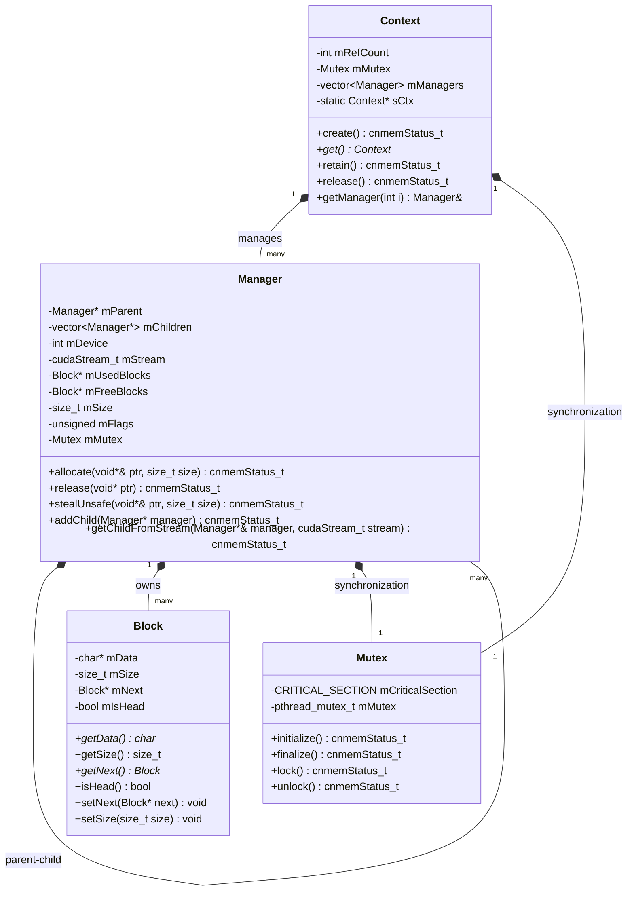
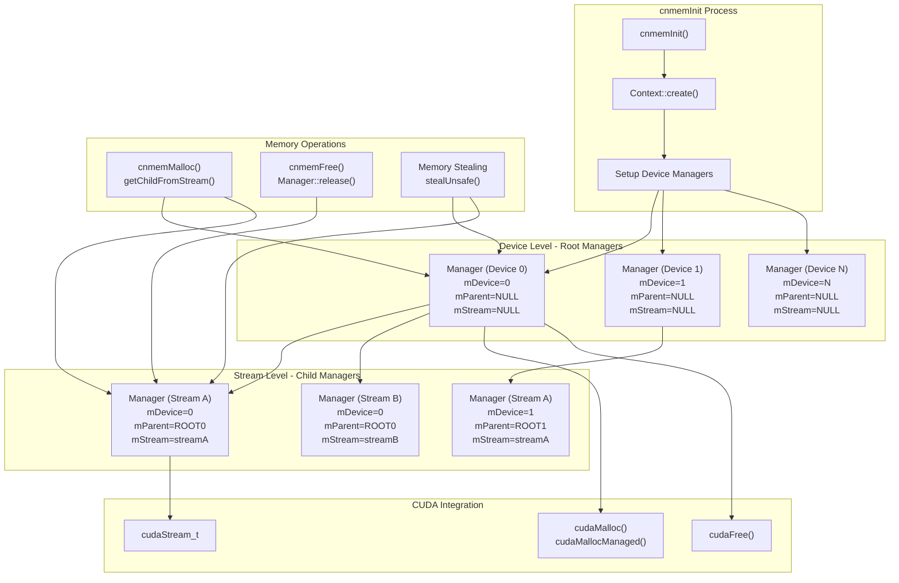
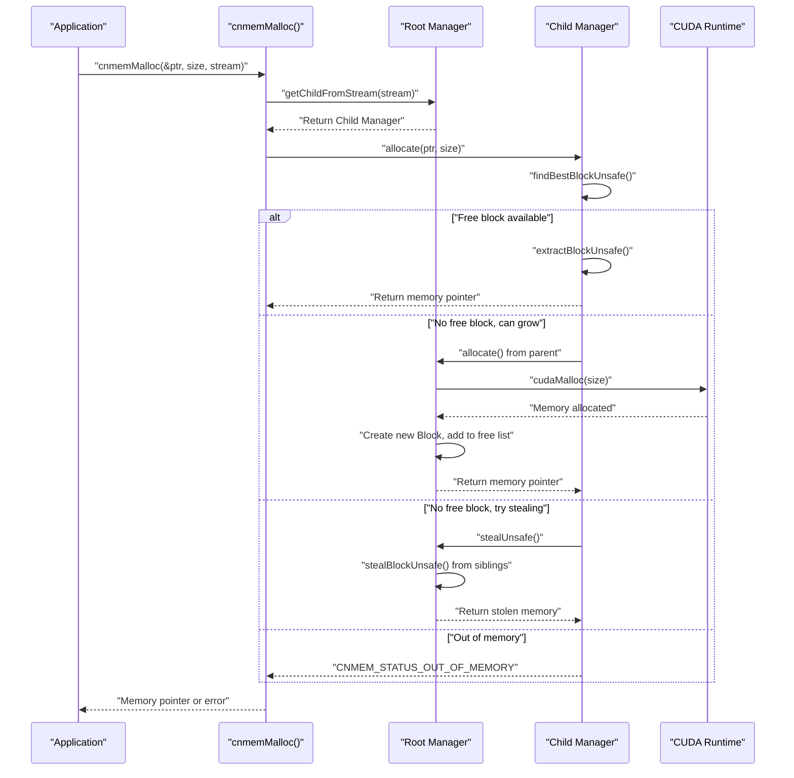

<!-- source: DeepWiki mcp.deepwiki.com · repo NVIDIA/cnmem · page 1 Overview · fetched 2026-10-26 -->

# Overview

Relevant source files

The following files were used as context for generating this wiki page:

- [README.md](README.md)
- [src/cnmem.cpp](src/cnmem.cpp)

This document provides a comprehensive overview of the cnmem library, a specialized CUDA memory management system designed for deep learning frameworks. It covers the core architecture, memory management hierarchy, and key operational workflows that make cnmem effective for applications working with large GPU memory buffers.

For detailed API documentation, see [API Reference](#3). For build instructions and setup, see [Getting Started](#2). For implementation details and algorithms, see [Architecture and Implementation](#4).

## Purpose and Scope

cnmem (CUDA Memory Manager) is a C++ library that provides efficient memory management for CUDA applications, particularly deep learning frameworks like TensorFlow and PyTorch. Unlike general-purpose memory allocators, cnmem is specifically optimized for applications that work with a limited number of large memory buffers and have predictable allocation patterns.

The library addresses several key challenges in CUDA memory management:
- **Pool-based allocation**: Reduces expensive `cudaMalloc`/`cudaFree` calls by pre-allocating memory pools
- **Stream-aware management**: Provides separate memory managers for different CUDA streams
- **Memory stealing**: Enables dynamic reallocation of memory between streams when needed
- **Thread-safe operations**: Supports multi-threaded access through mutex-based synchronization

**Sources:** [README.md:1-10](), [src/cnmem.cpp:1-61]()

## Core Architecture Components

The cnmem library is built around several key C++ classes that work together to provide hierarchical memory management:

### Core Class Architecture

**Key Components:**

- **`Context`**: Global singleton managing all memory managers across devices. Implements reference counting for library lifecycle management.
- **`Manager`**: Core memory management unit that handles allocation/deallocation for a specific device or stream. Forms parent-child hierarchies.
- **`Block`**: Represents a contiguous memory region with metadata including size, next pointer, and head flag for linked list management.
- **`Mutex`**: Cross-platform threading primitive providing synchronized access to shared memory structures.

**Sources:** [src/cnmem.cpp:966-1001](), [src/cnmem.cpp:307-422](), [src/cnmem.cpp:262-303](), [src/cnmem.cpp:191-258]()

## Hierarchical Memory Management

cnmem implements a two-level hierarchical memory management system where device-level root managers coordinate with stream-specific child managers:

### Memory Manager Hierarchy

**Memory Manager Types:**

1. **Root Managers**: One per GPU device, created during `cnmemInit()`. Directly interface with CUDA runtime via `cudaMalloc`/`cudaFree`. Manage device-level memory pools and coordinate child managers.

2. **Child Managers**: Associated with specific CUDA streams. Created either during initialization (via `cnmemDevice_t.streams`) or dynamically (via `cnmemRegisterStream()`). Inherit memory from parent managers and can steal memory from siblings when needed.

**Memory Flow:**
- Initial allocation: Child managers request memory from parent root managers
- Pool growth: Root managers call `cudaMalloc` when pools are exhausted (unless `CNMEM_FLAGS_CANNOT_GROW`)
- Memory stealing: Child managers can steal unused memory from siblings via `stealUnsafe()`

**Sources:** [src/cnmem.cpp:1071-1130](), [src/cnmem.cpp:1155-1171](), [src/cnmem.cpp:857-888]()

## Core Memory Operations

### Allocation Workflow

The memory allocation process in cnmem follows a sophisticated multi-step approach designed to maximize memory reuse and minimize CUDA runtime calls:

**Key Allocation Functions:**
- `cnmemMalloc()`: Public API entry point [src/cnmem.cpp:1175-1246]()
- `Manager::allocate()`: Core allocation logic with mutex protection [src/cnmem.cpp:462-497]()
- `Manager::findBestBlockUnsafe()`: Best-fit block selection algorithm [src/cnmem.cpp:575-585]()
- `Manager::stealUnsafe()`: Memory stealing between managers [src/cnmem.cpp:857-888]()

### Block Management and Memory Layout

cnmem uses a linked-list based approach to manage memory blocks within each pool:

**Free Block List**: Maintains available memory blocks sorted by address for efficient coalescing
**Used Block List**: Tracks allocated blocks for deallocation and debugging

Block coalescing occurs during deallocation to prevent fragmentation:
- Adjacent free blocks are automatically merged [src/cnmem.cpp:819-841]()
- Head blocks (from `cudaMalloc`) cannot be merged across allocation boundaries
- Memory alignment follows `CNMEM_GRANULARITY` (512 bytes) [src/cnmem.cpp:48]()

**Sources:** [src/cnmem.cpp:462-497](), [src/cnmem.cpp:575-585](), [src/cnmem.cpp:857-888](), [src/cnmem.cpp:1175-1246](), [src/cnmem.cpp:797-842]()

## Integration with CUDA and Deep Learning Frameworks

cnmem is designed as a drop-in replacement for direct CUDA memory management calls, providing a higher-level interface while maintaining compatibility with existing CUDA workflows:

### CUDA Runtime Integration

- **Device Management**: Automatic device switching and state restoration [src/cnmem.cpp:1094-1128]()
- **Stream Synchronization**: Handles both blocking and non-blocking streams [src/cnmem.cpp:384-396]()
- **Managed Memory Support**: Optional unified memory allocation via `CNMEM_FLAGS_MANAGED` [src/cnmem.cpp:511-521]()
- **Error Handling**: Comprehensive CUDA error checking with status code translation [src/cnmem.cpp:132-160]()

### Framework Integration Pattern

Deep learning frameworks typically integrate cnmem by:
1. Initialize cnmem during framework startup with `cnmemInit()`
2. Register compute streams with `cnmemRegisterStream()`  
3. Replace `cudaMalloc`/`cudaFree` calls with `cnmemMalloc`/`cnmemFree`
4. Use stream-aware allocation for tensor operations
5. Clean up with `cnmemFinalize()` during shutdown

The library's thread-safe design and stream-aware allocation make it particularly well-suited for frameworks that manage multiple concurrent GPU operations across different streams.

**Sources:** [src/cnmem.cpp:1071-1130](), [src/cnmem.cpp:1155-1171](), [src/cnmem.cpp:1175-1246](), [src/cnmem.cpp:1250-1266](), [README.md:3-6]()

---

