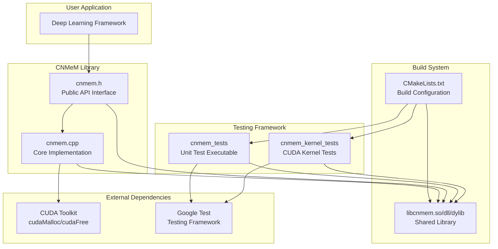
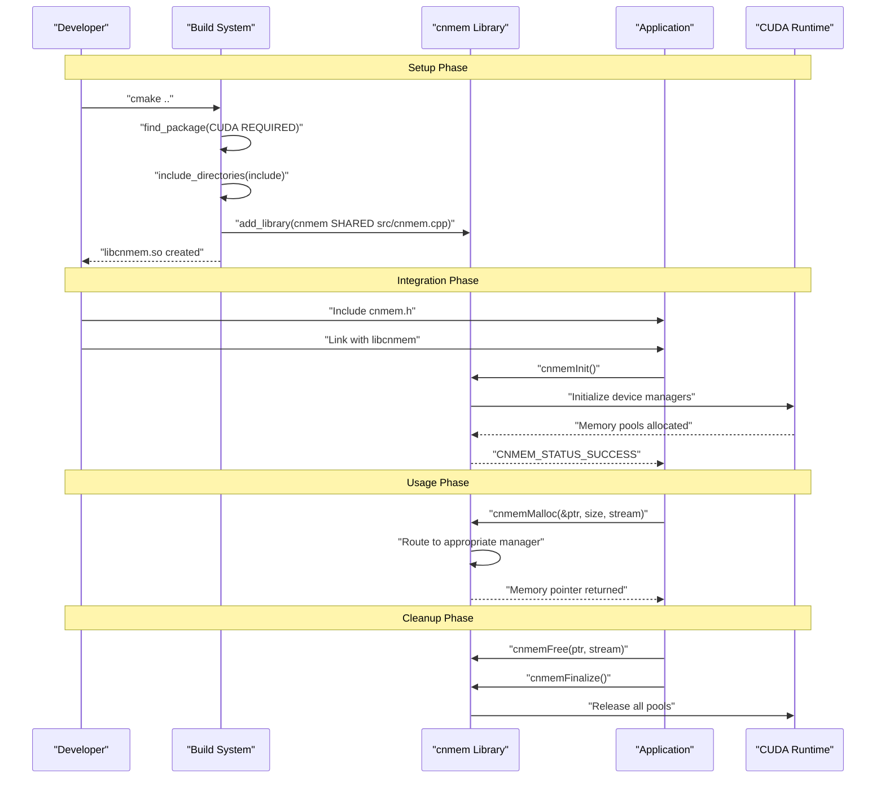
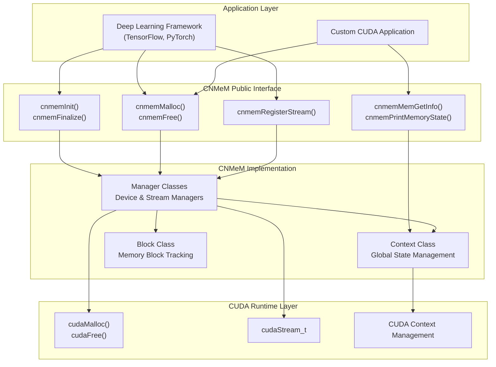

<!-- source: DeepWiki mcp.deepwiki.com · repo NVIDIA/cnmem · page 2 Getting Started · fetched 2026-10-26 -->

# Getting Started

Relevant source files

The following files were used as context for generating this wiki page:

- [CMakeLists.txt](CMakeLists.txt)
- [README.md](README.md)

This document provides an overview of how to set up and begin using the cnmem CUDA memory management library. It covers the prerequisites, basic setup workflow, and points you to detailed information for building and using the system.

For detailed build instructions including dependencies and platform-specific considerations, see [Building the Library](#2.1). For simple usage examples and common patterns, see [Quick Start Guide](#2.2). For complete function documentation, see [API Reference](#3).

## Prerequisites and Dependencies

Before building cnmem, you need the following components installed on your system:

| Component | Requirement | Purpose |
|-----------|-------------|---------|
| CUDA Toolkit | >= 7.0 recommended | Core CUDA runtime and development libraries |
| CMake | >= 2.8.8 | Build system configuration |
| C++ Compiler | C++11 support | Source compilation |
| Google Test | Optional | Unit test framework (only if building tests) |
| Threading Library | pthread (Linux) / Win32 (Windows) | Thread synchronization |

The cnmem library integrates directly with CUDA's memory management functions and requires proper CUDA environment setup including `CUDA_HOME` and library path configuration.

**Sources:** [README.md:11-25](), [CMakeLists.txt:5-6]()

## System Overview

CNMeM Overview: Core Components and Dependencies

**Sources:** [CMakeLists.txt:10-16](), [README.md:1-6]()

## Basic Setup Workflow

The process of setting up cnmem follows these key phases:

CNMeM Setup and Integration Workflow

**Sources:** [CMakeLists.txt:9-16](), [README.md:33-49]()

## Build Configuration Options

The cnmem build system provides several configuration options controlled through CMake flags:

| CMake Option | Effect | Files Generated |
|--------------|--------|-----------------|
| Default build | Library only | `libcnmem.so/dll/dylib` |
| `-DWITH_TESTS=True` | Library + tests | Library + `cnmem_tests` + `cnmem_kernel_tests` |
| `-DCMAKE_BUILD_TYPE=Debug` | Debug symbols | Debug builds with symbols |
| `-DCMAKE_INSTALL_PREFIX=path` | Install location | Custom installation directory |

The build system automatically detects:
- CUDA installation via `find_package(CUDA QUIET REQUIRED)` 
- Google Test framework via `find_package(GTest QUIET REQUIRED)` (when tests enabled)
- C++11 compiler support for modern standard library features

**Sources:** [CMakeLists.txt:19-49](), [CMakeLists.txt:27-34]()

## Library Integration Points

Applications integrate with cnmem through several key interfaces:

CNMeM Integration Architecture

**Sources:** [CMakeLists.txt:10-16](), [README.md:51-56]()

## Next Steps

After understanding this overview, proceed with:

1. **Building the Library**: Follow the detailed build instructions in [Building the Library](#2.1) to compile cnmem for your platform
2. **Basic Usage**: Review the [Quick Start Guide](#2.2) for simple examples of initialization, allocation, and cleanup
3. **API Details**: Consult the [API Reference](#3) for complete function documentation and parameter details
4. **Advanced Features**: Explore [Architecture and Implementation](#4) to understand the hierarchical memory management system

The cnmem library is designed specifically for applications that work with large memory buffers and predictable allocation patterns, making it particularly suitable for deep learning frameworks and GPU computing applications.

**Sources:** [README.md:3-9](), [CMakeLists.txt:1-16]()

---

