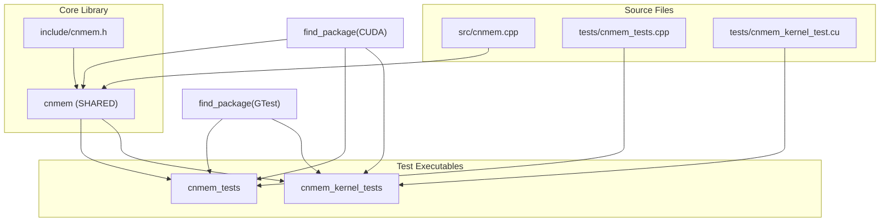
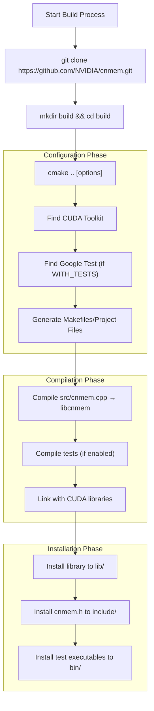

<!-- source: DeepWiki mcp.deepwiki.com · repo NVIDIA/cnmem · page 2.1 Building the Library · fetched 2026-10-26 -->

# Building the Library

<details>
<summary>Relevant source files</summary>

The following files were used as context for generating this wiki page:

- [CMakeLists.txt](CMakeLists.txt)
- [README.md](README.md)

</details>


This document provides comprehensive instructions for building the cnmem library from source code. It covers all necessary dependencies, build configuration options, and platform-specific considerations required to successfully compile cnmem on your system.

For information about using the built library in your applications, see [Quick Start Guide](#2.2). For detailed analysis of the build system internals and advanced configuration, see [Build System Details](#6.1).

## Prerequisites and Dependencies

The cnmem build system requires several dependencies to be installed and properly configured on your system before compilation can begin.

### Required Dependencies

| Component | Minimum Version | Purpose |
|-----------|----------------|---------|
| **CUDA Toolkit** | >= 7.0 (recommended) | Core CUDA runtime and development libraries |
| **CMake** | >= 2.8.8 | Cross-platform build system generator |
| **C++ Compiler** | C++11 support | Compilation of source code |

### Platform-Specific Dependencies

| Platform | Threading Library | Additional Requirements |
|----------|------------------|------------------------|
| **Linux** | Pthread | Standard POSIX threads |
| **Windows** | Win32 | Native Windows threading API |
| **macOS** | Pthread | Standard POSIX threads |

### Optional Dependencies

| Component | Required For | Notes |
|-----------|-------------|--------|
| **Google Test** | Unit testing (`WITH_TESTS=True`) | Provides testing framework |

**CUDA Installation Requirements:**

The CUDA toolkit must be properly installed with environment variables configured:
- `CUDA_HOME=/usr/local/cuda` (or your CUDA installation path)
- `LD_LIBRARY_PATH=$CUDA_HOME/lib64:$LD_LIBRARY_PATH` (Linux/macOS)
- CUDA binaries in system `PATH`

Sources: [CMakeLists.txt:5-7](), [README.md:11-25]()

## Build System Architecture

The cnmem build system is structured around CMake targets that handle library compilation, test building, and installation.

### CMake Target Dependencies



Sources: [CMakeLists.txt:5-14](), [CMakeLists.txt:21-41]()

## Basic Build Process

The standard cnmem build process follows CMake conventions with an out-of-source build directory structure.

### Build Process Flow



Sources: [README.md:28-39](), [CMakeLists.txt:1-16]()

## Build Instructions

### Basic Library Build

To build only the core cnmem library without tests:

```bash
cd $HOME
git clone https://github.com/NVIDIA/cnmem.git cnmem
cd cnmem
mkdir build
cd build
cmake ..
make
```

This creates the shared library with the following CMake configuration:
- Library name: `cnmem` 
- Library type: `SHARED` as specified in [CMakeLists.txt:12]()
- Version: `1.0.0` with `SOVERSION 1` from [CMakeLists.txt:13]()
- Preprocessor definition: `CNMEM_DLLEXPORT` from [CMakeLists.txt:11]()

### Build with Unit Tests

To build cnmem with the complete test suite:

```bash
cd cnmem
mkdir build
cd build
cmake -DWITH_TESTS=True ..
make
```

This build configuration creates additional targets when `WITH_TESTS` is enabled:

| Target | Source | Type | Purpose |
|--------|--------|------|---------|
| `cnmem_tests` | [tests/cnmem_tests.cpp]() | Executable | CPU-side unit tests |
| `cnmem_kernel_tests` | [tests/cnmem_kernel_test.cu]() | CUDA Executable | GPU kernel tests |

Sources: [README.md:41-49](), [CMakeLists.txt:19-41]()

## Build Configuration Options

### CMake Variables

The build system supports several configuration variables that modify compilation behavior:

| Variable | Default | Effect |
|----------|---------|--------|
| `WITH_TESTS` | `OFF` | Enables test target compilation |
| `CMAKE_BUILD_TYPE` | `Release` | Controls optimization level |
| `CMAKE_INSTALL_PREFIX` | `/usr/local` | Installation directory prefix |

### Compiler-Specific Features

The build system automatically detects compiler capabilities and applies appropriate flags:

#### Visual Studio (MSVC)
- **C++11 Support**: Automatically enabled for Visual Studio 2012+ via [CMakeLists.txt:28-30]()
- **Definition**: `USE_CPP_11` preprocessor flag when supported

#### GNU Compiler Collection (GCC)  
- **C++11 Standard**: `-std=c++11` flag from [CMakeLists.txt:33]()
- **Definition**: `USE_CPP_11` preprocessor flag

Sources: [CMakeLists.txt:27-34]()

## Platform-Specific Considerations

### Linux/Unix Systems

Standard build process using system package managers:

- **Threading**: Links with `-lpthread` from [CMakeLists.txt:35]()
- **CUDA Libraries**: Linked via `${CUDA_LIBRARIES}` variable
- **Library Output**: `libcnmem.so` shared library

### Windows (MSVC)

Windows builds require additional DLL handling:

- **Google Test DLL**: Automatically copied to bin folder via [CMakeLists.txt:44-47]()
- **Library Output**: `cnmem.lib` (import library) and `cnmem.dll` (dynamic library)
- **Runtime Dependencies**: CUDA runtime DLLs must be in system PATH

### macOS

Similar to Linux with:
- **Library Output**: `libcnmem.dylib` dynamic library
- **Framework**: Standard Unix build process

Sources: [CMakeLists.txt:35](), [CMakeLists.txt:44-47](), [README.md:53-55]()

## Build Artifacts and Installation

### Generated Files

The build process creates the following artifacts in the build directory:

| Artifact | Location | Description |
|----------|----------|-------------|
| `cnmem` library | `build/` | Main shared library (platform-specific extension) |
| `cnmem_tests` | `build/` | Unit test executable (if `WITH_TESTS` enabled) |
| `cnmem_kernel_tests` | `build/` | CUDA kernel test executable (if `WITH_TESTS` enabled) |

### Installation Structure

Running `make install` deploys files according to the install rules defined in [CMakeLists.txt:15-16]() and [CMakeLists.txt:36](), [CMakeLists.txt:41]():

```
${CMAKE_INSTALL_PREFIX}/
├── bin/
│   ├── cnmem_tests (if built)
│   ├── cnmem_kernel_tests (if built)
│   └── gtest.dll (Windows only, if tests built)
├── lib/
│   └── libcnmem.{so,dll,dylib}
└── include/
    └── cnmem.h
```

### Link Requirements

Applications using cnmem must link against:
- The cnmem library: `libcnmem.so` (Linux), `cnmem.lib` (Windows), `libcnmem.dylib` (macOS)  
- CUDA runtime libraries: Typically handled automatically by the CUDA toolkit installation

Sources: [CMakeLists.txt:15-16](), [CMakeLists.txt:36](), [CMakeLists.txt:41](), [README.md:51-55]()

---

