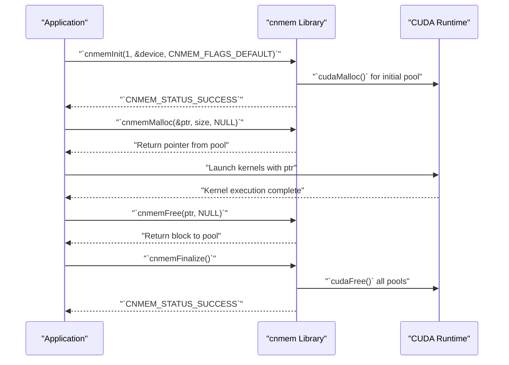
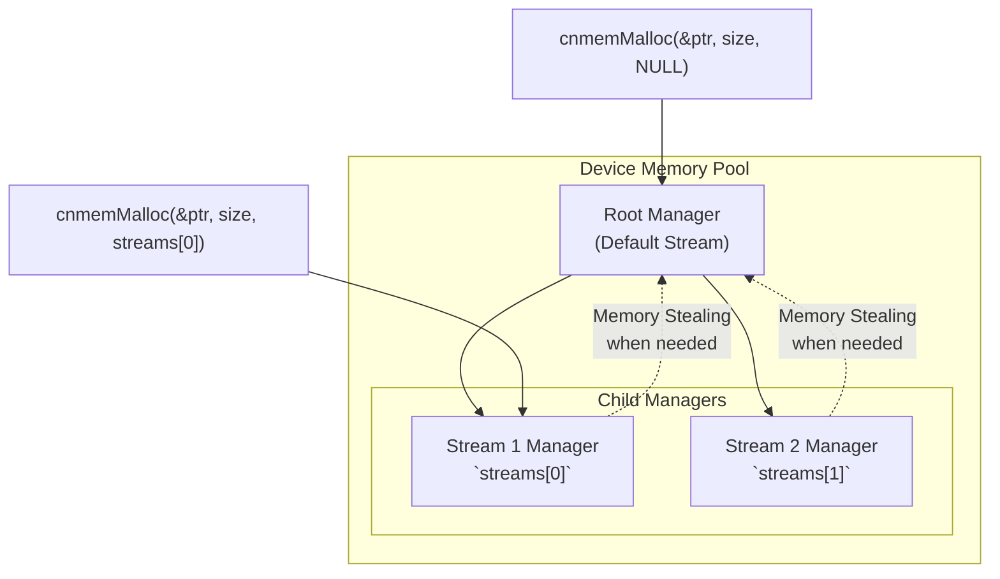
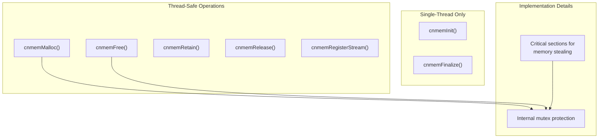

<!-- source: DeepWiki mcp.deepwiki.com · repo NVIDIA/cnmem · page 2.2 Quick Start Guide · fetched 2026-10-26 -->

# Quick Start Guide

<details>
<summary>Relevant source files</summary>

The following files were used as context for generating this wiki page:

- [include/cnmem.h](include/cnmem.h)
- [tests/cnmem_tests.cpp](tests/cnmem_tests.cpp)

</details>


This document provides simple examples and common usage patterns for getting started with the cnmem CUDA memory management library. It covers basic initialization, allocation/deallocation, stream management, and cleanup procedures. For detailed API documentation, see [API Reference](#3). For comprehensive testing examples, see [Testing and Validation](#5).

## Basic Usage Pattern

The fundamental cnmem workflow follows a simple initialize-allocate-free-finalize pattern:

**Basic cnmem Workflow**
```mermaid
graph TD
    A["`cnmemInit()`"] --> B["`cnmemMalloc()`"]
    B --> C["Use Memory in CUDA Kernels"]
    C --> D["`cnmemFree()`"]
    D --> E{More Allocations?}
    E -->|Yes| B
    E -->|No| F["`cnmemFinalize()`"]
    
    A -.-> G["`cnmemDevice_t` structure"]
    B -.-> H["`void**` pointer"]
    D -.-> H
```

Sources: [include/cnmem.h:113-126](), [tests/cnmem_tests.cpp:308-318]()

## Simple Example

Here's the minimal code pattern for using cnmem with default settings:

**Minimal Usage Pattern**


The basic initialization requires setting up a `cnmemDevice_t` structure:

| Field | Description | Example Value |
|-------|-------------|---------------|
| `device` | CUDA device number | `0` |
| `size` | Initial pool size (bytes) | `2048` or `0` for auto |
| `numStreams` | Number of managed streams | `0` for default |
| `streams` | Array of stream handles | `NULL` for default |
| `streamSizes` | Per-stream pool sizes | `NULL` for default |

Sources: [include/cnmem.h:81-94](), [tests/cnmem_tests.cpp:87-90]()

## Working with Streams

cnmem supports both the default stream (`NULL`) and named CUDA streams with dedicated memory pools:

**Stream-based Memory Management**


To use streams, configure them during initialization:

```c
cudaStream_t streams[2];
cudaStreamCreate(&streams[0]);
cudaStreamCreate(&streams[1]);

cnmemDevice_t device;
memset(&device, 0, sizeof(device));
device.size = 6144;  // 6KB total
device.numStreams = 2;
device.streams = streams;
```

Sources: [include/cnmem.h:87-92](), [tests/cnmem_tests.cpp:166-184]()

## Common Configurations

cnmem supports several configuration flags that control memory management behavior:

| Flag | Purpose | Use Case |
|------|---------|----------|
| `CNMEM_FLAGS_DEFAULT` | Allow growth and stealing | General purpose |
| `CNMEM_FLAGS_CANNOT_GROW` | Fixed pool size | Predictable memory usage |
| `CNMEM_FLAGS_CANNOT_STEAL` | No memory stealing | Stream isolation |
| `CNMEM_FLAGS_MANAGED` | Use `cudaMallocManaged` | Unified memory access |

**Memory Management Behavior**
```mermaid
flowchart TD
    REQ["Memory Request<br/>`cnmemMalloc()`"]
    
    REQ --> CHECK_POOL{"Pool has<br/>free memory?"}
    CHECK_POOL -->|Yes| RETURN_MEM["Return existing block"]
    CHECK_POOL -->|No| CHECK_GROW{"Can grow?<br/>`!CNMEM_FLAGS_CANNOT_GROW`"}
    
    CHECK_GROW -->|Yes| CUDA_MALLOC["`cudaMalloc()`<br/>Expand pool"]
    CUDA_MALLOC --> SUCCESS{"Success?"}
    SUCCESS -->|Yes| RETURN_NEW["Return new block"]
    SUCCESS -->|No| CHECK_STEAL
    
    CHECK_GROW -->|No| CHECK_STEAL{"Can steal?<br/>`!CNMEM_FLAGS_CANNOT_STEAL`"}
    CHECK_STEAL -->|Yes| STEAL["Steal from child managers"]
    STEAL --> STEAL_SUCCESS{"Success?"}
    STEAL_SUCCESS -->|Yes| RETURN_STOLEN["Return stolen block"]
    STEAL_SUCCESS -->|No| OOM["Return<br/>`CNMEM_STATUS_OUT_OF_MEMORY`"]
    CHECK_STEAL -->|No| OOM
```

Sources: [include/cnmem.h:71-77](), [include/cnmem.h:175-195](), [tests/cnmem_tests.cpp:418-443]()

## Error Handling and Cleanup

Always check return values and handle errors appropriately:

**Status Code Handling**
```mermaid
graph LR
    CALL["`cnmemMalloc()` call"]
    CALL --> CHECK_STATUS{"Check return value"}
    
    CHECK_STATUS --> SUCCESS["`CNMEM_STATUS_SUCCESS`<br/>Use the pointer"]
    CHECK_STATUS --> OOM["`CNMEM_STATUS_OUT_OF_MEMORY`<br/>Handle shortage"]
    CHECK_STATUS --> INVALID["`CNMEM_STATUS_INVALID_ARGUMENT`<br/>Fix parameters"]
    CHECK_STATUS --> NOT_INIT["`CNMEM_STATUS_NOT_INITIALIZED`<br/>Call cnmemInit first"]
    CHECK_STATUS --> CUDA_ERR["`CNMEM_STATUS_CUDA_ERROR`<br/>Check CUDA state"]
    
    SUCCESS --> USE["Launch kernels"]
    USE --> FREE["`cnmemFree(ptr, stream)`"]
```

Common cleanup patterns:

| Scenario | Action | Example |
|----------|--------|---------|
| Normal shutdown | Call `cnmemFinalize()` | Single-threaded cleanup |
| Reference counting | Use `cnmemRetain()`/`cnmemRelease()` | Multi-threaded scenarios |
| Error recovery | Check status, cleanup partial state | Handle `CNMEM_STATUS_OUT_OF_MEMORY` |
| Stream cleanup | Free stream pointers before destroying streams | Avoid invalid stream references |

The library provides `cnmemGetErrorString()` to convert status codes to human-readable messages.

Sources: [include/cnmem.h:59-67](), [include/cnmem.h:115-156](), [include/cnmem.h:255-257](), [tests/cnmem_tests.cpp:68-76]()

## Thread Safety Considerations

cnmem is designed for multi-threaded use with specific safety guarantees:

**Thread Safety Model**


Key thread safety rules:
- `cnmemInit()` and `cnmemFinalize()` must be called from a single thread
- `cnmemMalloc()` and `cnmemFree()` are thread-safe but may serialize during memory stealing
- Stream registration is thread-safe but should be done early in program lifecycle

Sources: [include/cnmem.h:104-105](), [include/cnmem.h:118-119](), [include/cnmem.h:194-195](), [tests/cnmem_tests.cpp:651-866]()

---

