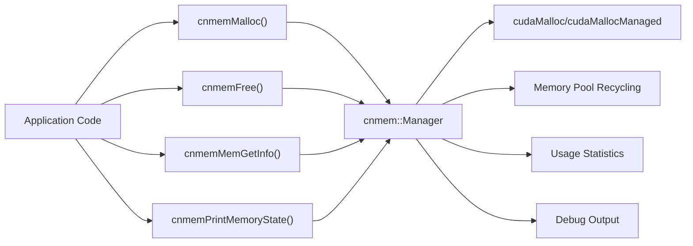
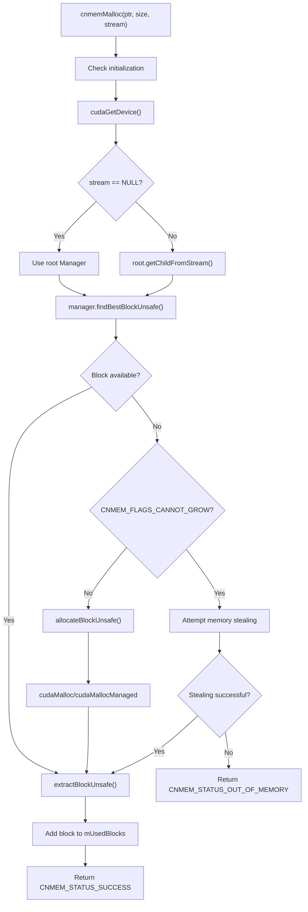

<!-- source: DeepWiki mcp.deepwiki.com · repo NVIDIA/cnmem · page 3 API Reference · fetched 2026-10-26 -->

# API Reference

<details>
<summary>Relevant source files</summary>

The following files were used as context for generating this wiki page:

- [include/cnmem.h](include/cnmem.h)
- [src/cnmem.cpp](src/cnmem.cpp)

</details>


This document provides complete reference documentation for the cnmem public API. It covers all functions, data structures, enums, and constants that applications can use to integrate CUDA memory management capabilities through cnmem.

For implementation details and internal architecture, see [Architecture and Implementation](#4). For testing and validation information, see [Testing and Validation](#5). For basic usage examples, see [Quick Start Guide](#2.2).

## Overview

The cnmem public API consists of three main categories of functions:

**Initialization and Configuration API Hierarchy**

```mermaid
graph TD
    Init["cnmemInit()"] --> Context["Global cnmem Context"]
    Context --> Retain["cnmemRetain()"]
    Context --> Release["cnmemRelease()"] 
    Context --> Finalize["cnmemFinalize()"]
    Context --> RegisterStream["cnmemRegisterStream()"]
    
    Init --> DeviceConfig["cnmemDevice_t Structure"]
    DeviceConfig --> DeviceField["device: int"]
    DeviceConfig --> SizeField["size: size_t"]
    DeviceConfig --> NumStreamsField["numStreams: int"]
    DeviceConfig --> StreamsField["streams: cudaStream_t*"]
    DeviceConfig --> StreamSizesField["streamSizes: size_t*"]
    
    Init --> Flags["cnmemManagerFlags_t"]
    Flags --> DefaultFlag["CNMEM_FLAGS_DEFAULT"]
    Flags --> CannotGrowFlag["CNMEM_FLAGS_CANNOT_GROW"]
    Flags --> CannotStealFlag["CNMEM_FLAGS_CANNOT_STEAL"]
    Flags --> ManagedFlag["CNMEM_FLAGS_MANAGED"]
```



**Memory Operations API Flow**



Sources: [include/cnmem.h:113-258](), [src/cnmem.cpp:1071-1311]()

## Status Codes and Error Handling

All cnmem functions return a `cnmemStatus_t` value indicating success or failure.

| Status Code | Value | Description |
|-------------|-------|-------------|
| `CNMEM_STATUS_SUCCESS` | 0 | Operation completed successfully |
| `CNMEM_STATUS_CUDA_ERROR` | 1 | CUDA runtime error occurred |
| `CNMEM_STATUS_INVALID_ARGUMENT` | 2 | Invalid function argument provided |
| `CNMEM_STATUS_NOT_INITIALIZED` | 3 | Library not initialized via `cnmemInit` |
| `CNMEM_STATUS_OUT_OF_MEMORY` | 4 | Insufficient memory available |
| `CNMEM_STATUS_UNKNOWN_ERROR` | 5 | Unspecified error condition |

### cnmemGetErrorString

```c
const char* cnmemGetErrorString(cnmemStatus_t status);
```

Converts a status code to a human-readable string representation.

**Parameters:**
- `status`: The status code to convert

**Returns:** Null-terminated string describing the status

Sources: [include/cnmem.h:257](), [src/cnmem.cpp:52-61]()

## Configuration Data Structures

### cnmemDevice_t

Configuration structure for initializing memory management on a specific device.

```c
typedef struct cnmemDevice_t_ {
    int device;              // CUDA device number
    size_t size;             // Memory pool size (0 = auto-detect)
    int numStreams;          // Number of named streams
    cudaStream_t *streams;   // Array of stream handles
    size_t *streamSizes;     // Per-stream memory allocations
} cnmemDevice_t;
```

**Field Details:**
- `device`: CUDA device ordinal (0-based)
- `size`: Initial memory pool size in bytes. If 0, cnmem allocates half of available device memory
- `numStreams`: Count of CUDA streams requiring dedicated memory managers
- `streams`: Pointer to array of `cudaStream_t` handles (can be NULL)
- `streamSizes`: Per-stream memory reservations (can be NULL for default sizes)

### cnmemManagerFlags_t

Bitfield flags controlling memory manager behavior.

| Flag | Value | Description |
|------|-------|-------------|
| `CNMEM_FLAGS_DEFAULT` | 0 | Default behavior: allow growth and stealing |
| `CNMEM_FLAGS_CANNOT_GROW` | 1 | Prevent pool expansion via `cudaMalloc` |
| `CNMEM_FLAGS_CANNOT_STEAL` | 2 | Disable memory stealing from other managers |
| `CNMEM_FLAGS_MANAGED` | 4 | Use `cudaMallocManaged` for unified memory |

Sources: [include/cnmem.h:81-94](), [include/cnmem.h:71-77]()

## Memory Manager Lifecycle

**cnmem Context and Manager Creation Process**

```mermaid
stateDiagram-v2
    [*] --> Uninitialized
    
    Uninitialized --> Initializing: cnmemInit()
    Initializing --> CreateContext: "Context::create()"
    CreateContext --> CreateManagers: "Allocate Manager array"
    CreateManagers --> ReserveMemory: "manager.reserve()"
    ReserveMemory --> CreateChildren: "Create stream managers"
    CreateChildren --> Ready: "Initialization complete"
    
    Ready --> Ready: cnmemRetain()/cnmemRelease()
    Ready --> Ready: cnmemMalloc()/cnmemFree()
    Ready --> Ready: cnmemRegisterStream()
    
    Ready --> Finalizing: cnmemFinalize() or refCount==0
    Finalizing --> ReleaseMemory: "manager.releaseAllUnsafe()"
    ReleaseMemory --> DestroyContext: "delete Context"
    DestroyContext --> [*]
```

Sources: [src/cnmem.cpp:1024-1059](), [src/cnmem.cpp:1071-1130](), [src/cnmem.cpp:1134-1151]()

### cnmemInit

```c
cnmemStatus_t cnmemInit(int numDevices, const cnmemDevice_t *devices, unsigned flags);
```

Initializes cnmem and allocates memory pools on specified devices. Must be called before any other cnmem function. **Not thread-safe**.

**Parameters:**
- `numDevices`: Number of devices in the `devices` array
- `devices`: Array of device configurations
- `flags`: Global behavior flags (OR'd `cnmemManagerFlags_t` values)

**Behavior:**
1. Creates global `cnmem::Context` singleton
2. For each device, creates root `cnmem::Manager` 
3. Allocates initial memory pool via `cudaMalloc` or `cudaMallocManaged`
4. Creates child managers for each named stream
5. Aligns all allocations to `CNMEM_GRANULARITY` (512 bytes)

**Returns:**
- `CNMEM_STATUS_SUCCESS`: Initialization completed
- `CNMEM_STATUS_INVALID_ARGUMENT`: Invalid device ID or memory size
- `CNMEM_STATUS_OUT_OF_MEMORY`: Insufficient GPU memory
- `CNMEM_STATUS_CUDA_ERROR`: CUDA runtime error

### cnmemFinalize

```c
cnmemStatus_t cnmemFinalize();
```

Releases all allocated memory and destroys the cnmem context. **Not thread-safe**. Must be called after all threads using cnmem have joined.

**Returns:**
- `CNMEM_STATUS_SUCCESS`: Cleanup completed
- `CNMEM_STATUS_NOT_INITIALIZED`: cnmem was not initialized

### cnmemRetain / cnmemRelease

```c
cnmemStatus_t cnmemRetain();
cnmemStatus_t cnmemRelease();
```

Reference counting functions for managing cnmem context lifetime. **Thread-safe**.

- `cnmemRetain()`: Increments reference count
- `cnmemRelease()`: Decrements reference count, finalizes when reaching 0

### cnmemRegisterStream

```c
cnmemStatus_t cnmemRegisterStream(cudaStream_t stream);
```

Dynamically adds a new stream to the memory management system. **Thread-safe**.

**Parameters:**
- `stream`: CUDA stream handle to register (must not be NULL)

**Behavior:**
1. Creates new child `cnmem::Manager` for the stream
2. Associates manager with current CUDA device
3. Inherits parent flags but removes `CNMEM_FLAGS_CANNOT_GROW`

Sources: [include/cnmem.h:113](), [include/cnmem.h:126](), [include/cnmem.h:140](), [include/cnmem.h:156](), [include/cnmem.h:167](), [src/cnmem.cpp:1071-1130](), [src/cnmem.cpp:1134-1137](), [src/cnmem.cpp:1141-1144](), [src/cnmem.cpp:1148-1151](), [src/cnmem.cpp:1155-1171]()

## Memory Management Functions

### cnmemMalloc

```c
cnmemStatus_t cnmemMalloc(void **ptr, size_t size, cudaStream_t stream);
```

Allocates GPU memory from managed memory pools. **Thread-safe**.

**Parameters:**
- `ptr`: Output pointer to allocated memory
- `size`: Requested allocation size in bytes
- `stream`: CUDA stream for allocation (NULL for default stream)

**Allocation Strategy:**



**Behavior Details:**
1. **Stream Selection**: NULL stream uses root manager, named streams use child managers
2. **Best Fit**: Searches free blocks for smallest adequate size
3. **Pool Growth**: If no free blocks and growth allowed, calls `cudaMalloc`
4. **Memory Stealing**: As last resort, steals blocks from other stream managers
5. **Size Alignment**: All allocations rounded up to `CNMEM_GRANULARITY` (512 bytes)
6. **Block Splitting**: Large blocks are split if significantly larger than request

**Returns:**
- `CNMEM_STATUS_SUCCESS`: Memory allocated successfully
- `CNMEM_STATUS_NOT_INITIALIZED`: cnmem not initialized
- `CNMEM_STATUS_INVALID_ARGUMENT`: Invalid pointer or arguments
- `CNMEM_STATUS_OUT_OF_MEMORY`: No memory available
- `CNMEM_STATUS_CUDA_ERROR`: CUDA runtime error

### cnmemFree

```c
cnmemStatus_t cnmemFree(void *ptr, cudaStream_t stream);
```

Releases previously allocated memory back to the pool. **Thread-safe**.

**Parameters:**
- `ptr`: Pointer to memory allocated by `cnmemMalloc` (NULL is ignored)
- `stream`: Stream used for original allocation

**Behavior:**
1. Locates memory block in manager's used block list
2. Removes block from used list
3. Adds block to free list in address-sorted order
4. Attempts block coalescing with adjacent free blocks

**Block Coalescing Rules:**
- Adjacent blocks can merge if they're contiguous in memory
- Cannot merge across `cudaMalloc` boundaries (head blocks)
- Maintains address-sorted free list for efficient coalescing

**Returns:**
- `CNMEM_STATUS_SUCCESS`: Memory released successfully  
- `CNMEM_STATUS_NOT_INITIALIZED`: cnmem not initialized
- `CNMEM_STATUS_INVALID_ARGUMENT`: Pointer not found in used blocks

Sources: [include/cnmem.h:204](), [include/cnmem.h:218](), [src/cnmem.cpp:1175-1246](), [src/cnmem.cpp:1250-1266]()

## Utility and Information Functions

### cnmemMemGetInfo

```c
cnmemStatus_t cnmemMemGetInfo(size_t *freeMem, size_t *totalMem, cudaStream_t stream);
```

Returns memory usage statistics for a specific manager. **Thread-safe**.

**Parameters:**
- `freeMem`: Output pointer for free memory amount
- `totalMem`: Output pointer for total managed memory
- `stream`: Stream to query (NULL for root manager)

**Behavior:**
- Iterates through free and used block lists
- Computes total memory as `freeMem + usedMem`
- Linear complexity in number of allocated blocks

**Returns:**
- `CNMEM_STATUS_SUCCESS`: Information retrieved
- `CNMEM_STATUS_NOT_INITIALIZED`: cnmem not initialized
- `CNMEM_STATUS_INVALID_ARGUMENT`: NULL output pointers

### cnmemPrintMemoryState

```c
cnmemStatus_t cnmemPrintMemoryState(FILE *file, cudaStream_t stream);
```

Outputs detailed memory manager state for debugging. **Thread-safe**.

**Parameters:**
- `file`: Output file handle (e.g., `stdout`, `stderr`)
- `stream`: Stream to examine (NULL for root manager)

**Output Format:**
```
>> [root/child] device=N, stream=0x..., used=XB, free=YB
| list="used", size=X
| | node=0x..., data=0x..., size=..., next=0x..., head=1/0
| list="free", size=Y
| | node=0x..., data=0x..., size=..., next=0x..., head=1/0
```

**Information Provided:**
- Manager type (root or child)
- Device and stream identifiers
- Used and free memory totals
- Detailed block-by-block listings
- Block addresses, sizes, and head flags

Sources: [include/cnmem.h:237](), [include/cnmem.h:252](), [src/cnmem.cpp:1270-1291](), [src/cnmem.cpp:1295-1307]()

## Constants and Macros

### Version Information

- `CNMEM_VERSION`: Integer version number (100 = version 1.0.0)

### Internal Constants

- `CNMEM_GRANULARITY`: Memory alignment boundary (512 bytes)

### API Export Macros

- `CNMEM_API`: Platform-specific function export decoration
- Platform-specific DLL export/import handling for Windows
- Visibility attributes for Linux/Unix systems

Sources: [include/cnmem.h:51](), [src/cnmem.cpp:48](), [include/cnmem.h:37-49]()

---

