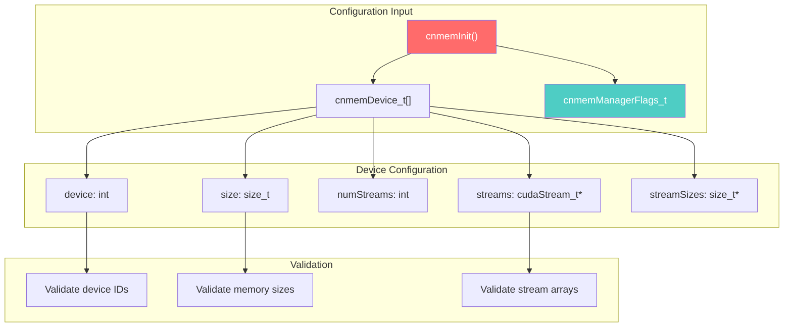
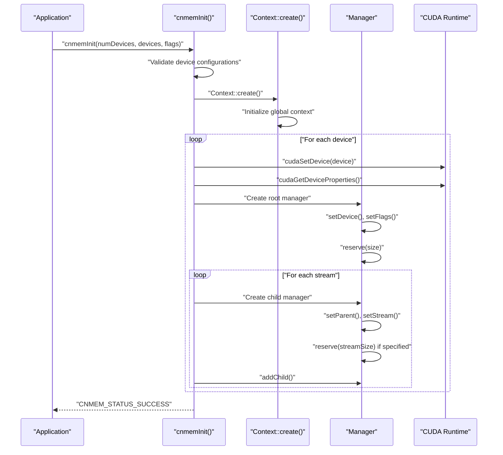
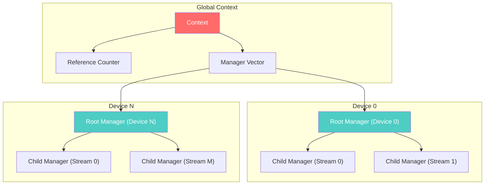
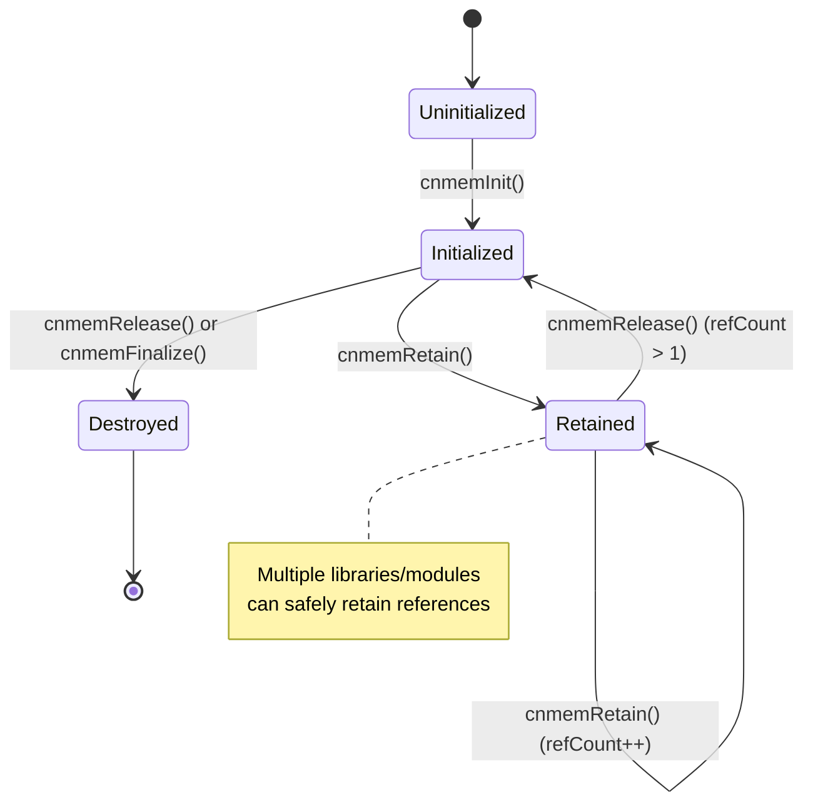
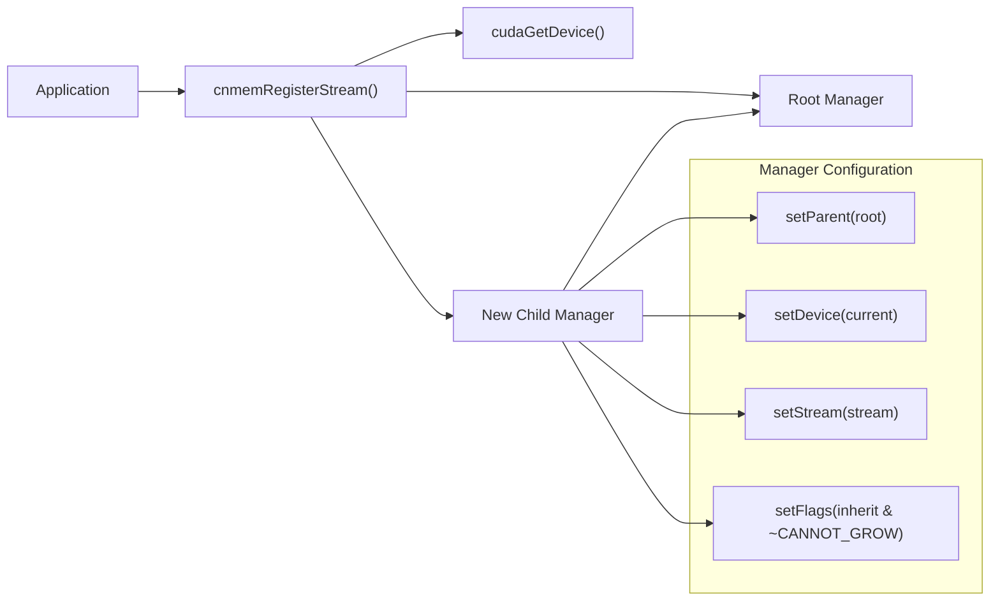

<!-- source: DeepWiki mcp.deepwiki.com · repo NVIDIA/cnmem · page 3.1 Initialization and Configuration · fetched 2026-10-26 -->

# Initialization and Configuration

Relevant source files

The following files were used as context for generating this wiki page:

- [include/cnmem.h](include/cnmem.h)
- [src/cnmem.cpp](src/cnmem.cpp)

This page covers the initialization and configuration of the cnmem library, including system setup, device configuration, reference counting, and stream management. This documentation focuses on the API functions and data structures used to initialize and configure the memory management system.

For information about memory allocation and deallocation operations, see [Memory Management Functions](#3.2). For details about the internal architecture created during initialization, see [Core Memory Management System](#4.1).

## Purpose and Scope

The initialization and configuration system establishes the cnmem memory management infrastructure by:

- Creating memory managers for specified CUDA devices
- Allocating initial memory pools on each device  
- Setting up stream-specific child managers
- Managing library lifetime through reference counting
- Providing configuration options through flags and device specifications

## Configuration Data Structures

### Device Configuration Structure

The `cnmemDevice_t` structure defines the configuration for each CUDA device:

| Field | Type | Description |
|-------|------|-------------|
| `device` | `int` | CUDA device number |
| `size` | `size_t` | Memory pool size (0 = auto-select half of device memory) |
| `numStreams` | `int` | Number of named streams for this device |
| `streams` | `cudaStream_t*` | Array of CUDA streams |
| `streamSizes` | `size_t*` | Memory sizes for each stream (optional) |

### Configuration Flags

The `cnmemManagerFlags_t` enum provides configuration options:

| Flag | Value | Description |
|------|-------|-------------|
| `CNMEM_FLAGS_DEFAULT` | 0 | Default behavior |
| `CNMEM_FLAGS_CANNOT_GROW` | 1 | Prevent memory pool growth |
| `CNMEM_FLAGS_CANNOT_STEAL` | 2 | Prevent memory stealing between managers |
| `CNMEM_FLAGS_MANAGED` | 4 | Use `cudaMallocManaged` for unified memory |

Sources: [include/cnmem.h:81-94](), [include/cnmem.h:71-77]()

## Configuration Structure Relationships

Sources: [src/cnmem.cpp:1071-1130](), [include/cnmem.h:81-94]()

## Initialization Process Flow

### Core Initialization Function

The `cnmemInit()` function orchestrates the complete system setup:

The initialization process creates a hierarchical structure of memory managers:

Sources: [src/cnmem.cpp:1071-1130](), [src/cnmem.cpp:966-1001](), [src/cnmem.cpp:1024-1028]()

## Reference Counting and Lifetime Management

### Context Management Functions

The library uses reference counting to manage its lifetime:

| Function | Purpose | Thread Safety |
|----------|---------|---------------|
| `cnmemRetain()` | Increment reference count | Thread-safe |
| `cnmemRelease()` | Decrement reference count | Thread-safe |
| `cnmemFinalize()` | Direct cleanup (calls `cnmemRelease()`) | Single-threaded |

### Reference Counting Implementation

The `Context` class manages this lifecycle:

- Initial reference count starts at 1 after `cnmemInit()`
- `cnmemRetain()` increments the counter atomically
- `cnmemRelease()` decrements and destroys when reaching 0
- Destruction releases all managers and CUDA memory

Sources: [src/cnmem.cpp:1039-1059](), [src/cnmem.cpp:1141-1151](), [src/cnmem.cpp:966-1001]()

## Stream Registration

### Dynamic Stream Addition

The `cnmemRegisterStream()` function allows adding streams after initialization:

Key characteristics of dynamic stream registration:

- Creates child manager with current device context
- Inherits parent flags except `CNMEM_FLAGS_CANNOT_GROW`
- No initial memory reservation (relies on parent allocation)
- Thread-safe operation

Sources: [src/cnmem.cpp:1155-1171](), [include/cnmem.h:158-167]()

## Status Codes and Error Handling

### Initialization Status Codes

| Status | Description | Common Causes |
|--------|-------------|---------------|
| `CNMEM_STATUS_SUCCESS` | Operation completed successfully | - |
| `CNMEM_STATUS_INVALID_ARGUMENT` | Invalid input parameters | Invalid device ID, null pointers |
| `CNMEM_STATUS_OUT_OF_MEMORY` | Insufficient device memory | Requested size exceeds available memory |
| `CNMEM_STATUS_CUDA_ERROR` | CUDA runtime error | Device not available, driver issues |
| `CNMEM_STATUS_NOT_INITIALIZED` | Library not initialized | Called before `cnmemInit()` |

### Error String Conversion

The `cnmemGetErrorString()` function converts status codes to human-readable strings for debugging and logging purposes.

Sources: [src/cnmem.cpp:52-61](), [include/cnmem.h:59-67]()

## Memory Size Calculations

During initialization, the system performs memory size calculations and alignments:

- Device size defaults to 50% of total device memory if not specified
- All allocations are aligned to `CNMEM_GRANULARITY` (512 bytes)
- Stream sizes are individually aligned for optimal memory access patterns
- Memory prefetching is performed when using managed memory (`CNMEM_FLAGS_MANAGED`)

The granularity alignment ensures optimal memory access performance and satisfies CUDA alignment requirements.

Sources: [src/cnmem.cpp:48](), [src/cnmem.cpp:1100-1122](), [src/cnmem.cpp:184-187]()

---

