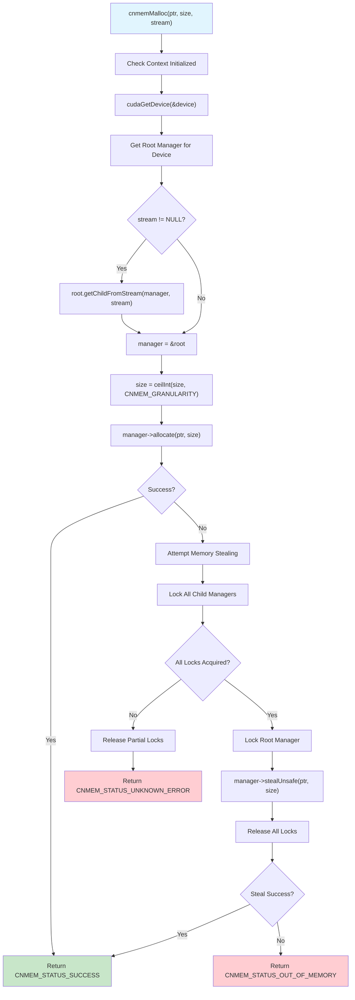
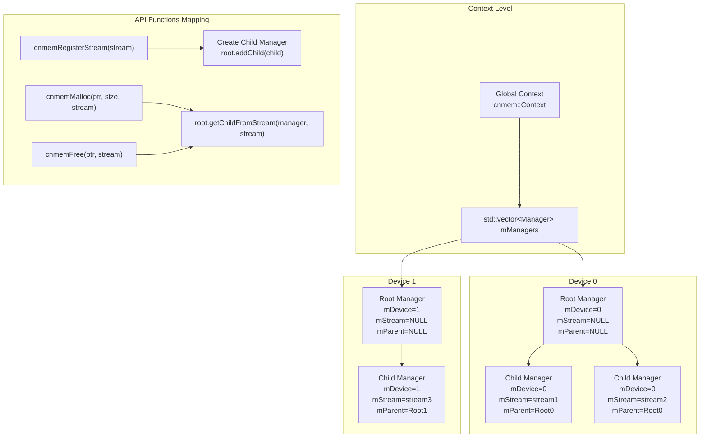
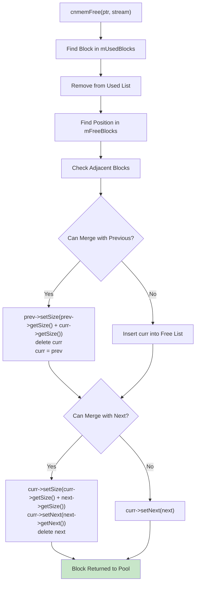

<!-- source: DeepWiki mcp.deepwiki.com · repo NVIDIA/cnmem · page 3.2 Memory Management Functions · fetched 2026-10-26 -->

# Memory Management Functions

<details>
<summary>Relevant source files</summary>

The following files were used as context for generating this wiki page:

- [include/cnmem.h](include/cnmem.h)
- [src/cnmem.cpp](src/cnmem.cpp)

</details>


This page documents the core memory management functions that form the primary interface for allocating and deallocating GPU memory through cnmem. These functions provide stream-aware memory allocation with automatic pool management and memory stealing capabilities.

For information about library initialization and configuration, see [Initialization and Configuration](#3.1). For utility functions like memory information queries, see [Utility and Information Functions](#3.3).

## Core Memory Management Functions

The cnmem library provides three primary memory management functions that handle GPU memory allocation, deallocation, and stream registration.

### cnmemMalloc

```c
cnmemStatus_t cnmemMalloc(void **ptr, size_t size, cudaStream_t stream);
```

Allocates GPU memory from managed pools with automatic fallback strategies. The function employs a sophisticated allocation hierarchy that attempts multiple strategies to satisfy memory requests.

| Parameter | Type | Description |
|-----------|------|-------------|
| `ptr` | `void **` | Output pointer to allocated device memory |
| `size` | `size_t` | Number of bytes to allocate |
| `stream` | `cudaStream_t` | Target CUDA stream, or NULL for default stream |

**Return Values:**
- `CNMEM_STATUS_SUCCESS` - Memory allocated successfully
- `CNMEM_STATUS_NOT_INITIALIZED` - Library not initialized via `cnmemInit`
- `CNMEM_STATUS_INVALID_ARGUMENT` - Invalid parameters (e.g., `ptr == NULL`)
- `CNMEM_STATUS_OUT_OF_MEMORY` - No memory available after all strategies attempted
- `CNMEM_STATUS_CUDA_ERROR` - CUDA runtime error

**Sources:** [src/cnmem.cpp:1175-1246](), [include/cnmem.h:169-204]()

### cnmemFree

```c
cnmemStatus_t cnmemFree(void *ptr, cudaStream_t stream);
```

Releases memory back to the managed pool for reuse. The memory block is returned to the appropriate manager's free list and may be coalesced with adjacent free blocks.

| Parameter | Type | Description |
|-----------|------|-------------|
| `ptr` | `void *` | Pointer to device memory to free |
| `stream` | `cudaStream_t` | Associated CUDA stream, or NULL for default stream |

**Return Values:**
- `CNMEM_STATUS_SUCCESS` - Memory freed successfully
- `CNMEM_STATUS_NOT_INITIALIZED` - Library not initialized
- `CNMEM_STATUS_INVALID_ARGUMENT` - Invalid memory pointer
- `CNMEM_STATUS_CUDA_ERROR` - CUDA runtime error

**Sources:** [src/cnmem.cpp:1250-1266](), [include/cnmem.h:206-218]()

### cnmemRegisterStream

```c
cnmemStatus_t cnmemRegisterStream(cudaStream_t stream);
```

Registers a new CUDA stream with the memory management system, creating a dedicated child manager for stream-specific allocations.

| Parameter | Type | Description |
|-----------|------|-------------|
| `stream` | `cudaStream_t` | CUDA stream to register (must not be NULL) |

**Return Values:**
- `CNMEM_STATUS_SUCCESS` - Stream registered successfully
- `CNMEM_STATUS_NOT_INITIALIZED` - Library not initialized
- `CNMEM_STATUS_INVALID_ARGUMENT` - Invalid stream parameter

**Sources:** [src/cnmem.cpp:1155-1171](), [include/cnmem.h:158-167]()

## Memory Allocation Strategy Flow

The following diagram illustrates the allocation strategy employed by `cnmemMalloc`, showing the hierarchical decision process and fallback mechanisms.



**Sources:** [src/cnmem.cpp:1175-1246](), [src/cnmem.cpp:462-497]()

## Manager Allocation Hierarchy

This diagram shows how memory allocation requests are routed through the hierarchical manager system and the internal allocation strategies within each manager.

```mermaid
flowchart TD
    subgraph "Device Level"
        RootMgr["Root Manager<br/>device=0"]
        Child1["Child Manager<br/>stream=stream1"]
        Child2["Child Manager<br/>stream=stream2"] 
        ChildN["Child Manager<br/>stream=streamN"]
    end
    
    subgraph "Manager::allocate() Internal Flow"
        FindBest["findBestBlockUnsafe(best, prev, size)"]
        BestFound{"best != NULL?"}
        CanGrow{"!(mFlags & CNMEM_FLAGS_CANNOT_GROW)?"}
        AllocBlock["allocateBlockUnsafe(best, prev, size)"]
        ExtractBlock["extractBlockUnsafe(best, prev, size, false)"]
        AddToUsed["Add to mUsedBlocks"]
        
        FindBest --> BestFound
        BestFound -->|Yes| ExtractBlock
        BestFound -->|No| CanGrow
        CanGrow -->|Yes| AllocBlock
        CanGrow -->|No| ReturnOOM["CNMEM_STATUS_OUT_OF_MEMORY"]
        AllocBlock --> ExtractBlock
        ExtractBlock --> AddToUsed
    end
    
    subgraph "allocateBlockUnsafe() Strategy"
        HasParent{"mParent != NULL?"}
        ParentAlloc["mParent->allocate(data, size)"]
        IsManaged{"mFlags & CNMEM_FLAGS_MANAGED?"}
        CudaMallocManaged["cudaMallocManaged(&data, size)"]
        CudaMalloc["cudaMalloc(&data, size)"]
        AddToFreeList["Add Block to mFreeBlocks"]
        
        HasParent -->|Yes| ParentAlloc
        HasParent -->|No| IsManaged
        IsManaged -->|Yes| CudaMallocManaged
        IsManaged -->|No| CudaMalloc
        ParentAlloc --> AddToFreeList
        CudaMallocManaged --> AddToFreeList
        CudaMalloc --> AddToFreeList
    end
    
    RootMgr --> Child1
    RootMgr --> Child2
    RootMgr --> ChildN
```



**Sources:** [src/cnmem.cpp:462-497](), [src/cnmem.cpp:501-543](), [src/cnmem.cpp:307-422]()

## Stream-Manager Mapping

The relationship between CUDA streams and memory managers is established through a parent-child hierarchy where each registered stream gets its own dedicated manager.



**Sources:** [src/cnmem.cpp:1155-1171](), [src/cnmem.cpp:588-600](), [src/cnmem.cpp:453-458]()

## Block Management and Memory Coalescing

When memory is freed via `cnmemFree`, the system employs sophisticated block coalescing to minimize fragmentation.



**Block Coalescing Rules:**
- Blocks can only be merged if they are physically adjacent in memory
- Merge boundaries cannot cross "head" blocks (blocks obtained directly from `cudaMalloc`)
- The `isHead()` flag prevents merging across allocation boundaries

**Sources:** [src/cnmem.cpp:797-842](), [src/cnmem.cpp:730-755]()

## Memory Granularity and Alignment

All memory allocations are rounded up to `CNMEM_GRANULARITY` (512 bytes) to ensure proper alignment and optimize memory pool management.

| Concept | Value | Purpose |
|---------|--------|---------|
| `CNMEM_GRANULARITY` | 512 bytes | Memory alignment boundary |
| `ceilInt(size, CNMEM_GRANULARITY)` | Rounds up allocation size | Prevents fragmentation |
| Stream size alignment | `CNMEM_GRANULARITY` | Ensures stream base addresses are aligned |

**Sources:** [src/cnmem.cpp:48](), [src/cnmem.cpp:1196](), [src/cnmem.cpp:1122]()

---

