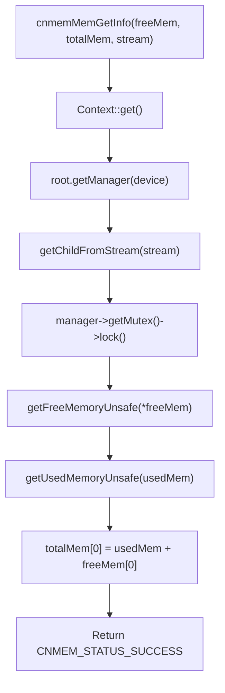
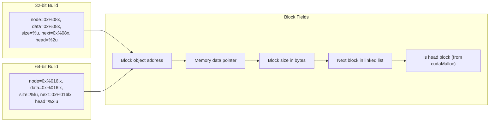
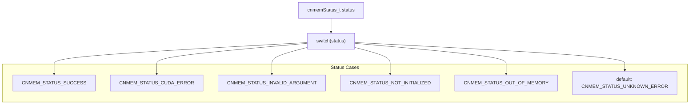
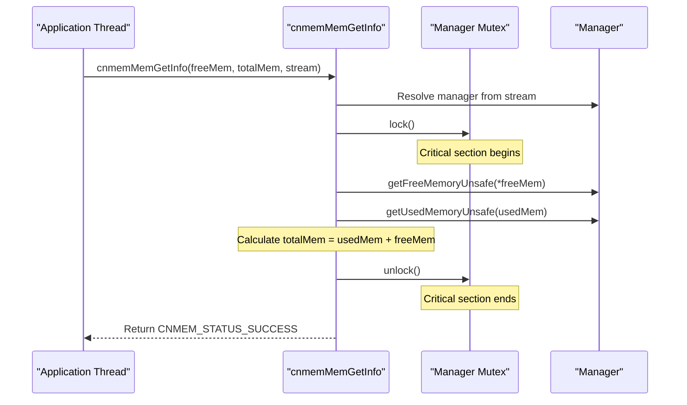
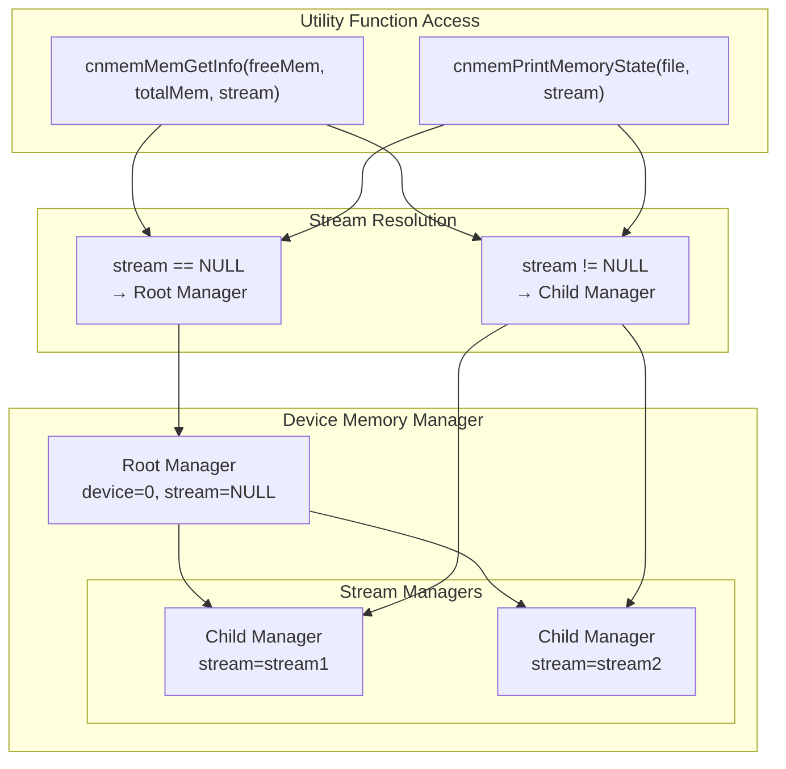

<!-- source: DeepWiki mcp.deepwiki.com · repo NVIDIA/cnmem · page 3.3 Utility and Information Functions · fetched 2026-10-26 -->

# Utility and Information Functions

<details>
<summary>Relevant source files</summary>

The following files were used as context for generating this wiki page:

- [include/cnmem.h](include/cnmem.h)
- [src/cnmem.cpp](src/cnmem.cpp)

</details>


This page documents the utility and information functions provided by cnmem for debugging, monitoring, and error handling. These functions complement the core memory management operations by providing visibility into memory usage, detailed state information for debugging, and human-readable error messages.

For core memory allocation and deallocation operations, see [Memory Management Functions](#3.2). For initialization and configuration, see [Initialization and Configuration](#3.1).

## Memory Usage Information

The `cnmemMemGetInfo` function provides runtime memory usage statistics for a specific stream or device, similar to CUDA's `cudaMemGetInfo` but scoped to cnmem's managed memory pools.

### Function Signature and Behavior

```c
cnmemStatus_t cnmemMemGetInfo(size_t *freeMem, size_t *totalMem, cudaStream_t stream)
```

The function operates by:

1. Resolving the appropriate `Manager` instance for the given stream
2. Acquiring the manager's mutex for thread-safe access
3. Computing free and used memory from the manager's block lists
4. Returning total memory as the sum of free and used memory



Sources: [src/cnmem.cpp:1270-1291](), [include/cnmem.h:224-237]()

### Memory Calculation Implementation

The underlying memory calculation traverses linked lists of memory blocks to compute total sizes:

| Function | Purpose | Complexity |
|----------|---------|------------|
| `getFreeMemoryUnsafe` | Sums sizes of all free blocks | O(n) where n = free blocks |
| `getUsedMemoryUnsafe` | Sums sizes of all used blocks | O(n) where n = used blocks |
| `getMemoryUnsafe` | Generic block list traversal | O(n) where n = blocks in list |

Sources: [src/cnmem.cpp:351-357](), [src/cnmem.cpp:618-624]()

## Memory State Debugging

The `cnmemPrintMemoryState` function provides detailed diagnostic information about the internal state of memory managers, printing comprehensive information about memory blocks to a specified file.

### Function Signature and Output Format

```c
cnmemStatus_t cnmemPrintMemoryState(FILE *file, cudaStream_t stream)
```

The function generates hierarchical output showing:

- Manager type (root or child), device ID, and stream identifier
- Used and free memory totals in bytes
- Detailed block-by-block information including addresses, sizes, and linkage

```mermaid
graph TD
    PrintState["cnmemPrintMemoryState(file, stream)"]
    Manager["manager->printMemoryState(file)"]
    
    subgraph "Manager Output"
        Header["Print manager header<br/>device, stream, used/free totals"]
        UsedList["printListUnsafe(file, \"used\", mUsedBlocks)"]
        FreeList["printListUnsafe(file, \"free\", mFreeBlocks)"]
        ParentRecurse["Recursively print parent state"]
    end
    
    subgraph "Block List Details"
        BlockTraverse["Traverse Block* linked list"]
        BlockInfo["Print node address, data pointer,<br/>size, next pointer, head flag"]
    end
    
    PrintState --> Manager
    Manager --> Header
    Header --> UsedList
    UsedList --> FreeList
    FreeList --> ParentRecurse
    
    UsedList --> BlockTraverse
    FreeList --> BlockTraverse
    BlockTraverse --> BlockInfo
```

Sources: [src/cnmem.cpp:1295-1307](), [src/cnmem.cpp:700-726]()

### Block List Output Format

The `printListUnsafe` method generates detailed information for each block in a linked list:



Sources: [src/cnmem.cpp:674-696]()

## Error String Conversion

The `cnmemGetErrorString` function provides human-readable descriptions of `cnmemStatus_t` error codes for debugging and user-facing error messages.

### Status Code Mapping

```c
const char* cnmemGetErrorString(cnmemStatus_t status)
```

| Status Code | String Representation |
|-------------|----------------------|
| `CNMEM_STATUS_SUCCESS` | "CNMEM_STATUS_SUCCESS" |
| `CNMEM_STATUS_CUDA_ERROR` | "CNMEM_STATUS_CUDA_ERROR" |
| `CNMEM_STATUS_INVALID_ARGUMENT` | "CNMEM_STATUS_INVALID_ARGUMENT" |
| `CNMEM_STATUS_NOT_INITIALIZED` | "CNMEM_STATUS_NOT_INITIALIZED" |
| `CNMEM_STATUS_OUT_OF_MEMORY` | "CNMEM_STATUS_OUT_OF_MEMORY" |
| Unknown values | "CNMEM_STATUS_UNKNOWN_ERROR" |



Sources: [src/cnmem.cpp:52-61](), [include/cnmem.h:59-67](), [include/cnmem.h:254-257]()

## Thread Safety and Performance Considerations

All utility functions maintain thread safety through appropriate mutex usage, but have performance implications:

| Function | Thread Safety | Performance Notes |
|----------|---------------|-------------------|
| `cnmemMemGetInfo` | Thread-safe via manager mutex | O(n) complexity - avoid in hot paths |
| `cnmemPrintMemoryState` | Thread-safe via manager mutex | Heavy I/O operation - debug use only |
| `cnmemGetErrorString` | Thread-safe (no shared state) | Constant time - safe for frequent use |

The mutex acquisition strategy ensures consistent memory state during information gathering:



Sources: [src/cnmem.cpp:1283-1289](), [src/cnmem.cpp:701-720]()

## Integration with Internal Manager Hierarchy

These utility functions operate within cnmem's hierarchical manager system, where root managers handle device-level pools and child managers handle stream-specific allocations:



Sources: [src/cnmem.cpp:1276-1280](), [src/cnmem.cpp:1301-1305](), [src/cnmem.cpp:589-600]()

---

