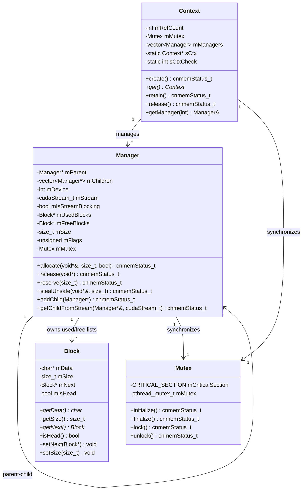
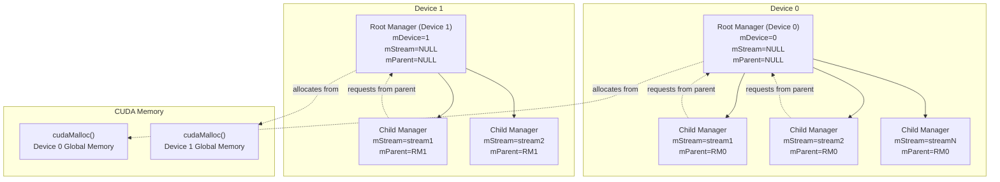
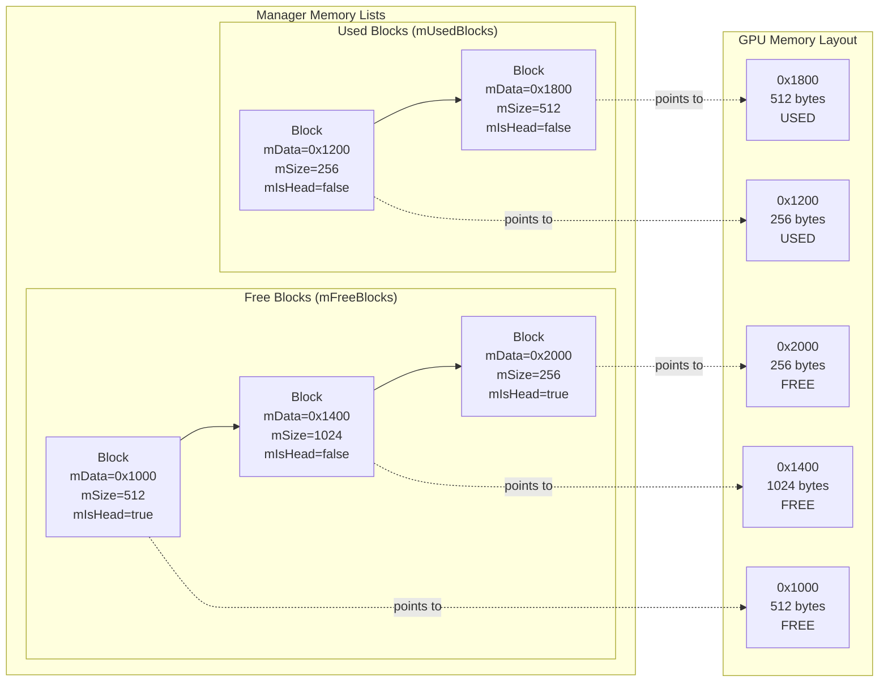
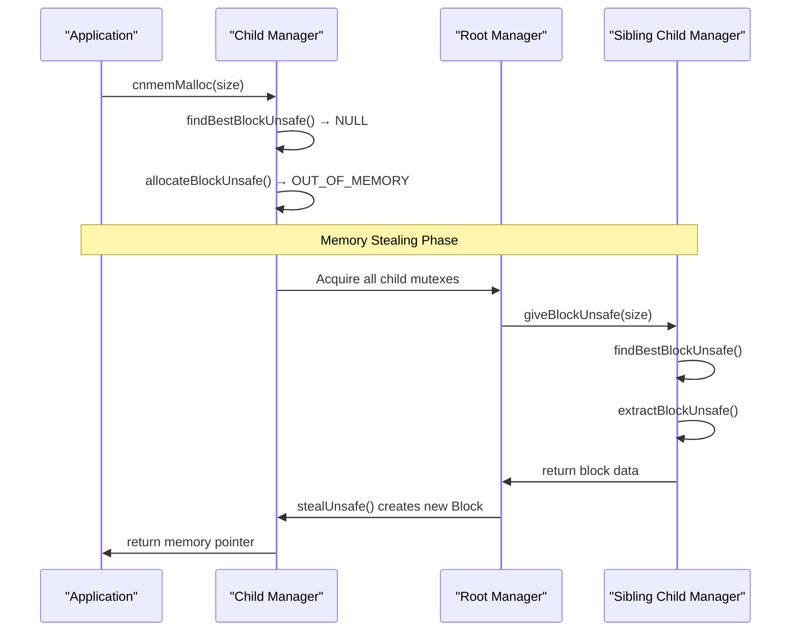

<!-- source: DeepWiki mcp.deepwiki.com · repo NVIDIA/cnmem · page 4 Architecture and Implementation · fetched 2026-10-26 -->

# Architecture and Implementation

Relevant source files

The following files were used as context for generating this wiki page:

- [src/cnmem.cpp](src/cnmem.cpp)

This document provides a detailed explanation of cnmem's internal architecture, core data structures, and implementation algorithms. It covers the hierarchical memory management system, allocation strategies, and synchronization mechanisms that enable efficient CUDA memory pooling.

For information about the public API and how to use cnmem, see [API Reference](#3). For details about building and testing the system, see [Getting Started](#2) and [Testing and Validation](#5).

## Core System Architecture

cnmem is built around four primary C++ classes that work together to provide hierarchical memory management with thread-safe operations and efficient memory pooling.

**Sources:** [src/cnmem.cpp:966-1001](), [src/cnmem.cpp:307-422](), [src/cnmem.cpp:262-303](), [src/cnmem.cpp:191-207]()

## Global Context Management

The `Context` class implements a singleton pattern with reference counting to manage the global state of cnmem. It maintains a vector of root `Manager` instances, one per GPU device.

| Component | Purpose | Key Methods |
|-----------|---------|-------------|
| `Context::sCtx` | Static singleton instance | `Context::get()` |
| `Context::sCtxCheck` | Magic number validation | `Context::check()` |
| `mRefCount` | Reference counting for cleanup | `retain()`, `release()` |
| `mManagers` | Vector of device managers | `getManager(int)` |

The context lifecycle follows this pattern:
1. `cnmemInit()` calls `Context::create()` to instantiate the singleton
2. Each `cnmemRetain()` increments the reference count
3. Each `cnmemRelease()` decrements the reference count
4. When reference count reaches zero, the context and all managers are destroyed

**Sources:** [src/cnmem.cpp:966-1001](), [src/cnmem.cpp:1024-1059](), [src/cnmem.cpp:1071-1130]()

## Hierarchical Memory Management System

cnmem implements a two-level hierarchy where root managers handle device-level memory pools and child managers handle stream-specific allocations.

### Root Manager Responsibilities

Root managers (`mParent == NULL`) handle:
- Direct allocation from CUDA via `cudaMalloc()` or `cudaMallocManaged()`
- Large memory pools initialized during `cnmemInit()`
- Parent-level memory stealing coordination
- Device-specific memory management

### Child Manager Responsibilities  

Child managers (`mParent != NULL`) handle:
- Stream-specific memory allocations
- Requesting memory from their parent root manager
- Local memory stealing from siblings
- Stream synchronization via `mIsStreamBlocking`

**Sources:** [src/cnmem.cpp:307-422](), [src/cnmem.cpp:501-543](), [src/cnmem.cpp:1095-1127]()

## Block Management and Memory Layout

Memory is managed through linked lists of `Block` objects that represent contiguous memory regions. Each manager maintains separate lists for used and free blocks.

### Block Properties

| Field | Purpose | Values |
|-------|---------|---------|
| `mData` | Pointer to GPU memory region | Device memory address |
| `mSize` | Size of memory block in bytes | Multiple of `CNMEM_GRANULARITY` (512) |
| `mNext` | Next block in linked list | `Block*` or `NULL` |
| `mIsHead` | Indicates block from `cudaMalloc()` | `true` for allocation boundaries |

### Memory Allocation Algorithm

The allocation process in `Manager::allocate()` follows this sequence:

1. **Find Best Fit**: `findBestBlockUnsafe()` searches free list for smallest block ≥ requested size
2. **Allocate New Block**: If no suitable block exists and `CNMEM_FLAGS_CANNOT_GROW` is not set, call `allocateBlockUnsafe()`
3. **Extract Block**: `extractBlockUnsafe()` removes block from free list, splitting if necessary
4. **Move to Used List**: Block is moved to `mUsedBlocks` linked list
5. **Return Pointer**: Return `mData` pointer to application

**Sources:** [src/cnmem.cpp:262-303](), [src/cnmem.cpp:462-497](), [src/cnmem.cpp:575-585](), [src/cnmem.cpp:547-571]()

## Memory Stealing Mechanism

When a manager cannot satisfy an allocation request from its own pools, cnmem implements a memory stealing algorithm to acquire memory from other managers.

### Stealing Process Details

The stealing mechanism involves multiple phases:

1. **Lock Acquisition**: `cnmemMalloc()` acquires locks on all child managers to prevent races
2. **Victim Selection**: `stealBlockUnsafe()` iterates through child managers seeking available blocks  
3. **Block Transfer**: `giveBlockUnsafe()` synchronizes the victim stream and transfers the block
4. **Block Splitting**: The root manager updates its used block list to reflect the stolen region
5. **Memory Handoff**: The requesting manager receives the stolen memory as a new allocation

### Thread Safety During Stealing

The stealing process requires careful lock ordering to prevent deadlocks:
- Child manager mutexes are acquired first in order
- Root manager mutex is acquired after all children
- If any lock acquisition fails, all acquired locks are released

**Sources:** [src/cnmem.cpp:1201-1245](), [src/cnmem.cpp:857-888](), [src/cnmem.cpp:892-962](), [src/cnmem.cpp:648-670]()

## Thread Synchronization Architecture

cnmem provides thread-safe memory management through per-manager mutexes and careful lock ordering. The `Mutex` class abstracts platform-specific synchronization primitives.

| Platform | Implementation | Lock Type |
|----------|---------------|-----------|
| Windows | `CRITICAL_SECTION` | Reentrant critical section |
| POSIX | `pthread_mutex_t` | Standard mutex |

### Synchronization Patterns

1. **Per-Manager Locking**: Each `Manager` has its own `Mutex` to minimize contention
2. **Lock Ordering**: Child mutexes acquired before parent mutexes during stealing
3. **RAII-style Unlocking**: `CNMEM_CHECK_OR_UNLOCK` macro ensures cleanup on errors
4. **Stream Synchronization**: Non-blocking streams require explicit `cudaStreamSynchronize()`

### Memory Coalescing

When blocks are released via `Manager::release()`, the system attempts to merge adjacent free blocks:

1. **Find Insertion Point**: Locate position in sorted free list based on memory address
2. **Merge Predecessor**: If previous block is adjacent, merge and delete current block
3. **Merge Successor**: If next block is adjacent, merge and delete next block  
4. **Boundary Respect**: Merging cannot cross `mIsHead=true` boundaries (original `cudaMalloc()` boundaries)

**Sources:** [src/cnmem.cpp:191-258](), [src/cnmem.cpp:462-497](), [src/cnmem.cpp:730-755](), [src/cnmem.cpp:797-842]()

## Memory Granularity and Alignment

cnmem enforces consistent memory alignment through the `CNMEM_GRANULARITY` constant set to 512 bytes. All allocation sizes are rounded up using `ceilInt()` to ensure:

- Optimal GPU memory access patterns
- Consistent block boundaries for coalescing
- Alignment with CUDA's preferred memory access granularity

The granularity affects:
- Initial pool sizes during `cnmemInit()`
- All allocation requests via `cnmemMalloc()`
- Stream-specific pool sizes when specified

**Sources:** [src/cnmem.cpp:48](), [src/cnmem.cpp:184-187](), [src/cnmem.cpp:1110](), [src/cnmem.cpp:1196]()

---

