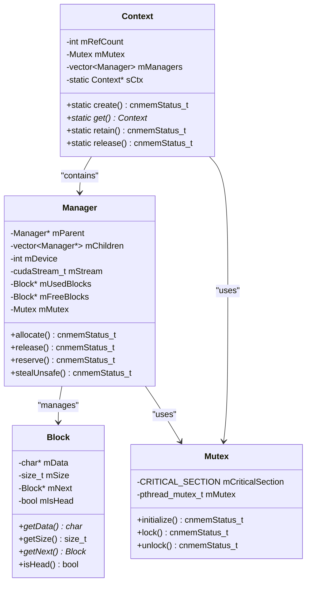
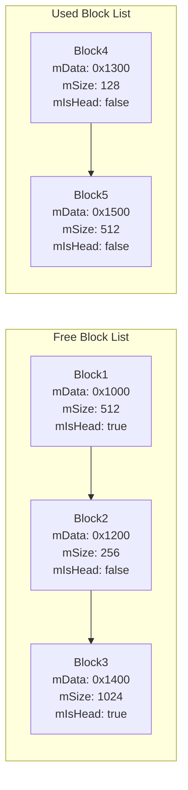
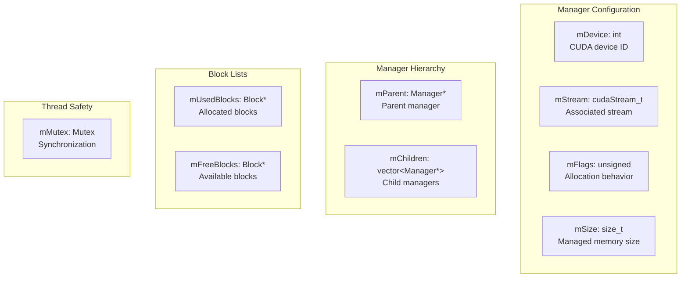
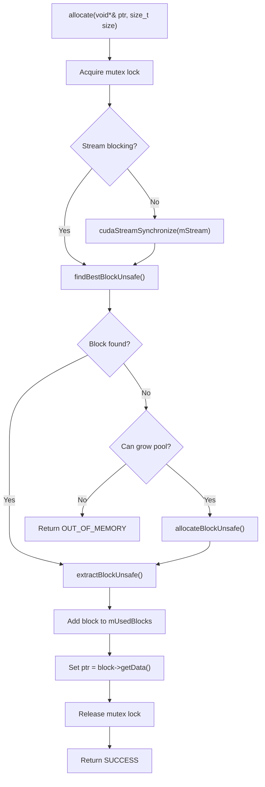
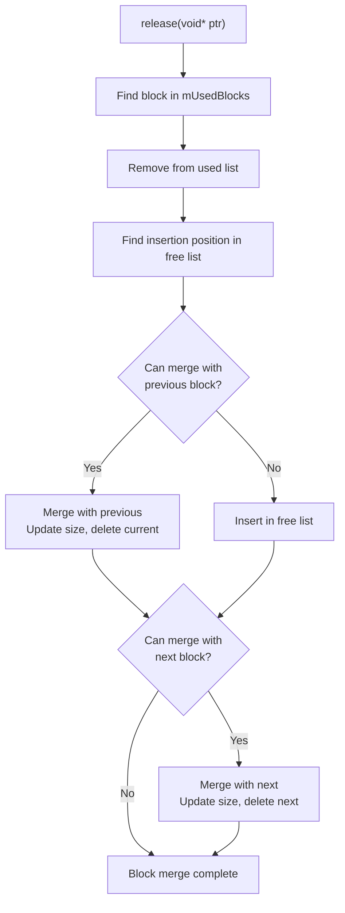
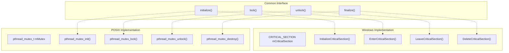
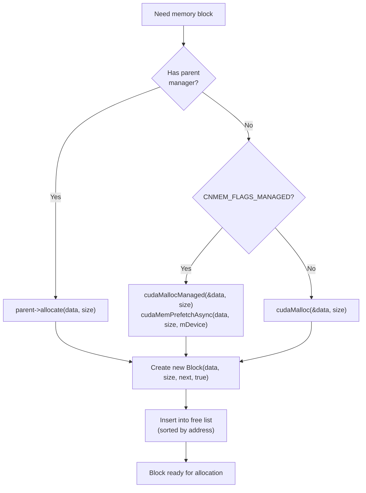

<!-- source: DeepWiki mcp.deepwiki.com · repo NVIDIA/cnmem · page 4.1 Core Memory Management System · fetched 2026-10-26 -->

# Core Memory Management System

<details>
<summary>Relevant source files</summary>

The following files were used as context for generating this wiki page:

- [src/cnmem.cpp](src/cnmem.cpp)

</details>


This document covers the fundamental classes and data structures that implement cnmem's memory management functionality. It focuses on the `Block`, `Manager`, `Context`, and `Mutex` classes and their core allocation algorithms. For information about the hierarchical parent-child manager relationships and memory stealing mechanisms, see [Hierarchical Managers and Memory Stealing](#4.2).

## Overview of Core Classes

The cnmem core memory management system consists of four primary classes that work together to provide efficient CUDA memory allocation:



**Sources:** [src/cnmem.cpp:262-303](), [src/cnmem.cpp:307-422](), [src/cnmem.cpp:966-1001](), [src/cnmem.cpp:191-207]()

## Block Class - Memory Block Representation

The `Block` class represents individual memory blocks in linked lists. Each block contains metadata about a contiguous region of CUDA device memory.

### Block Structure and Properties

| Field | Type | Purpose |
|-------|------|---------|
| `mData` | `char*` | Pointer to device memory region |
| `mSize` | `size_t` | Size of memory block in bytes |
| `mNext` | `Block*` | Next block in linked list |
| `mIsHead` | `bool` | Whether block was allocated from `cudaMalloc` |

The `mIsHead` flag is critical for memory management - it indicates whether a block represents the start of a region obtained directly from CUDA or a subdivision of a larger block. Head blocks cannot be merged across boundaries during deallocation.



**Sources:** [src/cnmem.cpp:262-303]()

## Manager Class - Core Allocation Engine

The `Manager` class implements the core memory allocation and deallocation logic. Each manager maintains separate linked lists for used and free blocks and provides thread-safe access through an embedded mutex.

### Manager State and Configuration



**Sources:** [src/cnmem.cpp:307-329]()

### Memory Allocation Algorithm

The core allocation process in `Manager::allocate()` follows a best-fit strategy:



The `findBestBlockUnsafe()` method implements a best-fit algorithm by scanning the free list for the smallest block that satisfies the size requirement:

**Sources:** [src/cnmem.cpp:462-497](), [src/cnmem.cpp:575-585]()

### Memory Deallocation and Block Merging

The deallocation process in `Manager::release()` includes sophisticated block merging to reduce fragmentation:



Block merging is constrained by head boundaries - blocks marked with `mIsHead = true` represent `cudaMalloc` boundaries and cannot be merged across:

**Sources:** [src/cnmem.cpp:730-755](), [src/cnmem.cpp:797-842]()

## Context Class - Global Manager Coordination

The `Context` class provides a singleton pattern for managing all memory managers across multiple CUDA devices. It implements reference counting for safe initialization and cleanup.

### Context Lifecycle Management

```mermaid
stateDiagram-v2
    [*] --> Uninitialized : Initial state
    Uninitialized --> Initialized : Context::create()
    Initialized --> Retained : Context::retain()
    Retained --> Initialized : Context::release()
    Initialized --> [*] : Context::release() (refCount = 0)
    
    note right of Initialized
        sCtx points to Context instance
        sCtxCheck = CTX_VALID (0x1f5632a3)
        mRefCount starts at 1
    end note
```

The context maintains a vector of managers indexed by device ID, allowing direct access to device-specific memory managers:

| Method | Purpose |
|--------|---------|
| `create()` | Initialize global singleton context |
| `get()` | Retrieve global context pointer |  
| `retain()` | Increment reference count |
| `release()` | Decrement reference count, destroy if zero |
| `getManager(int)` | Access device-specific manager |

**Sources:** [src/cnmem.cpp:966-1001](), [src/cnmem.cpp:1024-1059]()

## Thread Synchronization with Mutex Class

The `Mutex` class provides cross-platform thread synchronization using Windows Critical Sections or POSIX pthread mutexes:



**Sources:** [src/cnmem.cpp:191-258]()

## Memory Pool Growth and CUDA Integration

When free memory is exhausted, managers can grow their pools by allocating new blocks from their parent manager or directly from CUDA:



The allocation granularity is controlled by `CNMEM_GRANULARITY` (512 bytes), ensuring all allocations are aligned to this boundary for optimal memory access patterns.

**Sources:** [src/cnmem.cpp:501-543](), [src/cnmem.cpp:48]()

---

