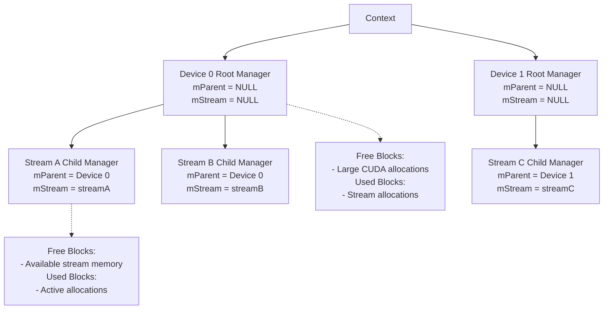
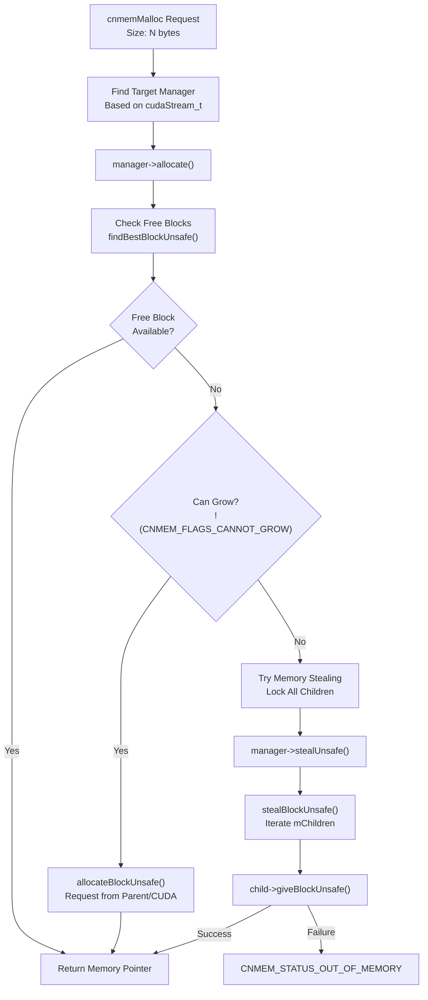
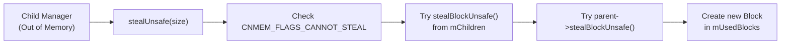
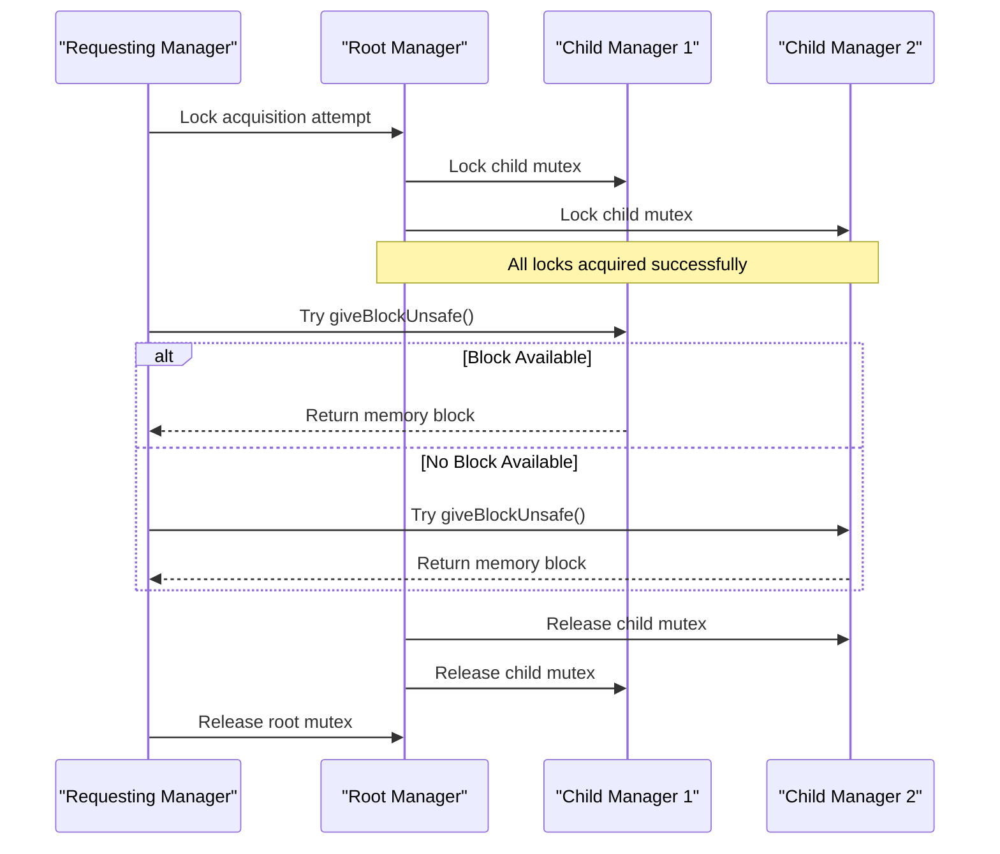
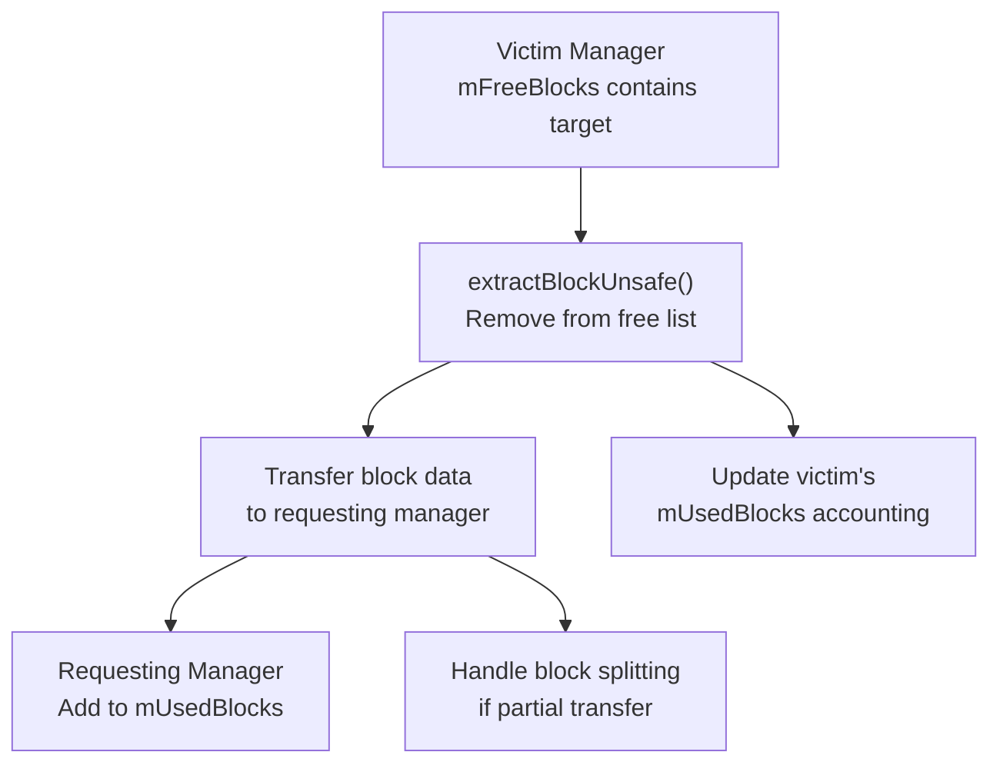

<!-- source: DeepWiki mcp.deepwiki.com · repo NVIDIA/cnmem · page 4.2 Hierarchical Managers and Memory Stealing · fetched 2026-10-26 -->

# Hierarchical Managers and Memory Stealing

Relevant source files

The following files were used as context for generating this wiki page:

- [src/cnmem.cpp](src/cnmem.cpp)

This document explains cnmem's hierarchical memory management architecture and the memory stealing mechanisms that enable efficient memory sharing between different CUDA streams and contexts. This page focuses on the parent-child manager relationships and inter-manager memory transfers. For information about the core data structures and basic allocation algorithms, see [Core Memory Management System](#4.1).

## Manager Hierarchy Architecture

The cnmem library implements a two-level hierarchy of memory managers to handle both device-level and stream-level memory allocation efficiently.

### Hierarchy Structure

**Sources:** [src/cnmem.cpp:307-312](), [src/cnmem.cpp:1092-1127](), [src/cnmem.cpp:1113-1126]()

### Root Managers (Device Level)

Root managers are created during `cnmemInit` for each GPU device and handle the primary memory pools:

| Property | Value | Purpose |
|----------|-------|---------|
| `mParent` | `NULL` | Indicates root-level manager |
| `mDevice` | Device ID | GPU device association |
| `mStream` | `NULL` | No specific stream binding |
| Memory Source | `cudaMalloc`/`cudaMallocManaged` | Direct CUDA allocation |

Root managers perform initial memory reservation using `reserve()` and serve as the ultimate source for memory blocks through `allocateBlockUnsafe()`.

**Sources:** [src/cnmem.cpp:1106-1111](), [src/cnmem.cpp:501-543](), [src/cnmem.cpp:846-853]()

### Child Managers (Stream Level)

Child managers are created for each CUDA stream and inherit memory from their parent root manager:

| Property | Value | Purpose |
|----------|-------|---------|
| `mParent` | Root manager pointer | Hierarchy linkage |
| `mDevice` | Same as parent | Device consistency |
| `mStream` | Specific `cudaStream_t` | Stream association |
| Memory Source | Parent allocation | Inherited memory blocks |

Child managers can optionally pre-reserve memory during initialization using `streamSizes` configuration.

**Sources:** [src/cnmem.cpp:1113-1126](), [src/cnmem.cpp:1155-1171]()

## Memory Stealing Mechanism

Memory stealing allows managers to acquire memory blocks from other managers when their own pools are exhausted, enabling dynamic load balancing across streams.

### Stealing Flow Diagram

**Sources:** [src/cnmem.cpp:1175-1246](), [src/cnmem.cpp:857-888](), [src/cnmem.cpp:892-962]()

### Stealing Implementation Details

#### `stealUnsafe()` Method

The primary stealing interface that child managers use to acquire memory from siblings:

**Sources:** [src/cnmem.cpp:857-888]()

#### `giveBlockUnsafe()` Method

Called by child managers to surrender memory blocks to other managers:

1. **Stream Synchronization**: `cudaStreamSynchronize(mStream)` ensures block is not in use
2. **Block Selection**: `findBestBlockUnsafe()` finds suitable free block
3. **Block Extraction**: `extractBlockUnsafe()` removes block from free list
4. **Memory Transfer**: Returns block data and size to requesting manager

**Sources:** [src/cnmem.cpp:648-670](), [src/cnmem.cpp:575-584](), [src/cnmem.cpp:547-571]()

### Multi-Threading and Lock Management

Memory stealing requires careful lock coordination to prevent race conditions:

The lock acquisition uses a fail-fast approach where any lock failure causes immediate cleanup and error return.

**Sources:** [src/cnmem.cpp:1203-1244](), [src/cnmem.cpp:327-328]()

## Block Management in Hierarchical Context

### Block Ownership and Head Flags

Blocks maintain ownership information through the `mIsHead` flag:

| Block Type | `mIsHead` Value | Ownership | Lifecycle |
|------------|----------------|-----------|-----------|
| Root Allocation | `true` | Direct CUDA allocation | Released via `cudaFree()` |
| Child Allocation | `true` | Inherited from parent | Released via parent `release()` |
| Split Block | `false` | Fragment of larger block | Cannot be independently freed |

**Sources:** [src/cnmem.cpp:269-270](), [src/cnmem.cpp:531](), [src/cnmem.cpp:777-785]()

### Memory Block Stealing Process

When a block is stolen from one manager to another, the system must maintain proper accounting:

The `stealBlockUnsafe()` method handles complex block splitting scenarios when only part of a larger block is transferred between managers.

**Sources:** [src/cnmem.cpp:892-962](), [src/cnmem.cpp:928-961]()

## Integration with CUDA Streams

### Stream-Specific Allocation

The `cnmemMalloc()` function routes allocation requests to appropriate managers based on the provided `cudaStream_t`:

1. **Stream Resolution**: `getChildFromStream()` finds the child manager for the specified stream
2. **Fallback to Root**: If no stream specified, uses root manager directly
3. **Manager Selection**: Routes request to appropriate manager in hierarchy

**Sources:** [src/cnmem.cpp:1189-1194](), [src/cnmem.cpp:589-600]()

### Stream Blocking Behavior

Child managers handle stream synchronization based on blocking characteristics:

| Stream Type | `mIsStreamBlocking` | Allocation Behavior |
|-------------|-------------------|-------------------|
| Default/NULL Stream | `true` | No explicit sync needed |
| Non-blocking Stream | `false` | Requires `cudaStreamSynchronize()` |
| Legacy Stream | `true` | Implicit synchronization |

**Sources:** [src/cnmem.cpp:384-396](), [src/cnmem.cpp:465-468]()

This hierarchical architecture enables cnmem to provide both efficient stream-local memory management and flexible cross-stream memory sharing when needed, optimizing memory utilization across complex CUDA applications.

---

