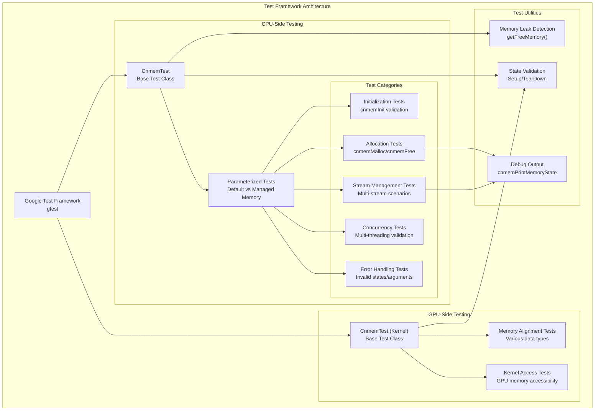
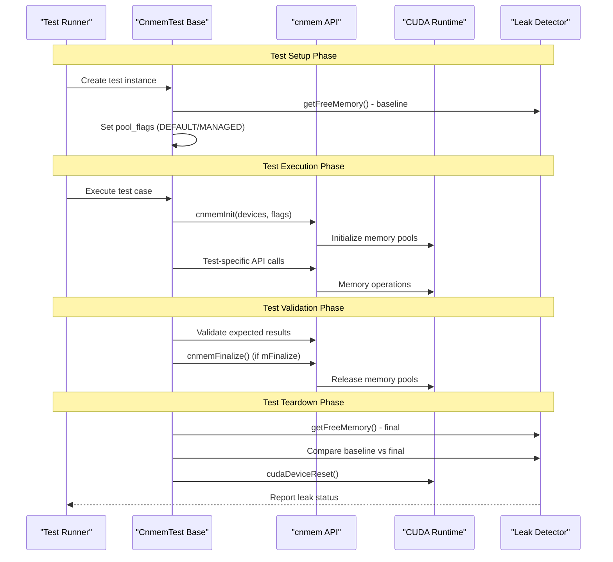

<!-- source: DeepWiki mcp.deepwiki.com · repo NVIDIA/cnmem · page 5 Testing and Validation · fetched 2026-10-26 -->

# Testing and Validation

<details>
<summary>Relevant source files</summary>

The following files were used as context for generating this wiki page:

- [tests/cnmem_kernel_test.cu](tests/cnmem_kernel_test.cu)
- [tests/cnmem_tests.cpp](tests/cnmem_tests.cpp)

</details>


This document provides an overview of cnmem's comprehensive testing framework and validation methodology. The testing system ensures the reliability and correctness of the CUDA memory management library through both CPU-side unit tests and GPU-side kernel validation.

For detailed information about specific test implementations, see [Unit Test Suite](#5.1) and [CUDA Kernel Testing](#5.2). For information about the core functionality being tested, see [API Reference](#3) and [Architecture and Implementation](#4).

## Test Framework Architecture

The cnmem testing system is built on Google Test (`gtest`) and consists of two primary test suites that validate different aspects of the memory management system. The framework supports both single-threaded and multi-threaded test scenarios, with automatic memory leak detection and device state validation.



**Sources:** [tests/cnmem_tests.cpp:45-66](), [tests/cnmem_tests.cpp:78-81](), [tests/cnmem_kernel_test.cu:13-28]()

## Test Execution Framework

The testing framework employs a systematic approach to validate cnmem functionality across different memory pool configurations and usage scenarios. Each test follows a consistent setup-execute-validate-teardown pattern with automatic leak detection.



**Sources:** [tests/cnmem_tests.cpp:58-76](), [tests/cnmem_tests.cpp:38-43](), [tests/cnmem_kernel_test.cu:30-38]()

## Test Coverage Matrix

The testing framework provides comprehensive coverage across multiple dimensions of cnmem functionality:

### Primary Test Categories

| Category | Test Count | Key Functions Tested | Memory Configurations |
|----------|------------|---------------------|---------------------|
| **Initialization** | 4 tests | `cnmemInit`, `cnmemFinalize` | Default, Managed, Invalid sizes |
| **Memory Operations** | 12 tests | `cnmemMalloc`, `cnmemFree` | Single/multiple allocations, various sizes |
| **Stream Management** | 8 tests | `cnmemRegisterStream` | Multi-stream, cross-stream operations |
| **Error Handling** | 6 tests | All API functions | Not initialized, invalid arguments |
| **Concurrency** | 8 tests | Thread-safe operations | Multi-threading, memory stealing |
| **Memory Alignment** | 5 tests | GPU kernel access | 8-bit to 192-bit alignments |

### Memory Pool Test Configurations

| Configuration Flag | Test Scenarios | Growth Behavior | Memory Stealing |
|-------------------|----------------|-----------------|-----------------|
| `CNMEM_FLAGS_DEFAULT` | All scenarios | Pool can grow | Enabled between streams |
| `CNMEM_FLAGS_MANAGED` | All scenarios | Pool can grow | Enabled (unified memory) |
| `CNMEM_FLAGS_CANNOT_GROW` | Limited scenarios | Fixed pool size | Required for large allocations |

**Sources:** [tests/cnmem_tests.cpp:78-81](), [tests/cnmem_tests.cpp:418-443](), [tests/cnmem_tests.cpp:447-478]()

## Validation Mechanisms

### Memory Leak Detection

The test framework implements automatic memory leak detection by comparing CUDA memory state before and after each test execution:

- **Baseline Measurement**: `getFreeMemory()` captures initial GPU memory state
- **Post-Test Validation**: Memory state compared against baseline in `TearDown()`
- **Leak Reporting**: Tests fail if memory is not properly released

### Multi-Threading Validation

Concurrent access testing validates thread-safety under various scenarios:

- **No Competition**: Each thread uses separate memory managers
- **Memory Competition**: Threads compete for root manager memory  
- **Memory Stealing**: Threads force memory stealing between stream managers
- **Dynamic Registration**: Concurrent stream registration and allocation

### GPU Kernel Validation

CUDA kernel tests verify that allocated memory is properly aligned and accessible from GPU code:

- **Alignment Testing**: Validates proper memory alignment for different data types
- **Kernel Access**: Ensures GPU kernels can read/write allocated memory
- **Cross-Stream Operations**: Tests memory allocated on different streams

**Sources:** [tests/cnmem_tests.cpp:38-43](), [tests/cnmem_tests.cpp:651-712](), [tests/cnmem_kernel_test.cu:75-120]()

## Test Execution and Configuration

### Build-Time Configuration

The testing framework supports conditional compilation based on C++11 availability:

- `USE_CPP_11` flag enables multi-threading tests using `std::thread`
- Threading tests are automatically disabled on systems without C++11 support
- Alternative thread implementations can be configured through CMake

### Test Parameterization

The unit test suite uses Google Test's parameterized testing to run identical test logic across different memory pool configurations:

```cpp
INSTANTIATE_TEST_CASE_P(DefaultOrManagedPool,
                        CnmemTest,
                        ::testing::Values(CNMEM_FLAGS_DEFAULT,
                                          CNMEM_FLAGS_MANAGED));
```

This ensures that both regular CUDA memory and managed memory configurations are thoroughly validated with the same test scenarios.

**Sources:** [tests/cnmem_tests.cpp:78-81](), [tests/cnmem_tests.cpp:32-34](), [tests/cnmem_tests.cpp:651]()

---

