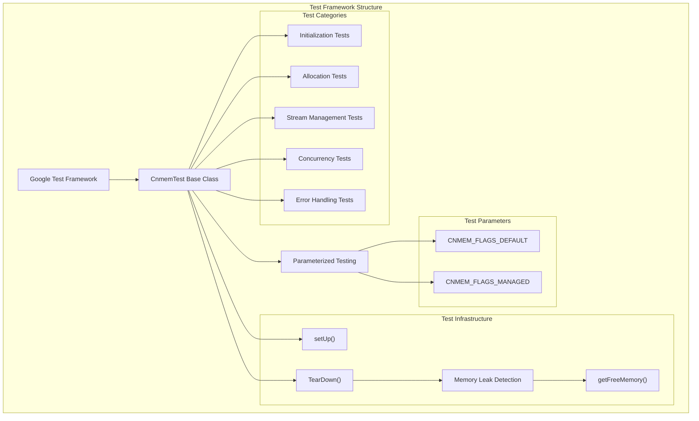
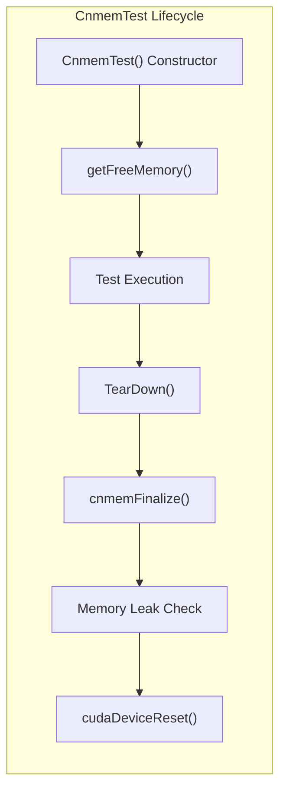
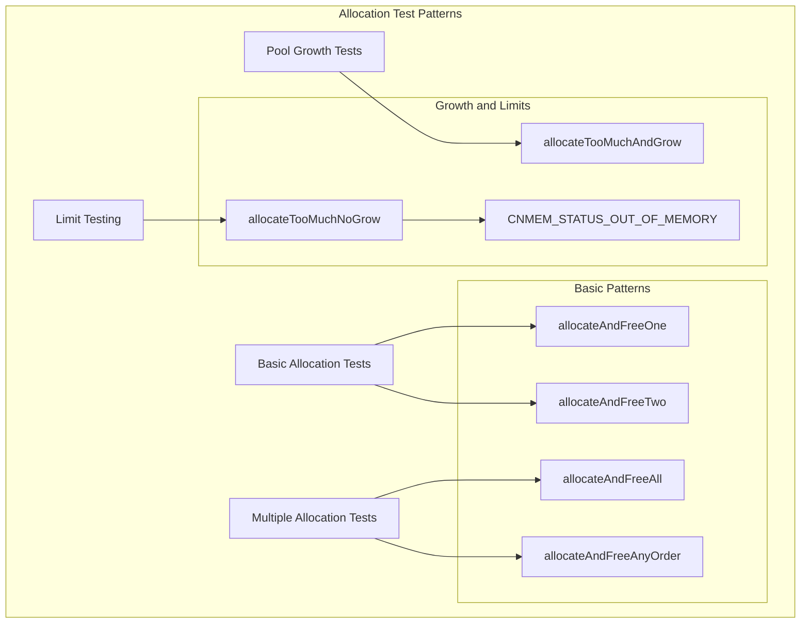
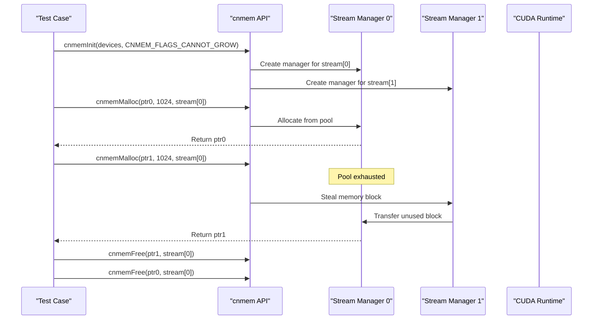
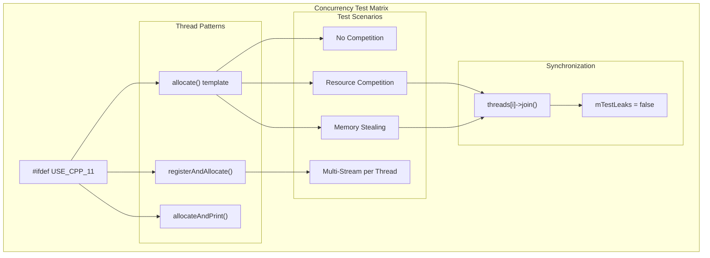

<!-- source: DeepWiki mcp.deepwiki.com · repo NVIDIA/cnmem · page 5.1 Unit Test Suite · fetched 2026-10-26 -->

# Unit Test Suite

<details>
<summary>Relevant source files</summary>

The following files were used as context for generating this wiki page:

- [tests/cnmem_tests.cpp](tests/cnmem_tests.cpp)

</details>


The unit test suite provides comprehensive validation of cnmem's CUDA memory management functionality through automated testing. This page describes the test framework structure, test categories, and key validation scenarios implemented in the test suite.

For information about GPU kernel testing, see [CUDA Kernel Testing](#5.2). For details about the core memory management implementation being tested, see [Core Memory Management System](#4.1).

## Test Framework Architecture

The cnmem unit test suite is built on Google Test and implements a parameterized testing approach to validate functionality across different memory pool configurations.



**Test Framework Architecture**

Sources: [tests/cnmem_tests.cpp:29-82]()

## Core Test Infrastructure

The `CnmemTest` class provides the foundation for all unit tests, implementing setup, teardown, and memory leak detection mechanisms.

### CnmemTest Class Structure

| Component | Purpose | Key Features |
|-----------|---------|--------------|
| `mFreeMem` | Baseline memory tracking | Stores initial free memory for leak detection |
| `mTestLeaks` | Leak detection control | Enables/disables memory leak validation |
| `mFinalize` | Cleanup control | Controls whether `cnmemFinalize()` is called |
| `pool_flags` | Pool configuration | Parameterized flags for different memory pool types |



**CnmemTest Lifecycle Management**

Sources: [tests/cnmem_tests.cpp:45-82]()

## Test Categories

### Initialization and Configuration Tests

Tests validate proper system initialization, device configuration, and error handling for invalid parameters.

| Test Case | Function | Purpose |
|-----------|----------|---------|
| `notInitializedFinalize` | Validates error handling when `cnmemFinalize()` is called before initialization |
| `notInitializedMalloc` | Ensures `cnmemMalloc()` returns `CNMEM_STATUS_NOT_INITIALIZED` |
| `initInvalidSize` | Tests rejection of memory pool sizes exceeding device capacity |
| `initNinetyFivePrct` | Validates initialization with 95% of available device memory |

Sources: [tests/cnmem_tests.cpp:85-151]()

### Memory Allocation and Deallocation Tests

Core functionality tests covering various allocation patterns and memory management scenarios.



**Memory Allocation Test Patterns**

Sources: [tests/cnmem_tests.cpp:308-443]()

### Stream Management and Memory Stealing Tests

Advanced tests validating stream-specific memory management and memory stealing between managers.

| Test Scenario | Implementation | Validation |
|---------------|----------------|------------|
| Multi-stream allocation | `freeTwoStreams` | Independent stream memory management |
| Stream registration | `addStream`, `cnmemRegisterStream()` | Dynamic stream addition |
| Memory stealing | `allocateAndSteal` series | Cross-stream memory redistribution |
| Stream reservation | `allocateAndReserveStream` | Pre-allocated stream-specific pools |



**Memory Stealing Test Sequence**

Sources: [tests/cnmem_tests.cpp:447-611]()

### Concurrency and Multi-threading Tests

Multi-threading validation requires C++11 support and tests various concurrent access patterns.

| Test Type | Thread Count | Validation Focus |
|-----------|--------------|------------------|
| `allocateConcurrentNoCompete` | 2 threads, 2 streams | Independent memory pools |
| `allocateConcurrentCompete` | 2 threads, shared pools | Resource contention handling |
| `allocateConcurrentSteal` | 4 threads, 4 streams | Memory stealing under load |
| `allocateConcurrentMultiStreamsPerThread` | 32 threads, 8 streams | High concurrency scenarios |



**Concurrency Test Architecture**

Sources: [tests/cnmem_tests.cpp:651-910]()

## Test Execution and Validation

### Memory Leak Detection

The test framework implements automatic memory leak detection by comparing CUDA memory usage before and after test execution.

```cpp
// Memory leak detection mechanism
static std::size_t getFreeMemory() {
    cudaFree(0);
    std::size_t freeMem, totalMem;
    cudaMemGetInfo(&freeMem, &totalMem);
    return freeMem;
}

void CnmemTest::TearDown() {
    if( mFinalize ) {
        ASSERT_EQ(CNMEM_STATUS_SUCCESS, cnmemFinalize()); 
    }
    if( mTestLeaks ) {
        ASSERT_EQ(mFreeMem, getFreeMemory());
    }
    cudaDeviceReset();
}
```

Sources: [tests/cnmem_tests.cpp:38-76]()

### Parameterized Testing

Tests run with both default and managed memory pool configurations to ensure compatibility across different CUDA memory management modes.

| Parameter | Value | Purpose |
|-----------|-------|---------|
| `CNMEM_FLAGS_DEFAULT` | Standard CUDA memory | Traditional device memory pools |
| `CNMEM_FLAGS_MANAGED` | CUDA Unified Memory | Managed memory pool validation |

Sources: [tests/cnmem_tests.cpp:78-81]()

### Error Condition Testing

Comprehensive validation of error handling across API boundaries and invalid usage patterns.

| Error Scenario | Expected Status | Test Coverage |
|----------------|----------------|---------------|
| Uninitialized API calls | `CNMEM_STATUS_NOT_INITIALIZED` | All API functions |
| Invalid arguments | `CNMEM_STATUS_INVALID_ARGUMENT` | Parameter validation |
| Memory exhaustion | `CNMEM_STATUS_OUT_OF_MEMORY` | Pool limit enforcement |
| Stream mismatches | `CNMEM_STATUS_INVALID_ARGUMENT` | Cross-stream operations |

Sources: [tests/cnmem_tests.cpp:85-443]()

## Running the Test Suite

The test suite integrates with the CMake build system and can be executed through standard Google Test mechanisms. Test execution produces detailed output for debugging and validation purposes, including optional memory state dumps and leak detection reports.

Sources: [tests/cnmem_tests.cpp:1016-1019]()

---

