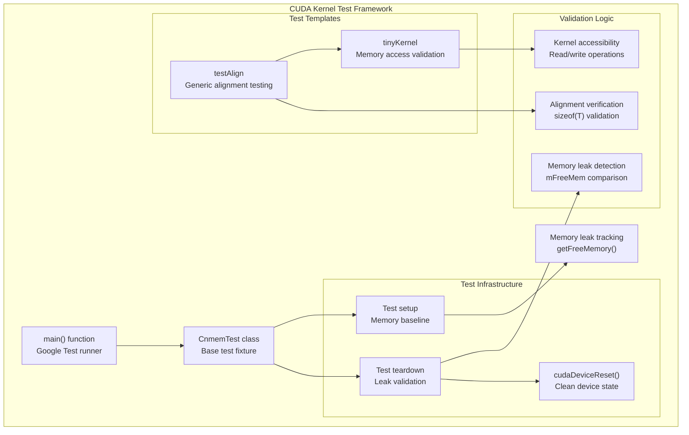
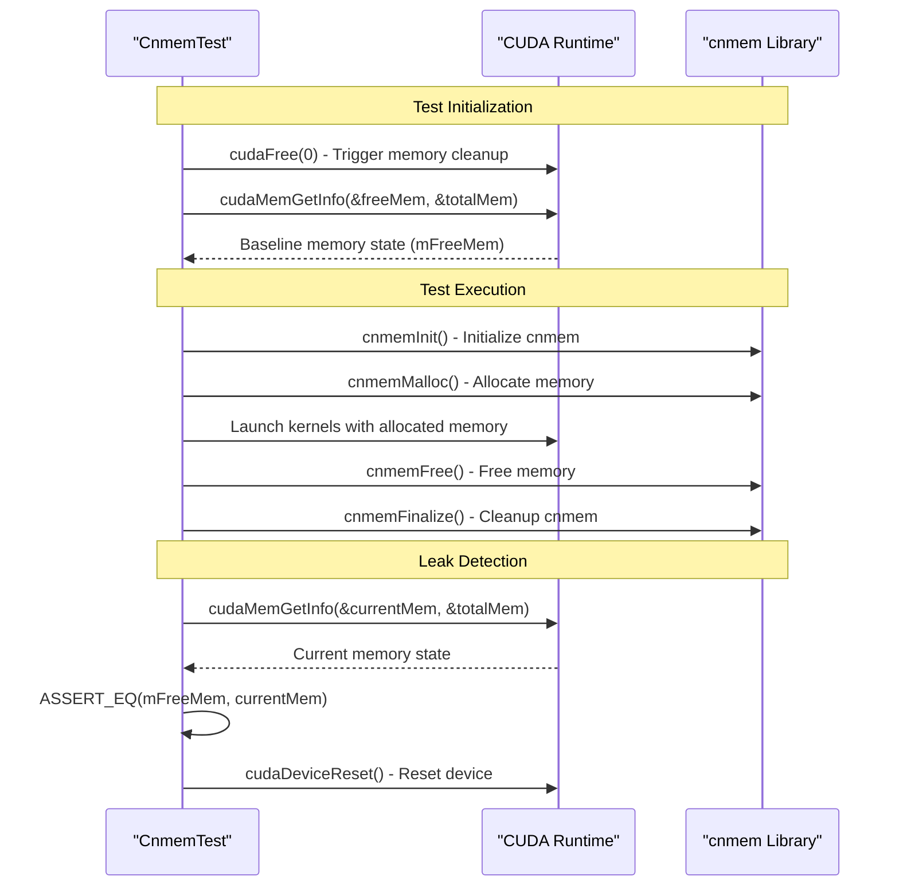
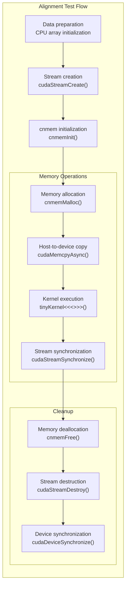
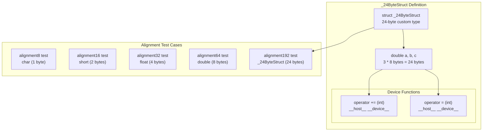
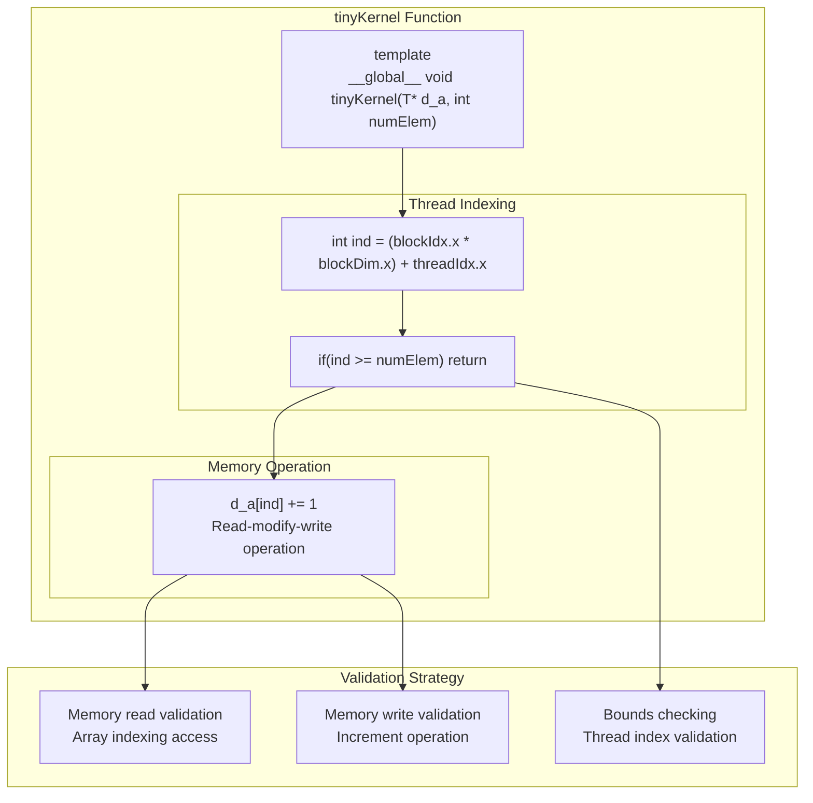
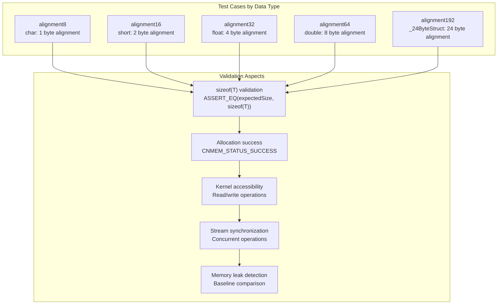

<!-- source: DeepWiki mcp.deepwiki.com · repo NVIDIA/cnmem · page 5.2 CUDA Kernel Testing · fetched 2026-10-26 -->

# CUDA Kernel Testing

Relevant source files

The following files were used as context for generating this wiki page:

- [tests/cnmem_kernel_test.cu](tests/cnmem_kernel_test.cu)

## Purpose and Scope

This document covers cnmem's CUDA kernel testing framework, which validates that memory allocated by cnmem is properly accessible from GPU kernels and maintains correct alignment properties. The kernel tests complement the CPU-side unit tests by verifying GPU-specific functionality including memory alignment, kernel memory access patterns, and GPU memory leak detection.

For comprehensive CPU-side testing of cnmem's API and core functionality, see [Unit Test Suite](#5.1).

## Test Framework Architecture

The CUDA kernel test framework is built on Google Test and provides specialized infrastructure for validating GPU memory operations. The framework centers around the `CnmemTest` class which manages test lifecycle and memory leak detection.

### Test Framework Components

Sources: [tests/cnmem_kernel_test.cu:13-38](), [tests/cnmem_kernel_test.cu:144-147]()

### Memory Leak Detection System

The test framework implements automatic memory leak detection by monitoring GPU memory usage before and after each test execution.

Sources: [tests/cnmem_kernel_test.cu:6-11](), [tests/cnmem_kernel_test.cu:30-38]()

## Memory Alignment Testing

The core functionality of the kernel tests validates that cnmem allocates GPU memory with proper alignment for different data types. The `testAlign` template function provides comprehensive alignment validation.

### Alignment Test Implementation

| Test Component | Purpose | Implementation |
|---|---|---|
| Template Parameter `T` | Data type being tested | Generic type for alignment validation |
| Template Parameter `expectedSize` | Expected size in bytes | Compile-time size verification |
| Stream Management | Multi-stream allocation | Tests concurrent stream allocations |
| Kernel Execution | Memory access validation | Verifies kernel can read/write memory |

The alignment test process follows this pattern:

Sources: [tests/cnmem_kernel_test.cu:75-120]()

### Custom Data Types for Alignment Testing

The test framework includes a custom `_24ByteStruct` to validate alignment behavior with non-standard sizes:

Sources: [tests/cnmem_kernel_test.cu:52-73](), [tests/cnmem_kernel_test.cu:122-140]()

## Kernel Accessibility Validation

The `tinyKernel` function validates that memory allocated by cnmem is properly accessible from GPU kernels and maintains data integrity during kernel operations.

### Kernel Implementation Details

Sources: [tests/cnmem_kernel_test.cu:42-49]()

## Test Execution and Configuration

The kernel tests are configured to work with multiple CUDA streams and validate concurrent memory operations. Each test initializes cnmem with specific stream configurations.

### Stream Configuration Pattern

| Configuration Parameter | Value | Purpose |
|---|---|---|
| `device.numStreams` | 2 | Test concurrent stream operations |
| `device.streams` | `streams[0], streams[1]` | Array of CUDA streams |
| `device.streamSizes` | `size*2 + sizeof(T) - 1` | Intentionally misaligned sizes for testing |
| `CNMEM_FLAGS_DEFAULT` | Default flags | Standard cnmem initialization |

The intentional misalignment in stream sizes (`sizeof(T) - 1`) tests cnmem's ability to handle non-optimal pool sizes while maintaining proper memory alignment for allocated blocks.

Sources: [tests/cnmem_kernel_test.cu:86-98]()

## Test Case Coverage

The kernel test suite provides comprehensive coverage of different data type alignments and memory access patterns:

Each test case validates that cnmem can properly allocate memory for the specific data type, that the memory is accessible from CUDA kernels, and that no memory leaks occur during the allocation and deallocation process.

Sources: [tests/cnmem_kernel_test.cu:122-140]()

---

