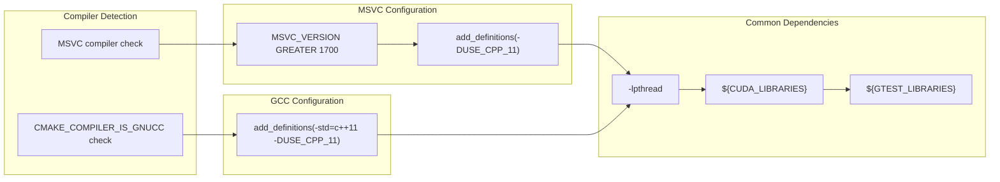
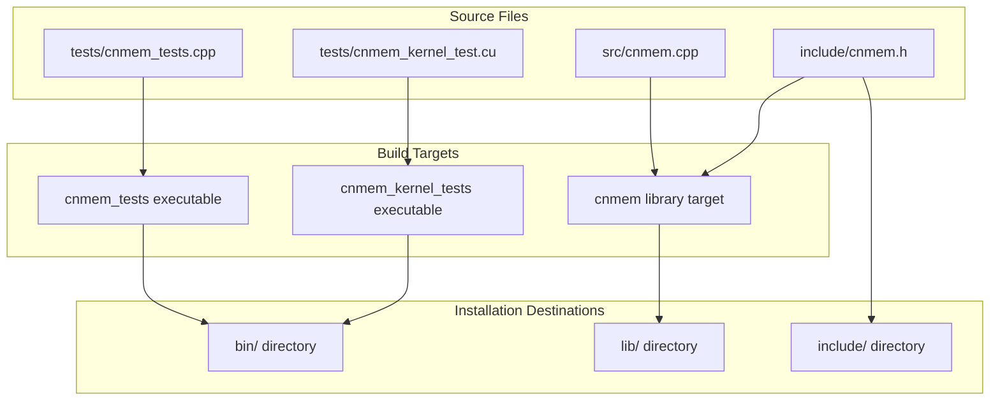
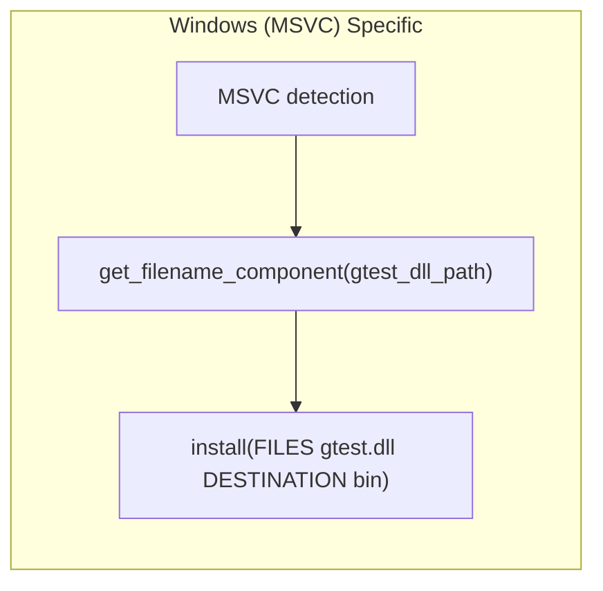
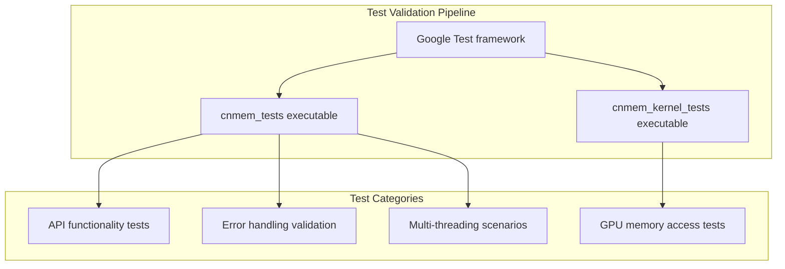

<!-- source: DeepWiki mcp.deepwiki.com · repo NVIDIA/cnmem · page 6 Developer Guide · fetched 2026-10-26 -->

# Developer Guide

Relevant source files

The following files were used as context for generating this wiki page:

- [CMakeLists.txt](CMakeLists.txt)
- [LICENSE](LICENSE)

This document provides essential information for developers who want to contribute to, modify, or extend the cnmem CUDA memory management library. It covers the build system architecture, development environment setup, project organization, and contribution guidelines.

For information about cnmem's architecture and implementation details, see [Architecture and Implementation](#4). For building and basic usage instructions, see [Getting Started](#2).

## Build System Architecture

The cnmem project uses CMake as its primary build system, configured through [CMakeLists.txt:1-51](). The build system is designed to support cross-platform development with conditional compilation for different operating systems and compilers.

### CMake Configuration Overview

```mermaid
graph TB
    subgraph "CMake Build Flow"
        CMAKE_MIN["cmake_minimum_required(VERSION 2.8.8)"]
        PROJECT["project(cnmem)"]
        FIND_CUDA["find_package(CUDA QUIET REQUIRED)"]
        
        subgraph "Library Target"
            INCLUDE_DIRS["include_directories(include)"]
            ADD_DEFS["add_definitions(-DCNMEM_DLLEXPORT)"]
            ADD_LIB["add_library(cnmem SHARED src/cnmem.cpp)"]
            SET_PROPS["set_target_properties(cnmem ...)"]
            LINK_CUDA["target_link_libraries(cnmem ${CUDA_LIBRARIES})"]
        end
        
        subgraph "Test Targets (WITH_TESTS)"
            FIND_GTEST["find_package(GTest QUIET REQUIRED)"]
            ADD_TESTS["add_executable(cnmem_tests tests/cnmem_tests.cpp)"]
            ADD_KERNEL_TESTS["cuda_add_executable(cnmem_kernel_tests tests/cnmem_kernel_test.cu)"]
            COMPILER_FLAGS["Compiler-specific flags (MSVC, GCC)"]
        end
        
        subgraph "Installation"
            INSTALL_LIB["install(TARGETS cnmem ...)"]
            INSTALL_HEADERS["install(FILES include/cnmem.h ...)"]
            INSTALL_TESTS["install(TARGETS cnmem_tests ...)"]
        end
    end
    
    CMAKE_MIN --> PROJECT
    PROJECT --> FIND_CUDA
    FIND_CUDA --> INCLUDE_DIRS
    INCLUDE_DIRS --> ADD_DEFS
    ADD_DEFS --> ADD_LIB
    ADD_LIB --> SET_PROPS
    SET_PROPS --> LINK_CUDA
    
    FIND_CUDA --> FIND_GTEST
    FIND_GTEST --> ADD_TESTS
    ADD_TESTS --> ADD_KERNEL_TESTS
    ADD_KERNEL_TESTS --> COMPILER_FLAGS
    
    LINK_CUDA --> INSTALL_LIB
    INSTALL_LIB --> INSTALL_HEADERS
    INSTALL_HEADERS --> INSTALL_TESTS
```

**Sources:** [CMakeLists.txt:1-51]()

### Build Configuration Details

| Build Component | Configuration | Lines |
|-----------------|---------------|-------|
| Minimum CMake Version | 2.8.8 | [CMakeLists.txt:2]() |
| CUDA Integration | `find_package(CUDA QUIET REQUIRED)` | [CMakeLists.txt:6]() |
| Library Type | Shared library (`SHARED`) | [CMakeLists.txt:12]() |
| Version Info | VERSION 1.0.0 SOVERSION 1 | [CMakeLists.txt:13]() |
| Export Definitions | `CNMEM_DLLEXPORT` | [CMakeLists.txt:11]() |
| Test Framework | Google Test | [CMakeLists.txt:22]() |

The build system supports conditional test compilation through the `WITH_TESTS` option [CMakeLists.txt:19](), enabling developers to build either just the library or include the comprehensive test suite.

**Sources:** [CMakeLists.txt:6-16](), [CMakeLists.txt:19-49]()

### Compiler-Specific Configuration

The build system includes specific handling for:
- **Visual Studio**: C++11 support detection for VS 2012+ [CMakeLists.txt:27-30]()
- **GCC**: Explicit C++11 standard flag [CMakeLists.txt:32-34]()
- **Threading**: pthread linking for all Unix-like systems [CMakeLists.txt:35]()

**Sources:** [CMakeLists.txt:27-35]()

## Development Environment Setup

### Required Dependencies

| Component | Purpose | Detection Method |
|-----------|---------|------------------|
| CUDA Toolkit | GPU memory management and kernel compilation | `find_package(CUDA QUIET REQUIRED)` |
| Google Test | Unit testing framework | `find_package(GTest QUIET REQUIRED)` |
| pthread | Multi-threading support | Direct linking |
| CMake | Build system | Minimum version 2.8.8 |

### Build Targets and Executables

The build system creates three main artifacts:
1. **cnmem shared library**: Core memory management functionality [CMakeLists.txt:12]()
2. **cnmem_tests**: CPU-side unit tests [CMakeLists.txt:26]()
3. **cnmem_kernel_tests**: GPU kernel tests [CMakeLists.txt:39]()

**Sources:** [CMakeLists.txt:12](), [CMakeLists.txt:26](), [CMakeLists.txt:39]()

### Platform-Specific Considerations

The build system includes Windows-specific handling for Google Test DLL distribution:

This ensures the Google Test runtime is available when running tests on Windows [CMakeLists.txt:44-47]().

**Sources:** [CMakeLists.txt:44-47]()

## Project Structure and Organization

### Source Code Organization

The cnmem project follows a standard C/C++ library structure:

| Directory/File | Purpose | Key Components |
|----------------|---------|----------------|
| `src/cnmem.cpp` | Core implementation | Memory managers, allocation algorithms |
| `include/cnmem.h` | Public API definitions | Function declarations, data structures |
| `tests/cnmem_tests.cpp` | Unit tests | API testing, error handling |
| `tests/cnmem_kernel_test.cu` | GPU kernel tests | Memory access validation |
| `CMakeLists.txt` | Build configuration | Compilation rules, dependencies |

### Licensing and Legal

The project is released under the BSD 3-Clause License [LICENSE:1-26](), which allows:
- Commercial and non-commercial use
- Modification and redistribution
- Integration into proprietary software

Key license requirements include:
- Copyright notice retention [LICENSE:6-7]()
- Disclaimer inclusion in binary distributions [LICENSE:8-10]()
- No endorsement using NVIDIA name without permission [LICENSE:11-13]()

**Sources:** [LICENSE:1-26]()

## Contributing Guidelines

### Development Workflow

For developers contributing to cnmem, the standard workflow involves:

1. **Environment Setup**: Ensure CUDA toolkit and required dependencies are installed
2. **Build Configuration**: Use `cmake` with appropriate flags (`-DWITH_TESTS=ON` for test builds)
3. **Code Modification**: Make changes to source files in `src/` or `include/` directories
4. **Testing**: Run both unit tests (`cnmem_tests`) and kernel tests (`cnmem_kernel_tests`)
5. **Integration**: Ensure builds work across different platforms (Windows/Linux)

### Code Standards and Practices

Based on the build configuration, cnmem follows these standards:
- **C++11 compatibility**: Required for modern compiler features [CMakeLists.txt:29,33]()
- **DLL export compatibility**: Uses `CNMEM_DLLEXPORT` for Windows builds [CMakeLists.txt:11]()
- **Thread safety**: Links with pthread for multi-threading support [CMakeLists.txt:35]()

### Testing Requirements

Contributions should maintain compatibility with the existing test framework:

Both test executables must pass before any changes can be considered complete. The kernel tests are particularly important as they validate GPU memory access patterns that cannot be tested through CPU-only unit tests.

**Sources:** [CMakeLists.txt:26](), [CMakeLists.txt:39-41]()

---

