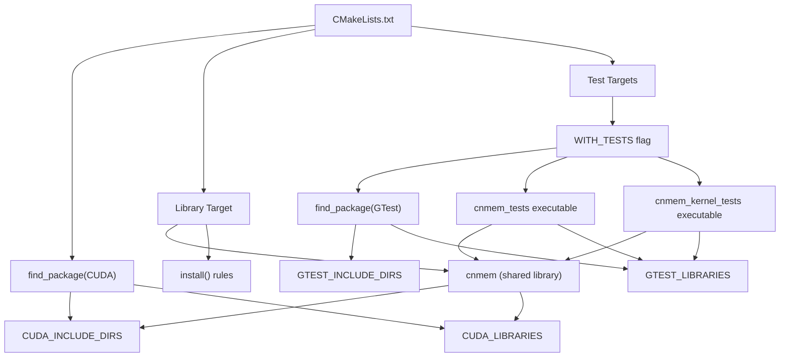
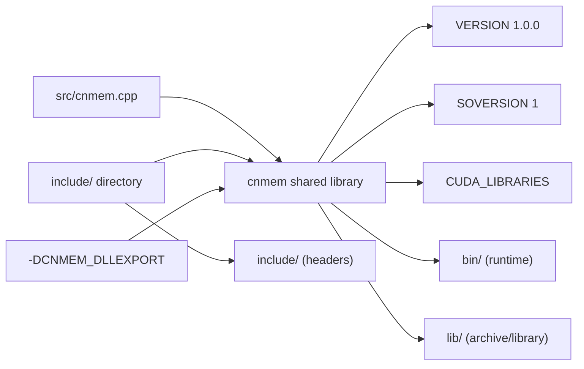
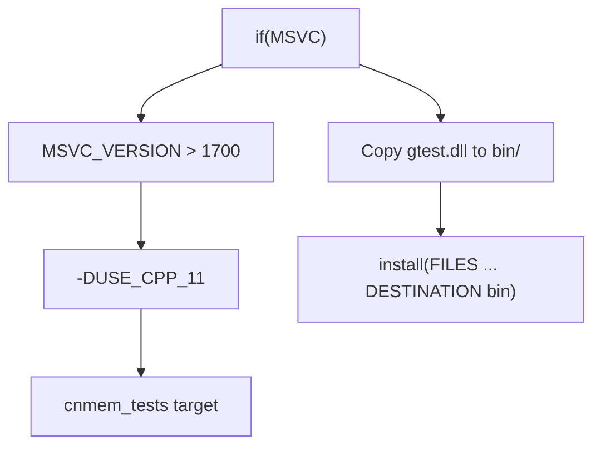

<!-- source: DeepWiki mcp.deepwiki.com · repo NVIDIA/cnmem · page 6.1 Build System Details · fetched 2026-10-26 -->

# Build System Details

Relevant source files

The following files were used as context for generating this wiki page:

- [CMakeLists.txt](CMakeLists.txt)

This document provides comprehensive technical documentation of cnmem's CMake-based build system, including dependency management, target configuration, cross-platform compilation, and test framework integration. This information is essential for developers who need to build cnmem from source, modify build configurations, or integrate cnmem into their own build systems.

For information about building the library for end users, see [Building the Library](#2.1). For project organization and contribution guidelines, see [Project Organization and Contributing](#6.2).

## Build System Overview

The cnmem library uses CMake as its primary build system, configured through a single [CMakeLists.txt:1-51]() file. The build system is designed to handle cross-platform compilation while managing complex dependencies including the CUDA toolkit and optional testing frameworks.

**Build System Architecture**

The build configuration follows a modular approach where core library compilation is separated from optional testing components, enabling flexible deployment scenarios.

Sources: [CMakeLists.txt:1-51]()

## Dependencies and Requirements

### Core Dependencies

The build system requires specific external dependencies that must be available at build time:

| Dependency | Minimum Version | Detection Method | Purpose |
|------------|----------------|------------------|---------|
| CMake | 2.8.8 | `cmake_minimum_required()` | Build system orchestration |
| CUDA Toolkit | Not specified | `find_package(CUDA QUIET REQUIRED)` | CUDA runtime and development libraries |

### Optional Dependencies

When building with tests enabled via the `WITH_TESTS` flag:

| Dependency | Detection Method | Purpose |
|------------|------------------|---------|
| Google Test | `find_package(GTest QUIET REQUIRED)` | Unit testing framework |
| pthread | `-lpthread` linker flag | Thread synchronization in tests |

The CUDA dependency resolution includes both include directories and libraries:
- Include paths: `${CUDA_INCLUDE_DIRS}` [CMakeLists.txt:7]()
- Link libraries: `${CUDA_LIBRARIES}` [CMakeLists.txt:14]()

Sources: [CMakeLists.txt:5-7](), [CMakeLists.txt:21-23](), [CMakeLists.txt:35](), [CMakeLists.txt:40]()

## Build Targets and Configuration

### Primary Library Target

The core `cnmem` shared library target is configured with specific properties:

**Library Target Configuration Details**

The library compilation includes:
- Source compilation: [CMakeLists.txt:12]() - `add_library(cnmem SHARED src/cnmem.cpp)`
- Export definition: [CMakeLists.txt:11]() - `add_definitions(-DCNMEM_DLLEXPORT)`
- Version properties: [CMakeLists.txt:13]() - `VERSION 1.0.0 SOVERSION 1`
- Include directories: [CMakeLists.txt:10]() - `include_directories(include)`

### Test Targets

When `WITH_TESTS` is enabled, two test executables are built:

#### Unit Test Executable
- Target name: `cnmem_tests` [CMakeLists.txt:26]()
- Source file: `tests/cnmem_tests.cpp`
- Links against: cnmem library, CUDA libraries, Google Test, pthread

#### CUDA Kernel Test Executable  
- Target name: `cnmem_kernel_tests` [CMakeLists.txt:39]()
- Source file: `tests/cnmem_kernel_test.cu`
- Built with: `cuda_add_executable()` for CUDA compilation
- Links against: cnmem library, CUDA libraries, Google Test, pthread

Sources: [CMakeLists.txt:10-16](), [CMakeLists.txt:25-41]()

## Cross-Platform Compilation Support

The build system includes platform-specific configurations to handle compiler differences:

### Microsoft Visual Studio (MSVC)

**MSVC-Specific Configuration**

For Visual Studio 2012 and later (version > 1700):
- Enables C++11 support: [CMakeLists.txt:29]() - `add_definitions(-DUSE_CPP_11)`
- Handles Google Test DLL deployment: [CMakeLists.txt:44-47]()

### GNU Compiler Collection (GCC)

For GCC-based builds:
- C++11 standard flag: [CMakeLists.txt:33]() - `add_definitions(-std=c++11 -DUSE_CPP_11)`
- Detected via: `CMAKE_COMPILER_IS_GNUCC` [CMakeLists.txt:32]()

### Threading Library Integration

Cross-platform threading support is handled through:
- POSIX systems: `-lpthread` linker flag [CMakeLists.txt:35,40]()
- Applied to both test executables for thread synchronization

Sources: [CMakeLists.txt:27-34](), [CMakeLists.txt:43-47]()

## Installation and Packaging

The build system defines comprehensive installation rules for different component types:

### Library Installation
- Runtime libraries: `bin/` directory [CMakeLists.txt:15]()
- Archive/static libraries: `lib/` directory 
- Shared/dynamic libraries: `lib/` directory

### Header Installation
- Public API header: `include/cnmem.h` → `include/` [CMakeLists.txt:16]()

### Test Executable Installation
- Test binaries: `cnmem_tests` and `cnmem_kernel_tests` → `bin/` [CMakeLists.txt:36,41]()

### Windows-Specific Installation
- Google Test runtime DLL: `gtest.dll` → `bin/` [CMakeLists.txt:46]()

This installation structure enables system-wide deployment where libraries, headers, and executables are placed in standard locations according to platform conventions.

Sources: [CMakeLists.txt:15-16](), [CMakeLists.txt:36](), [CMakeLists.txt:41](), [CMakeLists.txt:43-47]()

## Build Configuration Variables

The build system recognizes several key configuration variables:

| Variable | Type | Default | Purpose |
|----------|------|---------|---------|
| `WITH_TESTS` | Boolean | Not set | Enable/disable test target compilation |
| `CUDA_INCLUDE_DIRS` | Path list | Auto-detected | CUDA toolkit include directories |
| `CUDA_LIBRARIES` | Library list | Auto-detected | CUDA runtime and driver libraries |
| `GTEST_INCLUDE_DIRS` | Path list | Auto-detected | Google Test include directories |
| `GTEST_LIBRARIES` | Library list | Auto-detected | Google Test libraries |

These variables can be overridden during CMake configuration to customize the build for specific environments or to use non-standard installation paths for dependencies.

Sources: [CMakeLists.txt:19](), [CMakeLists.txt:6-7](), [CMakeLists.txt:22-23]()

---

