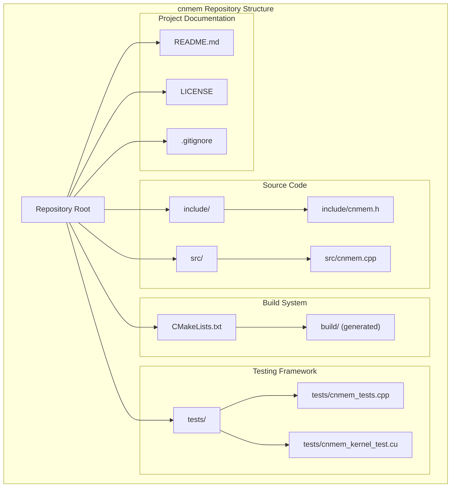
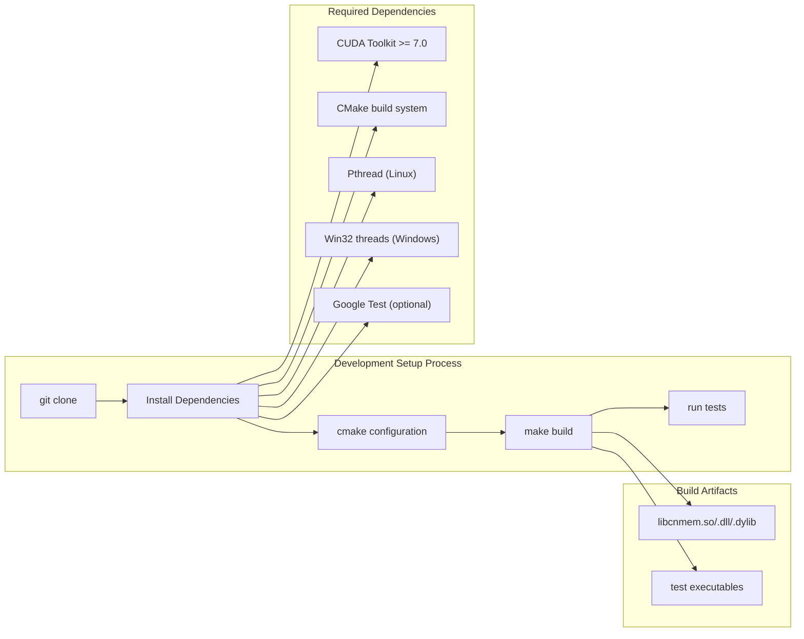
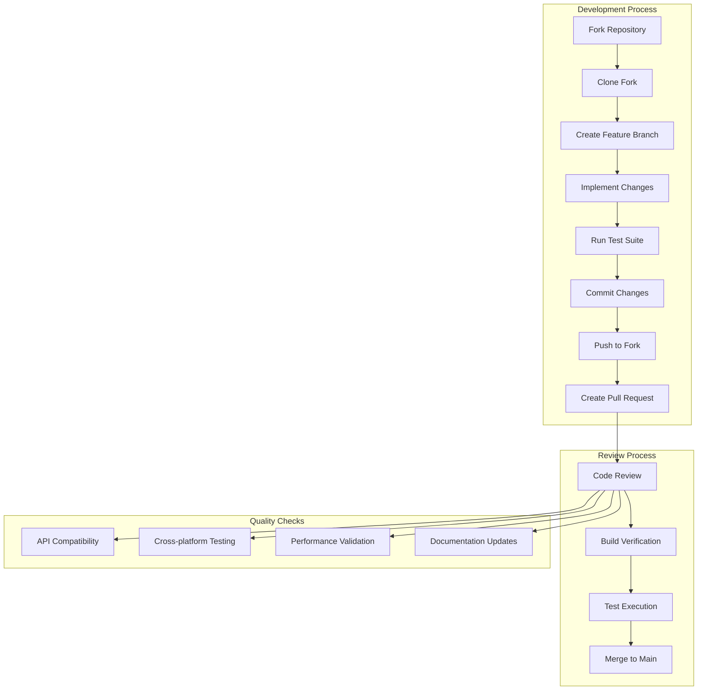

<!-- source: DeepWiki mcp.deepwiki.com · repo NVIDIA/cnmem · page 6.2 Project Organization and Contributing · fetched 2026-10-26 -->

# Project Organization and Contributing

Relevant source files

The following files were used as context for generating this wiki page:

- [.gitignore](.gitignore)
- [LICENSE](LICENSE)
- [README.md](README.md)

This document provides an overview of the cnmem project structure, development practices, and guidelines for contributors. It covers the repository organization, licensing terms, and the development workflow for maintaining and extending the CUDA memory management library.

For technical details about the build system configuration, see [Build System Details](#6.1). For information about testing procedures, see [Testing and Validation](#5).

## Project Structure

The cnmem project follows a straightforward organization designed for a focused CUDA memory management library. The codebase is structured around core functionality with minimal dependencies and clear separation between public interfaces, implementation, and testing infrastructure.

### Repository Layout

**Sources:** [README.md:1-57](), [LICENSE:1-27](), [.gitignore:1-3]()

The repository maintains a clean structure with distinct separation of concerns:

| Directory/File | Purpose | Key Contents |
|---------------|---------|--------------|
| `include/` | Public API headers | `cnmem.h` - Complete public interface |
| `src/` | Core implementation | `cnmem.cpp` - Memory management logic |
| `tests/` | Test suite | Unit tests and CUDA kernel tests |
| `CMakeLists.txt` | Build configuration | Cross-platform build rules |
| `README.md` | Project documentation | Build instructions and usage |
| `LICENSE` | Legal terms | BSD-style license |

## Licensing

The cnmem library is released under a BSD-style license by NVIDIA Corporation. The license permits both source and binary redistribution with modification, subject to standard BSD license conditions.

### License Terms

The project uses a permissive BSD 3-Clause license that allows:
- Redistribution in source and binary forms
- Modification of the source code
- Commercial and non-commercial use

Key requirements include:
- Retention of copyright notice in source redistributions
- Inclusion of license text in binary distributions
- No endorsement using NVIDIA or contributor names without permission

**Sources:** [LICENSE:1-27]()

## Development Workflow

The cnmem project follows standard open-source development practices centered around GitHub collaboration. The workflow emphasizes simplicity and focuses on the core CUDA memory management functionality.

### Development Environment Setup

**Sources:** [README.md:11-56]()

### Build Configuration Options

The project supports multiple build configurations:

| Configuration | CMake Command | Purpose |
|--------------|---------------|---------|
| Library only | `cmake ..` | Core library without tests |
| With tests | `cmake -DWITH_TESTS=True ..` | Include unit test suite |
| Debug build | `cmake -DCMAKE_BUILD_TYPE=Debug ..` | Development debugging |

## Contributing Guidelines

### Code Organization Principles

The cnmem codebase follows several key principles:

1. **Minimal Dependencies**: Limited to CUDA toolkit, standard threading libraries, and optional Google Test
2. **Clear API Boundaries**: Public interface isolated in `include/cnmem.h`
3. **Platform Portability**: Cross-platform support with CMake build system
4. **Focused Scope**: Designed specifically for deep learning framework memory patterns

### Development Standards

#### Code Structure
- Public API definitions in [include/cnmem.h]()
- Core implementation in [src/cnmem.cpp]()  
- Comprehensive test coverage in [tests/]()
- Cross-platform build configuration in [CMakeLists.txt]()

#### Testing Requirements
- Unit tests for all public API functions
- CUDA kernel accessibility tests
- Multi-threading safety validation
- Memory leak detection

### Repository Management

**Sources:** [README.md:28-32](), [.gitignore:1-3]()

### Contribution Areas

Contributors can focus on several key areas:

| Area | Description | Files Involved |
|------|-------------|----------------|
| Core Memory Management | Algorithm improvements, bug fixes | [src/cnmem.cpp]() |
| API Extensions | New functionality, compatibility | [include/cnmem.h]() |
| Platform Support | OS-specific optimizations | [CMakeLists.txt]() |
| Testing Infrastructure | Test coverage, validation | [tests/cnmem_tests.cpp](), [tests/cnmem_kernel_test.cu]() |
| Documentation | Usage examples, API docs | [README.md]() |

### Build System Integration

The project uses a CMake-based build system that handles:
- CUDA toolkit detection and integration
- Cross-platform compilation flags
- Dependency management for threading libraries
- Optional test framework integration
- Library artifact generation

Contributors should ensure changes maintain compatibility with the existing build configuration and support the target platforms specified in the project requirements.

**Sources:** [README.md:13-25](), [README.md:33-56]()