# Page: Overview

# Overview

<details>
<summary>Relevant source files</summary>

The following files were used as context for generating this wiki page:

- [README.md](README.md)
- [src/cnmem.cpp](src/cnmem.cpp)

</details>


This document provides a comprehensive overview of the cnmem library, a specialized CUDA memory management system designed for deep learning frameworks. It covers the core architecture, memory management hierarchy, and key operational workflows that make cnmem effective for applications working with large GPU memory buffers.

For detailed API documentation, see [API Reference](#3). For build instructions and setup, see [Getting Started](#2). For implementation details and algorithms, see [Architecture and Implementation](#4).

## Purpose and Scope

cnmem (CUDA Memory Manager) is a C++ library that provides efficient memory management for CUDA applications, particularly deep learning frameworks like TensorFlow and PyTorch. Unlike general-purpose memory allocators, cnmem is specifically optimized for applications that work with a limited number of large memory buffers and have predictable allocation patterns.

The library addresses several key challenges in CUDA memory management:
- **Pool-based allocation**: Reduces expensive `cudaMalloc`/`cudaFree` calls by pre-allocating memory pools
- **Stream-aware management**: Provides separate memory managers for different CUDA streams
- **Memory stealing**: Enables dynamic reallocation of memory between streams when needed
- **Thread-safe operations**: Supports multi-threaded access through mutex-based synchronization

**Sources:** [README.md:1-10](), [src/cnmem.cpp:1-61]()

## Core Architecture Components

The cnmem library is built around several key C++ classes that work together to provide hierarchical memory management:

### Core Class Architecture

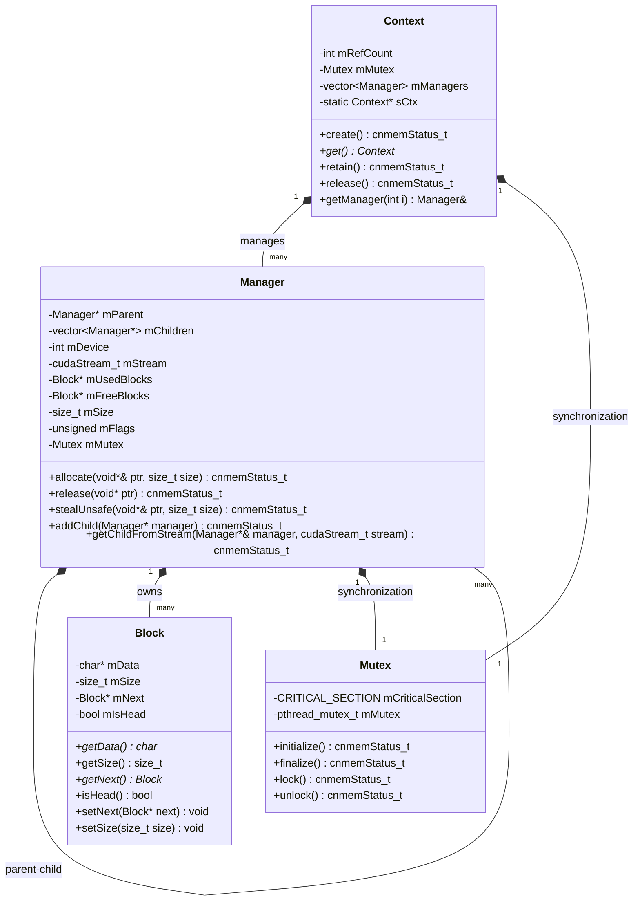

**Key Components:**

- **`Context`**: Global singleton managing all memory managers across devices. Implements reference counting for library lifecycle management.
- **`Manager`**: Core memory management unit that handles allocation/deallocation for a specific device or stream. Forms parent-child hierarchies.
- **`Block`**: Represents a contiguous memory region with metadata including size, next pointer, and head flag for linked list management.
- **`Mutex`**: Cross-platform threading primitive providing synchronized access to shared memory structures.

**Sources:** [src/cnmem.cpp:966-1001](), [src/cnmem.cpp:307-422](), [src/cnmem.cpp:262-303](), [src/cnmem.cpp:191-258]()

## Hierarchical Memory Management

cnmem implements a two-level hierarchical memory management system where device-level root managers coordinate with stream-specific child managers:

### Memory Manager Hierarchy

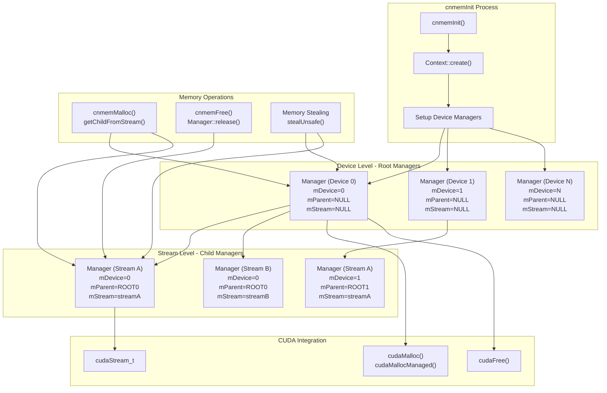

**Memory Manager Types:**

1. **Root Managers**: One per GPU device, created during `cnmemInit()`. Directly interface with CUDA runtime via `cudaMalloc`/`cudaFree`. Manage device-level memory pools and coordinate child managers.

2. **Child Managers**: Associated with specific CUDA streams. Created either during initialization (via `cnmemDevice_t.streams`) or dynamically (via `cnmemRegisterStream()`). Inherit memory from parent managers and can steal memory from siblings when needed.

**Memory Flow:**
- Initial allocation: Child managers request memory from parent root managers
- Pool growth: Root managers call `cudaMalloc` when pools are exhausted (unless `CNMEM_FLAGS_CANNOT_GROW`)
- Memory stealing: Child managers can steal unused memory from siblings via `stealUnsafe()`

**Sources:** [src/cnmem.cpp:1071-1130](), [src/cnmem.cpp:1155-1171](), [src/cnmem.cpp:857-888]()

## Core Memory Operations

### Allocation Workflow

The memory allocation process in cnmem follows a sophisticated multi-step approach designed to maximize memory reuse and minimize CUDA runtime calls:

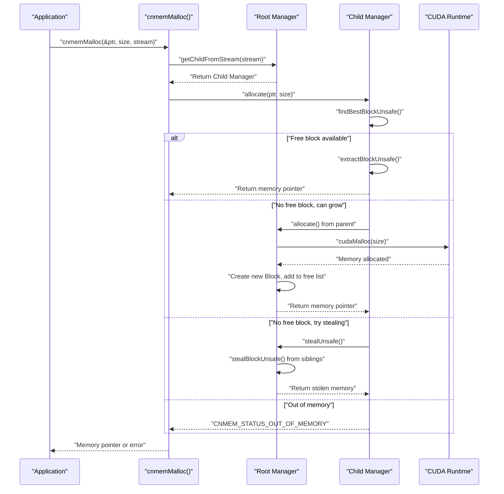

**Key Allocation Functions:**
- `cnmemMalloc()`: Public API entry point [src/cnmem.cpp:1175-1246]()
- `Manager::allocate()`: Core allocation logic with mutex protection [src/cnmem.cpp:462-497]()
- `Manager::findBestBlockUnsafe()`: Best-fit block selection algorithm [src/cnmem.cpp:575-585]()
- `Manager::stealUnsafe()`: Memory stealing between managers [src/cnmem.cpp:857-888]()

### Block Management and Memory Layout

cnmem uses a linked-list based approach to manage memory blocks within each pool:

**Free Block List**: Maintains available memory blocks sorted by address for efficient coalescing
**Used Block List**: Tracks allocated blocks for deallocation and debugging

Block coalescing occurs during deallocation to prevent fragmentation:
- Adjacent free blocks are automatically merged [src/cnmem.cpp:819-841]()
- Head blocks (from `cudaMalloc`) cannot be merged across allocation boundaries
- Memory alignment follows `CNMEM_GRANULARITY` (512 bytes) [src/cnmem.cpp:48]()

**Sources:** [src/cnmem.cpp:462-497](), [src/cnmem.cpp:575-585](), [src/cnmem.cpp:857-888](), [src/cnmem.cpp:1175-1246](), [src/cnmem.cpp:797-842]()

## Integration with CUDA and Deep Learning Frameworks

cnmem is designed as a drop-in replacement for direct CUDA memory management calls, providing a higher-level interface while maintaining compatibility with existing CUDA workflows:

### CUDA Runtime Integration

- **Device Management**: Automatic device switching and state restoration [src/cnmem.cpp:1094-1128]()
- **Stream Synchronization**: Handles both blocking and non-blocking streams [src/cnmem.cpp:384-396]()
- **Managed Memory Support**: Optional unified memory allocation via `CNMEM_FLAGS_MANAGED` [src/cnmem.cpp:511-521]()
- **Error Handling**: Comprehensive CUDA error checking with status code translation [src/cnmem.cpp:132-160]()

### Framework Integration Pattern

Deep learning frameworks typically integrate cnmem by:
1. Initialize cnmem during framework startup with `cnmemInit()`
2. Register compute streams with `cnmemRegisterStream()`  
3. Replace `cudaMalloc`/`cudaFree` calls with `cnmemMalloc`/`cnmemFree`
4. Use stream-aware allocation for tensor operations
5. Clean up with `cnmemFinalize()` during shutdown

The library's thread-safe design and stream-aware allocation make it particularly well-suited for frameworks that manage multiple concurrent GPU operations across different streams.

**Sources:** [src/cnmem.cpp:1071-1130](), [src/cnmem.cpp:1155-1171](), [src/cnmem.cpp:1175-1246](), [src/cnmem.cpp:1250-1266](), [README.md:3-6]()

---

# Page: Getting Started

# Getting Started

<details>
<summary>Relevant source files</summary>

The following files were used as context for generating this wiki page:

- [CMakeLists.txt](CMakeLists.txt)
- [README.md](README.md)

</details>


This document provides an overview of how to set up and begin using the cnmem CUDA memory management library. It covers the prerequisites, basic setup workflow, and points you to detailed information for building and using the system.

For detailed build instructions including dependencies and platform-specific considerations, see [Building the Library](#2.1). For simple usage examples and common patterns, see [Quick Start Guide](#2.2). For complete function documentation, see [API Reference](#3).

## Prerequisites and Dependencies

Before building cnmem, you need the following components installed on your system:

| Component | Requirement | Purpose |
|-----------|-------------|---------|
| CUDA Toolkit | >= 7.0 recommended | Core CUDA runtime and development libraries |
| CMake | >= 2.8.8 | Build system configuration |
| C++ Compiler | C++11 support | Source compilation |
| Google Test | Optional | Unit test framework (only if building tests) |
| Threading Library | pthread (Linux) / Win32 (Windows) | Thread synchronization |

The cnmem library integrates directly with CUDA's memory management functions and requires proper CUDA environment setup including `CUDA_HOME` and library path configuration.

**Sources:** [README.md:11-25](), [CMakeLists.txt:5-6]()

## System Overview

CNMeM Overview: Core Components and Dependencies

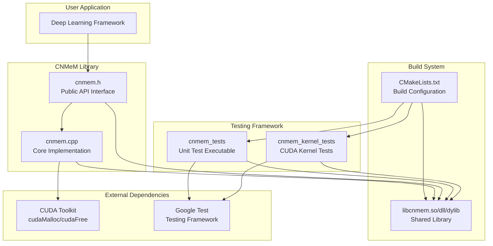

**Sources:** [CMakeLists.txt:10-16](), [README.md:1-6]()

## Basic Setup Workflow

The process of setting up cnmem follows these key phases:

CNMeM Setup and Integration Workflow

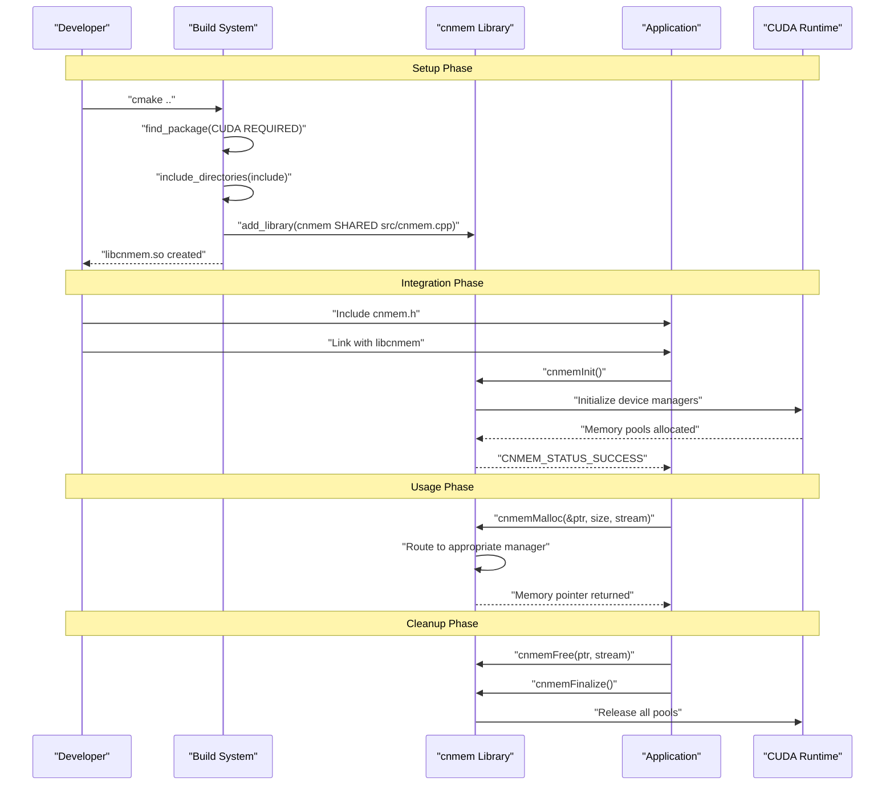

**Sources:** [CMakeLists.txt:9-16](), [README.md:33-49]()

## Build Configuration Options

The cnmem build system provides several configuration options controlled through CMake flags:

| CMake Option | Effect | Files Generated |
|--------------|--------|-----------------|
| Default build | Library only | `libcnmem.so/dll/dylib` |
| `-DWITH_TESTS=True` | Library + tests | Library + `cnmem_tests` + `cnmem_kernel_tests` |
| `-DCMAKE_BUILD_TYPE=Debug` | Debug symbols | Debug builds with symbols |
| `-DCMAKE_INSTALL_PREFIX=path` | Install location | Custom installation directory |

The build system automatically detects:
- CUDA installation via `find_package(CUDA QUIET REQUIRED)` 
- Google Test framework via `find_package(GTest QUIET REQUIRED)` (when tests enabled)
- C++11 compiler support for modern standard library features

**Sources:** [CMakeLists.txt:19-49](), [CMakeLists.txt:27-34]()

## Library Integration Points

Applications integrate with cnmem through several key interfaces:

CNMeM Integration Architecture

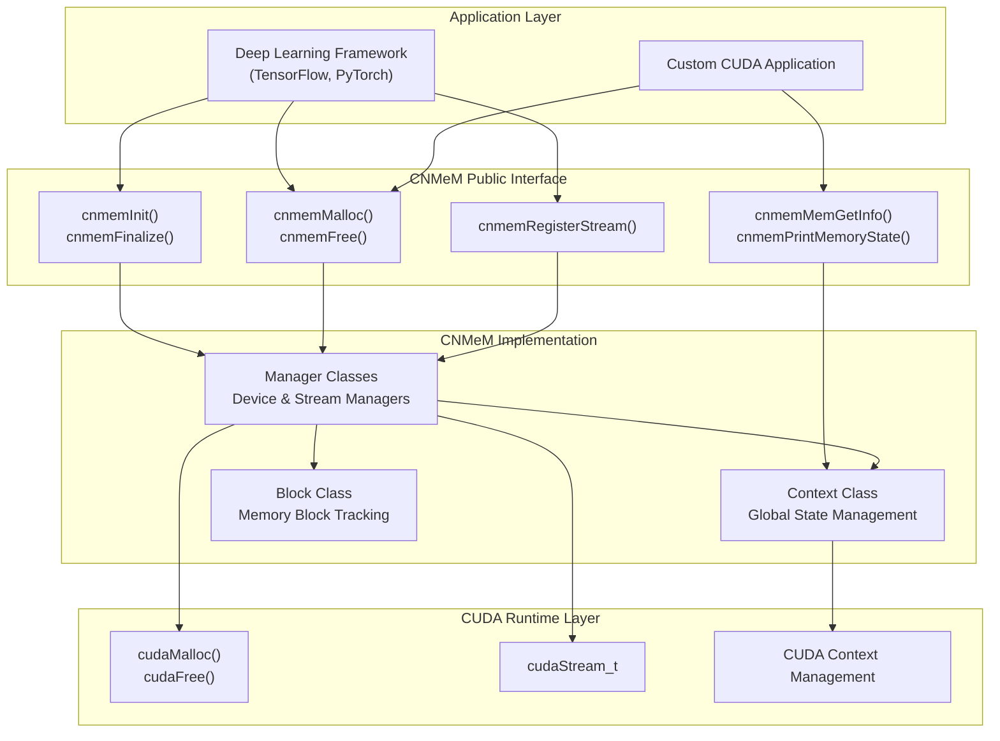

**Sources:** [CMakeLists.txt:10-16](), [README.md:51-56]()

## Next Steps

After understanding this overview, proceed with:

1. **Building the Library**: Follow the detailed build instructions in [Building the Library](#2.1) to compile cnmem for your platform
2. **Basic Usage**: Review the [Quick Start Guide](#2.2) for simple examples of initialization, allocation, and cleanup
3. **API Details**: Consult the [API Reference](#3) for complete function documentation and parameter details
4. **Advanced Features**: Explore [Architecture and Implementation](#4) to understand the hierarchical memory management system

The cnmem library is designed specifically for applications that work with large memory buffers and predictable allocation patterns, making it particularly suitable for deep learning frameworks and GPU computing applications.

**Sources:** [README.md:3-9](), [CMakeLists.txt:1-16]()

---

# Page: Building the Library

# Building the Library

<details>
<summary>Relevant source files</summary>

The following files were used as context for generating this wiki page:

- [CMakeLists.txt](CMakeLists.txt)
- [README.md](README.md)

</details>


This document provides comprehensive instructions for building the cnmem library from source code. It covers all necessary dependencies, build configuration options, and platform-specific considerations required to successfully compile cnmem on your system.

For information about using the built library in your applications, see [Quick Start Guide](#2.2). For detailed analysis of the build system internals and advanced configuration, see [Build System Details](#6.1).

## Prerequisites and Dependencies

The cnmem build system requires several dependencies to be installed and properly configured on your system before compilation can begin.

### Required Dependencies

| Component | Minimum Version | Purpose |
|-----------|----------------|---------|
| **CUDA Toolkit** | >= 7.0 (recommended) | Core CUDA runtime and development libraries |
| **CMake** | >= 2.8.8 | Cross-platform build system generator |
| **C++ Compiler** | C++11 support | Compilation of source code |

### Platform-Specific Dependencies

| Platform | Threading Library | Additional Requirements |
|----------|------------------|------------------------|
| **Linux** | Pthread | Standard POSIX threads |
| **Windows** | Win32 | Native Windows threading API |
| **macOS** | Pthread | Standard POSIX threads |

### Optional Dependencies

| Component | Required For | Notes |
|-----------|-------------|--------|
| **Google Test** | Unit testing (`WITH_TESTS=True`) | Provides testing framework |

**CUDA Installation Requirements:**

The CUDA toolkit must be properly installed with environment variables configured:
- `CUDA_HOME=/usr/local/cuda` (or your CUDA installation path)
- `LD_LIBRARY_PATH=$CUDA_HOME/lib64:$LD_LIBRARY_PATH` (Linux/macOS)
- CUDA binaries in system `PATH`

Sources: [CMakeLists.txt:5-7](), [README.md:11-25]()

## Build System Architecture

The cnmem build system is structured around CMake targets that handle library compilation, test building, and installation.

### CMake Target Dependencies

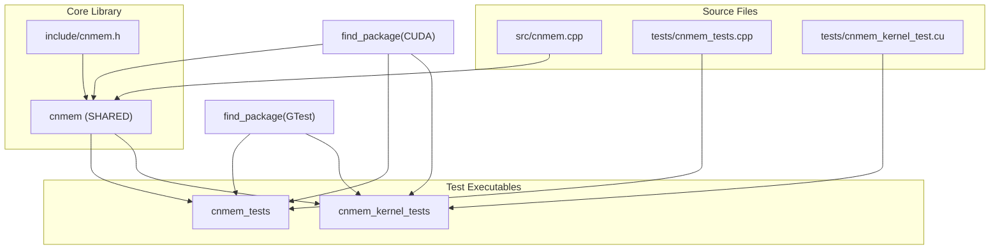

Sources: [CMakeLists.txt:5-14](), [CMakeLists.txt:21-41]()

## Basic Build Process

The standard cnmem build process follows CMake conventions with an out-of-source build directory structure.

### Build Process Flow

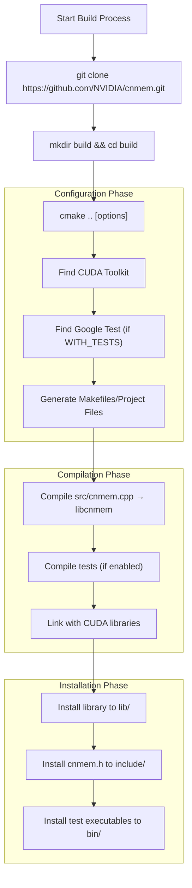

Sources: [README.md:28-39](), [CMakeLists.txt:1-16]()

## Build Instructions

### Basic Library Build

To build only the core cnmem library without tests:

```bash
cd $HOME
git clone https://github.com/NVIDIA/cnmem.git cnmem
cd cnmem
mkdir build
cd build
cmake ..
make
```

This creates the shared library with the following CMake configuration:
- Library name: `cnmem` 
- Library type: `SHARED` as specified in [CMakeLists.txt:12]()
- Version: `1.0.0` with `SOVERSION 1` from [CMakeLists.txt:13]()
- Preprocessor definition: `CNMEM_DLLEXPORT` from [CMakeLists.txt:11]()

### Build with Unit Tests

To build cnmem with the complete test suite:

```bash
cd cnmem
mkdir build
cd build
cmake -DWITH_TESTS=True ..
make
```

This build configuration creates additional targets when `WITH_TESTS` is enabled:

| Target | Source | Type | Purpose |
|--------|--------|------|---------|
| `cnmem_tests` | [tests/cnmem_tests.cpp]() | Executable | CPU-side unit tests |
| `cnmem_kernel_tests` | [tests/cnmem_kernel_test.cu]() | CUDA Executable | GPU kernel tests |

Sources: [README.md:41-49](), [CMakeLists.txt:19-41]()

## Build Configuration Options

### CMake Variables

The build system supports several configuration variables that modify compilation behavior:

| Variable | Default | Effect |
|----------|---------|--------|
| `WITH_TESTS` | `OFF` | Enables test target compilation |
| `CMAKE_BUILD_TYPE` | `Release` | Controls optimization level |
| `CMAKE_INSTALL_PREFIX` | `/usr/local` | Installation directory prefix |

### Compiler-Specific Features

The build system automatically detects compiler capabilities and applies appropriate flags:

#### Visual Studio (MSVC)
- **C++11 Support**: Automatically enabled for Visual Studio 2012+ via [CMakeLists.txt:28-30]()
- **Definition**: `USE_CPP_11` preprocessor flag when supported

#### GNU Compiler Collection (GCC)  
- **C++11 Standard**: `-std=c++11` flag from [CMakeLists.txt:33]()
- **Definition**: `USE_CPP_11` preprocessor flag

Sources: [CMakeLists.txt:27-34]()

## Platform-Specific Considerations

### Linux/Unix Systems

Standard build process using system package managers:

- **Threading**: Links with `-lpthread` from [CMakeLists.txt:35]()
- **CUDA Libraries**: Linked via `${CUDA_LIBRARIES}` variable
- **Library Output**: `libcnmem.so` shared library

### Windows (MSVC)

Windows builds require additional DLL handling:

- **Google Test DLL**: Automatically copied to bin folder via [CMakeLists.txt:44-47]()
- **Library Output**: `cnmem.lib` (import library) and `cnmem.dll` (dynamic library)
- **Runtime Dependencies**: CUDA runtime DLLs must be in system PATH

### macOS

Similar to Linux with:
- **Library Output**: `libcnmem.dylib` dynamic library
- **Framework**: Standard Unix build process

Sources: [CMakeLists.txt:35](), [CMakeLists.txt:44-47](), [README.md:53-55]()

## Build Artifacts and Installation

### Generated Files

The build process creates the following artifacts in the build directory:

| Artifact | Location | Description |
|----------|----------|-------------|
| `cnmem` library | `build/` | Main shared library (platform-specific extension) |
| `cnmem_tests` | `build/` | Unit test executable (if `WITH_TESTS` enabled) |
| `cnmem_kernel_tests` | `build/` | CUDA kernel test executable (if `WITH_TESTS` enabled) |

### Installation Structure

Running `make install` deploys files according to the install rules defined in [CMakeLists.txt:15-16]() and [CMakeLists.txt:36](), [CMakeLists.txt:41]():

```
${CMAKE_INSTALL_PREFIX}/
├── bin/
│   ├── cnmem_tests (if built)
│   ├── cnmem_kernel_tests (if built)
│   └── gtest.dll (Windows only, if tests built)
├── lib/
│   └── libcnmem.{so,dll,dylib}
└── include/
    └── cnmem.h
```

### Link Requirements

Applications using cnmem must link against:
- The cnmem library: `libcnmem.so` (Linux), `cnmem.lib` (Windows), `libcnmem.dylib` (macOS)  
- CUDA runtime libraries: Typically handled automatically by the CUDA toolkit installation

Sources: [CMakeLists.txt:15-16](), [CMakeLists.txt:36](), [CMakeLists.txt:41](), [README.md:51-55]()

---

# Page: Quick Start Guide

# Quick Start Guide

<details>
<summary>Relevant source files</summary>

The following files were used as context for generating this wiki page:

- [include/cnmem.h](include/cnmem.h)
- [tests/cnmem_tests.cpp](tests/cnmem_tests.cpp)

</details>


This document provides simple examples and common usage patterns for getting started with the cnmem CUDA memory management library. It covers basic initialization, allocation/deallocation, stream management, and cleanup procedures. For detailed API documentation, see [API Reference](#3). For comprehensive testing examples, see [Testing and Validation](#5).

## Basic Usage Pattern

The fundamental cnmem workflow follows a simple initialize-allocate-free-finalize pattern:

**Basic cnmem Workflow**
```mermaid
graph TD
    A["`cnmemInit()`"] --> B["`cnmemMalloc()`"]
    B --> C["Use Memory in CUDA Kernels"]
    C --> D["`cnmemFree()`"]
    D --> E{More Allocations?}
    E -->|Yes| B
    E -->|No| F["`cnmemFinalize()`"]
    
    A -.-> G["`cnmemDevice_t` structure"]
    B -.-> H["`void**` pointer"]
    D -.-> H
```

Sources: [include/cnmem.h:113-126](), [tests/cnmem_tests.cpp:308-318]()

## Simple Example

Here's the minimal code pattern for using cnmem with default settings:

**Minimal Usage Pattern**
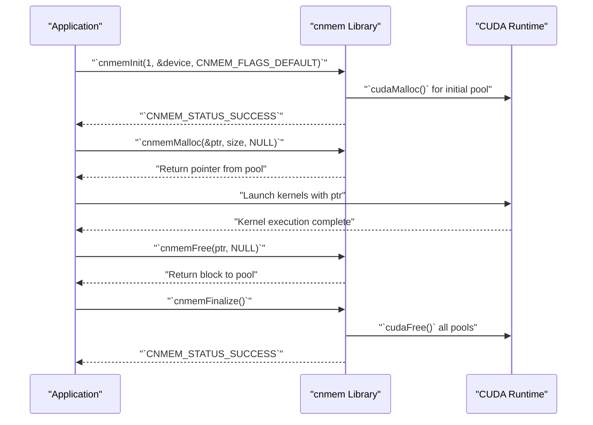

The basic initialization requires setting up a `cnmemDevice_t` structure:

| Field | Description | Example Value |
|-------|-------------|---------------|
| `device` | CUDA device number | `0` |
| `size` | Initial pool size (bytes) | `2048` or `0` for auto |
| `numStreams` | Number of managed streams | `0` for default |
| `streams` | Array of stream handles | `NULL` for default |
| `streamSizes` | Per-stream pool sizes | `NULL` for default |

Sources: [include/cnmem.h:81-94](), [tests/cnmem_tests.cpp:87-90]()

## Working with Streams

cnmem supports both the default stream (`NULL`) and named CUDA streams with dedicated memory pools:

**Stream-based Memory Management**
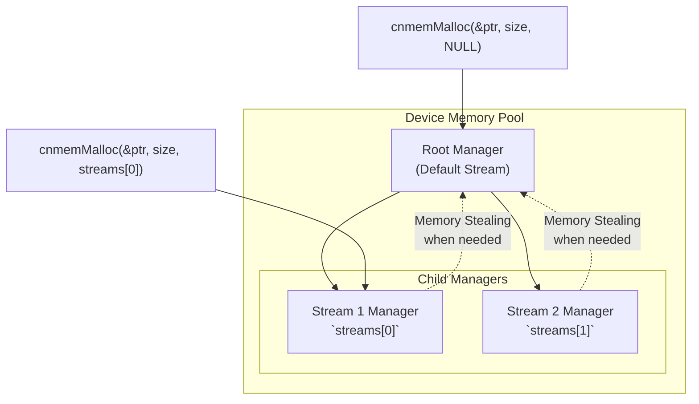

To use streams, configure them during initialization:

```c
cudaStream_t streams[2];
cudaStreamCreate(&streams[0]);
cudaStreamCreate(&streams[1]);

cnmemDevice_t device;
memset(&device, 0, sizeof(device));
device.size = 6144;  // 6KB total
device.numStreams = 2;
device.streams = streams;
```

Sources: [include/cnmem.h:87-92](), [tests/cnmem_tests.cpp:166-184]()

## Common Configurations

cnmem supports several configuration flags that control memory management behavior:

| Flag | Purpose | Use Case |
|------|---------|----------|
| `CNMEM_FLAGS_DEFAULT` | Allow growth and stealing | General purpose |
| `CNMEM_FLAGS_CANNOT_GROW` | Fixed pool size | Predictable memory usage |
| `CNMEM_FLAGS_CANNOT_STEAL` | No memory stealing | Stream isolation |
| `CNMEM_FLAGS_MANAGED` | Use `cudaMallocManaged` | Unified memory access |

**Memory Management Behavior**
```mermaid
flowchart TD
    REQ["Memory Request<br/>`cnmemMalloc()`"]
    
    REQ --> CHECK_POOL{"Pool has<br/>free memory?"}
    CHECK_POOL -->|Yes| RETURN_MEM["Return existing block"]
    CHECK_POOL -->|No| CHECK_GROW{"Can grow?<br/>`!CNMEM_FLAGS_CANNOT_GROW`"}
    
    CHECK_GROW -->|Yes| CUDA_MALLOC["`cudaMalloc()`<br/>Expand pool"]
    CUDA_MALLOC --> SUCCESS{"Success?"}
    SUCCESS -->|Yes| RETURN_NEW["Return new block"]
    SUCCESS -->|No| CHECK_STEAL
    
    CHECK_GROW -->|No| CHECK_STEAL{"Can steal?<br/>`!CNMEM_FLAGS_CANNOT_STEAL`"}
    CHECK_STEAL -->|Yes| STEAL["Steal from child managers"]
    STEAL --> STEAL_SUCCESS{"Success?"}
    STEAL_SUCCESS -->|Yes| RETURN_STOLEN["Return stolen block"]
    STEAL_SUCCESS -->|No| OOM["Return<br/>`CNMEM_STATUS_OUT_OF_MEMORY`"]
    CHECK_STEAL -->|No| OOM
```

Sources: [include/cnmem.h:71-77](), [include/cnmem.h:175-195](), [tests/cnmem_tests.cpp:418-443]()

## Error Handling and Cleanup

Always check return values and handle errors appropriately:

**Status Code Handling**
```mermaid
graph LR
    CALL["`cnmemMalloc()` call"]
    CALL --> CHECK_STATUS{"Check return value"}
    
    CHECK_STATUS --> SUCCESS["`CNMEM_STATUS_SUCCESS`<br/>Use the pointer"]
    CHECK_STATUS --> OOM["`CNMEM_STATUS_OUT_OF_MEMORY`<br/>Handle shortage"]
    CHECK_STATUS --> INVALID["`CNMEM_STATUS_INVALID_ARGUMENT`<br/>Fix parameters"]
    CHECK_STATUS --> NOT_INIT["`CNMEM_STATUS_NOT_INITIALIZED`<br/>Call cnmemInit first"]
    CHECK_STATUS --> CUDA_ERR["`CNMEM_STATUS_CUDA_ERROR`<br/>Check CUDA state"]
    
    SUCCESS --> USE["Launch kernels"]
    USE --> FREE["`cnmemFree(ptr, stream)`"]
```

Common cleanup patterns:

| Scenario | Action | Example |
|----------|--------|---------|
| Normal shutdown | Call `cnmemFinalize()` | Single-threaded cleanup |
| Reference counting | Use `cnmemRetain()`/`cnmemRelease()` | Multi-threaded scenarios |
| Error recovery | Check status, cleanup partial state | Handle `CNMEM_STATUS_OUT_OF_MEMORY` |
| Stream cleanup | Free stream pointers before destroying streams | Avoid invalid stream references |

The library provides `cnmemGetErrorString()` to convert status codes to human-readable messages.

Sources: [include/cnmem.h:59-67](), [include/cnmem.h:115-156](), [include/cnmem.h:255-257](), [tests/cnmem_tests.cpp:68-76]()

## Thread Safety Considerations

cnmem is designed for multi-threaded use with specific safety guarantees:

**Thread Safety Model**
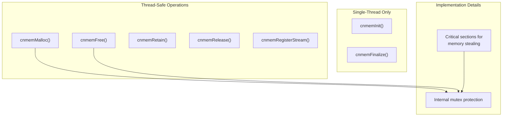

Key thread safety rules:
- `cnmemInit()` and `cnmemFinalize()` must be called from a single thread
- `cnmemMalloc()` and `cnmemFree()` are thread-safe but may serialize during memory stealing
- Stream registration is thread-safe but should be done early in program lifecycle

Sources: [include/cnmem.h:104-105](), [include/cnmem.h:118-119](), [include/cnmem.h:194-195](), [tests/cnmem_tests.cpp:651-866]()

---

# Page: API Reference

# API Reference

<details>
<summary>Relevant source files</summary>

The following files were used as context for generating this wiki page:

- [include/cnmem.h](include/cnmem.h)
- [src/cnmem.cpp](src/cnmem.cpp)

</details>


This document provides complete reference documentation for the cnmem public API. It covers all functions, data structures, enums, and constants that applications can use to integrate CUDA memory management capabilities through cnmem.

For implementation details and internal architecture, see [Architecture and Implementation](#4). For testing and validation information, see [Testing and Validation](#5). For basic usage examples, see [Quick Start Guide](#2.2).

## Overview

The cnmem public API consists of three main categories of functions:

**Initialization and Configuration API Hierarchy**

```mermaid
graph TD
    Init["cnmemInit()"] --> Context["Global cnmem Context"]
    Context --> Retain["cnmemRetain()"]
    Context --> Release["cnmemRelease()"] 
    Context --> Finalize["cnmemFinalize()"]
    Context --> RegisterStream["cnmemRegisterStream()"]
    
    Init --> DeviceConfig["cnmemDevice_t Structure"]
    DeviceConfig --> DeviceField["device: int"]
    DeviceConfig --> SizeField["size: size_t"]
    DeviceConfig --> NumStreamsField["numStreams: int"]
    DeviceConfig --> StreamsField["streams: cudaStream_t*"]
    DeviceConfig --> StreamSizesField["streamSizes: size_t*"]
    
    Init --> Flags["cnmemManagerFlags_t"]
    Flags --> DefaultFlag["CNMEM_FLAGS_DEFAULT"]
    Flags --> CannotGrowFlag["CNMEM_FLAGS_CANNOT_GROW"]
    Flags --> CannotStealFlag["CNMEM_FLAGS_CANNOT_STEAL"]
    Flags --> ManagedFlag["CNMEM_FLAGS_MANAGED"]
```

**Memory Operations API Flow**

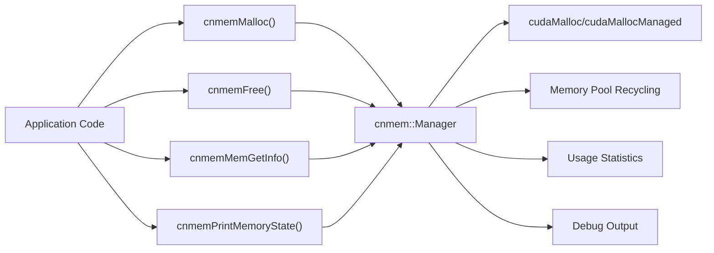

Sources: [include/cnmem.h:113-258](), [src/cnmem.cpp:1071-1311]()

## Status Codes and Error Handling

All cnmem functions return a `cnmemStatus_t` value indicating success or failure.

| Status Code | Value | Description |
|-------------|-------|-------------|
| `CNMEM_STATUS_SUCCESS` | 0 | Operation completed successfully |
| `CNMEM_STATUS_CUDA_ERROR` | 1 | CUDA runtime error occurred |
| `CNMEM_STATUS_INVALID_ARGUMENT` | 2 | Invalid function argument provided |
| `CNMEM_STATUS_NOT_INITIALIZED` | 3 | Library not initialized via `cnmemInit` |
| `CNMEM_STATUS_OUT_OF_MEMORY` | 4 | Insufficient memory available |
| `CNMEM_STATUS_UNKNOWN_ERROR` | 5 | Unspecified error condition |

### cnmemGetErrorString

```c
const char* cnmemGetErrorString(cnmemStatus_t status);
```

Converts a status code to a human-readable string representation.

**Parameters:**
- `status`: The status code to convert

**Returns:** Null-terminated string describing the status

Sources: [include/cnmem.h:257](), [src/cnmem.cpp:52-61]()

## Configuration Data Structures

### cnmemDevice_t

Configuration structure for initializing memory management on a specific device.

```c
typedef struct cnmemDevice_t_ {
    int device;              // CUDA device number
    size_t size;             // Memory pool size (0 = auto-detect)
    int numStreams;          // Number of named streams
    cudaStream_t *streams;   // Array of stream handles
    size_t *streamSizes;     // Per-stream memory allocations
} cnmemDevice_t;
```

**Field Details:**
- `device`: CUDA device ordinal (0-based)
- `size`: Initial memory pool size in bytes. If 0, cnmem allocates half of available device memory
- `numStreams`: Count of CUDA streams requiring dedicated memory managers
- `streams`: Pointer to array of `cudaStream_t` handles (can be NULL)
- `streamSizes`: Per-stream memory reservations (can be NULL for default sizes)

### cnmemManagerFlags_t

Bitfield flags controlling memory manager behavior.

| Flag | Value | Description |
|------|-------|-------------|
| `CNMEM_FLAGS_DEFAULT` | 0 | Default behavior: allow growth and stealing |
| `CNMEM_FLAGS_CANNOT_GROW` | 1 | Prevent pool expansion via `cudaMalloc` |
| `CNMEM_FLAGS_CANNOT_STEAL` | 2 | Disable memory stealing from other managers |
| `CNMEM_FLAGS_MANAGED` | 4 | Use `cudaMallocManaged` for unified memory |

Sources: [include/cnmem.h:81-94](), [include/cnmem.h:71-77]()

## Memory Manager Lifecycle

**cnmem Context and Manager Creation Process**

```mermaid
stateDiagram-v2
    [*] --> Uninitialized
    
    Uninitialized --> Initializing: cnmemInit()
    Initializing --> CreateContext: "Context::create()"
    CreateContext --> CreateManagers: "Allocate Manager array"
    CreateManagers --> ReserveMemory: "manager.reserve()"
    ReserveMemory --> CreateChildren: "Create stream managers"
    CreateChildren --> Ready: "Initialization complete"
    
    Ready --> Ready: cnmemRetain()/cnmemRelease()
    Ready --> Ready: cnmemMalloc()/cnmemFree()
    Ready --> Ready: cnmemRegisterStream()
    
    Ready --> Finalizing: cnmemFinalize() or refCount==0
    Finalizing --> ReleaseMemory: "manager.releaseAllUnsafe()"
    ReleaseMemory --> DestroyContext: "delete Context"
    DestroyContext --> [*]
```

Sources: [src/cnmem.cpp:1024-1059](), [src/cnmem.cpp:1071-1130](), [src/cnmem.cpp:1134-1151]()

### cnmemInit

```c
cnmemStatus_t cnmemInit(int numDevices, const cnmemDevice_t *devices, unsigned flags);
```

Initializes cnmem and allocates memory pools on specified devices. Must be called before any other cnmem function. **Not thread-safe**.

**Parameters:**
- `numDevices`: Number of devices in the `devices` array
- `devices`: Array of device configurations
- `flags`: Global behavior flags (OR'd `cnmemManagerFlags_t` values)

**Behavior:**
1. Creates global `cnmem::Context` singleton
2. For each device, creates root `cnmem::Manager` 
3. Allocates initial memory pool via `cudaMalloc` or `cudaMallocManaged`
4. Creates child managers for each named stream
5. Aligns all allocations to `CNMEM_GRANULARITY` (512 bytes)

**Returns:**
- `CNMEM_STATUS_SUCCESS`: Initialization completed
- `CNMEM_STATUS_INVALID_ARGUMENT`: Invalid device ID or memory size
- `CNMEM_STATUS_OUT_OF_MEMORY`: Insufficient GPU memory
- `CNMEM_STATUS_CUDA_ERROR`: CUDA runtime error

### cnmemFinalize

```c
cnmemStatus_t cnmemFinalize();
```

Releases all allocated memory and destroys the cnmem context. **Not thread-safe**. Must be called after all threads using cnmem have joined.

**Returns:**
- `CNMEM_STATUS_SUCCESS`: Cleanup completed
- `CNMEM_STATUS_NOT_INITIALIZED`: cnmem was not initialized

### cnmemRetain / cnmemRelease

```c
cnmemStatus_t cnmemRetain();
cnmemStatus_t cnmemRelease();
```

Reference counting functions for managing cnmem context lifetime. **Thread-safe**.

- `cnmemRetain()`: Increments reference count
- `cnmemRelease()`: Decrements reference count, finalizes when reaching 0

### cnmemRegisterStream

```c
cnmemStatus_t cnmemRegisterStream(cudaStream_t stream);
```

Dynamically adds a new stream to the memory management system. **Thread-safe**.

**Parameters:**
- `stream`: CUDA stream handle to register (must not be NULL)

**Behavior:**
1. Creates new child `cnmem::Manager` for the stream
2. Associates manager with current CUDA device
3. Inherits parent flags but removes `CNMEM_FLAGS_CANNOT_GROW`

Sources: [include/cnmem.h:113](), [include/cnmem.h:126](), [include/cnmem.h:140](), [include/cnmem.h:156](), [include/cnmem.h:167](), [src/cnmem.cpp:1071-1130](), [src/cnmem.cpp:1134-1137](), [src/cnmem.cpp:1141-1144](), [src/cnmem.cpp:1148-1151](), [src/cnmem.cpp:1155-1171]()

## Memory Management Functions

### cnmemMalloc

```c
cnmemStatus_t cnmemMalloc(void **ptr, size_t size, cudaStream_t stream);
```

Allocates GPU memory from managed memory pools. **Thread-safe**.

**Parameters:**
- `ptr`: Output pointer to allocated memory
- `size`: Requested allocation size in bytes
- `stream`: CUDA stream for allocation (NULL for default stream)

**Allocation Strategy:**

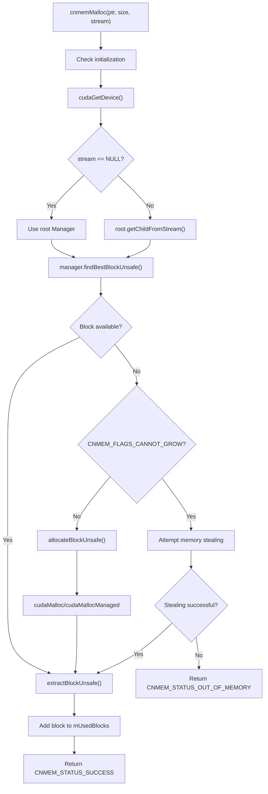

**Behavior Details:**
1. **Stream Selection**: NULL stream uses root manager, named streams use child managers
2. **Best Fit**: Searches free blocks for smallest adequate size
3. **Pool Growth**: If no free blocks and growth allowed, calls `cudaMalloc`
4. **Memory Stealing**: As last resort, steals blocks from other stream managers
5. **Size Alignment**: All allocations rounded up to `CNMEM_GRANULARITY` (512 bytes)
6. **Block Splitting**: Large blocks are split if significantly larger than request

**Returns:**
- `CNMEM_STATUS_SUCCESS`: Memory allocated successfully
- `CNMEM_STATUS_NOT_INITIALIZED`: cnmem not initialized
- `CNMEM_STATUS_INVALID_ARGUMENT`: Invalid pointer or arguments
- `CNMEM_STATUS_OUT_OF_MEMORY`: No memory available
- `CNMEM_STATUS_CUDA_ERROR`: CUDA runtime error

### cnmemFree

```c
cnmemStatus_t cnmemFree(void *ptr, cudaStream_t stream);
```

Releases previously allocated memory back to the pool. **Thread-safe**.

**Parameters:**
- `ptr`: Pointer to memory allocated by `cnmemMalloc` (NULL is ignored)
- `stream`: Stream used for original allocation

**Behavior:**
1. Locates memory block in manager's used block list
2. Removes block from used list
3. Adds block to free list in address-sorted order
4. Attempts block coalescing with adjacent free blocks

**Block Coalescing Rules:**
- Adjacent blocks can merge if they're contiguous in memory
- Cannot merge across `cudaMalloc` boundaries (head blocks)
- Maintains address-sorted free list for efficient coalescing

**Returns:**
- `CNMEM_STATUS_SUCCESS`: Memory released successfully  
- `CNMEM_STATUS_NOT_INITIALIZED`: cnmem not initialized
- `CNMEM_STATUS_INVALID_ARGUMENT`: Pointer not found in used blocks

Sources: [include/cnmem.h:204](), [include/cnmem.h:218](), [src/cnmem.cpp:1175-1246](), [src/cnmem.cpp:1250-1266]()

## Utility and Information Functions

### cnmemMemGetInfo

```c
cnmemStatus_t cnmemMemGetInfo(size_t *freeMem, size_t *totalMem, cudaStream_t stream);
```

Returns memory usage statistics for a specific manager. **Thread-safe**.

**Parameters:**
- `freeMem`: Output pointer for free memory amount
- `totalMem`: Output pointer for total managed memory
- `stream`: Stream to query (NULL for root manager)

**Behavior:**
- Iterates through free and used block lists
- Computes total memory as `freeMem + usedMem`
- Linear complexity in number of allocated blocks

**Returns:**
- `CNMEM_STATUS_SUCCESS`: Information retrieved
- `CNMEM_STATUS_NOT_INITIALIZED`: cnmem not initialized
- `CNMEM_STATUS_INVALID_ARGUMENT`: NULL output pointers

### cnmemPrintMemoryState

```c
cnmemStatus_t cnmemPrintMemoryState(FILE *file, cudaStream_t stream);
```

Outputs detailed memory manager state for debugging. **Thread-safe**.

**Parameters:**
- `file`: Output file handle (e.g., `stdout`, `stderr`)
- `stream`: Stream to examine (NULL for root manager)

**Output Format:**
```
>> [root/child] device=N, stream=0x..., used=XB, free=YB
| list="used", size=X
| | node=0x..., data=0x..., size=..., next=0x..., head=1/0
| list="free", size=Y
| | node=0x..., data=0x..., size=..., next=0x..., head=1/0
```

**Information Provided:**
- Manager type (root or child)
- Device and stream identifiers
- Used and free memory totals
- Detailed block-by-block listings
- Block addresses, sizes, and head flags

Sources: [include/cnmem.h:237](), [include/cnmem.h:252](), [src/cnmem.cpp:1270-1291](), [src/cnmem.cpp:1295-1307]()

## Constants and Macros

### Version Information

- `CNMEM_VERSION`: Integer version number (100 = version 1.0.0)

### Internal Constants

- `CNMEM_GRANULARITY`: Memory alignment boundary (512 bytes)

### API Export Macros

- `CNMEM_API`: Platform-specific function export decoration
- Platform-specific DLL export/import handling for Windows
- Visibility attributes for Linux/Unix systems

Sources: [include/cnmem.h:51](), [src/cnmem.cpp:48](), [include/cnmem.h:37-49]()

---

# Page: Initialization and Configuration

# Initialization and Configuration

<details>
<summary>Relevant source files</summary>

The following files were used as context for generating this wiki page:

- [include/cnmem.h](include/cnmem.h)
- [src/cnmem.cpp](src/cnmem.cpp)

</details>


This page covers the initialization and configuration of the cnmem library, including system setup, device configuration, reference counting, and stream management. This documentation focuses on the API functions and data structures used to initialize and configure the memory management system.

For information about memory allocation and deallocation operations, see [Memory Management Functions](#3.2). For details about the internal architecture created during initialization, see [Core Memory Management System](#4.1).

## Purpose and Scope

The initialization and configuration system establishes the cnmem memory management infrastructure by:

- Creating memory managers for specified CUDA devices
- Allocating initial memory pools on each device  
- Setting up stream-specific child managers
- Managing library lifetime through reference counting
- Providing configuration options through flags and device specifications

## Configuration Data Structures

### Device Configuration Structure

The `cnmemDevice_t` structure defines the configuration for each CUDA device:

| Field | Type | Description |
|-------|------|-------------|
| `device` | `int` | CUDA device number |
| `size` | `size_t` | Memory pool size (0 = auto-select half of device memory) |
| `numStreams` | `int` | Number of named streams for this device |
| `streams` | `cudaStream_t*` | Array of CUDA streams |
| `streamSizes` | `size_t*` | Memory sizes for each stream (optional) |

### Configuration Flags

The `cnmemManagerFlags_t` enum provides configuration options:

| Flag | Value | Description |
|------|-------|-------------|
| `CNMEM_FLAGS_DEFAULT` | 0 | Default behavior |
| `CNMEM_FLAGS_CANNOT_GROW` | 1 | Prevent memory pool growth |
| `CNMEM_FLAGS_CANNOT_STEAL` | 2 | Prevent memory stealing between managers |
| `CNMEM_FLAGS_MANAGED` | 4 | Use `cudaMallocManaged` for unified memory |

Sources: [include/cnmem.h:81-94](), [include/cnmem.h:71-77]()

## Configuration Structure Relationships

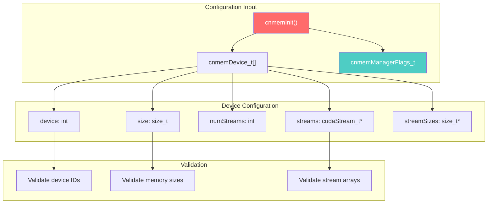

Sources: [src/cnmem.cpp:1071-1130](), [include/cnmem.h:81-94]()

## Initialization Process Flow

### Core Initialization Function

The `cnmemInit()` function orchestrates the complete system setup:

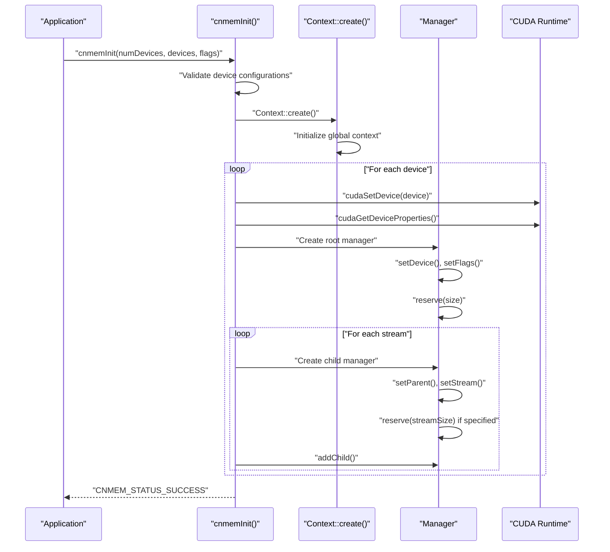

The initialization process creates a hierarchical structure of memory managers:

```mermaid
graph TB
    subgraph "Global Context"
        CONTEXT["Context"]
        REF_COUNT["Reference Counter"]
        MANAGERS["Manager Vector"]
    end
    
    subgraph "Device 0"
        ROOT0["Root Manager (Device 0)"]
        STREAM0_0["Child Manager (Stream 0)"]
        STREAM0_1["Child Manager (Stream 1)"]
    end
    
    subgraph "Device N"
        ROOTN["Root Manager (Device N)"]
        STREAMN_0["Child Manager (Stream 0)"]
        STREAMN_M["Child Manager (Stream M)"]
    end
    
    CONTEXT --> REF_COUNT
    CONTEXT --> MANAGERS
    MANAGERS --> ROOT0
    MANAGERS --> ROOTN
    
    ROOT0 --> STREAM0_0
    ROOT0 --> STREAM0_1
    ROOTN --> STREAMN_0
    ROOTN --> STREAMN_M
    
    style CONTEXT fill:#ff6b6b,color:#fff
    style ROOT0 fill:#4ecdc4,color:#fff
    style ROOTN fill:#4ecdc4,color:#fff
```

Sources: [src/cnmem.cpp:1071-1130](), [src/cnmem.cpp:966-1001](), [src/cnmem.cpp:1024-1028]()

## Reference Counting and Lifetime Management

### Context Management Functions

The library uses reference counting to manage its lifetime:

| Function | Purpose | Thread Safety |
|----------|---------|---------------|
| `cnmemRetain()` | Increment reference count | Thread-safe |
| `cnmemRelease()` | Decrement reference count | Thread-safe |
| `cnmemFinalize()` | Direct cleanup (calls `cnmemRelease()`) | Single-threaded |

### Reference Counting Implementation

```mermaid
stateDiagram-v2
    [*] --> Uninitialized
    Uninitialized --> Initialized : cnmemInit()
    Initialized --> Retained : cnmemRetain()
    Retained --> Retained : cnmemRetain() (refCount++)
    Retained --> Initialized : cnmemRelease() (refCount > 1)
    Initialized --> Destroyed : cnmemRelease() or cnmemFinalize()
    Destroyed --> [*]
    
    note right of Retained
        Multiple libraries/modules
        can safely retain references
    end note
```

The `Context` class manages this lifecycle:

- Initial reference count starts at 1 after `cnmemInit()`
- `cnmemRetain()` increments the counter atomically
- `cnmemRelease()` decrements and destroys when reaching 0
- Destruction releases all managers and CUDA memory

Sources: [src/cnmem.cpp:1039-1059](), [src/cnmem.cpp:1141-1151](), [src/cnmem.cpp:966-1001]()

## Stream Registration

### Dynamic Stream Addition

The `cnmemRegisterStream()` function allows adding streams after initialization:

```mermaid
graph LR
    APP["Application"] 
    API["cnmemRegisterStream()"]
    CURRENT_DEV["cudaGetDevice()"]
    ROOT_MGR["Root Manager"]
    CHILD_MGR["New Child Manager"]
    
    APP --> API
    API --> CURRENT_DEV
    API --> ROOT_MGR
    API --> CHILD_MGR
    CHILD_MGR --> ROOT_MGR
    
    subgraph "Manager Configuration"
        SET_PARENT["setParent(root)"]
        SET_DEVICE["setDevice(current)"]
        SET_STREAM["setStream(stream)"]
        SET_FLAGS["setFlags(inherit & ~CANNOT_GROW)"]
    end
    
    CHILD_MGR --> SET_PARENT
    CHILD_MGR --> SET_DEVICE  
    CHILD_MGR --> SET_STREAM
    CHILD_MGR --> SET_FLAGS
```

Key characteristics of dynamic stream registration:

- Creates child manager with current device context
- Inherits parent flags except `CNMEM_FLAGS_CANNOT_GROW`
- No initial memory reservation (relies on parent allocation)
- Thread-safe operation

Sources: [src/cnmem.cpp:1155-1171](), [include/cnmem.h:158-167]()

## Status Codes and Error Handling

### Initialization Status Codes

| Status | Description | Common Causes |
|--------|-------------|---------------|
| `CNMEM_STATUS_SUCCESS` | Operation completed successfully | - |
| `CNMEM_STATUS_INVALID_ARGUMENT` | Invalid input parameters | Invalid device ID, null pointers |
| `CNMEM_STATUS_OUT_OF_MEMORY` | Insufficient device memory | Requested size exceeds available memory |
| `CNMEM_STATUS_CUDA_ERROR` | CUDA runtime error | Device not available, driver issues |
| `CNMEM_STATUS_NOT_INITIALIZED` | Library not initialized | Called before `cnmemInit()` |

### Error String Conversion

The `cnmemGetErrorString()` function converts status codes to human-readable strings for debugging and logging purposes.

Sources: [src/cnmem.cpp:52-61](), [include/cnmem.h:59-67]()

## Memory Size Calculations

During initialization, the system performs memory size calculations and alignments:

- Device size defaults to 50% of total device memory if not specified
- All allocations are aligned to `CNMEM_GRANULARITY` (512 bytes)
- Stream sizes are individually aligned for optimal memory access patterns
- Memory prefetching is performed when using managed memory (`CNMEM_FLAGS_MANAGED`)

The granularity alignment ensures optimal memory access performance and satisfies CUDA alignment requirements.

Sources: [src/cnmem.cpp:48](), [src/cnmem.cpp:1100-1122](), [src/cnmem.cpp:184-187]()

---

# Page: Memory Management Functions

# Memory Management Functions

<details>
<summary>Relevant source files</summary>

The following files were used as context for generating this wiki page:

- [include/cnmem.h](include/cnmem.h)
- [src/cnmem.cpp](src/cnmem.cpp)

</details>


This page documents the core memory management functions that form the primary interface for allocating and deallocating GPU memory through cnmem. These functions provide stream-aware memory allocation with automatic pool management and memory stealing capabilities.

For information about library initialization and configuration, see [Initialization and Configuration](#3.1). For utility functions like memory information queries, see [Utility and Information Functions](#3.3).

## Core Memory Management Functions

The cnmem library provides three primary memory management functions that handle GPU memory allocation, deallocation, and stream registration.

### cnmemMalloc

```c
cnmemStatus_t cnmemMalloc(void **ptr, size_t size, cudaStream_t stream);
```

Allocates GPU memory from managed pools with automatic fallback strategies. The function employs a sophisticated allocation hierarchy that attempts multiple strategies to satisfy memory requests.

| Parameter | Type | Description |
|-----------|------|-------------|
| `ptr` | `void **` | Output pointer to allocated device memory |
| `size` | `size_t` | Number of bytes to allocate |
| `stream` | `cudaStream_t` | Target CUDA stream, or NULL for default stream |

**Return Values:**
- `CNMEM_STATUS_SUCCESS` - Memory allocated successfully
- `CNMEM_STATUS_NOT_INITIALIZED` - Library not initialized via `cnmemInit`
- `CNMEM_STATUS_INVALID_ARGUMENT` - Invalid parameters (e.g., `ptr == NULL`)
- `CNMEM_STATUS_OUT_OF_MEMORY` - No memory available after all strategies attempted
- `CNMEM_STATUS_CUDA_ERROR` - CUDA runtime error

**Sources:** [src/cnmem.cpp:1175-1246](), [include/cnmem.h:169-204]()

### cnmemFree

```c
cnmemStatus_t cnmemFree(void *ptr, cudaStream_t stream);
```

Releases memory back to the managed pool for reuse. The memory block is returned to the appropriate manager's free list and may be coalesced with adjacent free blocks.

| Parameter | Type | Description |
|-----------|------|-------------|
| `ptr` | `void *` | Pointer to device memory to free |
| `stream` | `cudaStream_t` | Associated CUDA stream, or NULL for default stream |

**Return Values:**
- `CNMEM_STATUS_SUCCESS` - Memory freed successfully
- `CNMEM_STATUS_NOT_INITIALIZED` - Library not initialized
- `CNMEM_STATUS_INVALID_ARGUMENT` - Invalid memory pointer
- `CNMEM_STATUS_CUDA_ERROR` - CUDA runtime error

**Sources:** [src/cnmem.cpp:1250-1266](), [include/cnmem.h:206-218]()

### cnmemRegisterStream

```c
cnmemStatus_t cnmemRegisterStream(cudaStream_t stream);
```

Registers a new CUDA stream with the memory management system, creating a dedicated child manager for stream-specific allocations.

| Parameter | Type | Description |
|-----------|------|-------------|
| `stream` | `cudaStream_t` | CUDA stream to register (must not be NULL) |

**Return Values:**
- `CNMEM_STATUS_SUCCESS` - Stream registered successfully
- `CNMEM_STATUS_NOT_INITIALIZED` - Library not initialized
- `CNMEM_STATUS_INVALID_ARGUMENT` - Invalid stream parameter

**Sources:** [src/cnmem.cpp:1155-1171](), [include/cnmem.h:158-167]()

## Memory Allocation Strategy Flow

The following diagram illustrates the allocation strategy employed by `cnmemMalloc`, showing the hierarchical decision process and fallback mechanisms.

```mermaid
flowchart TD
    Start["cnmemMalloc(ptr, size, stream)"] --> CheckInit["Check Context Initialized"]
    CheckInit --> GetDevice["cudaGetDevice(&device)"]
    GetDevice --> GetManager["Get Root Manager for Device"]
    
    GetManager --> StreamCheck{"stream != NULL?"}
    StreamCheck -->|Yes| GetChild["root.getChildFromStream(manager, stream)"]
    StreamCheck -->|No| UseRoot["manager = &root"]
    GetChild --> UseRoot
    
    UseRoot --> RoundSize["size = ceilInt(size, CNMEM_GRANULARITY)"]
    RoundSize --> TryAllocate["manager->allocate(ptr, size)"]
    
    TryAllocate --> AllocCheck{"Success?"}
    AllocCheck -->|Yes| Return["Return CNMEM_STATUS_SUCCESS"]
    AllocCheck -->|No| TrySteal["Attempt Memory Stealing"]
    
    TrySteal --> AcquireLocks["Lock All Child Managers"]
    AcquireLocks --> LockSuccess{"All Locks Acquired?"}
    LockSuccess -->|No| ReleaseLocks["Release Partial Locks"]
    ReleaseLocks --> ReturnError["Return CNMEM_STATUS_UNKNOWN_ERROR"]
    
    LockSuccess -->|Yes| LockRoot["Lock Root Manager"]
    LockRoot --> StealAttempt["manager->stealUnsafe(ptr, size)"]
    StealAttempt --> UnlockAll["Release All Locks"]
    UnlockAll --> StealCheck{"Steal Success?"}
    StealCheck -->|Yes| Return
    StealCheck -->|No| ReturnOOM["Return CNMEM_STATUS_OUT_OF_MEMORY"]
    
    style Start fill:#e1f5fe
    style Return fill:#c8e6c9
    style ReturnError fill:#ffcdd2
    style ReturnOOM fill:#ffcdd2
```

**Sources:** [src/cnmem.cpp:1175-1246](), [src/cnmem.cpp:462-497]()

## Manager Allocation Hierarchy

This diagram shows how memory allocation requests are routed through the hierarchical manager system and the internal allocation strategies within each manager.

```mermaid
flowchart TD
    subgraph "Device Level"
        RootMgr["Root Manager<br/>device=0"]
        Child1["Child Manager<br/>stream=stream1"]
        Child2["Child Manager<br/>stream=stream2"] 
        ChildN["Child Manager<br/>stream=streamN"]
    end
    
    subgraph "Manager::allocate() Internal Flow"
        FindBest["findBestBlockUnsafe(best, prev, size)"]
        BestFound{"best != NULL?"}
        CanGrow{"!(mFlags & CNMEM_FLAGS_CANNOT_GROW)?"}
        AllocBlock["allocateBlockUnsafe(best, prev, size)"]
        ExtractBlock["extractBlockUnsafe(best, prev, size, false)"]
        AddToUsed["Add to mUsedBlocks"]
        
        FindBest --> BestFound
        BestFound -->|Yes| ExtractBlock
        BestFound -->|No| CanGrow
        CanGrow -->|Yes| AllocBlock
        CanGrow -->|No| ReturnOOM["CNMEM_STATUS_OUT_OF_MEMORY"]
        AllocBlock --> ExtractBlock
        ExtractBlock --> AddToUsed
    end
    
    subgraph "allocateBlockUnsafe() Strategy"
        HasParent{"mParent != NULL?"}
        ParentAlloc["mParent->allocate(data, size)"]
        IsManaged{"mFlags & CNMEM_FLAGS_MANAGED?"}
        CudaMallocManaged["cudaMallocManaged(&data, size)"]
        CudaMalloc["cudaMalloc(&data, size)"]
        AddToFreeList["Add Block to mFreeBlocks"]
        
        HasParent -->|Yes| ParentAlloc
        HasParent -->|No| IsManaged
        IsManaged -->|Yes| CudaMallocManaged
        IsManaged -->|No| CudaMalloc
        ParentAlloc --> AddToFreeList
        CudaMallocManaged --> AddToFreeList
        CudaMalloc --> AddToFreeList
    end
    
    RootMgr --> Child1
    RootMgr --> Child2
    RootMgr --> ChildN
```

**Sources:** [src/cnmem.cpp:462-497](), [src/cnmem.cpp:501-543](), [src/cnmem.cpp:307-422]()

## Stream-Manager Mapping

The relationship between CUDA streams and memory managers is established through a parent-child hierarchy where each registered stream gets its own dedicated manager.

```mermaid
graph TD
    subgraph "Context Level"
        GlobalCtx["Global Context<br/>cnmem::Context"]
        Managers["std::vector&lt;Manager&gt; mManagers"]
    end
    
    subgraph "Device 0"
        Root0["Root Manager<br/>mDevice=0<br/>mStream=NULL<br/>mParent=NULL"]
        Stream0_1["Child Manager<br/>mDevice=0<br/>mStream=stream1<br/>mParent=Root0"]
        Stream0_2["Child Manager<br/>mDevice=0<br/>mStream=stream2<br/>mParent=Root0"]
    end
    
    subgraph "Device 1"
        Root1["Root Manager<br/>mDevice=1<br/>mStream=NULL<br/>mParent=NULL"]
        Stream1_1["Child Manager<br/>mDevice=1<br/>mStream=stream3<br/>mParent=Root1"]
    end
    
    GlobalCtx --> Managers
    Managers --> Root0
    Managers --> Root1
    Root0 --> Stream0_1
    Root0 --> Stream0_2
    Root1 --> Stream1_1
    
    subgraph "API Functions Mapping"
        RegStream["cnmemRegisterStream(stream)"]
        MallocCall["cnmemMalloc(ptr, size, stream)"]
        FreeCall["cnmemFree(ptr, stream)"]
        
        RegStream --> CreateChild["Create Child Manager<br/>root.addChild(child)"]
        MallocCall --> FindManager["root.getChildFromStream(manager, stream)"]
        FreeCall --> FindManager
    end
```

**Sources:** [src/cnmem.cpp:1155-1171](), [src/cnmem.cpp:588-600](), [src/cnmem.cpp:453-458]()

## Block Management and Memory Coalescing

When memory is freed via `cnmemFree`, the system employs sophisticated block coalescing to minimize fragmentation.

```mermaid
flowchart TD
    FreeCall["cnmemFree(ptr, stream)"] --> FindBlock["Find Block in mUsedBlocks"]
    FindBlock --> RemoveFromUsed["Remove from Used List"]
    RemoveFromUsed --> FindInsertPos["Find Position in mFreeBlocks"]
    FindInsertPos --> CheckCoalesce["Check Adjacent Blocks"]
    
    CheckCoalesce --> CheckPrev{"Can Merge with Previous?"}
    CheckPrev -->|Yes| MergePrev["prev->setSize(prev->getSize() + curr->getSize())<br/>delete curr<br/>curr = prev"]
    CheckPrev -->|No| InsertCurr["Insert curr into Free List"]
    MergePrev --> CheckNext
    InsertCurr --> CheckNext
    
    CheckNext{"Can Merge with Next?"}
    CheckNext -->|Yes| MergeNext["curr->setSize(curr->getSize() + next->getSize())<br/>curr->setNext(next->getNext())<br/>delete next"]
    CheckNext -->|No| SetNext["curr->setNext(next)"]
    
    MergeNext --> Done["Block Returned to Pool"]
    SetNext --> Done
    
    style Done fill:#c8e6c9
```

**Block Coalescing Rules:**
- Blocks can only be merged if they are physically adjacent in memory
- Merge boundaries cannot cross "head" blocks (blocks obtained directly from `cudaMalloc`)
- The `isHead()` flag prevents merging across allocation boundaries

**Sources:** [src/cnmem.cpp:797-842](), [src/cnmem.cpp:730-755]()

## Memory Granularity and Alignment

All memory allocations are rounded up to `CNMEM_GRANULARITY` (512 bytes) to ensure proper alignment and optimize memory pool management.

| Concept | Value | Purpose |
|---------|--------|---------|
| `CNMEM_GRANULARITY` | 512 bytes | Memory alignment boundary |
| `ceilInt(size, CNMEM_GRANULARITY)` | Rounds up allocation size | Prevents fragmentation |
| Stream size alignment | `CNMEM_GRANULARITY` | Ensures stream base addresses are aligned |

**Sources:** [src/cnmem.cpp:48](), [src/cnmem.cpp:1196](), [src/cnmem.cpp:1122]()

---

# Page: Utility and Information Functions

# Utility and Information Functions

<details>
<summary>Relevant source files</summary>

The following files were used as context for generating this wiki page:

- [include/cnmem.h](include/cnmem.h)
- [src/cnmem.cpp](src/cnmem.cpp)

</details>


This page documents the utility and information functions provided by cnmem for debugging, monitoring, and error handling. These functions complement the core memory management operations by providing visibility into memory usage, detailed state information for debugging, and human-readable error messages.

For core memory allocation and deallocation operations, see [Memory Management Functions](#3.2). For initialization and configuration, see [Initialization and Configuration](#3.1).

## Memory Usage Information

The `cnmemMemGetInfo` function provides runtime memory usage statistics for a specific stream or device, similar to CUDA's `cudaMemGetInfo` but scoped to cnmem's managed memory pools.

### Function Signature and Behavior

```c
cnmemStatus_t cnmemMemGetInfo(size_t *freeMem, size_t *totalMem, cudaStream_t stream)
```

The function operates by:

1. Resolving the appropriate `Manager` instance for the given stream
2. Acquiring the manager's mutex for thread-safe access
3. Computing free and used memory from the manager's block lists
4. Returning total memory as the sum of free and used memory

```mermaid
flowchart TD
    cnmemMemGetInfo["cnmemMemGetInfo(freeMem, totalMem, stream)"]
    Context["Context::get()"]
    RootManager["root.getManager(device)"]
    StreamManager["getChildFromStream(stream)"]
    
    Mutex["manager->getMutex()->lock()"]
    FreeMem["getFreeMemoryUnsafe(*freeMem)"]
    UsedMem["getUsedMemoryUnsafe(usedMem)"]
    CalcTotal["totalMem[0] = usedMem + freeMem[0]"]
    
    cnmemMemGetInfo --> Context
    Context --> RootManager
    RootManager --> StreamManager
    StreamManager --> Mutex
    Mutex --> FreeMem
    FreeMem --> UsedMem
    UsedMem --> CalcTotal
    
    CalcTotal --> Return["Return CNMEM_STATUS_SUCCESS"]
```

Sources: [src/cnmem.cpp:1270-1291](), [include/cnmem.h:224-237]()

### Memory Calculation Implementation

The underlying memory calculation traverses linked lists of memory blocks to compute total sizes:

| Function | Purpose | Complexity |
|----------|---------|------------|
| `getFreeMemoryUnsafe` | Sums sizes of all free blocks | O(n) where n = free blocks |
| `getUsedMemoryUnsafe` | Sums sizes of all used blocks | O(n) where n = used blocks |
| `getMemoryUnsafe` | Generic block list traversal | O(n) where n = blocks in list |

Sources: [src/cnmem.cpp:351-357](), [src/cnmem.cpp:618-624]()

## Memory State Debugging

The `cnmemPrintMemoryState` function provides detailed diagnostic information about the internal state of memory managers, printing comprehensive information about memory blocks to a specified file.

### Function Signature and Output Format

```c
cnmemStatus_t cnmemPrintMemoryState(FILE *file, cudaStream_t stream)
```

The function generates hierarchical output showing:

- Manager type (root or child), device ID, and stream identifier
- Used and free memory totals in bytes
- Detailed block-by-block information including addresses, sizes, and linkage

```mermaid
graph TD
    PrintState["cnmemPrintMemoryState(file, stream)"]
    Manager["manager->printMemoryState(file)"]
    
    subgraph "Manager Output"
        Header["Print manager header<br/>device, stream, used/free totals"]
        UsedList["printListUnsafe(file, \"used\", mUsedBlocks)"]
        FreeList["printListUnsafe(file, \"free\", mFreeBlocks)"]
        ParentRecurse["Recursively print parent state"]
    end
    
    subgraph "Block List Details"
        BlockTraverse["Traverse Block* linked list"]
        BlockInfo["Print node address, data pointer,<br/>size, next pointer, head flag"]
    end
    
    PrintState --> Manager
    Manager --> Header
    Header --> UsedList
    UsedList --> FreeList
    FreeList --> ParentRecurse
    
    UsedList --> BlockTraverse
    FreeList --> BlockTraverse
    BlockTraverse --> BlockInfo
```

Sources: [src/cnmem.cpp:1295-1307](), [src/cnmem.cpp:700-726]()

### Block List Output Format

The `printListUnsafe` method generates detailed information for each block in a linked list:

```mermaid
flowchart LR
    subgraph "32-bit Build"
        Format32["node=0x%08x, data=0x%08x,<br/>size=%u, next=0x%08x, head=%2u"]
    end
    
    subgraph "64-bit Build"
        Format64["node=0x%016lx, data=0x%016lx,<br/>size=%lu, next=0x%016lx, head=%2lu"]
    end
    
    subgraph "Block Fields"
        NodeAddr["Block object address"]
        DataAddr["Memory data pointer"]
        Size["Block size in bytes"]
        NextPtr["Next block in linked list"]
        HeadFlag["Is head block (from cudaMalloc)"]
    end
    
    Format32 --> NodeAddr
    Format64 --> NodeAddr
    NodeAddr --> DataAddr
    DataAddr --> Size
    Size --> NextPtr
    NextPtr --> HeadFlag
```

Sources: [src/cnmem.cpp:674-696]()

## Error String Conversion

The `cnmemGetErrorString` function provides human-readable descriptions of `cnmemStatus_t` error codes for debugging and user-facing error messages.

### Status Code Mapping

```c
const char* cnmemGetErrorString(cnmemStatus_t status)
```

| Status Code | String Representation |
|-------------|----------------------|
| `CNMEM_STATUS_SUCCESS` | "CNMEM_STATUS_SUCCESS" |
| `CNMEM_STATUS_CUDA_ERROR` | "CNMEM_STATUS_CUDA_ERROR" |
| `CNMEM_STATUS_INVALID_ARGUMENT` | "CNMEM_STATUS_INVALID_ARGUMENT" |
| `CNMEM_STATUS_NOT_INITIALIZED` | "CNMEM_STATUS_NOT_INITIALIZED" |
| `CNMEM_STATUS_OUT_OF_MEMORY` | "CNMEM_STATUS_OUT_OF_MEMORY" |
| Unknown values | "CNMEM_STATUS_UNKNOWN_ERROR" |

```mermaid
flowchart TD
    Input["cnmemStatus_t status"]
    Switch["switch(status)"]
    
    subgraph "Status Cases"
        Success["CNMEM_STATUS_SUCCESS"]
        CudaErr["CNMEM_STATUS_CUDA_ERROR"]
        InvalidArg["CNMEM_STATUS_INVALID_ARGUMENT"]
        NotInit["CNMEM_STATUS_NOT_INITIALIZED"]
        OutOfMem["CNMEM_STATUS_OUT_OF_MEMORY"]
        Default["default: CNMEM_STATUS_UNKNOWN_ERROR"]
    end
    
    Input --> Switch
    Switch --> Success
    Switch --> CudaErr
    Switch --> InvalidArg
    Switch --> NotInit
    Switch --> OutOfMem
    Switch --> Default
```

Sources: [src/cnmem.cpp:52-61](), [include/cnmem.h:59-67](), [include/cnmem.h:254-257]()

## Thread Safety and Performance Considerations

All utility functions maintain thread safety through appropriate mutex usage, but have performance implications:

| Function | Thread Safety | Performance Notes |
|----------|---------------|-------------------|
| `cnmemMemGetInfo` | Thread-safe via manager mutex | O(n) complexity - avoid in hot paths |
| `cnmemPrintMemoryState` | Thread-safe via manager mutex | Heavy I/O operation - debug use only |
| `cnmemGetErrorString` | Thread-safe (no shared state) | Constant time - safe for frequent use |

The mutex acquisition strategy ensures consistent memory state during information gathering:

```mermaid
sequenceDiagram
    participant App as "Application Thread"
    participant Func as "cnmemMemGetInfo"
    participant Mutex as "Manager Mutex"
    participant Manager as "Manager"
    
    App->>Func: cnmemMemGetInfo(freeMem, totalMem, stream)
    Func->>Manager: Resolve manager from stream
    Func->>Mutex: lock()
    Note over Mutex: Critical section begins
    Func->>Manager: getFreeMemoryUnsafe(*freeMem)
    Func->>Manager: getUsedMemoryUnsafe(usedMem)
    Note over Func: Calculate totalMem = usedMem + freeMem
    Func->>Mutex: unlock()
    Note over Mutex: Critical section ends
    Func-->>App: Return CNMEM_STATUS_SUCCESS
```

Sources: [src/cnmem.cpp:1283-1289](), [src/cnmem.cpp:701-720]()

## Integration with Internal Manager Hierarchy

These utility functions operate within cnmem's hierarchical manager system, where root managers handle device-level pools and child managers handle stream-specific allocations:

```mermaid
graph TB
    subgraph "Device Memory Manager"
        Root["Root Manager<br/>device=0, stream=NULL"]
        
        subgraph "Stream Managers"
            Child1["Child Manager<br/>stream=stream1"]
            Child2["Child Manager<br/>stream=stream2"]
        end
        
        Root --> Child1
        Root --> Child2
    end
    
    subgraph "Utility Function Access"
        MemInfo["cnmemMemGetInfo(freeMem, totalMem, stream)"]
        PrintState["cnmemPrintMemoryState(file, stream)"]
    end
    
    subgraph "Stream Resolution"
        NullStream["stream == NULL<br/>→ Root Manager"]
        NamedStream["stream != NULL<br/>→ Child Manager"]
    end
    
    MemInfo --> NullStream
    MemInfo --> NamedStream
    PrintState --> NullStream
    PrintState --> NamedStream
    
    NullStream --> Root
    NamedStream --> Child1
    NamedStream --> Child2
```

Sources: [src/cnmem.cpp:1276-1280](), [src/cnmem.cpp:1301-1305](), [src/cnmem.cpp:589-600]()

---

# Page: Architecture and Implementation

# Architecture and Implementation

<details>
<summary>Relevant source files</summary>

The following files were used as context for generating this wiki page:

- [src/cnmem.cpp](src/cnmem.cpp)

</details>


This document provides a detailed explanation of cnmem's internal architecture, core data structures, and implementation algorithms. It covers the hierarchical memory management system, allocation strategies, and synchronization mechanisms that enable efficient CUDA memory pooling.

For information about the public API and how to use cnmem, see [API Reference](#3). For details about building and testing the system, see [Getting Started](#2) and [Testing and Validation](#5).

## Core System Architecture

cnmem is built around four primary C++ classes that work together to provide hierarchical memory management with thread-safe operations and efficient memory pooling.

```mermaid
classDiagram
    class Context {
        -int mRefCount
        -Mutex mMutex
        -vector~Manager~ mManagers
        -static Context* sCtx
        -static int sCtxCheck
        +create() cnmemStatus_t
        +get() Context*
        +retain() cnmemStatus_t
        +release() cnmemStatus_t
        +getManager(int) Manager&
    }
    
    class Manager {
        -Manager* mParent
        -vector~Manager*~ mChildren
        -int mDevice
        -cudaStream_t mStream
        -bool mIsStreamBlocking
        -Block* mUsedBlocks
        -Block* mFreeBlocks
        -size_t mSize
        -unsigned mFlags
        -Mutex mMutex
        +allocate(void*&, size_t, bool) cnmemStatus_t
        +release(void*) cnmemStatus_t
        +reserve(size_t) cnmemStatus_t
        +stealUnsafe(void*&, size_t) cnmemStatus_t
        +addChild(Manager*) cnmemStatus_t
        +getChildFromStream(Manager*&, cudaStream_t) cnmemStatus_t
    }
    
    class Block {
        -char* mData
        -size_t mSize
        -Block* mNext
        -bool mIsHead
        +getData() char*
        +getSize() size_t
        +getNext() Block*
        +isHead() bool
        +setNext(Block*) void
        +setSize(size_t) void
    }
    
    class Mutex {
        -CRITICAL_SECTION mCriticalSection
        -pthread_mutex_t mMutex
        +initialize() cnmemStatus_t
        +finalize() cnmemStatus_t
        +lock() cnmemStatus_t
        +unlock() cnmemStatus_t
    }
    
    Context "1" --> "*" Manager : manages
    Manager "1" --> "*" Manager : parent-child
    Manager "1" --> "*" Block : owns used/free lists
    Manager "1" --> "1" Mutex : synchronizes
    Context "1" --> "1" Mutex : synchronizes
```

**Sources:** [src/cnmem.cpp:966-1001](), [src/cnmem.cpp:307-422](), [src/cnmem.cpp:262-303](), [src/cnmem.cpp:191-207]()

## Global Context Management

The `Context` class implements a singleton pattern with reference counting to manage the global state of cnmem. It maintains a vector of root `Manager` instances, one per GPU device.

| Component | Purpose | Key Methods |
|-----------|---------|-------------|
| `Context::sCtx` | Static singleton instance | `Context::get()` |
| `Context::sCtxCheck` | Magic number validation | `Context::check()` |
| `mRefCount` | Reference counting for cleanup | `retain()`, `release()` |
| `mManagers` | Vector of device managers | `getManager(int)` |

The context lifecycle follows this pattern:
1. `cnmemInit()` calls `Context::create()` to instantiate the singleton
2. Each `cnmemRetain()` increments the reference count
3. Each `cnmemRelease()` decrements the reference count
4. When reference count reaches zero, the context and all managers are destroyed

**Sources:** [src/cnmem.cpp:966-1001](), [src/cnmem.cpp:1024-1059](), [src/cnmem.cpp:1071-1130]()

## Hierarchical Memory Management System

cnmem implements a two-level hierarchy where root managers handle device-level memory pools and child managers handle stream-specific allocations.

```mermaid
graph TD
    subgraph "Device 0"
        RM0["Root Manager (Device 0)<br/>mDevice=0<br/>mStream=NULL<br/>mParent=NULL"]
        CM0_S1["Child Manager<br/>mStream=stream1<br/>mParent=RM0"]
        CM0_S2["Child Manager<br/>mStream=stream2<br/>mParent=RM0"]
        CM0_SN["Child Manager<br/>mStream=streamN<br/>mParent=RM0"]
    end
    
    subgraph "Device 1"
        RM1["Root Manager (Device 1)<br/>mDevice=1<br/>mStream=NULL<br/>mParent=NULL"]
        CM1_S1["Child Manager<br/>mStream=stream1<br/>mParent=RM1"]
        CM1_S2["Child Manager<br/>mStream=stream2<br/>mParent=RM1"]
    end
    
    subgraph "CUDA Memory"
        CUDA0["cudaMalloc()<br/>Device 0 Global Memory"]
        CUDA1["cudaMalloc()<br/>Device 1 Global Memory"]
    end
    
    RM0 --> CM0_S1
    RM0 --> CM0_S2
    RM0 --> CM0_SN
    RM1 --> CM1_S1
    RM1 --> CM1_S2
    
    RM0 -.->|"allocates from"| CUDA0
    RM1 -.->|"allocates from"| CUDA1
    
    CM0_S1 -.->|"requests from parent"| RM0
    CM0_S2 -.->|"requests from parent"| RM0
    CM1_S1 -.->|"requests from parent"| RM1
```

### Root Manager Responsibilities

Root managers (`mParent == NULL`) handle:
- Direct allocation from CUDA via `cudaMalloc()` or `cudaMallocManaged()`
- Large memory pools initialized during `cnmemInit()`
- Parent-level memory stealing coordination
- Device-specific memory management

### Child Manager Responsibilities  

Child managers (`mParent != NULL`) handle:
- Stream-specific memory allocations
- Requesting memory from their parent root manager
- Local memory stealing from siblings
- Stream synchronization via `mIsStreamBlocking`

**Sources:** [src/cnmem.cpp:307-422](), [src/cnmem.cpp:501-543](), [src/cnmem.cpp:1095-1127]()

## Block Management and Memory Layout

Memory is managed through linked lists of `Block` objects that represent contiguous memory regions. Each manager maintains separate lists for used and free blocks.

```mermaid
graph LR
    subgraph "Manager Memory Lists"
        subgraph "Free Blocks (mFreeBlocks)"
            FB1["Block<br/>mData=0x1000<br/>mSize=512<br/>mIsHead=true"]
            FB2["Block<br/>mData=0x1400<br/>mSize=1024<br/>mIsHead=false"]
            FB3["Block<br/>mData=0x2000<br/>mSize=256<br/>mIsHead=true"]
        end
        
        subgraph "Used Blocks (mUsedBlocks)"
            UB1["Block<br/>mData=0x1200<br/>mSize=256<br/>mIsHead=false"]
            UB2["Block<br/>mData=0x1800<br/>mSize=512<br/>mIsHead=false"]
        end
    end
    
    subgraph "GPU Memory Layout"
        MEM1["0x1000<br/>512 bytes<br/>FREE"]
        MEM2["0x1200<br/>256 bytes<br/>USED"]
        MEM3["0x1400<br/>1024 bytes<br/>FREE"]
        MEM4["0x1800<br/>512 bytes<br/>USED"]
        MEM5["0x2000<br/>256 bytes<br/>FREE"]
    end
    
    FB1 --> FB2
    FB2 --> FB3
    UB1 --> UB2
    
    FB1 -.->|points to| MEM1
    UB1 -.->|points to| MEM2
    FB2 -.->|points to| MEM3
    UB2 -.->|points to| MEM4
    FB3 -.->|points to| MEM5
```

### Block Properties

| Field | Purpose | Values |
|-------|---------|---------|
| `mData` | Pointer to GPU memory region | Device memory address |
| `mSize` | Size of memory block in bytes | Multiple of `CNMEM_GRANULARITY` (512) |
| `mNext` | Next block in linked list | `Block*` or `NULL` |
| `mIsHead` | Indicates block from `cudaMalloc()` | `true` for allocation boundaries |

### Memory Allocation Algorithm

The allocation process in `Manager::allocate()` follows this sequence:

1. **Find Best Fit**: `findBestBlockUnsafe()` searches free list for smallest block ≥ requested size
2. **Allocate New Block**: If no suitable block exists and `CNMEM_FLAGS_CANNOT_GROW` is not set, call `allocateBlockUnsafe()`
3. **Extract Block**: `extractBlockUnsafe()` removes block from free list, splitting if necessary
4. **Move to Used List**: Block is moved to `mUsedBlocks` linked list
5. **Return Pointer**: Return `mData` pointer to application

**Sources:** [src/cnmem.cpp:262-303](), [src/cnmem.cpp:462-497](), [src/cnmem.cpp:575-585](), [src/cnmem.cpp:547-571]()

## Memory Stealing Mechanism

When a manager cannot satisfy an allocation request from its own pools, cnmem implements a memory stealing algorithm to acquire memory from other managers.

```mermaid
sequenceDiagram
    participant App as "Application"
    participant CM as "Child Manager"
    participant RM as "Root Manager"
    participant CM2 as "Sibling Child Manager"
    
    App->>CM: cnmemMalloc(size)
    CM->>CM: findBestBlockUnsafe() → NULL
    CM->>CM: allocateBlockUnsafe() → OUT_OF_MEMORY
    
    Note over App,CM2: Memory Stealing Phase
    CM->>RM: Acquire all child mutexes
    RM->>CM2: giveBlockUnsafe(size)
    CM2->>CM2: findBestBlockUnsafe()
    CM2->>CM2: extractBlockUnsafe()
    CM2->>RM: return block data
    RM->>CM: stealUnsafe() creates new Block
    CM->>App: return memory pointer
```

### Stealing Process Details

The stealing mechanism involves multiple phases:

1. **Lock Acquisition**: `cnmemMalloc()` acquires locks on all child managers to prevent races
2. **Victim Selection**: `stealBlockUnsafe()` iterates through child managers seeking available blocks  
3. **Block Transfer**: `giveBlockUnsafe()` synchronizes the victim stream and transfers the block
4. **Block Splitting**: The root manager updates its used block list to reflect the stolen region
5. **Memory Handoff**: The requesting manager receives the stolen memory as a new allocation

### Thread Safety During Stealing

The stealing process requires careful lock ordering to prevent deadlocks:
- Child manager mutexes are acquired first in order
- Root manager mutex is acquired after all children
- If any lock acquisition fails, all acquired locks are released

**Sources:** [src/cnmem.cpp:1201-1245](), [src/cnmem.cpp:857-888](), [src/cnmem.cpp:892-962](), [src/cnmem.cpp:648-670]()

## Thread Synchronization Architecture

cnmem provides thread-safe memory management through per-manager mutexes and careful lock ordering. The `Mutex` class abstracts platform-specific synchronization primitives.

| Platform | Implementation | Lock Type |
|----------|---------------|-----------|
| Windows | `CRITICAL_SECTION` | Reentrant critical section |
| POSIX | `pthread_mutex_t` | Standard mutex |

### Synchronization Patterns

1. **Per-Manager Locking**: Each `Manager` has its own `Mutex` to minimize contention
2. **Lock Ordering**: Child mutexes acquired before parent mutexes during stealing
3. **RAII-style Unlocking**: `CNMEM_CHECK_OR_UNLOCK` macro ensures cleanup on errors
4. **Stream Synchronization**: Non-blocking streams require explicit `cudaStreamSynchronize()`

### Memory Coalescing

When blocks are released via `Manager::release()`, the system attempts to merge adjacent free blocks:

1. **Find Insertion Point**: Locate position in sorted free list based on memory address
2. **Merge Predecessor**: If previous block is adjacent, merge and delete current block
3. **Merge Successor**: If next block is adjacent, merge and delete next block  
4. **Boundary Respect**: Merging cannot cross `mIsHead=true` boundaries (original `cudaMalloc()` boundaries)

**Sources:** [src/cnmem.cpp:191-258](), [src/cnmem.cpp:462-497](), [src/cnmem.cpp:730-755](), [src/cnmem.cpp:797-842]()

## Memory Granularity and Alignment

cnmem enforces consistent memory alignment through the `CNMEM_GRANULARITY` constant set to 512 bytes. All allocation sizes are rounded up using `ceilInt()` to ensure:

- Optimal GPU memory access patterns
- Consistent block boundaries for coalescing
- Alignment with CUDA's preferred memory access granularity

The granularity affects:
- Initial pool sizes during `cnmemInit()`
- All allocation requests via `cnmemMalloc()`
- Stream-specific pool sizes when specified

**Sources:** [src/cnmem.cpp:48](), [src/cnmem.cpp:184-187](), [src/cnmem.cpp:1110](), [src/cnmem.cpp:1196]()

---

# Page: Core Memory Management System

# Core Memory Management System

<details>
<summary>Relevant source files</summary>

The following files were used as context for generating this wiki page:

- [src/cnmem.cpp](src/cnmem.cpp)

</details>


This document covers the fundamental classes and data structures that implement cnmem's memory management functionality. It focuses on the `Block`, `Manager`, `Context`, and `Mutex` classes and their core allocation algorithms. For information about the hierarchical parent-child manager relationships and memory stealing mechanisms, see [Hierarchical Managers and Memory Stealing](#4.2).

## Overview of Core Classes

The cnmem core memory management system consists of four primary classes that work together to provide efficient CUDA memory allocation:

```mermaid
classDiagram
    class Block {
        -char* mData
        -size_t mSize  
        -Block* mNext
        -bool mIsHead
        +getData() char*
        +getSize() size_t
        +getNext() Block*
        +isHead() bool
    }
    
    class Manager {
        -Manager* mParent
        -vector~Manager*~ mChildren
        -int mDevice
        -cudaStream_t mStream
        -Block* mUsedBlocks
        -Block* mFreeBlocks
        -Mutex mMutex
        +allocate() cnmemStatus_t
        +release() cnmemStatus_t
        +reserve() cnmemStatus_t
        +stealUnsafe() cnmemStatus_t
    }
    
    class Context {
        -int mRefCount
        -Mutex mMutex
        -vector~Manager~ mManagers
        -static Context* sCtx
        +static create() cnmemStatus_t
        +static get() Context*
        +static retain() cnmemStatus_t
        +static release() cnmemStatus_t
    }
    
    class Mutex {
        -CRITICAL_SECTION mCriticalSection
        -pthread_mutex_t mMutex
        +initialize() cnmemStatus_t
        +lock() cnmemStatus_t
        +unlock() cnmemStatus_t
    }
    
    Manager --> Block : "manages"
    Manager --> Mutex : "uses"
    Context --> Manager : "contains"
    Context --> Mutex : "uses"
```

**Sources:** [src/cnmem.cpp:262-303](), [src/cnmem.cpp:307-422](), [src/cnmem.cpp:966-1001](), [src/cnmem.cpp:191-207]()

## Block Class - Memory Block Representation

The `Block` class represents individual memory blocks in linked lists. Each block contains metadata about a contiguous region of CUDA device memory.

### Block Structure and Properties

| Field | Type | Purpose |
|-------|------|---------|
| `mData` | `char*` | Pointer to device memory region |
| `mSize` | `size_t` | Size of memory block in bytes |
| `mNext` | `Block*` | Next block in linked list |
| `mIsHead` | `bool` | Whether block was allocated from `cudaMalloc` |

The `mIsHead` flag is critical for memory management - it indicates whether a block represents the start of a region obtained directly from CUDA or a subdivision of a larger block. Head blocks cannot be merged across boundaries during deallocation.

```mermaid
graph LR
    subgraph "Free Block List"
        FreeBlock1["Block1<br/>mData: 0x1000<br/>mSize: 512<br/>mIsHead: true"] --> FreeBlock2["Block2<br/>mData: 0x1200<br/>mSize: 256<br/>mIsHead: false"]
        FreeBlock2 --> FreeBlock3["Block3<br/>mData: 0x1400<br/>mSize: 1024<br/>mIsHead: true"]
    end
    
    subgraph "Used Block List"  
        UsedBlock1["Block4<br/>mData: 0x1300<br/>mSize: 128<br/>mIsHead: false"] --> UsedBlock2["Block5<br/>mData: 0x1500<br/>mSize: 512<br/>mIsHead: false"]
    end
```

**Sources:** [src/cnmem.cpp:262-303]()

## Manager Class - Core Allocation Engine

The `Manager` class implements the core memory allocation and deallocation logic. Each manager maintains separate linked lists for used and free blocks and provides thread-safe access through an embedded mutex.

### Manager State and Configuration

```mermaid
graph TD
    subgraph "Manager Configuration"
        Device["mDevice: int<br/>CUDA device ID"]
        Stream["mStream: cudaStream_t<br/>Associated stream"]
        Flags["mFlags: unsigned<br/>Allocation behavior"]
        Size["mSize: size_t<br/>Managed memory size"]
    end
    
    subgraph "Manager Hierarchy"
        Parent["mParent: Manager*<br/>Parent manager"]
        Children["mChildren: vector&lt;Manager*&gt;<br/>Child managers"]
    end
    
    subgraph "Block Lists"
        UsedBlocks["mUsedBlocks: Block*<br/>Allocated blocks"]
        FreeBlocks["mFreeBlocks: Block*<br/>Available blocks"]
    end
    
    subgraph "Thread Safety"
        Mutex["mMutex: Mutex<br/>Synchronization"]
    end
```

**Sources:** [src/cnmem.cpp:307-329]()

### Memory Allocation Algorithm

The core allocation process in `Manager::allocate()` follows a best-fit strategy:

```mermaid
flowchart TD
    Start["allocate(void*& ptr, size_t size)"] --> Lock["Acquire mutex lock"]
    Lock --> Sync{Stream blocking?}
    Sync -->|No| StreamSync["cudaStreamSynchronize(mStream)"]
    Sync -->|Yes| FindBest["findBestBlockUnsafe()"]
    StreamSync --> FindBest
    
    FindBest --> HasBlock{Block found?}
    HasBlock -->|Yes| Extract["extractBlockUnsafe()"]
    HasBlock -->|No| CanGrow{Can grow pool?}
    
    CanGrow -->|Yes| AllocNew["allocateBlockUnsafe()"]
    CanGrow -->|No| OutOfMem["Return OUT_OF_MEMORY"]
    
    AllocNew --> Extract
    Extract --> AddUsed["Add block to mUsedBlocks"]
    AddUsed --> SetPtr["Set ptr = block->getData()"]
    SetPtr --> Unlock["Release mutex lock"]
    Unlock --> Success["Return SUCCESS"]
```

The `findBestBlockUnsafe()` method implements a best-fit algorithm by scanning the free list for the smallest block that satisfies the size requirement:

**Sources:** [src/cnmem.cpp:462-497](), [src/cnmem.cpp:575-585]()

### Memory Deallocation and Block Merging

The deallocation process in `Manager::release()` includes sophisticated block merging to reduce fragmentation:

```mermaid
flowchart TD
    Start["release(void* ptr)"] --> FindUsed["Find block in mUsedBlocks"]
    FindUsed --> RemoveUsed["Remove from used list"]
    RemoveUsed --> FindPos["Find insertion position in free list"]
    
    FindPos --> CheckMergePrev{Can merge with<br/>previous block?}
    CheckMergePrev -->|Yes| MergePrev["Merge with previous<br/>Update size, delete current"]
    CheckMergePrev -->|No| InsertFree["Insert in free list"]
    
    MergePrev --> CheckMergeNext{Can merge with<br/>next block?}
    InsertFree --> CheckMergeNext
    
    CheckMergeNext -->|Yes| MergeNext["Merge with next<br/>Update size, delete next"]
    CheckMergeNext -->|No| Complete["Block merge complete"]
    
    MergeNext --> Complete
```

Block merging is constrained by head boundaries - blocks marked with `mIsHead = true` represent `cudaMalloc` boundaries and cannot be merged across:

**Sources:** [src/cnmem.cpp:730-755](), [src/cnmem.cpp:797-842]()

## Context Class - Global Manager Coordination

The `Context` class provides a singleton pattern for managing all memory managers across multiple CUDA devices. It implements reference counting for safe initialization and cleanup.

### Context Lifecycle Management

```mermaid
stateDiagram-v2
    [*] --> Uninitialized : Initial state
    Uninitialized --> Initialized : Context::create()
    Initialized --> Retained : Context::retain()
    Retained --> Initialized : Context::release()
    Initialized --> [*] : Context::release() (refCount = 0)
    
    note right of Initialized
        sCtx points to Context instance
        sCtxCheck = CTX_VALID (0x1f5632a3)
        mRefCount starts at 1
    end note
```

The context maintains a vector of managers indexed by device ID, allowing direct access to device-specific memory managers:

| Method | Purpose |
|--------|---------|
| `create()` | Initialize global singleton context |
| `get()` | Retrieve global context pointer |  
| `retain()` | Increment reference count |
| `release()` | Decrement reference count, destroy if zero |
| `getManager(int)` | Access device-specific manager |

**Sources:** [src/cnmem.cpp:966-1001](), [src/cnmem.cpp:1024-1059]()

## Thread Synchronization with Mutex Class

The `Mutex` class provides cross-platform thread synchronization using Windows Critical Sections or POSIX pthread mutexes:

```mermaid
graph TD
    subgraph "Windows Implementation"
        WinMutex["CRITICAL_SECTION mCriticalSection"]
        WinInit["InitializeCriticalSection()"]
        WinLock["EnterCriticalSection()"] 
        WinUnlock["LeaveCriticalSection()"]
        WinDestroy["DeleteCriticalSection()"]
    end
    
    subgraph "POSIX Implementation"
        PosixMutex["pthread_mutex_t mMutex"]
        PosixInit["pthread_mutex_init()"]
        PosixLock["pthread_mutex_lock()"]
        PosixUnlock["pthread_mutex_unlock()"]
        PosixDestroy["pthread_mutex_destroy()"]
    end
    
    subgraph "Common Interface"
        Initialize["initialize()"]
        Lock["lock()"]
        Unlock["unlock()"]
        Finalize["finalize()"]
    end
    
    Initialize -.-> WinInit
    Initialize -.-> PosixInit
    Lock -.-> WinLock  
    Lock -.-> PosixLock
    Unlock -.-> WinUnlock
    Unlock -.-> PosixUnlock
    Finalize -.-> WinDestroy
    Finalize -.-> PosixDestroy
```

**Sources:** [src/cnmem.cpp:191-258]()

## Memory Pool Growth and CUDA Integration

When free memory is exhausted, managers can grow their pools by allocating new blocks from their parent manager or directly from CUDA:

```mermaid
flowchart TD
    NeedMemory["Need memory block"] --> HasParent{Has parent<br/>manager?}
    
    HasParent -->|Yes| ParentAlloc["parent->allocate(data, size)"]
    HasParent -->|No| CheckManaged{CNMEM_FLAGS_MANAGED?}
    
    CheckManaged -->|Yes| CudaMallocManaged["cudaMallocManaged(&data, size)<br/>cudaMemPrefetchAsync(data, size, mDevice)"]
    CheckManaged -->|No| CudaMalloc["cudaMalloc(&data, size)"]
    
    ParentAlloc --> CreateBlock["Create new Block(data, size, next, true)"]
    CudaMallocManaged --> CreateBlock
    CudaMalloc --> CreateBlock
    
    CreateBlock --> InsertSorted["Insert into free list<br/>(sorted by address)"]
    InsertSorted --> Ready["Block ready for allocation"]
```

The allocation granularity is controlled by `CNMEM_GRANULARITY` (512 bytes), ensuring all allocations are aligned to this boundary for optimal memory access patterns.

**Sources:** [src/cnmem.cpp:501-543](), [src/cnmem.cpp:48]()

---

# Page: Hierarchical Managers and Memory Stealing

# Hierarchical Managers and Memory Stealing

<details>
<summary>Relevant source files</summary>

The following files were used as context for generating this wiki page:

- [src/cnmem.cpp](src/cnmem.cpp)

</details>


This document explains cnmem's hierarchical memory management architecture and the memory stealing mechanisms that enable efficient memory sharing between different CUDA streams and contexts. This page focuses on the parent-child manager relationships and inter-manager memory transfers. For information about the core data structures and basic allocation algorithms, see [Core Memory Management System](#4.1).

## Manager Hierarchy Architecture

The cnmem library implements a two-level hierarchy of memory managers to handle both device-level and stream-level memory allocation efficiently.

### Hierarchy Structure

```mermaid
graph TD
    CTX["Context"]
    DEV0["Device 0 Root Manager<br/>mParent = NULL<br/>mStream = NULL"]
    DEV1["Device 1 Root Manager<br/>mParent = NULL<br/>mStream = NULL"]
    
    STREAM0["Stream A Child Manager<br/>mParent = Device 0<br/>mStream = streamA"]
    STREAM1["Stream B Child Manager<br/>mParent = Device 0<br/>mStream = streamB"]
    STREAM2["Stream C Child Manager<br/>mParent = Device 1<br/>mStream = streamC"]
    
    CTX --> DEV0
    CTX --> DEV1
    DEV0 --> STREAM0
    DEV0 --> STREAM1
    DEV1 --> STREAM2
    
    DEV0_BLOCKS["Free Blocks:<br/>- Large CUDA allocations<br/>Used Blocks:<br/>- Stream allocations"]
    STREAM0_BLOCKS["Free Blocks:<br/>- Available stream memory<br/>Used Blocks:<br/>- Active allocations"]
    
    DEV0 -.-> DEV0_BLOCKS
    STREAM0 -.-> STREAM0_BLOCKS
```

**Sources:** [src/cnmem.cpp:307-312](), [src/cnmem.cpp:1092-1127](), [src/cnmem.cpp:1113-1126]()

### Root Managers (Device Level)

Root managers are created during `cnmemInit` for each GPU device and handle the primary memory pools:

| Property | Value | Purpose |
|----------|-------|---------|
| `mParent` | `NULL` | Indicates root-level manager |
| `mDevice` | Device ID | GPU device association |
| `mStream` | `NULL` | No specific stream binding |
| Memory Source | `cudaMalloc`/`cudaMallocManaged` | Direct CUDA allocation |

Root managers perform initial memory reservation using `reserve()` and serve as the ultimate source for memory blocks through `allocateBlockUnsafe()`.

**Sources:** [src/cnmem.cpp:1106-1111](), [src/cnmem.cpp:501-543](), [src/cnmem.cpp:846-853]()

### Child Managers (Stream Level)

Child managers are created for each CUDA stream and inherit memory from their parent root manager:

| Property | Value | Purpose |
|----------|-------|---------|
| `mParent` | Root manager pointer | Hierarchy linkage |
| `mDevice` | Same as parent | Device consistency |
| `mStream` | Specific `cudaStream_t` | Stream association |
| Memory Source | Parent allocation | Inherited memory blocks |

Child managers can optionally pre-reserve memory during initialization using `streamSizes` configuration.

**Sources:** [src/cnmem.cpp:1113-1126](), [src/cnmem.cpp:1155-1171]()

## Memory Stealing Mechanism

Memory stealing allows managers to acquire memory blocks from other managers when their own pools are exhausted, enabling dynamic load balancing across streams.

### Stealing Flow Diagram

```mermaid
flowchart TD
    ALLOC_REQUEST["cnmemMalloc Request<br/>Size: N bytes"]
    FIND_MANAGER["Find Target Manager<br/>Based on cudaStream_t"]
    LOCAL_ALLOC["manager->allocate()"]
    CHECK_FREE["Check Free Blocks<br/>findBestBlockUnsafe()"]
    
    HAS_FREE{"Free Block<br/>Available?"}
    CAN_GROW{"Can Grow?<br/>!(CNMEM_FLAGS_CANNOT_GROW)"}
    GROW_POOL["allocateBlockUnsafe()<br/>Request from Parent/CUDA"]
    
    TRY_STEAL["Try Memory Stealing<br/>Lock All Children"]
    STEAL_CALL["manager->stealUnsafe()"]
    STEAL_FROM_CHILDREN["stealBlockUnsafe()<br/>Iterate mChildren"]
    GIVE_BLOCK["child->giveBlockUnsafe()"]
    
    SUCCESS["Return Memory Pointer"]
    OOM["CNMEM_STATUS_OUT_OF_MEMORY"]
    
    ALLOC_REQUEST --> FIND_MANAGER
    FIND_MANAGER --> LOCAL_ALLOC
    LOCAL_ALLOC --> CHECK_FREE
    CHECK_FREE --> HAS_FREE
    
    HAS_FREE -->|Yes| SUCCESS
    HAS_FREE -->|No| CAN_GROW
    CAN_GROW -->|Yes| GROW_POOL
    CAN_GROW -->|No| TRY_STEAL
    GROW_POOL --> SUCCESS
    
    TRY_STEAL --> STEAL_CALL
    STEAL_CALL --> STEAL_FROM_CHILDREN
    STEAL_FROM_CHILDREN --> GIVE_BLOCK
    GIVE_BLOCK -->|Success| SUCCESS
    GIVE_BLOCK -->|Failure| OOM
```

**Sources:** [src/cnmem.cpp:1175-1246](), [src/cnmem.cpp:857-888](), [src/cnmem.cpp:892-962]()

### Stealing Implementation Details

#### `stealUnsafe()` Method

The primary stealing interface that child managers use to acquire memory from siblings:

```mermaid
graph LR
    CHILD["Child Manager<br/>(Out of Memory)"]
    STEAL["stealUnsafe(size)"]
    CHECK_FLAGS["Check CNMEM_FLAGS_CANNOT_STEAL"]
    TRY_CHILDREN["Try stealBlockUnsafe()<br/>from mChildren"]
    TRY_PARENT["Try parent->stealBlockUnsafe()"]
    CREATE_BLOCK["Create new Block<br/>in mUsedBlocks"]
    
    CHILD --> STEAL
    STEAL --> CHECK_FLAGS
    CHECK_FLAGS --> TRY_CHILDREN
    TRY_CHILDREN --> TRY_PARENT
    TRY_PARENT --> CREATE_BLOCK
```

**Sources:** [src/cnmem.cpp:857-888]()

#### `giveBlockUnsafe()` Method

Called by child managers to surrender memory blocks to other managers:

1. **Stream Synchronization**: `cudaStreamSynchronize(mStream)` ensures block is not in use
2. **Block Selection**: `findBestBlockUnsafe()` finds suitable free block
3. **Block Extraction**: `extractBlockUnsafe()` removes block from free list
4. **Memory Transfer**: Returns block data and size to requesting manager

**Sources:** [src/cnmem.cpp:648-670](), [src/cnmem.cpp:575-584](), [src/cnmem.cpp:547-571]()

### Multi-Threading and Lock Management

Memory stealing requires careful lock coordination to prevent race conditions:

```mermaid
sequenceDiagram
    participant REQ as "Requesting Manager"
    participant ROOT as "Root Manager"
    participant CHILD1 as "Child Manager 1"
    participant CHILD2 as "Child Manager 2"
    
    REQ->>ROOT: Lock acquisition attempt
    ROOT->>CHILD1: Lock child mutex
    ROOT->>CHILD2: Lock child mutex
    
    Note over ROOT,CHILD2: All locks acquired successfully
    
    REQ->>CHILD1: Try giveBlockUnsafe()
    alt Block Available
        CHILD1-->>REQ: Return memory block
    else No Block Available
        REQ->>CHILD2: Try giveBlockUnsafe()
        CHILD2-->>REQ: Return memory block
    end
    
    ROOT->>CHILD2: Release child mutex
    ROOT->>CHILD1: Release child mutex
    REQ->>ROOT: Release root mutex
```

The lock acquisition uses a fail-fast approach where any lock failure causes immediate cleanup and error return.

**Sources:** [src/cnmem.cpp:1203-1244](), [src/cnmem.cpp:327-328]()

## Block Management in Hierarchical Context

### Block Ownership and Head Flags

Blocks maintain ownership information through the `mIsHead` flag:

| Block Type | `mIsHead` Value | Ownership | Lifecycle |
|------------|----------------|-----------|-----------|
| Root Allocation | `true` | Direct CUDA allocation | Released via `cudaFree()` |
| Child Allocation | `true` | Inherited from parent | Released via parent `release()` |
| Split Block | `false` | Fragment of larger block | Cannot be independently freed |

**Sources:** [src/cnmem.cpp:269-270](), [src/cnmem.cpp:531](), [src/cnmem.cpp:777-785]()

### Memory Block Stealing Process

When a block is stolen from one manager to another, the system must maintain proper accounting:

```mermaid
graph TD
    VICTIM["Victim Manager<br/>mFreeBlocks contains target"]
    EXTRACT["extractBlockUnsafe()<br/>Remove from free list"]
    TRANSFER["Transfer block data<br/>to requesting manager"]
    REQUESTER["Requesting Manager<br/>Add to mUsedBlocks"]
    
    UPDATE_VICTIM["Update victim's<br/>mUsedBlocks accounting"]
    SPLIT_ACCOUNTING["Handle block splitting<br/>if partial transfer"]
    
    VICTIM --> EXTRACT
    EXTRACT --> TRANSFER
    TRANSFER --> REQUESTER
    
    EXTRACT --> UPDATE_VICTIM
    TRANSFER --> SPLIT_ACCOUNTING
```

The `stealBlockUnsafe()` method handles complex block splitting scenarios when only part of a larger block is transferred between managers.

**Sources:** [src/cnmem.cpp:892-962](), [src/cnmem.cpp:928-961]()

## Integration with CUDA Streams

### Stream-Specific Allocation

The `cnmemMalloc()` function routes allocation requests to appropriate managers based on the provided `cudaStream_t`:

1. **Stream Resolution**: `getChildFromStream()` finds the child manager for the specified stream
2. **Fallback to Root**: If no stream specified, uses root manager directly
3. **Manager Selection**: Routes request to appropriate manager in hierarchy

**Sources:** [src/cnmem.cpp:1189-1194](), [src/cnmem.cpp:589-600]()

### Stream Blocking Behavior

Child managers handle stream synchronization based on blocking characteristics:

| Stream Type | `mIsStreamBlocking` | Allocation Behavior |
|-------------|-------------------|-------------------|
| Default/NULL Stream | `true` | No explicit sync needed |
| Non-blocking Stream | `false` | Requires `cudaStreamSynchronize()` |
| Legacy Stream | `true` | Implicit synchronization |

**Sources:** [src/cnmem.cpp:384-396](), [src/cnmem.cpp:465-468]()

This hierarchical architecture enables cnmem to provide both efficient stream-local memory management and flexible cross-stream memory sharing when needed, optimizing memory utilization across complex CUDA applications.

---

# Page: Testing and Validation

# Testing and Validation

<details>
<summary>Relevant source files</summary>

The following files were used as context for generating this wiki page:

- [tests/cnmem_kernel_test.cu](tests/cnmem_kernel_test.cu)
- [tests/cnmem_tests.cpp](tests/cnmem_tests.cpp)

</details>


This document provides an overview of cnmem's comprehensive testing framework and validation methodology. The testing system ensures the reliability and correctness of the CUDA memory management library through both CPU-side unit tests and GPU-side kernel validation.

For detailed information about specific test implementations, see [Unit Test Suite](#5.1) and [CUDA Kernel Testing](#5.2). For information about the core functionality being tested, see [API Reference](#3) and [Architecture and Implementation](#4).

## Test Framework Architecture

The cnmem testing system is built on Google Test (`gtest`) and consists of two primary test suites that validate different aspects of the memory management system. The framework supports both single-threaded and multi-threaded test scenarios, with automatic memory leak detection and device state validation.

```mermaid
graph TB
    subgraph "Test Framework Architecture"
        GTEST["Google Test Framework<br/>gtest"]
        
        subgraph "CPU-Side Testing"
            UNIT_BASE["CnmemTest<br/>Base Test Class"]
            PARAM["Parameterized Tests<br/>Default vs Managed Memory"]
            
            subgraph "Test Categories"
                INIT_TESTS["Initialization Tests<br/>cnmemInit validation"]
                ALLOC_TESTS["Allocation Tests<br/>cnmemMalloc/cnmemFree"]
                STREAM_TESTS["Stream Management Tests<br/>Multi-stream scenarios"]
                CONCUR_TESTS["Concurrency Tests<br/>Multi-threading validation"]
                ERROR_TESTS["Error Handling Tests<br/>Invalid states/arguments"]
            end
        end
        
        subgraph "GPU-Side Testing"
            KERNEL_BASE["CnmemTest (Kernel)<br/>Base Test Class"]
            ALIGN_TESTS["Memory Alignment Tests<br/>Various data types"]
            KERNEL_ACCESS["Kernel Access Tests<br/>GPU memory accessibility"]
        end
        
        subgraph "Test Utilities"
            LEAK_DETECT["Memory Leak Detection<br/>getFreeMemory()"]
            STATE_VALID["State Validation<br/>Setup/TearDown"]
            LOG_OUTPUT["Debug Output<br/>cnmemPrintMemoryState"]
        end
    end
    
    GTEST --> UNIT_BASE
    GTEST --> KERNEL_BASE
    
    UNIT_BASE --> PARAM
    PARAM --> INIT_TESTS
    PARAM --> ALLOC_TESTS
    PARAM --> STREAM_TESTS
    PARAM --> CONCUR_TESTS
    PARAM --> ERROR_TESTS
    
    KERNEL_BASE --> ALIGN_TESTS
    KERNEL_BASE --> KERNEL_ACCESS
    
    UNIT_BASE --> LEAK_DETECT
    UNIT_BASE --> STATE_VALID
    KERNEL_BASE --> STATE_VALID
    
    ALLOC_TESTS --> LOG_OUTPUT
    STREAM_TESTS --> LOG_OUTPUT
```

**Sources:** [tests/cnmem_tests.cpp:45-66](), [tests/cnmem_tests.cpp:78-81](), [tests/cnmem_kernel_test.cu:13-28]()

## Test Execution Framework

The testing framework employs a systematic approach to validate cnmem functionality across different memory pool configurations and usage scenarios. Each test follows a consistent setup-execute-validate-teardown pattern with automatic leak detection.

```mermaid
sequenceDiagram
    participant RUNNER as "Test Runner"
    participant BASE as "CnmemTest Base"
    participant CNMEM as "cnmem API"
    participant CUDA as "CUDA Runtime"
    participant VALIDATOR as "Leak Detector"
    
    Note over RUNNER,VALIDATOR: Test Setup Phase
    RUNNER->>BASE: Create test instance
    BASE->>VALIDATOR: getFreeMemory() - baseline
    BASE->>BASE: Set pool_flags (DEFAULT/MANAGED)
    
    Note over RUNNER,VALIDATOR: Test Execution Phase
    RUNNER->>BASE: Execute test case
    BASE->>CNMEM: cnmemInit(devices, flags)
    CNMEM->>CUDA: Initialize memory pools
    BASE->>CNMEM: Test-specific API calls
    CNMEM->>CUDA: Memory operations
    
    Note over RUNNER,VALIDATOR: Test Validation Phase
    BASE->>CNMEM: Validate expected results
    BASE->>CNMEM: cnmemFinalize() (if mFinalize)
    CNMEM->>CUDA: Release memory pools
    
    Note over RUNNER,VALIDATOR: Test Teardown Phase  
    BASE->>VALIDATOR: getFreeMemory() - final
    BASE->>VALIDATOR: Compare baseline vs final
    BASE->>CUDA: cudaDeviceReset()
    VALIDATOR-->>RUNNER: Report leak status
```

**Sources:** [tests/cnmem_tests.cpp:58-76](), [tests/cnmem_tests.cpp:38-43](), [tests/cnmem_kernel_test.cu:30-38]()

## Test Coverage Matrix

The testing framework provides comprehensive coverage across multiple dimensions of cnmem functionality:

### Primary Test Categories

| Category | Test Count | Key Functions Tested | Memory Configurations |
|----------|------------|---------------------|---------------------|
| **Initialization** | 4 tests | `cnmemInit`, `cnmemFinalize` | Default, Managed, Invalid sizes |
| **Memory Operations** | 12 tests | `cnmemMalloc`, `cnmemFree` | Single/multiple allocations, various sizes |
| **Stream Management** | 8 tests | `cnmemRegisterStream` | Multi-stream, cross-stream operations |
| **Error Handling** | 6 tests | All API functions | Not initialized, invalid arguments |
| **Concurrency** | 8 tests | Thread-safe operations | Multi-threading, memory stealing |
| **Memory Alignment** | 5 tests | GPU kernel access | 8-bit to 192-bit alignments |

### Memory Pool Test Configurations

| Configuration Flag | Test Scenarios | Growth Behavior | Memory Stealing |
|-------------------|----------------|-----------------|-----------------|
| `CNMEM_FLAGS_DEFAULT` | All scenarios | Pool can grow | Enabled between streams |
| `CNMEM_FLAGS_MANAGED` | All scenarios | Pool can grow | Enabled (unified memory) |
| `CNMEM_FLAGS_CANNOT_GROW` | Limited scenarios | Fixed pool size | Required for large allocations |

**Sources:** [tests/cnmem_tests.cpp:78-81](), [tests/cnmem_tests.cpp:418-443](), [tests/cnmem_tests.cpp:447-478]()

## Validation Mechanisms

### Memory Leak Detection

The test framework implements automatic memory leak detection by comparing CUDA memory state before and after each test execution:

- **Baseline Measurement**: `getFreeMemory()` captures initial GPU memory state
- **Post-Test Validation**: Memory state compared against baseline in `TearDown()`
- **Leak Reporting**: Tests fail if memory is not properly released

### Multi-Threading Validation

Concurrent access testing validates thread-safety under various scenarios:

- **No Competition**: Each thread uses separate memory managers
- **Memory Competition**: Threads compete for root manager memory  
- **Memory Stealing**: Threads force memory stealing between stream managers
- **Dynamic Registration**: Concurrent stream registration and allocation

### GPU Kernel Validation

CUDA kernel tests verify that allocated memory is properly aligned and accessible from GPU code:

- **Alignment Testing**: Validates proper memory alignment for different data types
- **Kernel Access**: Ensures GPU kernels can read/write allocated memory
- **Cross-Stream Operations**: Tests memory allocated on different streams

**Sources:** [tests/cnmem_tests.cpp:38-43](), [tests/cnmem_tests.cpp:651-712](), [tests/cnmem_kernel_test.cu:75-120]()

## Test Execution and Configuration

### Build-Time Configuration

The testing framework supports conditional compilation based on C++11 availability:

- `USE_CPP_11` flag enables multi-threading tests using `std::thread`
- Threading tests are automatically disabled on systems without C++11 support
- Alternative thread implementations can be configured through CMake

### Test Parameterization

The unit test suite uses Google Test's parameterized testing to run identical test logic across different memory pool configurations:

```cpp
INSTANTIATE_TEST_CASE_P(DefaultOrManagedPool,
                        CnmemTest,
                        ::testing::Values(CNMEM_FLAGS_DEFAULT,
                                          CNMEM_FLAGS_MANAGED));
```

This ensures that both regular CUDA memory and managed memory configurations are thoroughly validated with the same test scenarios.

**Sources:** [tests/cnmem_tests.cpp:78-81](), [tests/cnmem_tests.cpp:32-34](), [tests/cnmem_tests.cpp:651]()

---

# Page: Unit Test Suite

# Unit Test Suite

<details>
<summary>Relevant source files</summary>

The following files were used as context for generating this wiki page:

- [tests/cnmem_tests.cpp](tests/cnmem_tests.cpp)

</details>


The unit test suite provides comprehensive validation of cnmem's CUDA memory management functionality through automated testing. This page describes the test framework structure, test categories, and key validation scenarios implemented in the test suite.

For information about GPU kernel testing, see [CUDA Kernel Testing](#5.2). For details about the core memory management implementation being tested, see [Core Memory Management System](#4.1).

## Test Framework Architecture

The cnmem unit test suite is built on Google Test and implements a parameterized testing approach to validate functionality across different memory pool configurations.

```mermaid
graph TD
    subgraph "Test Framework Structure"
        GTEST["Google Test Framework"]
        CNMEM_TEST["CnmemTest Base Class"]
        PARAM["Parameterized Testing"]
        
        subgraph "Test Parameters"
            DEFAULT["CNMEM_FLAGS_DEFAULT"]
            MANAGED["CNMEM_FLAGS_MANAGED"]
        end
        
        subgraph "Test Infrastructure"
            SETUP["setUp()"]
            TEARDOWN["TearDown()"]
            LEAK_CHECK["Memory Leak Detection"]
            FREE_MEM["getFreeMemory()"]
        end
        
        subgraph "Test Categories"
            INIT_TESTS["Initialization Tests"]
            ALLOC_TESTS["Allocation Tests"] 
            STREAM_TESTS["Stream Management Tests"]
            CONCURRENT_TESTS["Concurrency Tests"]
            ERROR_TESTS["Error Handling Tests"]
        end
    end
    
    GTEST --> CNMEM_TEST
    CNMEM_TEST --> PARAM
    PARAM --> DEFAULT
    PARAM --> MANAGED
    
    CNMEM_TEST --> SETUP
    CNMEM_TEST --> TEARDOWN
    TEARDOWN --> LEAK_CHECK
    LEAK_CHECK --> FREE_MEM
    
    CNMEM_TEST --> INIT_TESTS
    CNMEM_TEST --> ALLOC_TESTS
    CNMEM_TEST --> STREAM_TESTS
    CNMEM_TEST --> CONCURRENT_TESTS
    CNMEM_TEST --> ERROR_TESTS
```

**Test Framework Architecture**

Sources: [tests/cnmem_tests.cpp:29-82]()

## Core Test Infrastructure

The `CnmemTest` class provides the foundation for all unit tests, implementing setup, teardown, and memory leak detection mechanisms.

### CnmemTest Class Structure

| Component | Purpose | Key Features |
|-----------|---------|--------------|
| `mFreeMem` | Baseline memory tracking | Stores initial free memory for leak detection |
| `mTestLeaks` | Leak detection control | Enables/disables memory leak validation |
| `mFinalize` | Cleanup control | Controls whether `cnmemFinalize()` is called |
| `pool_flags` | Pool configuration | Parameterized flags for different memory pool types |

```mermaid
graph LR
    subgraph "CnmemTest Lifecycle"
        CTOR["CnmemTest() Constructor"]
        GET_FREE["getFreeMemory()"]
        TEST_EXEC["Test Execution"]
        TEARDOWN["TearDown()"]
        FINALIZE["cnmemFinalize()"]
        LEAK_CHECK["Memory Leak Check"]
        RESET["cudaDeviceReset()"]
    end
    
    CTOR --> GET_FREE
    GET_FREE --> TEST_EXEC
    TEST_EXEC --> TEARDOWN
    TEARDOWN --> FINALIZE
    FINALIZE --> LEAK_CHECK
    LEAK_CHECK --> RESET
```

**CnmemTest Lifecycle Management**

Sources: [tests/cnmem_tests.cpp:45-82]()

## Test Categories

### Initialization and Configuration Tests

Tests validate proper system initialization, device configuration, and error handling for invalid parameters.

| Test Case | Function | Purpose |
|-----------|----------|---------|
| `notInitializedFinalize` | Validates error handling when `cnmemFinalize()` is called before initialization |
| `notInitializedMalloc` | Ensures `cnmemMalloc()` returns `CNMEM_STATUS_NOT_INITIALIZED` |
| `initInvalidSize` | Tests rejection of memory pool sizes exceeding device capacity |
| `initNinetyFivePrct` | Validates initialization with 95% of available device memory |

Sources: [tests/cnmem_tests.cpp:85-151]()

### Memory Allocation and Deallocation Tests

Core functionality tests covering various allocation patterns and memory management scenarios.

```mermaid
graph TD
    subgraph "Allocation Test Patterns"
        BASIC["Basic Allocation Tests"]
        MULTI["Multiple Allocation Tests"]
        GROWTH["Pool Growth Tests"]
        LIMITS["Limit Testing"]
        
        subgraph "Basic Patterns"
            ALLOC_ONE["allocateAndFreeOne"]
            ALLOC_TWO["allocateAndFreeTwo"]
            ALLOC_ALL["allocateAndFreeAll"]
            ALLOC_ORDER["allocateAndFreeAnyOrder"]
        end
        
        subgraph "Growth and Limits"
            GROW_TEST["allocateTooMuchAndGrow"]
            NO_GROW["allocateTooMuchNoGrow"]
            OUT_OF_MEM["CNMEM_STATUS_OUT_OF_MEMORY"]
        end
    end
    
    BASIC --> ALLOC_ONE
    BASIC --> ALLOC_TWO
    MULTI --> ALLOC_ALL
    MULTI --> ALLOC_ORDER
    GROWTH --> GROW_TEST
    LIMITS --> NO_GROW
    NO_GROW --> OUT_OF_MEM
```

**Memory Allocation Test Patterns**

Sources: [tests/cnmem_tests.cpp:308-443]()

### Stream Management and Memory Stealing Tests

Advanced tests validating stream-specific memory management and memory stealing between managers.

| Test Scenario | Implementation | Validation |
|---------------|----------------|------------|
| Multi-stream allocation | `freeTwoStreams` | Independent stream memory management |
| Stream registration | `addStream`, `cnmemRegisterStream()` | Dynamic stream addition |
| Memory stealing | `allocateAndSteal` series | Cross-stream memory redistribution |
| Stream reservation | `allocateAndReserveStream` | Pre-allocated stream-specific pools |

```mermaid
sequenceDiagram
    participant TEST as "Test Case"
    participant CNMEM as "cnmem API"
    participant MGR0 as "Stream Manager 0"
    participant MGR1 as "Stream Manager 1"
    participant CUDA as "CUDA Runtime"
    
    TEST->>CNMEM: cnmemInit(devices, CNMEM_FLAGS_CANNOT_GROW)
    CNMEM->>MGR0: Create manager for stream[0]
    CNMEM->>MGR1: Create manager for stream[1]
    
    TEST->>CNMEM: cnmemMalloc(ptr0, 1024, stream[0])
    CNMEM->>MGR0: Allocate from pool
    MGR0-->>TEST: Return ptr0
    
    TEST->>CNMEM: cnmemMalloc(ptr1, 1024, stream[0]) 
    Note over MGR0: Pool exhausted
    CNMEM->>MGR1: Steal memory block
    MGR1->>MGR0: Transfer unused block
    MGR0-->>TEST: Return ptr1
    
    TEST->>CNMEM: cnmemFree(ptr1, stream[0])
    TEST->>CNMEM: cnmemFree(ptr0, stream[0])
```

**Memory Stealing Test Sequence**

Sources: [tests/cnmem_tests.cpp:447-611]()

### Concurrency and Multi-threading Tests

Multi-threading validation requires C++11 support and tests various concurrent access patterns.

| Test Type | Thread Count | Validation Focus |
|-----------|--------------|------------------|
| `allocateConcurrentNoCompete` | 2 threads, 2 streams | Independent memory pools |
| `allocateConcurrentCompete` | 2 threads, shared pools | Resource contention handling |
| `allocateConcurrentSteal` | 4 threads, 4 streams | Memory stealing under load |
| `allocateConcurrentMultiStreamsPerThread` | 32 threads, 8 streams | High concurrency scenarios |

```mermaid
graph TD
    subgraph "Concurrency Test Matrix"
        CPP11["#ifdef USE_CPP_11"]
        
        subgraph "Thread Patterns"
            ALLOCATE_FUNC["allocate<N>() template"]
            REGISTER_ALLOC["registerAndAllocate<N>()"]
            ALLOC_PRINT["allocateAndPrint<N>()"]
        end
        
        subgraph "Test Scenarios"
            NO_COMPETE["No Competition"]
            COMPETE["Resource Competition"] 
            STEAL["Memory Stealing"]
            MULTI_STREAM["Multi-Stream per Thread"]
        end
        
        subgraph "Synchronization"
            THREAD_JOIN["threads[i]->join()"]
            LEAK_DISABLE["mTestLeaks = false"]
        end
    end
    
    CPP11 --> ALLOCATE_FUNC
    CPP11 --> REGISTER_ALLOC
    CPP11 --> ALLOC_PRINT
    
    ALLOCATE_FUNC --> NO_COMPETE
    ALLOCATE_FUNC --> COMPETE
    ALLOCATE_FUNC --> STEAL
    REGISTER_ALLOC --> MULTI_STREAM
    
    COMPETE --> THREAD_JOIN
    STEAL --> THREAD_JOIN
    THREAD_JOIN --> LEAK_DISABLE
```

**Concurrency Test Architecture**

Sources: [tests/cnmem_tests.cpp:651-910]()

## Test Execution and Validation

### Memory Leak Detection

The test framework implements automatic memory leak detection by comparing CUDA memory usage before and after test execution.

```cpp
// Memory leak detection mechanism
static std::size_t getFreeMemory() {
    cudaFree(0);
    std::size_t freeMem, totalMem;
    cudaMemGetInfo(&freeMem, &totalMem);
    return freeMem;
}

void CnmemTest::TearDown() {
    if( mFinalize ) {
        ASSERT_EQ(CNMEM_STATUS_SUCCESS, cnmemFinalize()); 
    }
    if( mTestLeaks ) {
        ASSERT_EQ(mFreeMem, getFreeMemory());
    }
    cudaDeviceReset();
}
```

Sources: [tests/cnmem_tests.cpp:38-76]()

### Parameterized Testing

Tests run with both default and managed memory pool configurations to ensure compatibility across different CUDA memory management modes.

| Parameter | Value | Purpose |
|-----------|-------|---------|
| `CNMEM_FLAGS_DEFAULT` | Standard CUDA memory | Traditional device memory pools |
| `CNMEM_FLAGS_MANAGED` | CUDA Unified Memory | Managed memory pool validation |

Sources: [tests/cnmem_tests.cpp:78-81]()

### Error Condition Testing

Comprehensive validation of error handling across API boundaries and invalid usage patterns.

| Error Scenario | Expected Status | Test Coverage |
|----------------|----------------|---------------|
| Uninitialized API calls | `CNMEM_STATUS_NOT_INITIALIZED` | All API functions |
| Invalid arguments | `CNMEM_STATUS_INVALID_ARGUMENT` | Parameter validation |
| Memory exhaustion | `CNMEM_STATUS_OUT_OF_MEMORY` | Pool limit enforcement |
| Stream mismatches | `CNMEM_STATUS_INVALID_ARGUMENT` | Cross-stream operations |

Sources: [tests/cnmem_tests.cpp:85-443]()

## Running the Test Suite

The test suite integrates with the CMake build system and can be executed through standard Google Test mechanisms. Test execution produces detailed output for debugging and validation purposes, including optional memory state dumps and leak detection reports.

Sources: [tests/cnmem_tests.cpp:1016-1019]()

---

# Page: CUDA Kernel Testing

# CUDA Kernel Testing

<details>
<summary>Relevant source files</summary>

The following files were used as context for generating this wiki page:

- [tests/cnmem_kernel_test.cu](tests/cnmem_kernel_test.cu)

</details>


## Purpose and Scope

This document covers cnmem's CUDA kernel testing framework, which validates that memory allocated by cnmem is properly accessible from GPU kernels and maintains correct alignment properties. The kernel tests complement the CPU-side unit tests by verifying GPU-specific functionality including memory alignment, kernel memory access patterns, and GPU memory leak detection.

For comprehensive CPU-side testing of cnmem's API and core functionality, see [Unit Test Suite](#5.1).

## Test Framework Architecture

The CUDA kernel test framework is built on Google Test and provides specialized infrastructure for validating GPU memory operations. The framework centers around the `CnmemTest` class which manages test lifecycle and memory leak detection.

### Test Framework Components

```mermaid
graph TB
    subgraph "CUDA Kernel Test Framework"
        TestClass["CnmemTest class<br/>Base test fixture"]
        MemTracker["Memory leak tracking<br/>getFreeMemory()"]
        TestMain["main() function<br/>Google Test runner"]
        
        subgraph "Test Infrastructure"
            SetUp["Test setup<br/>Memory baseline"]
            TearDown["Test teardown<br/>Leak validation"]
            DeviceReset["cudaDeviceReset()<br/>Clean device state"]
        end
        
        subgraph "Test Templates"
            AlignTest["testAlign<T, expectedSize><br/>Generic alignment testing"]
            KernelFunc["tinyKernel<T><br/>Memory access validation"]
        end
        
        subgraph "Validation Logic"
            MemCheck["Memory leak detection<br/>mFreeMem comparison"]
            AlignCheck["Alignment verification<br/>sizeof(T) validation"]
            AccessCheck["Kernel accessibility<br/>Read/write operations"]
        end
    end
    
    TestClass --> SetUp
    TestClass --> TearDown
    SetUp --> MemTracker
    TearDown --> MemCheck
    TearDown --> DeviceReset
    
    AlignTest --> KernelFunc
    AlignTest --> AlignCheck
    KernelFunc --> AccessCheck
    
    TestMain --> TestClass
```

Sources: [tests/cnmem_kernel_test.cu:13-38](), [tests/cnmem_kernel_test.cu:144-147]()

### Memory Leak Detection System

The test framework implements automatic memory leak detection by monitoring GPU memory usage before and after each test execution.

```mermaid
sequenceDiagram
    participant Test as "CnmemTest"
    participant CUDA as "CUDA Runtime"
    participant cnmem as "cnmem Library"
    
    Note over Test,cnmem: Test Initialization
    Test->>CUDA: cudaFree(0) - Trigger memory cleanup
    Test->>CUDA: cudaMemGetInfo(&freeMem, &totalMem)
    CUDA-->>Test: Baseline memory state (mFreeMem)
    
    Note over Test,cnmem: Test Execution
    Test->>cnmem: cnmemInit() - Initialize cnmem
    Test->>cnmem: cnmemMalloc() - Allocate memory
    Test->>CUDA: Launch kernels with allocated memory
    Test->>cnmem: cnmemFree() - Free memory
    Test->>cnmem: cnmemFinalize() - Cleanup cnmem
    
    Note over Test,cnmem: Leak Detection
    Test->>CUDA: cudaMemGetInfo(&currentMem, &totalMem)
    CUDA-->>Test: Current memory state
    Test->>Test: ASSERT_EQ(mFreeMem, currentMem)
    Test->>CUDA: cudaDeviceReset() - Reset device
```

Sources: [tests/cnmem_kernel_test.cu:6-11](), [tests/cnmem_kernel_test.cu:30-38]()

## Memory Alignment Testing

The core functionality of the kernel tests validates that cnmem allocates GPU memory with proper alignment for different data types. The `testAlign` template function provides comprehensive alignment validation.

### Alignment Test Implementation

| Test Component | Purpose | Implementation |
|---|---|---|
| Template Parameter `T` | Data type being tested | Generic type for alignment validation |
| Template Parameter `expectedSize` | Expected size in bytes | Compile-time size verification |
| Stream Management | Multi-stream allocation | Tests concurrent stream allocations |
| Kernel Execution | Memory access validation | Verifies kernel can read/write memory |

The alignment test process follows this pattern:

```mermaid
graph LR
    subgraph "Alignment Test Flow"
        DataPrep["Data preparation<br/>CPU array initialization"]
        StreamSetup["Stream creation<br/>cudaStreamCreate()"]
        CnmemInit["cnmem initialization<br/>cnmemInit()"]
        
        subgraph "Memory Operations"
            Malloc["Memory allocation<br/>cnmemMalloc()"]
            MemCopy["Host-to-device copy<br/>cudaMemcpyAsync()"]
            KernelLaunch["Kernel execution<br/>tinyKernel<<<>>>()"]
            StreamSync["Stream synchronization<br/>cudaStreamSynchronize()"]
        end
        
        subgraph "Cleanup"
            MemFree["Memory deallocation<br/>cnmemFree()"]
            StreamDestroy["Stream destruction<br/>cudaStreamDestroy()"]
            DeviceSync["Device synchronization<br/>cudaDeviceSynchronize()"]
        end
    end
    
    DataPrep --> StreamSetup
    StreamSetup --> CnmemInit
    CnmemInit --> Malloc
    Malloc --> MemCopy
    MemCopy --> KernelLaunch
    KernelLaunch --> StreamSync
    StreamSync --> MemFree
    MemFree --> StreamDestroy
    StreamDestroy --> DeviceSync
```

Sources: [tests/cnmem_kernel_test.cu:75-120]()

### Custom Data Types for Alignment Testing

The test framework includes a custom `_24ByteStruct` to validate alignment behavior with non-standard sizes:

```mermaid
graph TB
    subgraph "_24ByteStruct Definition"
        StructDef["struct _24ByteStruct<br/>24-byte custom type"]
        Members["double a, b, c<br/>3 * 8 bytes = 24 bytes"]
        
        subgraph "Device Functions"
            OpAdd["operator += (int)<br/>__host__ __device__"]
            OpAssign["operator = (int)<br/>__host__ __device__"]
        end
    end
    
    subgraph "Alignment Test Cases"
        Test8["alignment8 test<br/>char (1 byte)"]
        Test16["alignment16 test<br/>short (2 bytes)"]
        Test32["alignment32 test<br/>float (4 bytes)"]
        Test64["alignment64 test<br/>double (8 bytes)"]
        Test192["alignment192 test<br/>_24ByteStruct (24 bytes)"]
    end
    
    StructDef --> Members
    Members --> OpAdd
    Members --> OpAssign
    
    StructDef --> Test192
```

Sources: [tests/cnmem_kernel_test.cu:52-73](), [tests/cnmem_kernel_test.cu:122-140]()

## Kernel Accessibility Validation

The `tinyKernel` function validates that memory allocated by cnmem is properly accessible from GPU kernels and maintains data integrity during kernel operations.

### Kernel Implementation Details

```mermaid
graph TB
    subgraph "tinyKernel Function"
        KernelSig["template<typename T><br/>__global__ void tinyKernel(T* d_a, int numElem)"]
        
        subgraph "Thread Indexing"
            ThreadId["int ind = (blockIdx.x * blockDim.x) + threadIdx.x"]
            BoundsCheck["if(ind >= numElem) return"]
        end
        
        subgraph "Memory Operation"
            MemAccess["d_a[ind] += 1<br/>Read-modify-write operation"]
        end
    end
    
    subgraph "Validation Strategy"
        ReadTest["Memory read validation<br/>Array indexing access"]
        WriteTest["Memory write validation<br/>Increment operation"]
        BoundsSafety["Bounds checking<br/>Thread index validation"]
    end
    
    KernelSig --> ThreadId
    ThreadId --> BoundsCheck
    BoundsCheck --> MemAccess
    
    MemAccess --> ReadTest
    MemAccess --> WriteTest
    BoundsCheck --> BoundsSafety
```

Sources: [tests/cnmem_kernel_test.cu:42-49]()

## Test Execution and Configuration

The kernel tests are configured to work with multiple CUDA streams and validate concurrent memory operations. Each test initializes cnmem with specific stream configurations.

### Stream Configuration Pattern

| Configuration Parameter | Value | Purpose |
|---|---|---|
| `device.numStreams` | 2 | Test concurrent stream operations |
| `device.streams` | `streams[0], streams[1]` | Array of CUDA streams |
| `device.streamSizes` | `size*2 + sizeof(T) - 1` | Intentionally misaligned sizes for testing |
| `CNMEM_FLAGS_DEFAULT` | Default flags | Standard cnmem initialization |

The intentional misalignment in stream sizes (`sizeof(T) - 1`) tests cnmem's ability to handle non-optimal pool sizes while maintaining proper memory alignment for allocated blocks.

Sources: [tests/cnmem_kernel_test.cu:86-98]()

## Test Case Coverage

The kernel test suite provides comprehensive coverage of different data type alignments and memory access patterns:

```mermaid
graph TB
    subgraph "Test Cases by Data Type"
        Align8["alignment8<br/>char: 1 byte alignment"]
        Align16["alignment16<br/>short: 2 byte alignment"]  
        Align32["alignment32<br/>float: 4 byte alignment"]
        Align64["alignment64<br/>double: 8 byte alignment"]
        Align192["alignment192<br/>_24ByteStruct: 24 byte alignment"]
    end
    
    subgraph "Validation Aspects"
        SizeCheck["sizeof(T) validation<br/>ASSERT_EQ(expectedSize, sizeof(T))"]
        AllocCheck["Allocation success<br/>CNMEM_STATUS_SUCCESS"]
        KernelAccess["Kernel accessibility<br/>Read/write operations"]
        StreamSync["Stream synchronization<br/>Concurrent operations"]
        LeakDetection["Memory leak detection<br/>Baseline comparison"]
    end
    
    Align8 --> SizeCheck
    Align16 --> SizeCheck  
    Align32 --> SizeCheck
    Align64 --> SizeCheck
    Align192 --> SizeCheck
    
    SizeCheck --> AllocCheck
    AllocCheck --> KernelAccess
    KernelAccess --> StreamSync
    StreamSync --> LeakDetection
```

Each test case validates that cnmem can properly allocate memory for the specific data type, that the memory is accessible from CUDA kernels, and that no memory leaks occur during the allocation and deallocation process.

Sources: [tests/cnmem_kernel_test.cu:122-140]()

---

# Page: Developer Guide

# Developer Guide

<details>
<summary>Relevant source files</summary>

The following files were used as context for generating this wiki page:

- [CMakeLists.txt](CMakeLists.txt)
- [LICENSE](LICENSE)

</details>


This document provides essential information for developers who want to contribute to, modify, or extend the cnmem CUDA memory management library. It covers the build system architecture, development environment setup, project organization, and contribution guidelines.

For information about cnmem's architecture and implementation details, see [Architecture and Implementation](#4). For building and basic usage instructions, see [Getting Started](#2).

## Build System Architecture

The cnmem project uses CMake as its primary build system, configured through [CMakeLists.txt:1-51](). The build system is designed to support cross-platform development with conditional compilation for different operating systems and compilers.

### CMake Configuration Overview

```mermaid
graph TB
    subgraph "CMake Build Flow"
        CMAKE_MIN["cmake_minimum_required(VERSION 2.8.8)"]
        PROJECT["project(cnmem)"]
        FIND_CUDA["find_package(CUDA QUIET REQUIRED)"]
        
        subgraph "Library Target"
            INCLUDE_DIRS["include_directories(include)"]
            ADD_DEFS["add_definitions(-DCNMEM_DLLEXPORT)"]
            ADD_LIB["add_library(cnmem SHARED src/cnmem.cpp)"]
            SET_PROPS["set_target_properties(cnmem ...)"]
            LINK_CUDA["target_link_libraries(cnmem ${CUDA_LIBRARIES})"]
        end
        
        subgraph "Test Targets (WITH_TESTS)"
            FIND_GTEST["find_package(GTest QUIET REQUIRED)"]
            ADD_TESTS["add_executable(cnmem_tests tests/cnmem_tests.cpp)"]
            ADD_KERNEL_TESTS["cuda_add_executable(cnmem_kernel_tests tests/cnmem_kernel_test.cu)"]
            COMPILER_FLAGS["Compiler-specific flags (MSVC, GCC)"]
        end
        
        subgraph "Installation"
            INSTALL_LIB["install(TARGETS cnmem ...)"]
            INSTALL_HEADERS["install(FILES include/cnmem.h ...)"]
            INSTALL_TESTS["install(TARGETS cnmem_tests ...)"]
        end
    end
    
    CMAKE_MIN --> PROJECT
    PROJECT --> FIND_CUDA
    FIND_CUDA --> INCLUDE_DIRS
    INCLUDE_DIRS --> ADD_DEFS
    ADD_DEFS --> ADD_LIB
    ADD_LIB --> SET_PROPS
    SET_PROPS --> LINK_CUDA
    
    FIND_CUDA --> FIND_GTEST
    FIND_GTEST --> ADD_TESTS
    ADD_TESTS --> ADD_KERNEL_TESTS
    ADD_KERNEL_TESTS --> COMPILER_FLAGS
    
    LINK_CUDA --> INSTALL_LIB
    INSTALL_LIB --> INSTALL_HEADERS
    INSTALL_HEADERS --> INSTALL_TESTS
```

**Sources:** [CMakeLists.txt:1-51]()

### Build Configuration Details

| Build Component | Configuration | Lines |
|-----------------|---------------|-------|
| Minimum CMake Version | 2.8.8 | [CMakeLists.txt:2]() |
| CUDA Integration | `find_package(CUDA QUIET REQUIRED)` | [CMakeLists.txt:6]() |
| Library Type | Shared library (`SHARED`) | [CMakeLists.txt:12]() |
| Version Info | VERSION 1.0.0 SOVERSION 1 | [CMakeLists.txt:13]() |
| Export Definitions | `CNMEM_DLLEXPORT` | [CMakeLists.txt:11]() |
| Test Framework | Google Test | [CMakeLists.txt:22]() |

The build system supports conditional test compilation through the `WITH_TESTS` option [CMakeLists.txt:19](), enabling developers to build either just the library or include the comprehensive test suite.

**Sources:** [CMakeLists.txt:6-16](), [CMakeLists.txt:19-49]()

### Compiler-Specific Configuration

```mermaid
graph LR
    subgraph "Compiler Detection"
        MSVC_CHECK["MSVC compiler check"]
        GCC_CHECK["CMAKE_COMPILER_IS_GNUCC check"]
    end
    
    subgraph "MSVC Configuration"
        MSVC_VERSION["MSVC_VERSION GREATER 1700"]
        CPP11_MSVC["add_definitions(-DUSE_CPP_11)"]
    end
    
    subgraph "GCC Configuration"
        GCC_FLAGS["add_definitions(-std=c++11 -DUSE_CPP_11)"]
    end
    
    subgraph "Common Dependencies"
        PTHREAD["-lpthread"]
        CUDA_LIBS["${CUDA_LIBRARIES}"]
        GTEST_LIBS["${GTEST_LIBRARIES}"]
    end
    
    MSVC_CHECK --> MSVC_VERSION
    MSVC_VERSION --> CPP11_MSVC
    GCC_CHECK --> GCC_FLAGS
    
    CPP11_MSVC --> PTHREAD
    GCC_FLAGS --> PTHREAD
    PTHREAD --> CUDA_LIBS
    CUDA_LIBS --> GTEST_LIBS
```

The build system includes specific handling for:
- **Visual Studio**: C++11 support detection for VS 2012+ [CMakeLists.txt:27-30]()
- **GCC**: Explicit C++11 standard flag [CMakeLists.txt:32-34]()
- **Threading**: pthread linking for all Unix-like systems [CMakeLists.txt:35]()

**Sources:** [CMakeLists.txt:27-35]()

## Development Environment Setup

### Required Dependencies

| Component | Purpose | Detection Method |
|-----------|---------|------------------|
| CUDA Toolkit | GPU memory management and kernel compilation | `find_package(CUDA QUIET REQUIRED)` |
| Google Test | Unit testing framework | `find_package(GTest QUIET REQUIRED)` |
| pthread | Multi-threading support | Direct linking |
| CMake | Build system | Minimum version 2.8.8 |

### Build Targets and Executables

```mermaid
graph TD
    subgraph "Build Targets"
        CNMEM_LIB["cnmem library target"]
        CNMEM_TESTS["cnmem_tests executable"]
        KERNEL_TESTS["cnmem_kernel_tests executable"]
    end
    
    subgraph "Source Files"
        CPP_SRC["src/cnmem.cpp"]
        TEST_CPP["tests/cnmem_tests.cpp"]
        TEST_CU["tests/cnmem_kernel_test.cu"]
        HEADER["include/cnmem.h"]
    end
    
    subgraph "Installation Destinations"
        BIN_DIR["bin/ directory"]
        LIB_DIR["lib/ directory"]  
        INCLUDE_DIR["include/ directory"]
    end
    
    CPP_SRC --> CNMEM_LIB
    HEADER --> CNMEM_LIB
    TEST_CPP --> CNMEM_TESTS
    TEST_CU --> KERNEL_TESTS
    
    CNMEM_LIB --> LIB_DIR
    CNMEM_TESTS --> BIN_DIR
    KERNEL_TESTS --> BIN_DIR
    HEADER --> INCLUDE_DIR
```

The build system creates three main artifacts:
1. **cnmem shared library**: Core memory management functionality [CMakeLists.txt:12]()
2. **cnmem_tests**: CPU-side unit tests [CMakeLists.txt:26]()
3. **cnmem_kernel_tests**: GPU kernel tests [CMakeLists.txt:39]()

**Sources:** [CMakeLists.txt:12](), [CMakeLists.txt:26](), [CMakeLists.txt:39]()

### Platform-Specific Considerations

The build system includes Windows-specific handling for Google Test DLL distribution:

```mermaid
graph LR
    subgraph "Windows (MSVC) Specific"
        MSVC_DETECT["MSVC detection"]
        GTEST_DLL_PATH["get_filename_component(gtest_dll_path)"]
        DLL_INSTALL["install(FILES gtest.dll DESTINATION bin)"]
    end
    
    MSVC_DETECT --> GTEST_DLL_PATH
    GTEST_DLL_PATH --> DLL_INSTALL
```

This ensures the Google Test runtime is available when running tests on Windows [CMakeLists.txt:44-47]().

**Sources:** [CMakeLists.txt:44-47]()

## Project Structure and Organization

### Source Code Organization

The cnmem project follows a standard C/C++ library structure:

| Directory/File | Purpose | Key Components |
|----------------|---------|----------------|
| `src/cnmem.cpp` | Core implementation | Memory managers, allocation algorithms |
| `include/cnmem.h` | Public API definitions | Function declarations, data structures |
| `tests/cnmem_tests.cpp` | Unit tests | API testing, error handling |
| `tests/cnmem_kernel_test.cu` | GPU kernel tests | Memory access validation |
| `CMakeLists.txt` | Build configuration | Compilation rules, dependencies |

### Licensing and Legal

The project is released under the BSD 3-Clause License [LICENSE:1-26](), which allows:
- Commercial and non-commercial use
- Modification and redistribution
- Integration into proprietary software

Key license requirements include:
- Copyright notice retention [LICENSE:6-7]()
- Disclaimer inclusion in binary distributions [LICENSE:8-10]()
- No endorsement using NVIDIA name without permission [LICENSE:11-13]()

**Sources:** [LICENSE:1-26]()

## Contributing Guidelines

### Development Workflow

For developers contributing to cnmem, the standard workflow involves:

1. **Environment Setup**: Ensure CUDA toolkit and required dependencies are installed
2. **Build Configuration**: Use `cmake` with appropriate flags (`-DWITH_TESTS=ON` for test builds)
3. **Code Modification**: Make changes to source files in `src/` or `include/` directories
4. **Testing**: Run both unit tests (`cnmem_tests`) and kernel tests (`cnmem_kernel_tests`)
5. **Integration**: Ensure builds work across different platforms (Windows/Linux)

### Code Standards and Practices

Based on the build configuration, cnmem follows these standards:
- **C++11 compatibility**: Required for modern compiler features [CMakeLists.txt:29,33]()
- **DLL export compatibility**: Uses `CNMEM_DLLEXPORT` for Windows builds [CMakeLists.txt:11]()
- **Thread safety**: Links with pthread for multi-threading support [CMakeLists.txt:35]()

### Testing Requirements

Contributions should maintain compatibility with the existing test framework:

```mermaid
graph TB
    subgraph "Test Validation Pipeline"
        UNIT_TESTS["cnmem_tests executable"]
        KERNEL_TESTS["cnmem_kernel_tests executable"]
        GTEST_FRAMEWORK["Google Test framework"]
    end
    
    subgraph "Test Categories"
        API_TESTS["API functionality tests"]
        ERROR_TESTS["Error handling validation"]
        THREADING_TESTS["Multi-threading scenarios"]
        MEMORY_TESTS["GPU memory access tests"]
    end
    
    GTEST_FRAMEWORK --> UNIT_TESTS
    GTEST_FRAMEWORK --> KERNEL_TESTS
    
    UNIT_TESTS --> API_TESTS
    UNIT_TESTS --> ERROR_TESTS
    UNIT_TESTS --> THREADING_TESTS
    KERNEL_TESTS --> MEMORY_TESTS
```

Both test executables must pass before any changes can be considered complete. The kernel tests are particularly important as they validate GPU memory access patterns that cannot be tested through CPU-only unit tests.

**Sources:** [CMakeLists.txt:26](), [CMakeLists.txt:39-41]()

---

# Page: Build System Details

# Build System Details

<details>
<summary>Relevant source files</summary>

The following files were used as context for generating this wiki page:

- [CMakeLists.txt](CMakeLists.txt)

</details>


This document provides comprehensive technical documentation of cnmem's CMake-based build system, including dependency management, target configuration, cross-platform compilation, and test framework integration. This information is essential for developers who need to build cnmem from source, modify build configurations, or integrate cnmem into their own build systems.

For information about building the library for end users, see [Building the Library](#2.1). For project organization and contribution guidelines, see [Project Organization and Contributing](#6.2).

## Build System Overview

The cnmem library uses CMake as its primary build system, configured through a single [CMakeLists.txt:1-51]() file. The build system is designed to handle cross-platform compilation while managing complex dependencies including the CUDA toolkit and optional testing frameworks.

```mermaid
graph TD
    CMAKE["CMakeLists.txt"] --> FINDCUDA["find_package(CUDA)"]
    CMAKE --> BUILDLIB["Library Target"]
    CMAKE --> BUILDTEST["Test Targets"]
    
    FINDCUDA --> CUDAINC["CUDA_INCLUDE_DIRS"]
    FINDCUDA --> CUDALIB["CUDA_LIBRARIES"]
    
    BUILDLIB --> CNMEMLIB["cnmem (shared library)"]
    BUILDLIB --> INSTALLRULES["install() rules"]
    
    BUILDTEST --> WITHTESTS["WITH_TESTS flag"]
    WITHTESTS --> GTEST["find_package(GTest)"]
    WITHTESTS --> UNITTESTS["cnmem_tests executable"]
    WITHTESTS --> KERNELTESTS["cnmem_kernel_tests executable"]
    
    GTEST --> GTESTINC["GTEST_INCLUDE_DIRS"]
    GTEST --> GTESTLIB["GTEST_LIBRARIES"]
    
    CNMEMLIB --> CUDAINC
    CNMEMLIB --> CUDALIB
    UNITTESTS --> CNMEMLIB
    UNITTESTS --> GTESTLIB
    KERNELTESTS --> CNMEMLIB
    KERNELTESTS --> GTESTLIB
```

**Build System Architecture**

The build configuration follows a modular approach where core library compilation is separated from optional testing components, enabling flexible deployment scenarios.

Sources: [CMakeLists.txt:1-51]()

## Dependencies and Requirements

### Core Dependencies

The build system requires specific external dependencies that must be available at build time:

| Dependency | Minimum Version | Detection Method | Purpose |
|------------|----------------|------------------|---------|
| CMake | 2.8.8 | `cmake_minimum_required()` | Build system orchestration |
| CUDA Toolkit | Not specified | `find_package(CUDA QUIET REQUIRED)` | CUDA runtime and development libraries |

### Optional Dependencies

When building with tests enabled via the `WITH_TESTS` flag:

| Dependency | Detection Method | Purpose |
|------------|------------------|---------|
| Google Test | `find_package(GTest QUIET REQUIRED)` | Unit testing framework |
| pthread | `-lpthread` linker flag | Thread synchronization in tests |

The CUDA dependency resolution includes both include directories and libraries:
- Include paths: `${CUDA_INCLUDE_DIRS}` [CMakeLists.txt:7]()
- Link libraries: `${CUDA_LIBRARIES}` [CMakeLists.txt:14]()

Sources: [CMakeLists.txt:5-7](), [CMakeLists.txt:21-23](), [CMakeLists.txt:35](), [CMakeLists.txt:40]()

## Build Targets and Configuration

### Primary Library Target

The core `cnmem` shared library target is configured with specific properties:

```mermaid
graph LR
    SRCFILES["src/cnmem.cpp"] --> CNMEMTARGET["cnmem shared library"]
    INCDIR["include/ directory"] --> CNMEMTARGET
    CNMEMDLL["-DCNMEM_DLLEXPORT"] --> CNMEMTARGET
    
    CNMEMTARGET --> VERSION["VERSION 1.0.0"]
    CNMEMTARGET --> SOVERSION["SOVERSION 1"]
    CNMEMTARGET --> CUDALINK["CUDA_LIBRARIES"]
    
    CNMEMTARGET --> BININSTALL["bin/ (runtime)"]
    CNMEMTARGET --> LIBINSTALL["lib/ (archive/library)"]
    INCDIR --> INCINSTALL["include/ (headers)"]
```

**Library Target Configuration Details**

The library compilation includes:
- Source compilation: [CMakeLists.txt:12]() - `add_library(cnmem SHARED src/cnmem.cpp)`
- Export definition: [CMakeLists.txt:11]() - `add_definitions(-DCNMEM_DLLEXPORT)`
- Version properties: [CMakeLists.txt:13]() - `VERSION 1.0.0 SOVERSION 1`
- Include directories: [CMakeLists.txt:10]() - `include_directories(include)`

### Test Targets

When `WITH_TESTS` is enabled, two test executables are built:

#### Unit Test Executable
- Target name: `cnmem_tests` [CMakeLists.txt:26]()
- Source file: `tests/cnmem_tests.cpp`
- Links against: cnmem library, CUDA libraries, Google Test, pthread

#### CUDA Kernel Test Executable  
- Target name: `cnmem_kernel_tests` [CMakeLists.txt:39]()
- Source file: `tests/cnmem_kernel_test.cu`
- Built with: `cuda_add_executable()` for CUDA compilation
- Links against: cnmem library, CUDA libraries, Google Test, pthread

Sources: [CMakeLists.txt:10-16](), [CMakeLists.txt:25-41]()

## Cross-Platform Compilation Support

The build system includes platform-specific configurations to handle compiler differences:

### Microsoft Visual Studio (MSVC)

```mermaid
graph TD
    MSVCCHECK["if(MSVC)"] --> VERSIONCHECK["MSVC_VERSION > 1700"]
    VERSIONCHECK --> CPP11DEF["-DUSE_CPP_11"]
    MSVCCHECK --> DLLCOPY["Copy gtest.dll to bin/"]
    
    CPP11DEF --> CNMEMTESTS["cnmem_tests target"]
    DLLCOPY --> INSTALLBIN["install(FILES ... DESTINATION bin)"]
```

**MSVC-Specific Configuration**

For Visual Studio 2012 and later (version > 1700):
- Enables C++11 support: [CMakeLists.txt:29]() - `add_definitions(-DUSE_CPP_11)`
- Handles Google Test DLL deployment: [CMakeLists.txt:44-47]()

### GNU Compiler Collection (GCC)

For GCC-based builds:
- C++11 standard flag: [CMakeLists.txt:33]() - `add_definitions(-std=c++11 -DUSE_CPP_11)`
- Detected via: `CMAKE_COMPILER_IS_GNUCC` [CMakeLists.txt:32]()

### Threading Library Integration

Cross-platform threading support is handled through:
- POSIX systems: `-lpthread` linker flag [CMakeLists.txt:35,40]()
- Applied to both test executables for thread synchronization

Sources: [CMakeLists.txt:27-34](), [CMakeLists.txt:43-47]()

## Installation and Packaging

The build system defines comprehensive installation rules for different component types:

### Library Installation
- Runtime libraries: `bin/` directory [CMakeLists.txt:15]()
- Archive/static libraries: `lib/` directory 
- Shared/dynamic libraries: `lib/` directory

### Header Installation
- Public API header: `include/cnmem.h` → `include/` [CMakeLists.txt:16]()

### Test Executable Installation
- Test binaries: `cnmem_tests` and `cnmem_kernel_tests` → `bin/` [CMakeLists.txt:36,41]()

### Windows-Specific Installation
- Google Test runtime DLL: `gtest.dll` → `bin/` [CMakeLists.txt:46]()

This installation structure enables system-wide deployment where libraries, headers, and executables are placed in standard locations according to platform conventions.

Sources: [CMakeLists.txt:15-16](), [CMakeLists.txt:36](), [CMakeLists.txt:41](), [CMakeLists.txt:43-47]()

## Build Configuration Variables

The build system recognizes several key configuration variables:

| Variable | Type | Default | Purpose |
|----------|------|---------|---------|
| `WITH_TESTS` | Boolean | Not set | Enable/disable test target compilation |
| `CUDA_INCLUDE_DIRS` | Path list | Auto-detected | CUDA toolkit include directories |
| `CUDA_LIBRARIES` | Library list | Auto-detected | CUDA runtime and driver libraries |
| `GTEST_INCLUDE_DIRS` | Path list | Auto-detected | Google Test include directories |
| `GTEST_LIBRARIES` | Library list | Auto-detected | Google Test libraries |

These variables can be overridden during CMake configuration to customize the build for specific environments or to use non-standard installation paths for dependencies.

Sources: [CMakeLists.txt:19](), [CMakeLists.txt:6-7](), [CMakeLists.txt:22-23]()

---

# Page: Project Organization and Contributing

# Project Organization and Contributing

<details>
<summary>Relevant source files</summary>

The following files were used as context for generating this wiki page:

- [.gitignore](.gitignore)
- [LICENSE](LICENSE)
- [README.md](README.md)

</details>


This document provides an overview of the cnmem project structure, development practices, and guidelines for contributors. It covers the repository organization, licensing terms, and the development workflow for maintaining and extending the CUDA memory management library.

For technical details about the build system configuration, see [Build System Details](#6.1). For information about testing procedures, see [Testing and Validation](#5).

## Project Structure

The cnmem project follows a straightforward organization designed for a focused CUDA memory management library. The codebase is structured around core functionality with minimal dependencies and clear separation between public interfaces, implementation, and testing infrastructure.

### Repository Layout

```mermaid
graph TD
    subgraph "cnmem Repository Structure"
        ROOT["Repository Root"]
        
        subgraph "Source Code"
            INCLUDE["include/"]
            HEADER["include/cnmem.h"]
            SRC["src/"]
            IMPL["src/cnmem.cpp"]
        end
        
        subgraph "Build System"
            CMAKE["CMakeLists.txt"]
            BUILD["build/ (generated)"]
        end
        
        subgraph "Testing Framework"
            TESTS["tests/"]
            UNIT["tests/cnmem_tests.cpp"]
            KERNEL["tests/cnmem_kernel_test.cu"]
        end
        
        subgraph "Project Documentation"
            README["README.md"]
            LICENSE["LICENSE"]
            GITIGNORE[".gitignore"]
        end
    end
    
    ROOT --> INCLUDE
    ROOT --> SRC
    ROOT --> CMAKE
    ROOT --> TESTS
    ROOT --> README
    ROOT --> LICENSE
    ROOT --> GITIGNORE
    
    INCLUDE --> HEADER
    SRC --> IMPL
    TESTS --> UNIT
    TESTS --> KERNEL
    CMAKE --> BUILD
```

**Sources:** [README.md:1-57](), [LICENSE:1-27](), [.gitignore:1-3]()

The repository maintains a clean structure with distinct separation of concerns:

| Directory/File | Purpose | Key Contents |
|---------------|---------|--------------|
| `include/` | Public API headers | `cnmem.h` - Complete public interface |
| `src/` | Core implementation | `cnmem.cpp` - Memory management logic |
| `tests/` | Test suite | Unit tests and CUDA kernel tests |
| `CMakeLists.txt` | Build configuration | Cross-platform build rules |
| `README.md` | Project documentation | Build instructions and usage |
| `LICENSE` | Legal terms | BSD-style license |

## Licensing

The cnmem library is released under a BSD-style license by NVIDIA Corporation. The license permits both source and binary redistribution with modification, subject to standard BSD license conditions.

### License Terms

The project uses a permissive BSD 3-Clause license that allows:
- Redistribution in source and binary forms
- Modification of the source code
- Commercial and non-commercial use

Key requirements include:
- Retention of copyright notice in source redistributions
- Inclusion of license text in binary distributions
- No endorsement using NVIDIA or contributor names without permission

**Sources:** [LICENSE:1-27]()

## Development Workflow

The cnmem project follows standard open-source development practices centered around GitHub collaboration. The workflow emphasizes simplicity and focuses on the core CUDA memory management functionality.

### Development Environment Setup

```mermaid
graph LR
    subgraph "Development Setup Process"
        CLONE["git clone"]
        DEPS["Install Dependencies"]
        CONFIG["cmake configuration"]
        BUILD["make build"]
        TEST["run tests"]
    end
    
    subgraph "Required Dependencies"
        CUDA["CUDA Toolkit >= 7.0"]
        CMAKE_DEP["CMake build system"]
        PTHREAD["Pthread (Linux)"]
        WIN32["Win32 threads (Windows)"]
        GTEST["Google Test (optional)"]
    end
    
    subgraph "Build Artifacts"
        LIBRARY["libcnmem.so/.dll/.dylib"]
        TEST_BINARIES["test executables"]
    end
    
    CLONE --> DEPS
    DEPS --> CONFIG
    CONFIG --> BUILD
    BUILD --> TEST
    
    DEPS --> CUDA
    DEPS --> CMAKE_DEP
    DEPS --> PTHREAD
    DEPS --> WIN32
    DEPS --> GTEST
    
    BUILD --> LIBRARY
    BUILD --> TEST_BINARIES
```

**Sources:** [README.md:11-56]()

### Build Configuration Options

The project supports multiple build configurations:

| Configuration | CMake Command | Purpose |
|--------------|---------------|---------|
| Library only | `cmake ..` | Core library without tests |
| With tests | `cmake -DWITH_TESTS=True ..` | Include unit test suite |
| Debug build | `cmake -DCMAKE_BUILD_TYPE=Debug ..` | Development debugging |

## Contributing Guidelines

### Code Organization Principles

The cnmem codebase follows several key principles:

1. **Minimal Dependencies**: Limited to CUDA toolkit, standard threading libraries, and optional Google Test
2. **Clear API Boundaries**: Public interface isolated in `include/cnmem.h`
3. **Platform Portability**: Cross-platform support with CMake build system
4. **Focused Scope**: Designed specifically for deep learning framework memory patterns

### Development Standards

#### Code Structure
- Public API definitions in [include/cnmem.h]()
- Core implementation in [src/cnmem.cpp]()  
- Comprehensive test coverage in [tests/]()
- Cross-platform build configuration in [CMakeLists.txt]()

#### Testing Requirements
- Unit tests for all public API functions
- CUDA kernel accessibility tests
- Multi-threading safety validation
- Memory leak detection

### Repository Management

```mermaid
graph TD
    subgraph "Development Process"
        FORK["Fork Repository"]
        CLONE["Clone Fork"]
        BRANCH["Create Feature Branch"]
        DEVELOP["Implement Changes"]
        TEST["Run Test Suite"]
        COMMIT["Commit Changes"]
        PUSH["Push to Fork"]
        PR["Create Pull Request"]
    end
    
    subgraph "Review Process"
        REVIEW["Code Review"]
        BUILD_CHECK["Build Verification"]
        TEST_CHECK["Test Execution"]
        MERGE["Merge to Main"]
    end
    
    subgraph "Quality Checks"
        API_COMPAT["API Compatibility"]
        PLATFORM_TEST["Cross-platform Testing"]
        PERF_TEST["Performance Validation"]
        DOC_UPDATE["Documentation Updates"]
    end
    
    FORK --> CLONE
    CLONE --> BRANCH
    BRANCH --> DEVELOP
    DEVELOP --> TEST
    TEST --> COMMIT
    COMMIT --> PUSH
    PUSH --> PR
    
    PR --> REVIEW
    REVIEW --> BUILD_CHECK
    BUILD_CHECK --> TEST_CHECK
    TEST_CHECK --> MERGE
    
    REVIEW --> API_COMPAT
    REVIEW --> PLATFORM_TEST
    REVIEW --> PERF_TEST
    REVIEW --> DOC_UPDATE
```

**Sources:** [README.md:28-32](), [.gitignore:1-3]()

### Contribution Areas

Contributors can focus on several key areas:

| Area | Description | Files Involved |
|------|-------------|----------------|
| Core Memory Management | Algorithm improvements, bug fixes | [src/cnmem.cpp]() |
| API Extensions | New functionality, compatibility | [include/cnmem.h]() |
| Platform Support | OS-specific optimizations | [CMakeLists.txt]() |
| Testing Infrastructure | Test coverage, validation | [tests/cnmem_tests.cpp](), [tests/cnmem_kernel_test.cu]() |
| Documentation | Usage examples, API docs | [README.md]() |

### Build System Integration

The project uses a CMake-based build system that handles:
- CUDA toolkit detection and integration
- Cross-platform compilation flags
- Dependency management for threading libraries
- Optional test framework integration
- Library artifact generation

Contributors should ensure changes maintain compatibility with the existing build configuration and support the target platforms specified in the project requirements.

**Sources:** [README.md:13-25](), [README.md:33-56]()