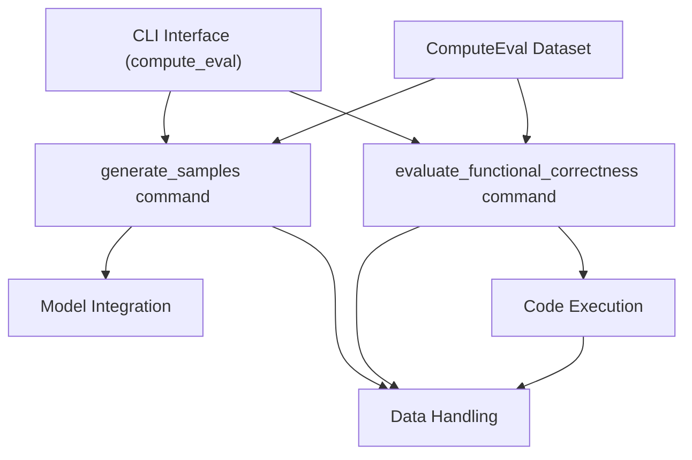
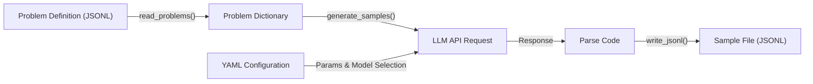
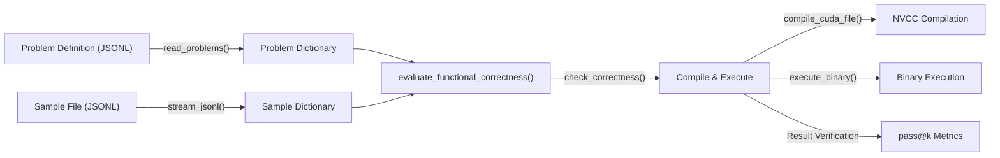
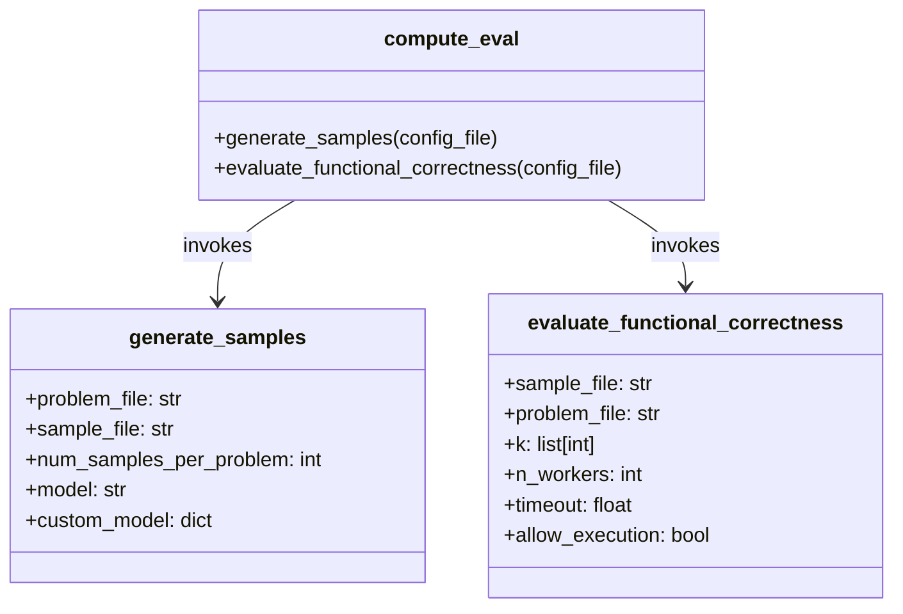
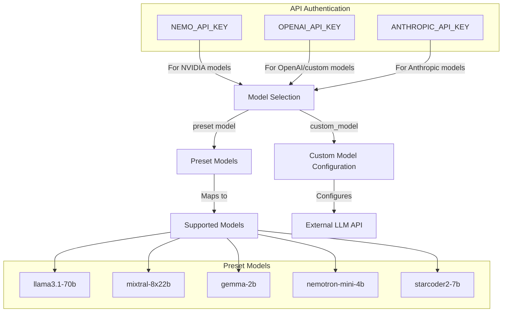
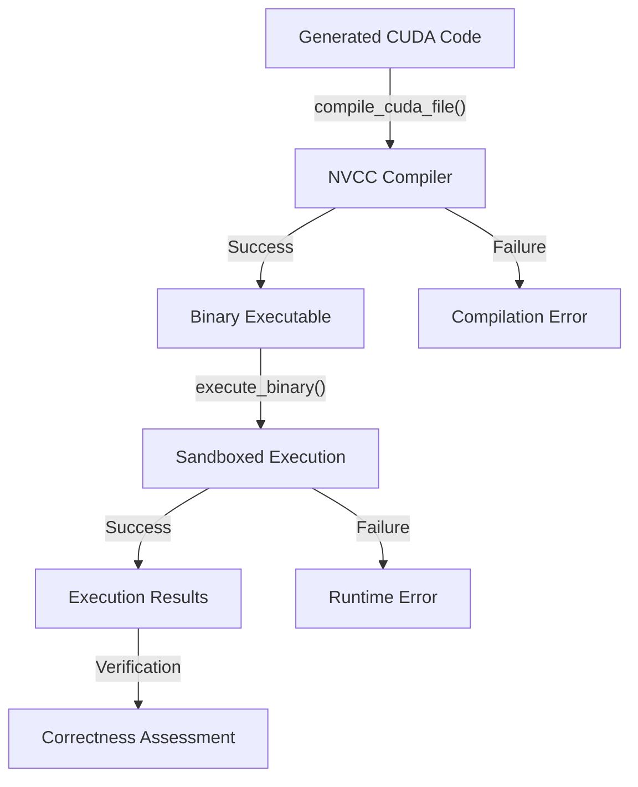

<!-- source: DeepWiki mcp.deepwiki.com · repo NVIDIA/compute-eval · page 1 Overview · fetched 2026-10-26 -->

# Overview

Relevant source files

The following files were used as context for generating this wiki page:

- [LICENSE](LICENSE)
- [README.md](README.md)

## Purpose and Scope

ComputeEval is a framework designed to generate and evaluate CUDA code produced by Large Language Models (LLMs). This document provides a high-level overview of the system architecture, core components, and workflows. The framework enables users to systematically assess LLM capabilities in generating functionally correct CUDA code through a comprehensive evaluation process.

For information about getting started with the framework, see [Getting Started](#2).

Sources: [README.md:3-14]()

## System Architecture

ComputeEval consists of two primary workflows: code generation and evaluation. The system is designed with a modular architecture that separates these concerns while providing a unified command-line interface.

The system architecture consists of these core components:
- A command-line interface that exposes generation and evaluation functions
- A code generation module that interfaces with various LLM APIs
- An evaluation module that assesses functional correctness
- A secure execution environment for running generated CUDA code
- Data handling utilities for managing problems, samples, and results

Sources: [README.md:5-14](), [README.md:169-201]()

## Core Workflows

ComputeEval operates through two primary workflows: code generation and evaluation. These workflows can be executed independently but are designed to work together in a pipeline.

### Generation Workflow

The generation workflow reads problem definitions from a JSONL file, uses them to generate prompts for LLMs, and then stores the generated code samples in another JSONL file. The process is configurable through YAML configuration files that specify parameters like model selection, sample count, and generation settings.

Sources: [README.md:134-142](), [README.md:174-188]()

### Evaluation Workflow

The evaluation workflow compiles and executes generated CUDA code samples against test cases to determine functional correctness. It calculates pass@k metrics to evaluate model performance. This process requires GPU hardware with CUDA Toolkit installed and implements security measures for safe execution of generated code.

Sources: [README.md:144-167](), [README.md:189-201]()

## System Components

### Command-Line Interface

The main entry point for ComputeEval is the `compute_eval` command-line interface, which supports two primary commands:

- `generate_samples`: Generates code samples using LLMs
- `evaluate_functional_correctness`: Evaluates the functional correctness of generated samples

Both commands accept configuration via YAML files, making the system flexible and easy to configure without code changes.

For detailed information about the CLI interface, see [Main CLI Interface](#6.1).

Sources: [README.md:169-201]()

### Model Integration

ComputeEval supports multiple LLM providers through a flexible model integration system. Models can be specified either by using preset model identifiers or by configuring custom models with API endpoints.

The system automatically handles the appropriate API calls and authentication for each model provider using environment variables for API keys.

Sources: [README.md:38-73](), [README.md:114-132]()

### Data Handling

ComputeEval uses structured data formats for problems, samples, and evaluation results:

| File Type | Format | Description |
|-----------|--------|-------------|
| Problem File | JSONL | Contains CUDA programming challenges with descriptions, templates, and test cases |
| Sample File | JSONL | Contains generated code samples with metadata about the model and generation parameters |
| Results | Dictionary | Contains pass@k metrics calculated from evaluation results |

The data handling component provides utilities for reading, writing, and processing these data formats. For more information about data handling, see [Data Handling](#3.4).

Sources: [README.md:83-98]()

### Code Execution

ComputeEval includes a secure execution environment for compiling and running generated CUDA code:

This component handles:
- CUDA code compilation using NVCC
- Safe execution of compiled binaries
- Timeout management to prevent infinite loops
- Result verification against expected outputs

For security reasons, all code execution requires explicit permission via the `--allow-execution` flag. It's recommended to run ComputeEval in a sandboxed environment when evaluating generated code.

Sources: [README.md:76-81]()

## Evaluation Metrics

ComputeEval uses the pass@k metric to evaluate model performance:

- **pass@k**: The probability that at least one of k samples will pass all test cases
- Multiple k values can be specified for evaluation (e.g., pass@1, pass@10)
- Higher pass@k values indicate better model performance

The system implements an unbiased estimator for pass@k when evaluating a subset of samples, making it efficient to estimate model performance without testing all generated samples.

For more details on the evaluation process, see [Code Evaluation](#3.2).

Sources: [README.md:144-167]()

## Dataset

The ComputeEval dataset consists of handcrafted CUDA programming challenges designed to evaluate an LLM's capability at writing reliable CUDA code. Each problem includes:

- A detailed description of the programming task
- A function signature template
- Input/output examples
- Test cases for verification

For more information about the dataset, see [Dataset](#4).

Sources: [README.md:7-9](), [README.md:202-204]()

## License Information

ComputeEval is licensed under the Apache License 2.0, while the dataset is licensed under CC BY 4.0. This ensures that both the software and data can be freely used, modified, and shared with proper attribution.

Sources: [LICENSE:1-21]()

---

