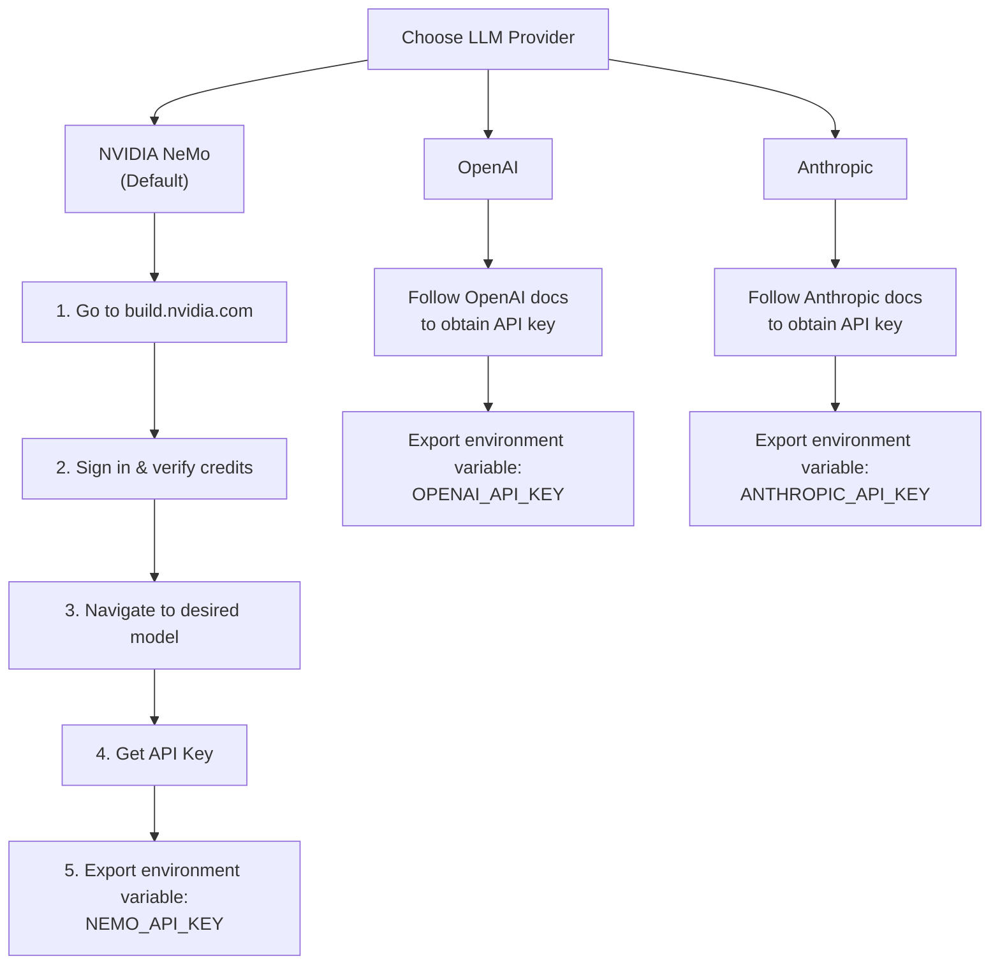
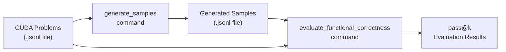
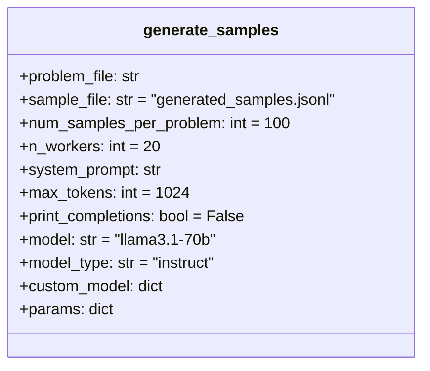
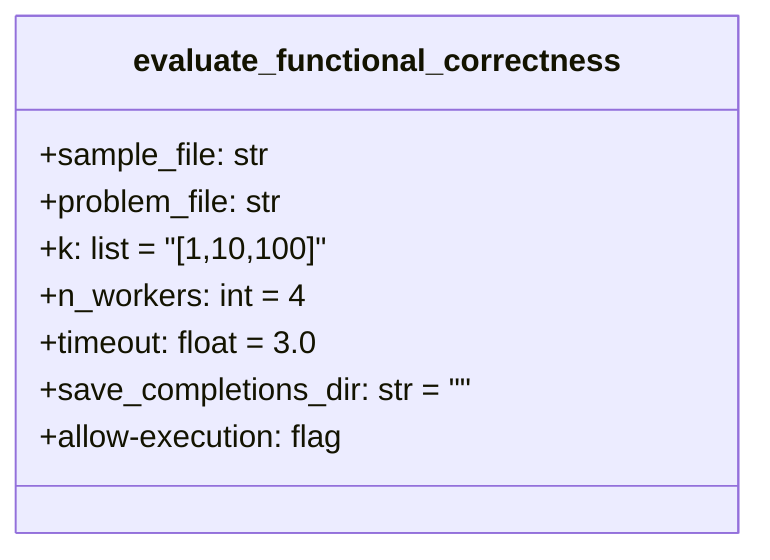
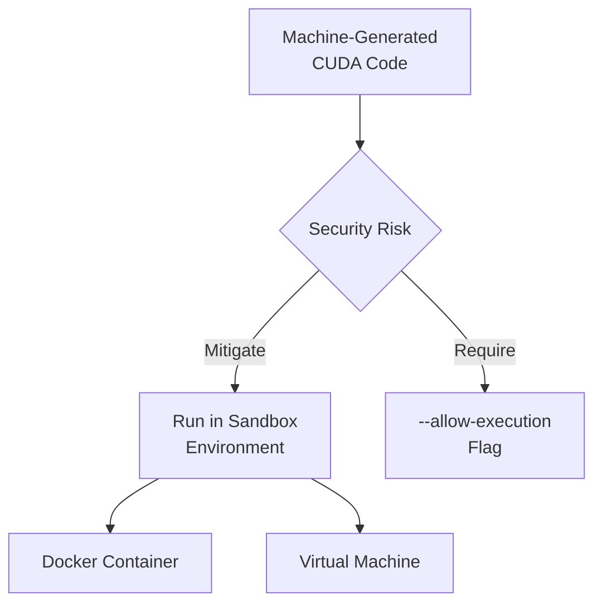

<!-- source: DeepWiki mcp.deepwiki.com · repo NVIDIA/compute-eval · page 2 Getting Started · fetched 2026-10-26 -->

# Getting Started

<details>
<summary>Relevant source files</summary>

The following files were used as context for generating this wiki page:

- [CONTRIBUTING.md](CONTRIBUTING.md)
- [README.md](README.md)

</details>


This guide will walk you through the process of setting up and using the compute-eval framework for evaluating Large Language Models (LLMs) on CUDA code generation tasks. After completing this guide, you'll be able to generate CUDA code samples using LLMs and evaluate their functional correctness.

For a high-level overview of the entire system, see [Overview](#1). For detailed information about the system architecture, see [System Architecture](#3).

## Prerequisites

Before you begin, ensure you have the following prerequisites installed:

- Python 3.10 or higher
- NVIDIA GPU with CUDA Toolkit 12 or greater (required only for evaluation)

Sources: [README.md:20-21]()

## Installation

There are two ways to install compute-eval:

### Option 1: Using pip

```bash
pip install .
```

### Option 2: Using Poetry (Recommended for development)

If you're planning to contribute to the project or prefer Poetry for dependency management:

```bash
# Install Poetry if you don't have it
pip install pipx
pipx install poetry
pipx ensurepath

# Configure Poetry to create virtual environments in the project directory
poetry config virtualenvs.in-project true

# Install the package
poetry shell
poetry install
```

Sources: [README.md:27-33](), [CONTRIBUTING.md:5-26]()

## API Key Configuration

To generate code samples, you'll need to obtain an API key from one of the supported LLM providers.



### NVIDIA NeMo (Default)

1. Go to [build.nvidia.com](https://build.nvidia.com)
2. Sign in with your account
3. Verify that you have sufficient credits to call hosted models
4. Navigate to the desired model and click on it
5. Click on "Get API Key"
6. Copy the generated API key
7. Export it as an environment variable:

```bash
export NEMO_API_KEY="your-nvidia-key"
```

### OpenAI

Follow the instructions in the [OpenAI documentation](https://openai.com/index/openai-api), then:

```bash
export OPENAI_API_KEY="your-openai-key"
```

### Anthropic (Claude)

Follow instructions on the [Anthropic documentation](https://www.anthropic.com/api), then:

```bash
export ANTHROPIC_API_KEY="your-anthropic-key"
```

Sources: [README.md:37-73]()

## Configuring ComputeEval

ComputeEval uses YAML configuration files to define parameters for code generation and evaluation. Let's examine the basic configuration structure:

### Sample Generation Configuration

```yaml
problem_file: data/cuda_problems_121924.jsonl  # Input CUDA problems
sample_file: data/samples.jsonl                # Output file for generated samples

model: llama3.1-nemotron-70b-instruct         # Model to use
num_samples_per_problem: 3                    # Samples to generate per problem
```

### Custom Model Configuration

```yaml
problem_file: data/problems.jsonl
sample_file: data/samples.jsonl

num_samples_per_problem: 3

custom_model:
  api_endpoint: https://integrate.api.nvidia.com/v1
  model_id: nvidia/llama-3.1-nemotron-70b-instruct
```

### Evaluation Configuration

```yaml
sample_file: data/samples.jsonl               # Generated samples to evaluate
problem_file: data/cuda_problems_121924.jsonl # Problem definitions

k: [1, 3]                                     # Pass@k values to calculate
```

Sources: [README.md:82-99](), [README.md:146-152]()

## Basic Usage

The ComputeEval workflow consists of two main steps: generating code samples and evaluating their functional correctness.



### Step 1: Generate Samples

Create a configuration file (e.g., `config_gen_samples.yaml`) with your desired parameters, then run:

```bash
compute_eval generate_samples -config_file=config_gen_samples.yaml
```

This command reads problems from your specified file, generates code samples using the configured LLM, and writes the results to the output file.

### Step 2: Evaluate Functional Correctness

Create an evaluation configuration file (e.g., `config_evalcorrectness.yaml`), then run:

```bash
compute_eval evaluate_functional_correctness -config_file=config_evalcorrectness.yaml --allow-execution
```

The `--allow-execution` flag is required because this command will compile and execute the generated CUDA code to test its correctness.

Sources: [README.md:134-167]()

## Command Reference

### generate_samples



This command generates samples for given problems using a specified model.

Key parameters:
- `problem_file`: Path to file containing CUDA problems
- `sample_file`: Path for output file with generated samples
- `num_samples_per_problem`: Number of samples to generate per problem
- `model`: LLM to use for code generation
- `custom_model`: API endpoint and model ID for custom models

### evaluate_functional_correctness



This command evaluates the functional correctness of generated samples.

Key parameters:
- `sample_file`: Path to file containing generated samples
- `problem_file`: Path to file containing problem definitions
- `k`: List of k values for pass@k calculation
- `timeout`: Timeout for each evaluation in seconds
- `--allow-execution`: Required flag to permit code execution

Sources: [README.md:169-201]()

## Available Models

ComputeEval supports a variety of LLMs for code generation. The following models are available:

| Model Identifier | Actual Model |
|------------------|--------------|
| mixtral-8x22b | mistralai/mixtral-8x22b-instruct-v0.1 |
| gemma-2b | google/gemma-2b |
| llama3.1-8b | meta/llama-3.1-8b-instruct |
| llama3.1-70b | meta/llama-3.1-70b-instruct |
| llama3.1-405b | meta/llama-3.1-405b-instruct |
| llama3.2-1b | meta/llama-3.2-1b-instruct |
| llama3.2-3b | meta/llama-3.2-3b-instruct |
| llama3.2-90b | meta/llama-3.2-90b-vision-instruct |
| llama3.1-nemotron-70b | nvidia/llama-3.1-nemotron-70b-instruct |
| nemotron-mini-4b | nvidia/nemotron-mini-4b-instruct |
| starcoder2-7b | bigcode/starcoder2-7b |
| mistral-nemo-12b | nv-mistralai/mistral-nemo-12b-instruct |

By default, NVIDIA hosted `llama-3.1-70b-instruct` is used when no model is specified.

Sources: [README.md:114-132]()

## Security Considerations



ComputeEval executes machine-generated CUDA code during evaluation. While it's unlikely that the generated code is malicious, there are potential security risks. To mitigate these risks:

1. The `--allow-execution` flag is required for evaluation to explicitly acknowledge the risk
2. It's strongly recommended to use a sandbox environment (e.g., Docker container or virtual machine) when running generated code

Sources: [README.md:77-80]()

## Complete Workflow Example

Here's a complete example of using ComputeEval to generate and evaluate CUDA code:

1. Create a sample generation configuration file named `config_gen_samples.yaml`:

```yaml
problem_file: data/cuda_problems_121924.jsonl
sample_file: data/samples.jsonl
model: llama3.1-nemotron-70b-instruct
num_samples_per_problem: 3
```

2. Generate samples:

```bash
compute_eval generate_samples -config_file=config_gen_samples.yaml
```

3. Create an evaluation configuration file named `config_evalcorrectness.yaml`:

```yaml
sample_file: data/samples.jsonl
problem_file: data/cuda_problems_121924.jsonl
k: [1, 3]
```

4. Evaluate the generated samples:

```bash
compute_eval evaluate_functional_correctness -config_file=config_evalcorrectness.yaml --allow-execution
```

5. Review the pass@k results to assess the LLM's performance.

Sources: [README.md:134-167]()

## Troubleshooting

- If you encounter API key issues, ensure you've exported the correct environment variable for your chosen model provider.
- For custom models, verify that you've set the `OPENAI_API_KEY` environment variable.
- If evaluation fails, check that you have a compatible NVIDIA GPU with the required CUDA Toolkit.
- Remember that the maximum k value in evaluation must not exceed the number of samples generated per problem.

Sources: [README.md:164-167]()

---

