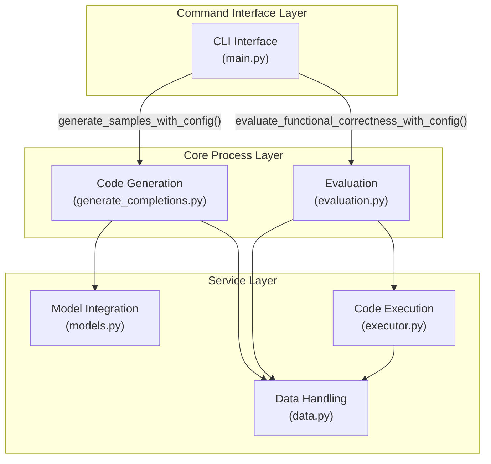
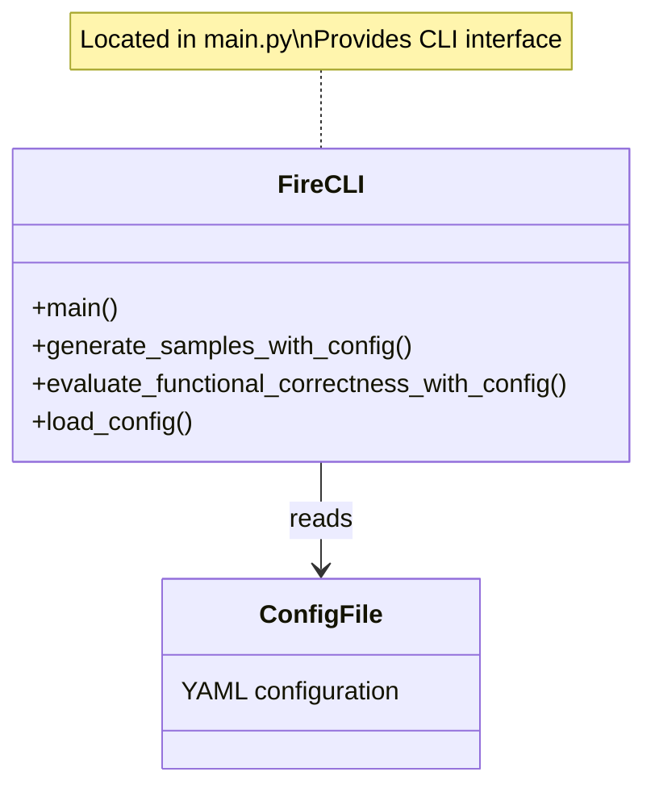
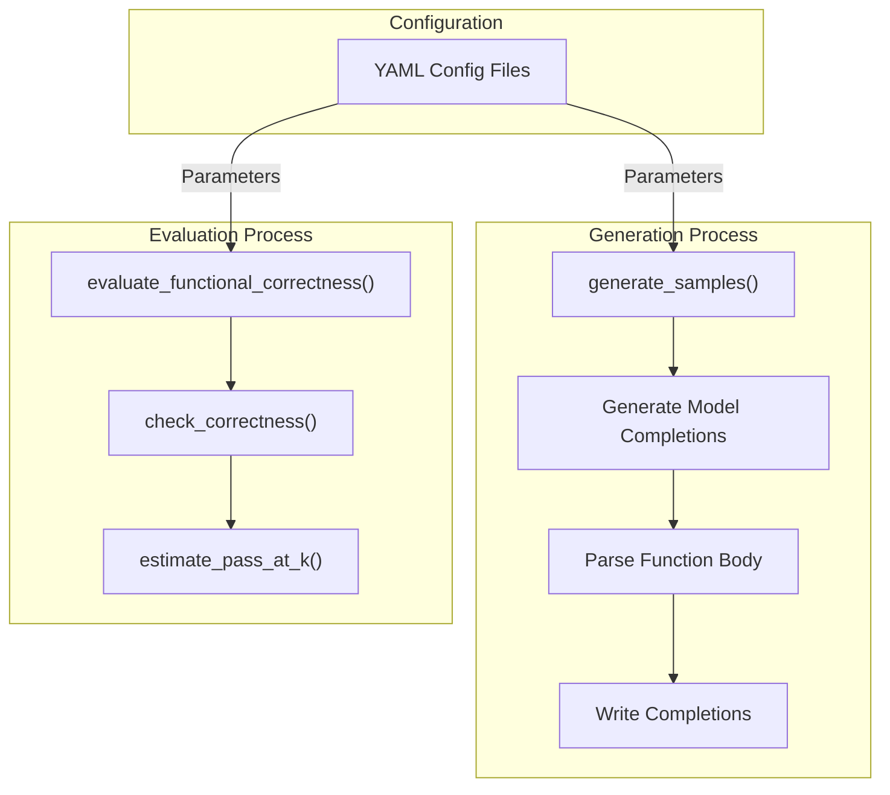
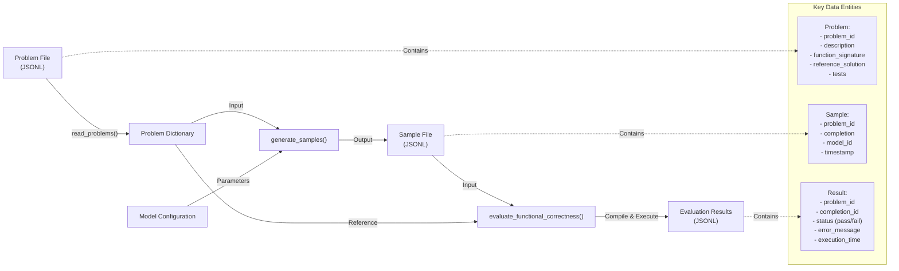
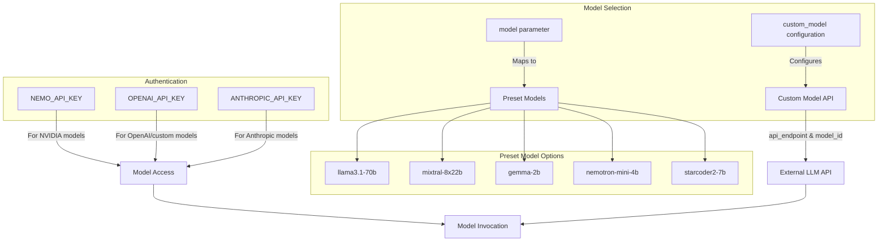
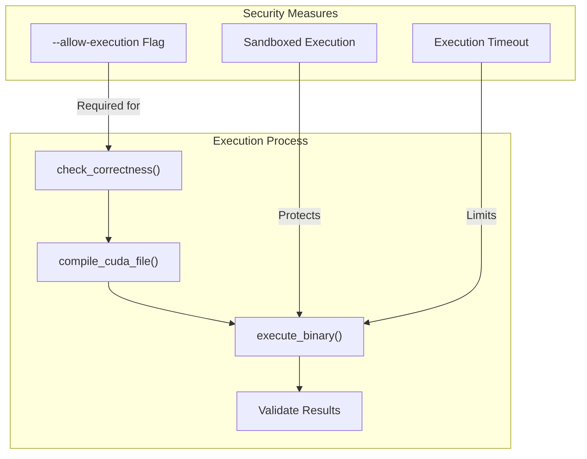
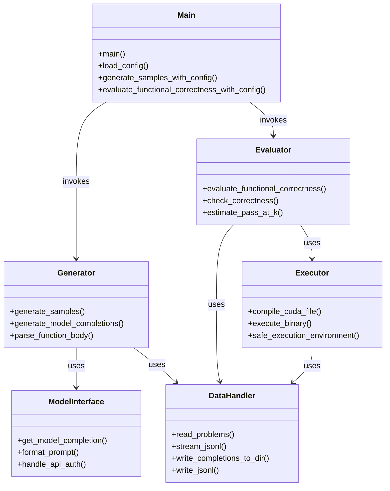

<!-- source: DeepWiki mcp.deepwiki.com · repo NVIDIA/compute-eval · page 3 System Architecture · fetched 2026-10-26 -->

# System Architecture

Relevant source files

The following files were used as context for generating this wiki page:

- [README.md](README.md)
- [compute_eval/__init__.py](compute_eval/__init__.py)
- [compute_eval/main.py](compute_eval/main.py)

This document provides a comprehensive overview of the ComputeEval system architecture, focusing on the core components, their interactions, and the overall data flow within the system. It explains how the different modules work together to generate and evaluate CUDA code samples produced by Large Language Models (LLMs).

For specific details about the Code Generation process, see [Code Generation](#3.1). For information about the Evaluation process, see [Code Evaluation](#3.2).

## 1. High-Level Architecture Overview

ComputeEval is structured as a pipeline-oriented architecture centered around two primary workflows: code generation and code evaluation. The system is designed with a clear separation of concerns, allowing independent operation of its major components.

**Diagram: High-Level System Architecture**

Sources: [compute_eval/main.py:16-52]()

## 2. Command Interface Layer

The Command Interface Layer serves as the entry point to the system, exposing two primary commands through a CLI built with the Fire library.

**Diagram: Command Layer Structure**

The CLI accepts YAML configuration files that define parameters for both code generation and evaluation processes. The `load_config()` function reads these files and passes the parameters to the appropriate functions.

Sources: [compute_eval/main.py:16-52]()

## 3. Core Process Layer

The Core Process Layer contains the two primary workflows of the system: Code Generation and Code Evaluation.

**Diagram: Core Process Flow**

The generation process creates CUDA code using LLMs, while the evaluation process tests the correctness of the generated code and calculates pass@k metrics.

Sources: [compute_eval/main.py:19-20]()

## 4. Data Flow Architecture

The data flow in ComputeEval follows a pipeline pattern, where problem definitions flow into the generation process, resulting in code samples that are then evaluated for correctness.

**Diagram: System Data Flow**

Sources: [compute_eval/main.py:19-20]()

## 5. Model Integration Architecture

The system integrates with various LLM providers through a flexible model interface that supports both preset models and custom model configurations.

**Diagram: Model Integration Architecture**

Sources: [README.md:38-130]()

## 6. Execution Environment Architecture

The execution environment is designed to safely compile and run generated CUDA code, preventing potential security issues while accurately testing the code's functionality.

**Diagram: Execution Environment Architecture**

Sources: [README.md:76-80]()

## 7. Component Relationships

The following diagram maps the key system components to their interactions, showing how data and control flow between different parts of the system.

**Diagram: Component Relationship Mapping**

Sources: [compute_eval/main.py:16-52]()

## 8. Configuration Architecture

The system uses YAML configuration files to control its behavior, allowing flexible experimental setups without code changes.

```mermaid
graph TD
    subgraph "Configuration Types"
        GenConfig["Generation Configuration"]
        EvalConfig["Evaluation Configuration"]
    end
    
    subgraph "Generation Parameters"
        ProblemFile["problem_file"]
        SampleFile["sample_file"]
        Model["model or custom_model"]
        NumSamples["num_samples_per_problem"]
        SystemPrompt["system_prompt"]
        MaxTokens["max_tokens"]
    end
    
    subgraph "Evaluation Parameters"
        SampleFileEval["sample_file"]
        ProblemFileEval["problem_file"]
        KValues["k (for pass@k)"]
        Workers["n_workers"]
        Timeout["timeout"]
        SaveDir["save_completions_dir"]
    end
    
    GenConfig --> ProblemFile
    GenConfig --> SampleFile
    GenConfig --> Model
    GenConfig --> NumSamples
    GenConfig --> SystemPrompt
    GenConfig --> MaxTokens
    
    EvalConfig --> SampleFileEval
    EvalConfig --> ProblemFileEval
    EvalConfig --> KValues
    EvalConfig --> Workers
    EvalConfig --> Timeout
    EvalConfig --> SaveDir
```

**Diagram: Configuration Architecture**

Sources: [README.md:82-163]()

## Summary

The ComputeEval system architecture is built around two primary workflows:
1. **Code Generation**: Uses LLMs to generate CUDA code samples for predefined problems
2. **Code Evaluation**: Tests the functional correctness of generated code and calculates pass@k metrics

The system design emphasizes:
- **Separation of concerns**: Each component has a clear responsibility
- **Configurable operation**: YAML files control system behavior
- **Secure execution**: Sandboxed environment for running generated code
- **Flexible model integration**: Support for multiple LLM providers
- **Streamlined data flow**: Consistent data formats throughout the pipeline

This architecture enables efficient evaluation of LLM capabilities for CUDA code generation, providing a framework that can be extended with additional models and evaluation methodologies.

Sources: [README.md:1-209](), [compute_eval/main.py:16-52]()

---

