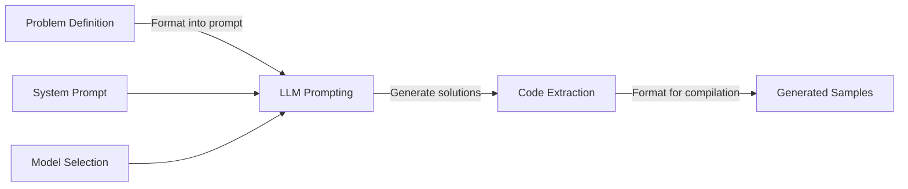
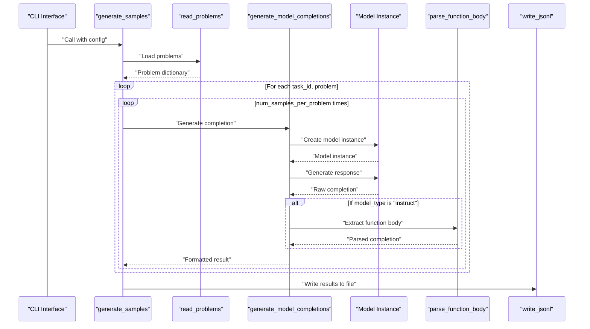
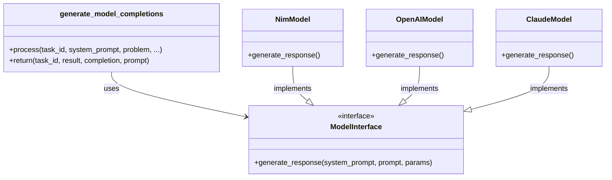
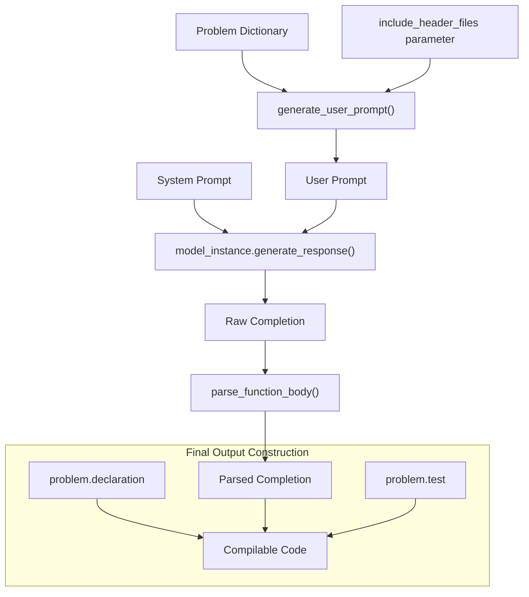

<!-- source: DeepWiki mcp.deepwiki.com · repo NVIDIA/compute-eval · page 3.1 Code Generation · fetched 2026-10-26 -->

# Code Generation

<details>
<summary>Relevant source files</summary>

The following files were used as context for generating this wiki page:

- [compute_eval/generate_completions.py](compute_eval/generate_completions.py)
- [compute_eval/main.py](compute_eval/main.py)

</details>


This page documents the code generation system within the NVIDIA Compute-Eval framework. The code generation component is responsible for prompting Large Language Models (LLMs) to produce CUDA code solutions for given programming problems. For information about evaluating the generated code's functional correctness, see [Code Evaluation](#3.2).

## 1. Overview

The code generation system takes problem descriptions from a dataset, constructs prompts for language models, generates code completions, and formats them for later evaluation. It supports multiple model providers including NVIDIA NeMo, OpenAI, and Anthropic Claude.



Sources: [compute_eval/generate_completions.py:184-245]()

## 2. Code Generation Workflow

The code generation process begins with the `generate_samples` function, which orchestrates the entire workflow:



Sources: [compute_eval/generate_completions.py:184-245](), [compute_eval/generate_completions.py:29-128](), [compute_eval/generate_completions.py:130-182]()

### 2.1 Process Steps

1. **Problem Loading**: Problems are loaded from a JSONL file using the `read_problems` function.
2. **Parallel Generation**: Multiple completions are generated for each problem using a thread pool for parallel processing.
3. **Response Generation**: Each model generates responses based on system and user prompts.
4. **Code Extraction**: For instructional models, the actual code is extracted from potentially markdown-formatted responses.
5. **Result Formatting**: The code is formatted with the problem declaration and test code to create compilable files.
6. **Output Writing**: Results are written to an output JSONL file.

Sources: [compute_eval/generate_completions.py:184-245]()

## 3. Model Integration

The system supports a variety of LLMs through a flexible model interface:



### 3.1 Supported Models

The system provides built-in support for various LLMs through a model mapping mechanism:

| Model ID | Provider | Description |
|----------|----------|-------------|
| mixtral-8x22b-v0.1 | Mistral AI | Mixtral 8x22B Instruct model |
| gemma-2-2b-it | Google | Gemma 2 2B Instruct model |
| llama-3.1-8b-instruct | Meta | Llama 3.1 8B Instruct model |
| llama-3.1-70b-instruct | Meta | Llama 3.1 70B Instruct model |
| llama-3.1-405b-instruct | Meta | Llama 3.1 405B Instruct model |
| llama-3.2-1b-instruct | Meta | Llama 3.2 1B Instruct model |
| llama-3.2-3b-instruct | Meta | Llama 3.2 3B Instruct model |
| llama-3.1-nemotron-70b-instruct | NVIDIA | NVIDIA-enhanced Llama 3.1 70B |
| nemotron-mini-4b-instruct | NVIDIA | NVIDIA's 4B parameter model |
| starcoder2-7b | BigCode | Code-specialized model |
| mistral-nemo-12b-instruct | NVIDIA/Mistral | NVIDIA Mistral 12B |
| claude-sonnet-3.5 | Anthropic | Claude 3.5 Sonnet model |

Sources: [compute_eval/generate_completions.py:64-85]()

### 3.2 Custom Model Support

For models not in the preset list, the system supports custom model configuration by providing:
- API endpoint URL
- Model ID

When a custom model is specified, the system uses the OpenAI API client with the provided endpoint and model ID.

Sources: [compute_eval/generate_completions.py:59-62]()

## 4. Prompt Construction

The system constructs prompts for the LLMs using two components:

1. **System Prompt**: A general instruction prompt that guides the model on how to approach CUDA programming tasks.
2. **User Prompt**: A specific prompt generated from the problem description.



### 4.1 Code Extraction

For instruction-tuned models, the system extracts the actual code from the potentially markdown-formatted response using the `parse_function_body` function. This process:

1. Identifies code blocks between markdown triple backticks
2. Removes the function signature if necessary
3. Extracts only the function body

Sources: [compute_eval/generate_completions.py:130-182]()

## 5. Configuration Options

The code generation process can be configured with various parameters:

| Parameter | Description | Default |
|-----------|-------------|---------|
| problem_file | Path to the JSONL file containing problems | Required |
| sample_file | Path to output JSONL file for generated samples | "generated_samples.jsonl" |
| num_samples_per_problem | Number of samples to generate per problem | 100 |
| n_workers | Number of parallel workers for generation | 20 |
| system_prompt | System prompt for the model | Default prompt |
| print_completions | Whether to print completions during generation | False |
| include_header_files | Whether to include header files in the prompt | False |
| model | Model ID to use for generation | "llama-3.1-70b-instruct" |
| model_type | Type of model ("instruct" or "base") | "instruct" |
| custom_model | Dictionary with custom model configuration | None |
| params | Additional parameters to pass to the model | None |

Configuration can be provided directly via function parameters or through a YAML configuration file.

Sources: [compute_eval/generate_completions.py:184-245](), [compute_eval/main.py:28-32]()

## 6. Output Format

The generated samples are saved in JSONL format with the following structure for each entry:

```json
{
  "task_id": "problem_identifier",
  "compilable_code": "complete code with declaration, completion, and test",
  "generated_completion": "only the generated function body",
  "prompt": "the prompt sent to the model"
}
```

The output is formatted to ensure that:
1. The problem declaration is preserved
2. The generated code is clearly marked between comment markers
3. The test code is included for later evaluation

Sources: [compute_eval/generate_completions.py:121-127](), [compute_eval/generate_completions.py:230-236]()

## 7. CLI Integration

Code generation is exposed through the CLI via the `generate_samples` command, which can be invoked with direct parameters or a configuration file:

```bash
python -m compute_eval.main generate_samples --config_file=config.yaml
```

or

```bash
python -m compute_eval.main generate_samples --problem_file=problems.jsonl --model=llama-3.1-70b-instruct
```

Sources: [compute_eval/main.py:28-32](), [compute_eval/main.py:42-48]()

---

