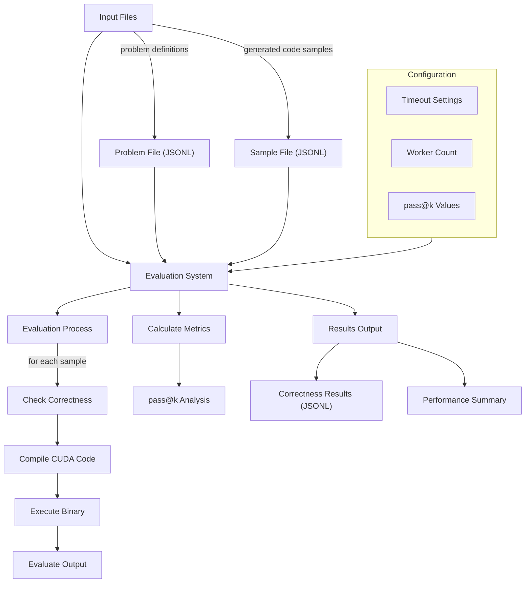
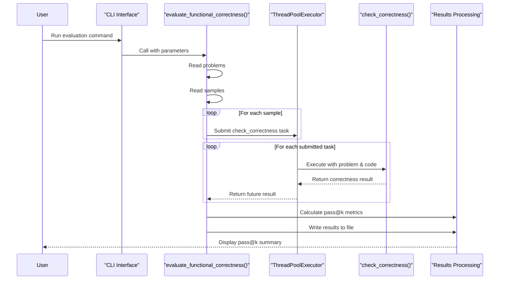
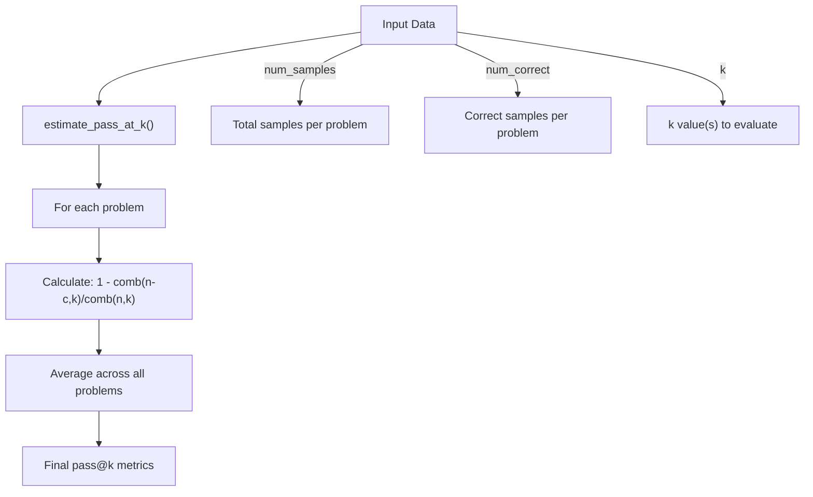
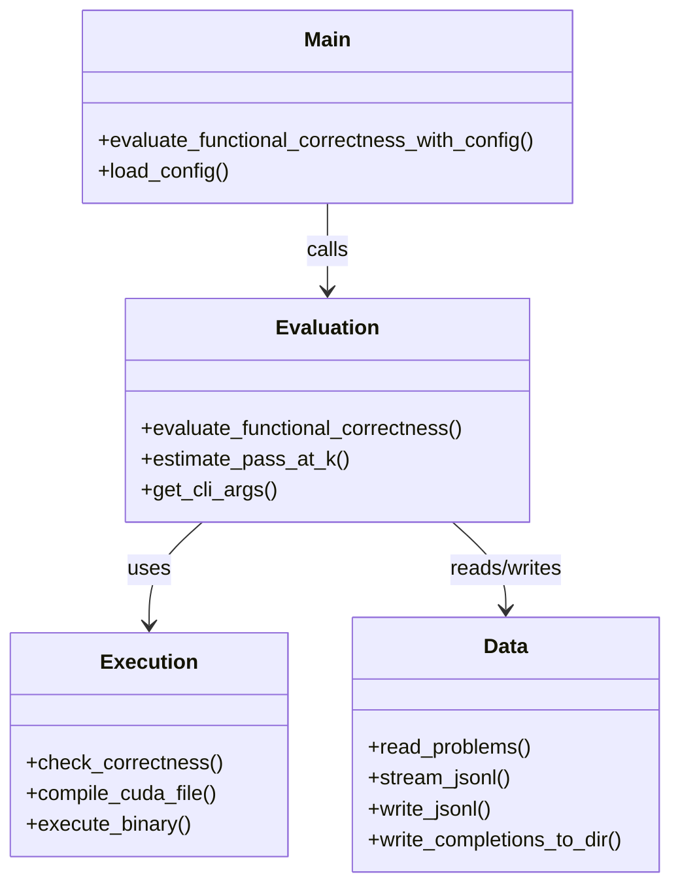

<!-- source: DeepWiki mcp.deepwiki.com · repo NVIDIA/compute-eval · page 3.2 Code Evaluation · fetched 2026-10-26 -->

# Code Evaluation

<details>
<summary>Relevant source files</summary>

The following files were used as context for generating this wiki page:

- [compute_eval/evaluation.py](compute_eval/evaluation.py)
- [compute_eval/main.py](compute_eval/main.py)

</details>


This page documents the code evaluation subsystem of the NVIDIA Compute-Eval framework, which is responsible for assessing the functional correctness of generated CUDA code samples. The evaluation system focuses on determining whether code generated by Large Language Models (LLMs) executes correctly and produces expected outputs for given problem statements. 

For information about how code samples are generated, see [Code Generation](#3.1). For details on the secure execution environment, see [Code Execution](#3.3).

## Evaluation System Overview

The code evaluation system takes generated CUDA code samples, compiles them, executes them in a secure environment, and determines whether they pass predefined test cases. It then calculates performance metrics like pass@k to measure LLM effectiveness at code generation tasks.



Sources: [compute_eval/evaluation.py:118-233](), [compute_eval/main.py:35-39]()

## Functional Correctness Evaluation

The evaluation system assesses whether generated code samples correctly solve the original problem by compiling and executing them against test cases. This process is managed by the `evaluate_functional_correctness` function.

### Core Evaluation Workflow



Sources: [compute_eval/evaluation.py:118-233](), [compute_eval/main.py:35-39]()

### Function Parameters

The `evaluate_functional_correctness` function accepts multiple parameters to configure the evaluation process:

| Parameter | Type | Description |
|-----------|------|-------------|
| `sample_file` | str | Path to JSONL file containing generated code samples |
| `problem_file` | str | Path to JSONL file containing problem definitions |
| `allow_execution` | bool | Flag to permit execution of untrusted code (default: False) |
| `k` | Tuple[int] | Values for pass@k calculation (default: (1, 10, 100)) |
| `n_workers` | int | Number of parallel workers for evaluation (default: 4) |
| `timeout` | float | Maximum execution time per sample in seconds (default: 60.0) |
| `save_completions_dir` | str | Optional directory to save processed completions (default: "") |

Sources: [compute_eval/evaluation.py:118-126]()

## Pass@k Metric

The pass@k metric is a statistical measure for evaluating code generation models when generating multiple solutions per problem. It estimates the probability that at least one correct solution would be found if k solutions were sampled per problem.

### Calculating Pass@k

The `estimate_pass_at_k` function implements the mathematical formula for pass@k calculation:

1 - comb(n - c, k) / comb(n, k)

Where:
- n is the number of samples generated per problem
- c is the number of correct samples
- k is the parameter being evaluated (e.g., 1, 10, 100)



Sources: [compute_eval/evaluation.py:77-102]()

## Evaluation Process Details

### Initialization and Safety

The evaluation system requires explicit permission to execute generated code for security reasons. The system displays a prominent warning and requires the `allow_execution` flag to be set to `True`.

```
===================
     WARNING
===================

Evaluation of correctness or performance will execute untrusted model-generated
code.

Although it is highly unlikely that model-generated code will do something
overtly malicious in response to this test suite, model-generated code may act
destructively due to a lack of model capability or alignment.

Users are strongly encouraged to sandbox this evaluation suite so that it does
not perform destructive actions on their host or network.

In order to execute this code you must explicitly pass the --allow-execution flag.
```

Sources: [compute_eval/evaluation.py:59-74](), [compute_eval/evaluation.py:132-134]()

### Code Evaluation Flow

1. **Read Input Files**: The system reads problem definitions and generated samples
2. **Parallel Evaluation**: Samples are evaluated using a ThreadPoolExecutor
3. **Individual Sample Check**:
   - Each sample is compiled and executed against the problem's test cases
   - Execution has a configurable timeout to prevent infinite loops
   - Compilation can include problem-specific compiler and linker flags
4. **Results Collection**: All evaluation results are collected and processed
5. **Metric Calculation**: The pass@k metrics are calculated based on sample correctness
6. **Output Generation**: Results are written to a JSONL file for further analysis

Sources: [compute_eval/evaluation.py:149-203]()

### Result Processing

After evaluating all samples, the system:

1. Calculates pass@k metrics for specified k values
2. Merges evaluation results with the original samples
3. Writes comprehensive results to a new JSONL file
4. Optionally saves completions to a specified directory
5. Displays a summary of pass@k metrics

The output JSONL file includes all original sample data plus:
- `result`: Detailed test execution results
- `skipped`: Flag indicating if the test was skipped
- `passed`: Boolean indicating whether the sample passed all tests
- `completion_id`: Unique identifier for the completion

Sources: [compute_eval/evaluation.py:206-233]()

## CLI Usage

The evaluation functionality is exposed through a command-line interface. The system can be invoked directly or configured using a YAML file:

### Direct Command Line Usage

```
python -m compute_eval.main evaluate_functional_correctness \
    --sample_file path/to/samples.jsonl \
    --problem_file path/to/problems.jsonl \
    --allow_execution True \
    --k 1 10 100 \
    --n_workers 4 \
    --timeout 60.0
```

### Using Configuration File

```
python -m compute_eval.main evaluate_functional_correctness \
    --config_file path/to/config.yaml
```

Example YAML configuration:

```yaml
sample_file: path/to/samples.jsonl
problem_file: path/to/problems.jsonl
allow_execution: true
k: [1, 10, 100]
n_workers: 4
timeout: 60.0
save_completions_dir: path/to/save/dir
```

Sources: [compute_eval/main.py:35-39](), [compute_eval/main.py:22-26]()

## Integration with System Components

The evaluation system integrates with other components of the compute-eval framework:



Sources: [compute_eval/main.py:35-39](), [compute_eval/evaluation.py:51-57](), [compute_eval/evaluation.py:149-203]()

## Security Considerations

When evaluating model-generated code, security is a significant concern. The system includes several safeguards:

1. **Explicit Execution Permission**: Requires the `--allow-execution` flag
2. **Warning Display**: Shows a prominent warning about executing untrusted code
3. **Execution Timeout**: Limits the maximum execution time for each sample
4. **Parallel Isolation**: Executes each sample in a separate process
5. **Recommendation for Sandboxing**: Encourages users to run the evaluation in a sandboxed environment

The execution itself happens in the Code Execution subsystem, which provides additional security features. See [Code Execution](#3.3) for more details.

Sources: [compute_eval/evaluation.py:59-74](), [compute_eval/evaluation.py:132-134]()

---

