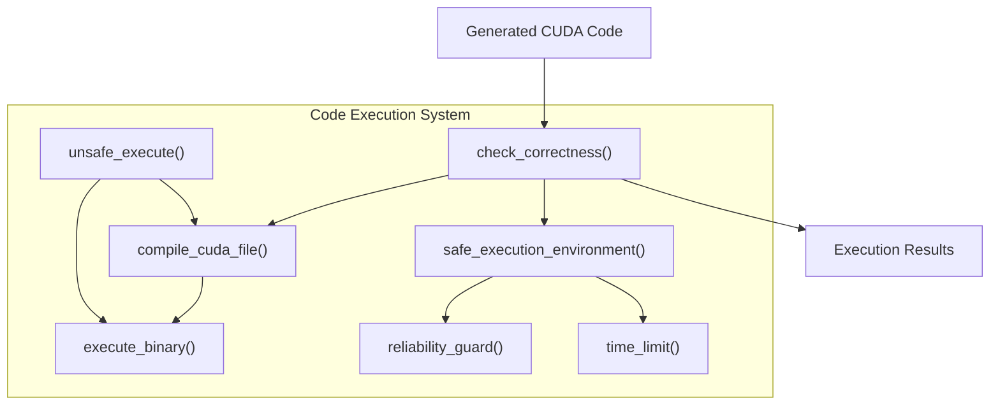
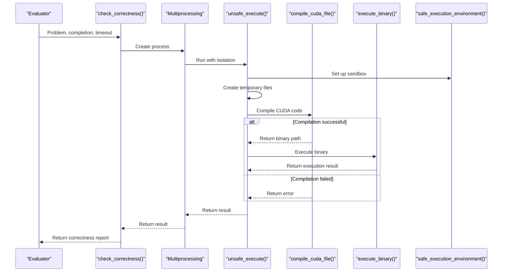
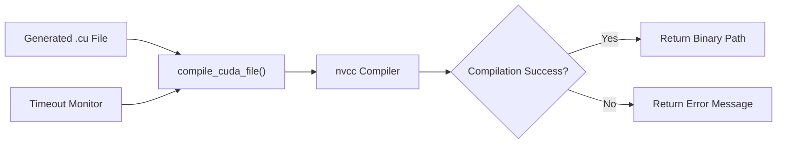
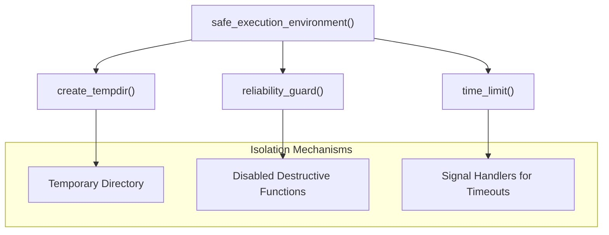
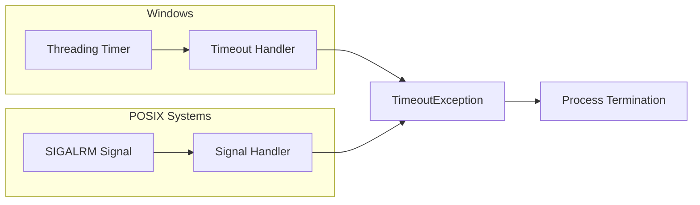
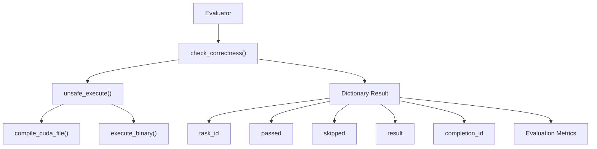

<!-- source: DeepWiki mcp.deepwiki.com · repo NVIDIA/compute-eval · page 3.3 Code Execution · fetched 2026-10-26 -->

# Code Execution

Relevant source files

The following files were used as context for generating this wiki page:

- [compute_eval/execution.py](compute_eval/execution.py)

This document details the secure code execution environment used within the compute-eval framework to compile and run generated CUDA code for evaluation purposes. The execution system provides controlled, sandboxed environments to safely compile, execute, and verify the correctness of model-generated CUDA code.

For information about the overall evaluation process and metrics, see [Code Evaluation](#3.2).

## 1. Execution System Overview

The Code Execution system handles the critical task of safely turning generated CUDA code into executable programs, running them, and capturing their results. It provides isolation mechanisms to ensure the generated code cannot harm the host system while allowing accurate functional correctness assessment.

Sources: [compute_eval/execution.py:206-247](). [compute_eval/execution.py:155-196](), [compute_eval/execution.py:57-92](), [compute_eval/execution.py:95-127]()

## 2. Execution Workflow

The execution process follows a sequential workflow to safely compile and run CUDA code:

Sources: [compute_eval/execution.py:206-247](), [compute_eval/execution.py:155-196]()

## 3. CUDA Code Compilation

The compilation process transforms the generated CUDA code into executable binaries using NVIDIA's nvcc compiler.

### 3.1 Compilation Function

The `compile_cuda_file()` function handles the compilation process by:
1. Invoking the `nvcc` compiler with appropriate arguments
2. Capturing compilation errors and outputs
3. Managing compilation timeouts
4. Reporting compilation success or failure

Sources: [compute_eval/execution.py:57-92]()

### 3.2 Compilation Workflow

Sources: [compute_eval/execution.py:57-92]()

## 4. Binary Execution

After successful compilation, the generated binary is executed in a controlled environment.

### 4.1 Execution Function

The `execute_binary()` function:
1. Runs the compiled binary with appropriate environment settings
2. Captures program output and return codes
3. Interprets execution results
4. Handles timeouts and runtime errors

Sources: [compute_eval/execution.py:95-127]()

### 4.2 Execution Return Codes

| Return Code | Meaning | Result |
|-------------|---------|--------|
| 0 | Successful execution | "passed" |
| 200 | GPU architecture compatibility issue | "skipped" |
| Other | Program error | Error message |

Sources: [compute_eval/execution.py:95-127]()

## 5. Safety and Sandboxing

The execution system employs multiple layers of security to ensure safe execution of untrusted code.

### 5.1 Safe Execution Environment

Sources: [compute_eval/execution.py:130-152](), [compute_eval/execution.py:250-273](), [compute_eval/execution.py:332-416]()

### 5.2 Reliability Guard

The `reliability_guard()` function disables potentially harmful system functions:

- File system operations (remove, rename, chmod)
- Process operations (kill, fork)
- System environment modifications
- Memory-limited execution (optional)

This prevents generated code from interfering with the test environment or host system.

Sources: [compute_eval/execution.py:332-416]()

### 5.3 Process Isolation

The execution system uses Python's multiprocessing module to:

1. Execute code in separate processes
2. Enforce resource limits per process
3. Reliably terminate runaway processes
4. Clean up child processes after execution

Sources: [compute_eval/execution.py:206-247](), [compute_eval/execution.py:418-433]()

## 6. Timeout Management

Timeouts are critical for handling infinite loops or resource-intensive code that could otherwise hang the evaluation system.

### 6.1 Time Limiting Mechanisms

Sources: [compute_eval/execution.py:250-273](), [compute_eval/execution.py:292-293]()

### 6.2 Process Cleanup

The system ensures thorough cleanup after execution:
1. All child processes are terminated
2. Temporary directories are removed
3. System resources are released

Sources: [compute_eval/execution.py:418-433](), [compute_eval/execution.py:286-290]()

## 7. Integration with Evaluation System

The execution system integrates with the broader evaluation workflow through the `check_correctness()` function.

Sources: [compute_eval/execution.py:206-247]()

## 8. Error Handling

The execution system provides comprehensive error handling:

1. Compilation errors are captured and reported
2. Runtime errors from binary execution are caught
3. Timeouts are properly handled and reported
4. System errors during any phase are gracefully managed

This ensures robust operation even when executing potentially problematic generated code.

Sources: [compute_eval/execution.py:57-92](), [compute_eval/execution.py:95-127](), [compute_eval/execution.py:155-196]()

## 9. Security Considerations

The execution system is designed with security in mind but has important limitations:

> **WARNING**: The reliability guard is NOT a complete security sandbox. Untrusted code, including model-generated code, should not be blindly executed outside of a proper security sandbox.

For production deployments, additional security measures should be considered, such as:
- Container-based isolation
- More restrictive resource limits
- Network isolation
- Filesystem isolation

Sources: [compute_eval/execution.py:332-416]()

---

