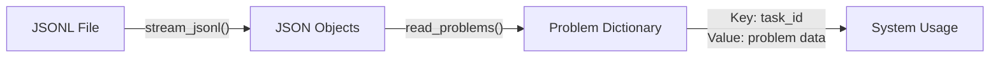
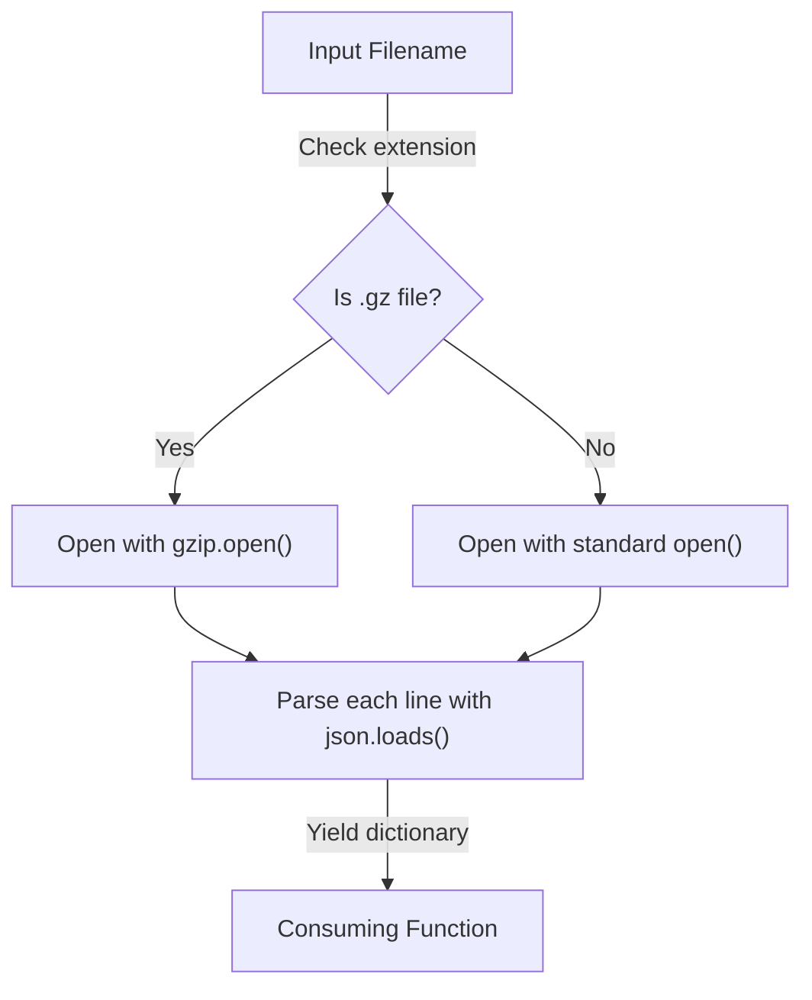
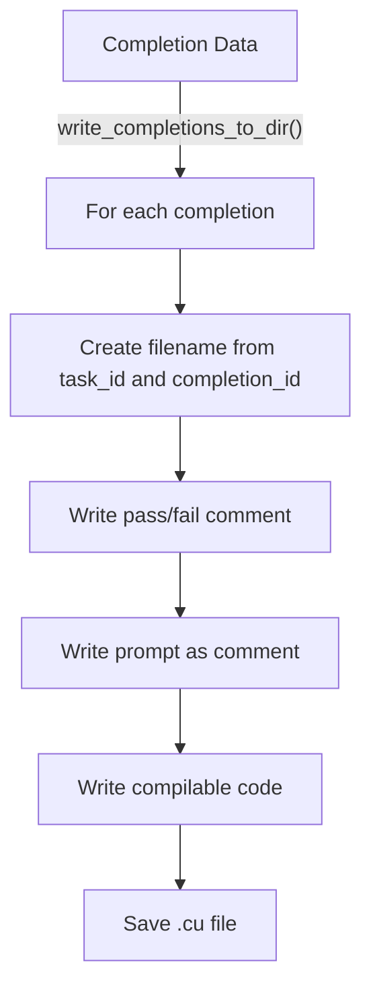
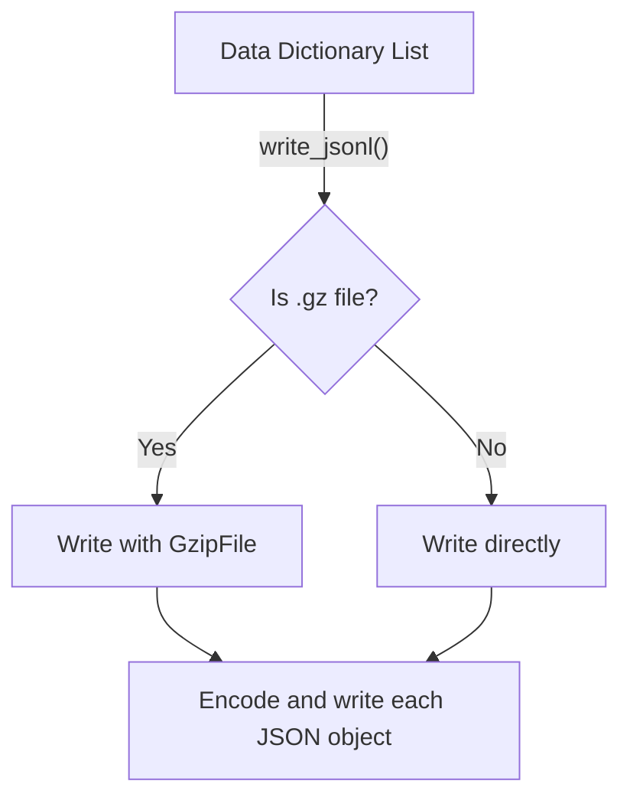
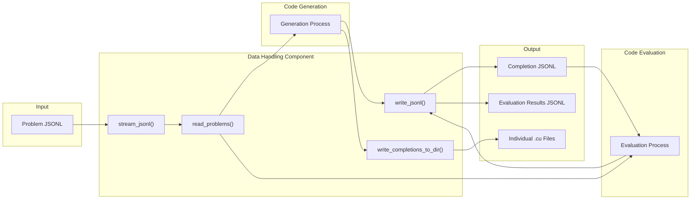

<!-- source: DeepWiki mcp.deepwiki.com · repo NVIDIA/compute-eval · page 3.4 Data Handling · fetched 2026-10-26 -->

# Data Handling

<details>
<summary>Relevant source files</summary>

The following files were used as context for generating this wiki page:

- [compute_eval/data.py](compute_eval/data.py)

</details>


The Data Handling component in compute-eval manages all input/output operations related to problem definitions, generated CUDA code samples, and evaluation results. This module provides utility functions for reading problem definitions, parsing JSONL files, and writing output data in structured formats.

For information about how generated code is executed, see [Code Execution](#3.3).

## Data Formats

The compute-eval system primarily uses JSONL (JSON Lines) format for structured data storage. JSONL is a convenient format where each line is a valid JSON object, making it easy to stream and process records incrementally.

### Problem Format

Problems are stored in JSONL files where each line represents a single programming challenge. A typical problem definition includes:

- `task_id`: Unique identifier for the problem
- `prompt`: The programming challenge description
- `entry_point`: The function name that needs to be implemented
- `test_code`: Code used to validate the implementation
- Additional metadata specific to the CUDA problem

### Completion Format

Generated code solutions (completions) are stored in two forms:

1. As individual `.cu` files when writing to a directory
2. As entries in a JSONL file when stored collectively

Completion entries typically include:
- `task_id`: The problem identifier
- `completion_id`: Unique identifier for this completion
- `prompt`: The original prompt
- `compilable_code`: The generated CUDA code
- `passed`: Boolean indicating whether the code passed testing

Sources: [compute_eval/data.py]()

## Input Operations

### Reading Problems

The system provides functions to read problem definitions from JSONL files. The main function used is `read_problems()`, which parses a JSONL file and returns a dictionary of problems indexed by their task IDs.



**Diagram: Problem Loading Process**

Sources: [compute_eval/data.py:48-49]()

### Parsing JSONL Files

The `stream_jsonl()` function handles the parsing of JSONL files, with support for both plain and gzipped files. It yields each line as a Python dictionary after parsing it from JSON.



**Diagram: JSONL Parsing Process**

Sources: [compute_eval/data.py:52-66]()

## Output Operations

### Writing Completions

The system can write generated code completions to individual files in a specified directory using `write_completions_to_dir()`. Each file contains:

1. A comment indicating if the solution passed or failed
2. The original prompt as a comment
3. The actual compilable CUDA code



**Diagram: Completion Writing Process**

Sources: [compute_eval/data.py:69-90]()

### Writing Results

Results and other structured data can be written to JSONL files using the `write_jsonl()` function, which supports both plain and gzipped output formats, as well as appending to existing files.



**Diagram: JSONL Writing Process**

Sources: [compute_eval/data.py:92-111]()

## Data Flow in the System

The Data Handling component interacts with other components of the compute-eval system as illustrated below:



**Diagram: Data Flow Through System Components**

Sources: [compute_eval/data.py]()

## JSONL Structure Examples

Below are examples of the data structures used in the system's JSONL files:

### Problem JSONL Example

```json
{
  "task_id": "cuda_vector_add_1",
  "prompt": "Implement a CUDA kernel that adds two vectors element-wise...",
  "entry_point": "vector_add",
  "test_code": "// Test code that verifies the vector addition works correctly"
}
```

### Completion JSONL Example

```json
{
  "task_id": "cuda_vector_add_1",
  "completion_id": "model_name_sample_0",
  "prompt": "Implement a CUDA kernel that adds two vectors element-wise...",
  "compilable_code": "// CUDA code generated by the model",
  "passed": true
}
```

### Results JSONL Example

```json
{
  "task_id": "cuda_vector_add_1",
  "completion_id": "model_name_sample_0",
  "passed": true,
  "compile_error": null,
  "runtime_error": null,
  "execution_time": 0.023
}
```

## Implementation Details

### Core Data Handling Functions

| Function | Purpose | Input | Output |
|----------|---------|-------|--------|
| `read_problems()` | Reads problems from a JSONL file | Path to JSONL file | Dictionary of problems indexed by task_id |
| `stream_jsonl()` | Parses JSONL line by line | Path to JSONL file | Iterator of dictionary objects |
| `write_completions_to_dir()` | Saves completions as .cu files | Directory path, completion data | Files on disk |
| `write_jsonl()` | Writes data to JSONL format | Filename, data iterable, append flag | JSONL file on disk |

The Data Handling component provides these abstractions for file operations, allowing other system components to focus on their specific responsibilities without managing the details of data persistence.

Sources: [compute_eval/data.py]()

---

