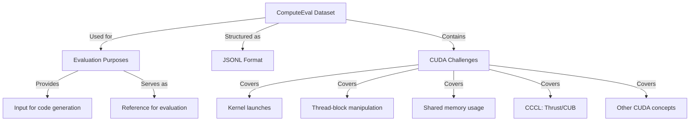
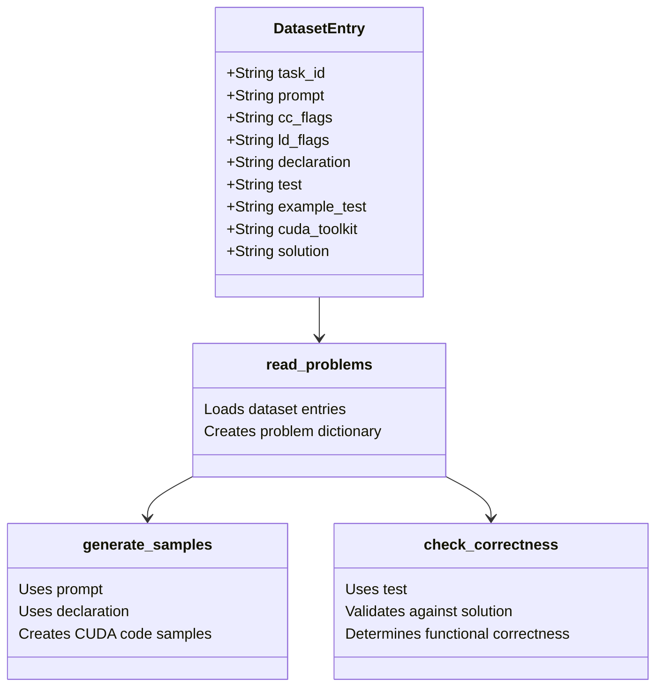
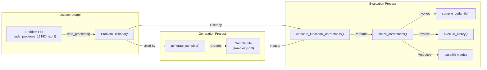

<!-- source: DeepWiki mcp.deepwiki.com · repo NVIDIA/compute-eval · page 4 Dataset · fetched 2026-10-26 -->

# Dataset

<details>
<summary>Relevant source files</summary>

The following files were used as context for generating this wiki page:

- [DATASET_CARD.md](DATASET_CARD.md)
- [README.md](README.md)

</details>


This document describes the ComputeEval dataset, which forms the foundation for evaluating Large Language Models on CUDA code generation tasks. The dataset consists of handcrafted CUDA programming challenges designed to systematically assess model capabilities across various CUDA programming concepts.

## Dataset Overview

The ComputeEval dataset is a collection of CUDA programming tasks structured as self-contained challenges. Each challenge represents a specific problem requiring CUDA code generation expertise.



Sources: [DATASET_CARD.md:3-3](), [README.md:8-8]()

## Dataset Structure

### File Format

The dataset is stored in JSON Lines (`.jsonl`) format, with each line representing a single CUDA programming task. The dataset is primarily accessed through `data/cuda_problems_121924.jsonl` in the repository.

### Data Fields

Each task entry contains structured fields that define both the problem statement and evaluation criteria:

| Field | Description |
|-------|-------------|
| `task_id` | Unique identifier for the task (e.g., "CUDA/0") |
| `prompt` | Natural language description of the CUDA code to write |
| `cc_flags` | Compiler arguments that may be used during compilation |
| `ld_flags` | Linker arguments that may be used during compilation |
| `declaration` | Preliminary code (includes, macros, device stubs) required before the solution |
| `test` | C++ snippet (often containing `main()`) that verifies correctness at runtime |
| `example_test` | Ancillary snippet or annotation (may be empty or contain additional tests) |
| `cuda_toolkit` | String indicating CUDA version requirements (e.g., "12.0") |
| `solution` | Example or reference kernel that solves the prompt |

Sources: [DATASET_CARD.md:11-23]()

## Dataset Entry Structure

The following diagram illustrates how a dataset entry is structured and maps to different components in the system:



Sources: [DATASET_CARD.md:13-23](), [README.md:95-97](), [README.md:153-162]()

## Integration in System Workflow

The ComputeEval dataset serves as a critical input to both the generation and evaluation components of the system:



Sources: [README.md:84-98](), [README.md:146-162]()

## Usage in System Components

### In Code Generation

The dataset is loaded into the generation process through this workflow:

1. Problems are loaded from the dataset file using the `read_problems()` function
2. The system extracts the `prompt` and `declaration` fields for each problem
3. These fields are formatted into appropriate prompts for the selected LLM
4. The LLM generates CUDA code samples based on these prompts
5. Generated samples are saved to a samples file (typically `data/samples.jsonl`)

Example configuration for generation:

```yaml
problem_file: data/cuda_problems_121924.jsonl  # Dataset input
sample_file: data/samples.jsonl  # Generated samples output
model: llama-3.1-nemotron-70b-instruct  # Model to use
num_samples_per_problem: 3  # Samples per problem
```

Sources: [README.md:84-98]()

### In Evaluation

The dataset is used in the evaluation process as follows:

1. Both problem definitions and generated samples are loaded
2. For each sample, the system uses the corresponding problem's `test` field
3. The sample code is compiled and executed against this test
4. Results determine whether the sample passes or fails
5. The system calculates pass@k metrics based on all samples

Example configuration for evaluation:

```yaml
sample_file: data/samples.jsonl
problem_file: data/cuda_problems_121924.jsonl
k: [1, 3]
```

Sources: [README.md:146-162]()

## Current Status and Future Development

The ComputeEval dataset is currently in Alpha stage. According to the project documentation, the development team plans to:

1. Refine the evaluation framework
2. Make frequent updates to the dataset
3. Add additional problems spanning all aspects of CUDA development

Sources: [README.md:12-14]()

## License

The ComputeEval dataset is licensed under Creative Commons Attribution 4.0 International License (CC-BY-4.0).

Sources: [DATASET_CARD.md:26-29]()

---

