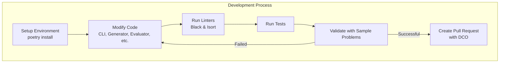
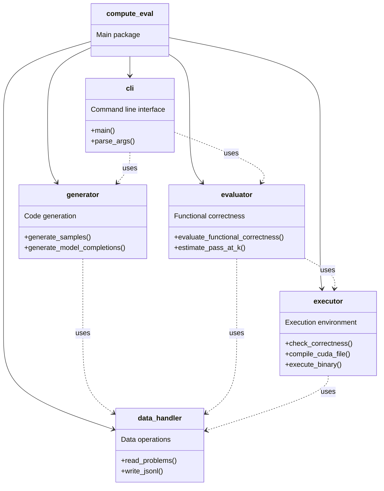
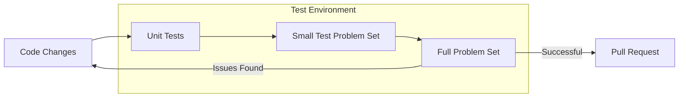

<!-- source: DeepWiki mcp.deepwiki.com · repo NVIDIA/compute-eval · page 5 Development Guide · fetched 2026-10-26 -->

# Development Guide

<details>
<summary>Relevant source files</summary>

The following files were used as context for generating this wiki page:

- [.gitignore](.gitignore)
- [CONTRIBUTING.md](CONTRIBUTING.md)

</details>


This guide provides comprehensive instructions for setting up a development environment, understanding the codebase structure, and contributing to the compute-eval repository. For information about system architecture and components, see [System Architecture](#3).

## Prerequisites

Before starting development, ensure you have:

- Python 3.10 or higher installed
- Git for version control
- CUDA toolkit (for testing CUDA code compilation and execution)
- Appropriate API keys for model providers you plan to use

## Setting Up the Development Environment

The compute-eval project uses Poetry for dependency management and virtual environment creation.

### Installing Poetry

Poetry can be installed using pipx, which ensures proper isolation:

```bash
pip install pipx
pipx install poetry
pipx ensurepath # ensures that ~/.local/bin is added to $PATH
```

### Configuring the Development Environment

1. Clone the repository:
   ```bash
   git clone https://github.com/NVIDIA/compute-eval.git
   cd compute-eval
   ```

2. Configure Poetry to create virtualenvs in the project directory:
   ```bash
   poetry config virtualenvs.in-project true
   ```

3. Create the virtual environment and install dependencies:
   ```bash
   poetry shell # starts a new shell inside the virtual environment
   poetry install
   ```

4. Create a `.env` file in the project root with your API keys:
   ```
   NEMO_API_KEY="<YOUR-NEMO-API-KEY>"
   # Or for custom models:
   API_KEY="<YOUR-API-KEY>"
   # For other providers as needed:
   OPENAI_API_KEY="<YOUR-OPENAI-API-KEY>"
   ANTHROPIC_API_KEY="<YOUR-ANTHROPIC-API-KEY>"
   ```

Sources: [CONTRIBUTING.md:3-41]()

## Development Workflow

The compute-eval system consists of several interconnected components. The following diagram illustrates the development workflow and how different components interact:

**Development Workflow Overview**



### Repository Structure and Key Components

**Repository Component Structure**



When making code changes, consider how your modifications affect the interactions between these components.

Sources: System Overview diagrams

## Code Standards and Linting

The compute-eval project uses strict formatting standards enforced by Black (code formatter) and Isort (import sorter).

### Setting Up Linting in VSCode

1. Install the recommended extensions:
   - Black Python Formatter
   - Isort Formatter

2. Add the following configuration to your VSCode settings:
   ```json
   "[python]": {
       "editor.defaultFormatter": "ms-python.black-formatter",
       "editor.formatOnSave": true,
       "editor.codeActionsOnSave": {
           "source.organizeImports": "always"
       },
   },
   "isort.args":["--profile", "black"],
   ```

This configuration ensures that:
- Files are automatically formatted when saved
- Imports are organized according to the Black-compatible Isort profile

Sources: [CONTRIBUTING.md:42-58]()

## Testing Your Changes

### Running the System Locally

To test your changes:

1. Generate code samples from the test problem set:
   ```bash
   python -m compute_eval.cli generate --problem_file path/to/problems.jsonl --model custom_model --output_file samples.jsonl
   ```

2. Evaluate the generated samples:
   ```bash
   python -m compute_eval.cli evaluate --problem_file path/to/problems.jsonl --sample_file samples.jsonl --output_file results.jsonl
   ```

### Validation Best Practices

**Development Testing Flow**



## Contributing Changes

When you're ready to contribute your changes:

1. Ensure all tests pass
2. Verify code has been properly formatted with Black and Isort
3. Create a pull request with a clear description of changes
4. Include a DCO (Developer Certificate of Origin) in your commit message

### DCO Requirement

All commits must include a signed-off-by line that indicates your agreement with the [Developer Certificate of Origin](https://developercertificate.org/). Add this by using the `-s` flag with git commit:

```bash
git commit -s -m "Your commit message"
```

Sources: [CONTRIBUTING.md:60-62]()

## Common Development Tasks

The following table outlines common development tasks and how to perform them:

| Task | Command/Action |
|------|---------------|
| Start development environment | `poetry shell` |
| Install dependencies | `poetry install` |
| Format code | `black compute_eval/` or save in VSCode with configured formatter |
| Organize imports | `isort compute_eval/` or save in VSCode with configured formatter |
| Generate test samples | `python -m compute_eval.cli generate --problem_file test_problems.jsonl --model custom_model --output_file test_samples.jsonl` |
| Evaluate test samples | `python -m compute_eval.cli evaluate --problem_file test_problems.jsonl --sample_file test_samples.jsonl --output_file test_results.jsonl` |

## Development Notes

- Generated sample files and results files are ignored by git by default, as specified in the `.gitignore` file
- Always keep API keys in your `.env` file, which is excluded from version control
- The project is installed in editable mode by default, so changes to the code take effect immediately without reinstallation

Sources: [.gitignore:39-44]()

## Troubleshooting Common Issues

| Issue | Solution |
|-------|----------|
| Missing API keys | Ensure your `.env` file exists with the correct API keys |
| CUDA compilation errors | Verify CUDA toolkit installation and compatibility with your GPU |
| Import errors | Check if you're running the code from within the Poetry environment |
| Linting errors | Run Black and Isort manually to format your code |

By following this development guide, you'll be able to set up, modify, and contribute to the compute-eval repository effectively.

---

