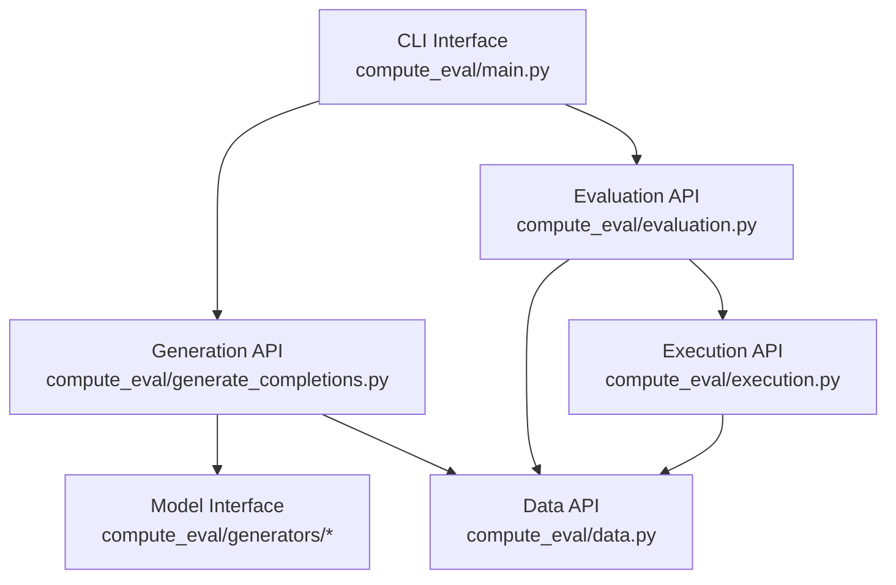
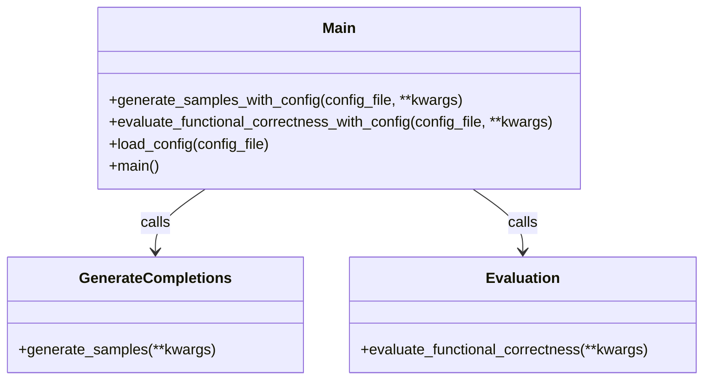
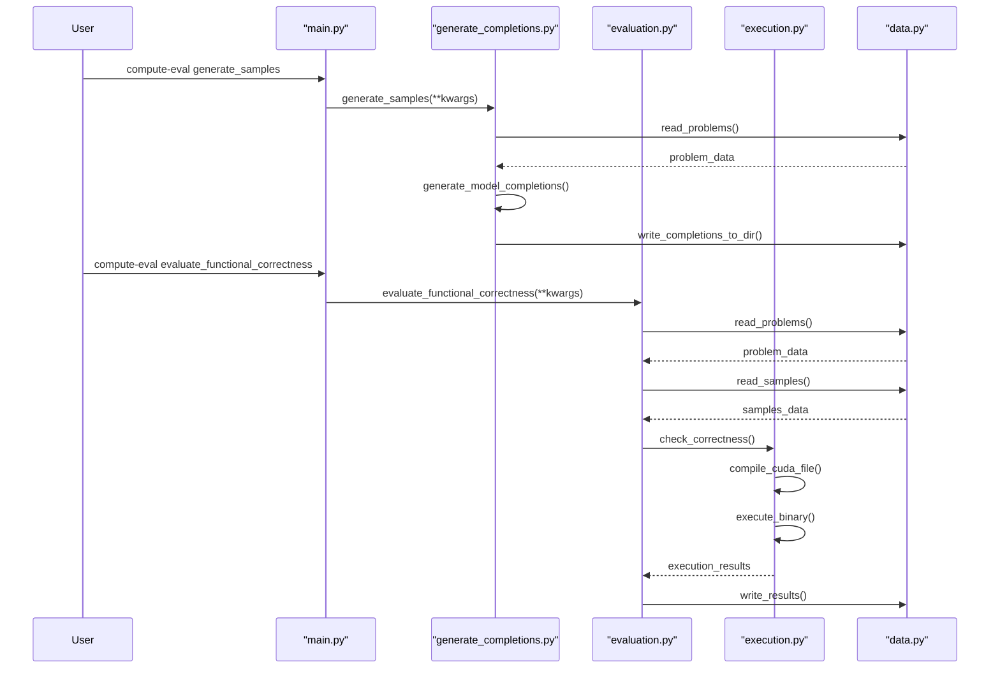

<!-- source: DeepWiki mcp.deepwiki.com · repo NVIDIA/compute-eval · page 6 API Reference · fetched 2026-10-26 -->

# API Reference

<details>
<summary>Relevant source files</summary>

The following files were used as context for generating this wiki page:

- [compute_eval/__init__.py](compute_eval/__init__.py)
- [compute_eval/main.py](compute_eval/main.py)

</details>


This document provides a comprehensive reference guide to the Compute-Eval API, serving as a central hub for accessing detailed documentation about each system interface. It outlines the organization of the API components and directs users to specific sub-pages for detailed documentation on each component.

For information about the overall system architecture, see [System Architecture](#3).
For guides on getting started with the system, see [Getting Started](#2).

## API Structure Overview

The Compute-Eval API is organized into several key components that work together to generate and evaluate CUDA code samples. The following diagram illustrates the relationships between these API components and their corresponding code implementations:



This API structure reflects the system's workflow, where code samples are first generated using language models and then evaluated for functional correctness.

Sources: [compute_eval/main.py:19-20]()

## Command-Line Interface

The Compute-Eval system exposes its functionality through a command-line interface implemented in `main.py`. The CLI provides two main commands:

1. `generate_samples`: Generates CUDA code samples using specified language models
2. `evaluate_functional_correctness`: Evaluates the functional correctness of generated samples



The CLI implementation uses the `fire` library to expose these commands in a user-friendly way. Both commands support configuration through YAML files or direct parameter passing.

Sources: [compute_eval/main.py:16-52]()

### Configuration Loading

The CLI supports loading configuration parameters from YAML files:

```python
def load_config(config_file):
    with open(config_file, "r") as file:
        return yaml.safe_load(file)
```

Configuration parameters from files can be combined with command-line arguments, with command-line arguments taking precedence:

```python
def generate_samples_with_config(config_file=None, **kwargs):
    if config_file:
        config = load_config(config_file)
        kwargs.update(config)
    generate_samples(**kwargs)
```

Sources: [compute_eval/main.py:23-39]()

## API Components

The following table maps API components to their corresponding code files and main entry points:

| API Component | Code File | Main Entry Points | Documentation |
|---------------|-----------|-------------------|---------------|
| CLI Interface | compute_eval/main.py | `generate_samples_with_config()`, `evaluate_functional_correctness_with_config()` | [Main CLI Interface](#6.1) |
| Generation API | compute_eval/generate_completions.py | `generate_samples()` | [Generation API](#6.2) |
| Evaluation API | compute_eval/evaluation.py | `evaluate_functional_correctness()` | [Evaluation API](#6.3) |
| Execution API | compute_eval/execution.py | Various execution functions | [Execution API](#6.4) |
| Data API | compute_eval/data.py | Various data handling functions | [Data API](#6.5) |

Sources: [compute_eval/main.py:19-20](), [compute_eval/main.py:28-39]()

### Generation API

The Generation API (`compute_eval/generate_completions.py`) provides functionality for generating CUDA code samples using language models. The main entry point is the `generate_samples()` function, which handles the process of generating code solutions for CUDA programming problems.

For detailed documentation, see [Generation API](#6.2).

### Evaluation API

The Evaluation API (`compute_eval/evaluation.py`) handles the assessment of functional correctness for generated code samples. The primary function is `evaluate_functional_correctness()`, which evaluates how well the generated code solutions perform when compiled and executed.

For detailed documentation, see [Evaluation API](#6.3).

### Execution API

The Execution API handles the secure compilation and execution of generated CUDA code, providing the infrastructure needed for evaluating code correctness. It includes mechanisms for safely compiling and running CUDA code within a controlled environment.

For detailed documentation, see [Execution API](#6.4).

### Data API

The Data API manages all data input/output operations, including reading problem definitions, writing generated samples, and handling evaluation results. It provides the functions necessary for data persistence and retrieval throughout the system.

For detailed documentation, see [Data API](#6.5).

## API Call Flow

The following sequence diagram illustrates how API calls flow through the system during typical usage:



Sources: [compute_eval/main.py:42-48]()

## CLI Usage Examples

Here are examples of using the Compute-Eval CLI:

**Generate samples using a configuration file:**
```bash
python -m compute_eval.main generate_samples --config_file=configs/generation.yaml
```

**Evaluate functional correctness with direct parameters:**
```bash
python -m compute_eval.main evaluate_functional_correctness --samples_file=samples.jsonl --problems_file=problems.jsonl
```

**Generate samples with direct parameters:**
```bash
python -m compute_eval.main generate_samples --model=llama3.1-70b --problem_file=problems.jsonl --output_dir=samples/
```

Sources: [compute_eval/main.py:42-48]()

---

