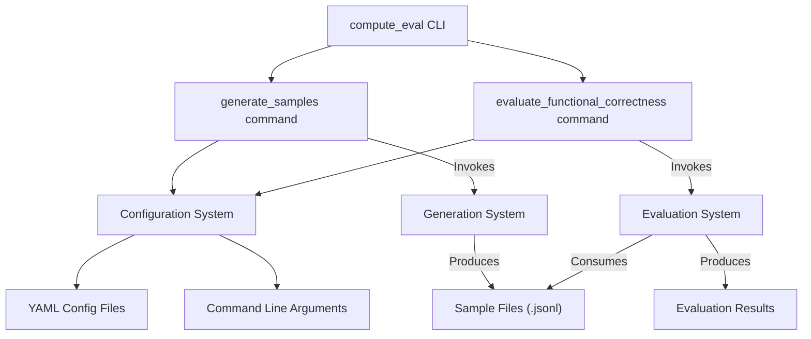
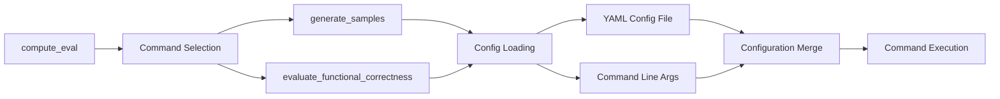
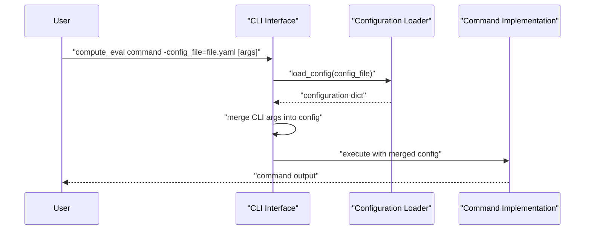
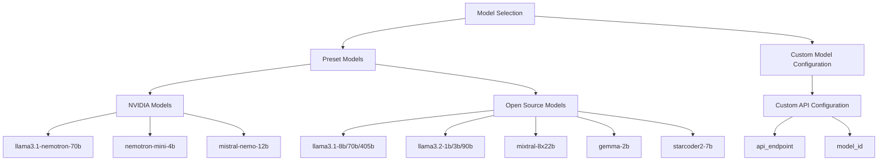
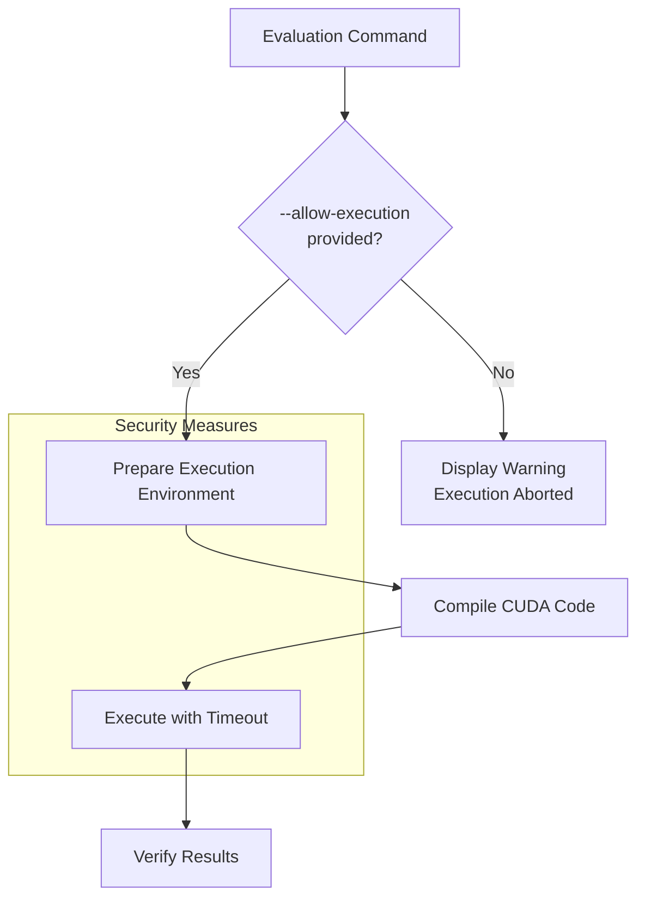
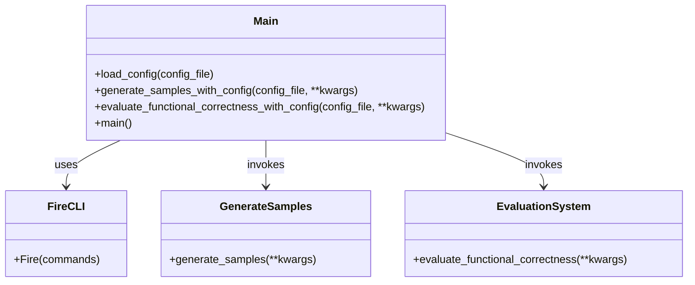

<!-- source: DeepWiki mcp.deepwiki.com · repo NVIDIA/compute-eval · page 6.1 Main CLI Interface · fetched 2026-10-26 -->

# Main CLI Interface

<details>
<summary>Relevant source files</summary>

The following files were used as context for generating this wiki page:

- [README.md](README.md)
- [compute_eval/main.py](compute_eval/main.py)

</details>


## Purpose and Scope

This document details the Command Line Interface (CLI) of the compute-eval framework, which serves as the primary entry point for generating and evaluating CUDA code. The CLI exposes two main commands: `generate_samples` for producing code with Large Language Models and `evaluate_functional_correctness` for testing the generated code's functionality. This document covers command syntax, configuration options, and execution patterns.

For information about the Generation API implementation, see [Generation API](#6.2). For information about the Evaluation API implementation, see [Evaluation API](#6.3).

## Overview of CLI Architecture

The compute-eval framework uses a command-line interface built with the Python Fire library. The interface provides a simple way to access the two primary functionalities of the system: code generation and code evaluation.



Sources: [compute_eval/main.py:42-48]()

## Command Line Structure

The compute-eval CLI provides two primary commands that correspond to the main workflows in the system:

```
compute_eval <command> [options]
```

Where `<command>` is one of:
- `generate_samples`: Generate CUDA code samples using LLMs
- `evaluate_functional_correctness`: Evaluate the functional correctness of generated samples

Each command accepts configuration either through command-line arguments or a YAML configuration file using the `-config_file` parameter.



Sources: [compute_eval/main.py:28-39](), [compute_eval/main.py:23-25]()

## Configuration System

The compute-eval system uses a flexible configuration approach that allows parameters to be specified in either YAML files or as command-line arguments. When both are provided, command-line arguments take precedence over the config file values.

### Configuration Loading Process



Sources: [compute_eval/main.py:23-25](), [compute_eval/main.py:28-32](), [compute_eval/main.py:35-39]()

## Command: generate_samples

The `generate_samples` command generates CUDA code samples for given problems using a specified LLM model.

### Parameters

| Parameter | Type | Default | Description |
|-----------|------|---------|-------------|
| `problem_file` | str | (required) | Path to the file containing problems |
| `sample_file` | str | "generated_samples.jsonl" | Path for output samples |
| `num_samples_per_problem` | int | 100 | Number of samples to generate per problem |
| `n_workers` | int | 20 | Number of worker threads |
| `system_prompt` | str | (predefined) | System prompt for the model |
| `max_tokens` | int | 1024 | Maximum tokens to generate |
| `print_completions` | bool | False | Print completions to stdout |
| `model` | str | "llama3.1-70b" | Model to use for generation |
| `model_type` | str | "instruct" | Type of model |
| `custom_model` | dict | None | API endpoint and model ID for custom models |
| `params` | dict | None | Parameters for chat completions |

### Example Usage

Via config file:
```bash
compute_eval generate_samples -config_file=example_config_gen_samples.yaml
```

With a configuration file containing:
```yaml
problem_file: data/cuda_problems_121924.jsonl
sample_file: data/samples.jsonl
model: llama-3.1-nemotron-70b-instruct
num_samples_per_problem: 3
```

Via direct command line:
```bash
compute_eval generate_samples --problem_file=data/cuda_problems_121924.jsonl --sample_file=data/samples.jsonl --model=llama3.1-70b --num_samples_per_problem=3
```

Sources: [README.md:169-188](), [README.md:82-94](), [README.md:137-142]()

## Command: evaluate_functional_correctness

The `evaluate_functional_correctness` command evaluates the functional correctness of generated CUDA code samples and calculates pass@k metrics.

### Parameters

| Parameter | Type | Default | Description |
|-----------|------|---------|-------------|
| `sample_file` | str | (required) | Path to the file containing samples |
| `problem_file` | str | (required) | Path to the file containing problems |
| `k` | str | "1,10,100" | List of k values as comma-separated string |
| `n_workers` | int | 4 | Number of worker threads |
| `timeout` | float | 3.0 | Timeout for each evaluation in seconds |
| `save_completions_dir` | str | "" | Directory to save completions as .cu files |
| `allow_execution` | flag | (required) | Flag to allow execution of generated code |

### Example Usage

Via config file:
```bash
compute_eval evaluate_functional_correctness -config_file=example_config_evalcorrectness.yaml --allow-execution
```

With a configuration file containing:
```yaml
sample_file: data/samples.jsonl
problem_file: data/cuda_problems_121924.jsonl
k: [1, 3]
```

Via direct command line:
```bash
compute_eval evaluate_functional_correctness --sample_file=data/samples.jsonl --problem_file=data/cuda_problems_121924.jsonl --k="1,3" --allow-execution
```

Sources: [README.md:189-201](), [README.md:144-152](), [README.md:154-158]()

## API Keys and Model Configuration

The CLI interface supports various LLM providers through API keys that must be set as environment variables.

### Available Models

The framework supports several preset models that can be specified using the `model` parameter:



### API Key Configuration

| Provider | Environment Variable | Used For |
|----------|---------------------|----------|
| NVIDIA NeMo | `NEMO_API_KEY` | NVIDIA-hosted models (default) |
| OpenAI | `OPENAI_API_KEY` | OpenAI models or custom models |
| Anthropic | `ANTHROPIC_API_KEY` | Anthropic (Claude) models |

Sources: [README.md:38-73](), [README.md:114-132]()

## Configuration File Format

The compute-eval system uses YAML configuration files for structured parameter specification. Below are the core configuration structures:

### Generate Samples Configuration

```yaml
# Required parameters
problem_file: data/cuda_problems_121924.jsonl  # Path to input problems
sample_file: data/samples.jsonl                # Path for output samples

# Model selection (one of these options)
model: llama3.1-70b                            # Preset model name
# OR
custom_model:                                  # Custom model configuration
  api_endpoint: https://api.example.com/v1
  model_id: provider/model-name

# Optional parameters
num_samples_per_problem: 3                     # Samples per problem
n_workers: 20                                  # Worker threads
system_prompt: "You are a CUDA programming expert..."  # Custom system prompt
max_tokens: 1024                               # Maximum tokens to generate
print_completions: false                       # Print to stdout
params:                                        # Model parameters
  temperature: 0.7
  top_p: 0.95
```

### Evaluate Functional Correctness Configuration

```yaml
# Required parameters
sample_file: data/samples.jsonl                # Path to samples
problem_file: data/cuda_problems_121924.jsonl  # Path to problems

# Optional parameters
k: [1, 3, 10]                                  # K values for pass@k metric
n_workers: 4                                   # Worker threads
timeout: 3.0                                   # Evaluation timeout in seconds
save_completions_dir: "output/completions"     # Save completions directory
```

Sources: [README.md:82-112](), [README.md:144-152]()

## Code Execution Security

The compute-eval framework executes machine-generated CUDA code, which could pose potential security risks. The system implements specific safety measures:

1. All code execution requires the explicit `--allow-execution` flag
2. Timeouts are enforced to prevent infinite loops or resource exhaustion
3. Generated code is executed in a controlled environment



It is strongly recommended to run the framework in a sandboxed environment (e.g., Docker container or virtual machine) to further mitigate security risks.

Sources: [README.md:77-80](), [README.md:157-158]()

## Implementation Details

The CLI interface is implemented using the Python Fire library, which automatically converts Python functions into command-line interfaces. The main entry point is defined in the `main.py` file, which exposes the two primary commands.



The command implementation works as follows:
1. The `main()` function defines the CLI command structure using Fire
2. Each command has a wrapper function that handles configuration loading
3. Configuration is loaded from files and merged with command-line arguments
4. The appropriate implementation function is called with the merged configuration

Sources: [compute_eval/main.py:16-52]()

---

