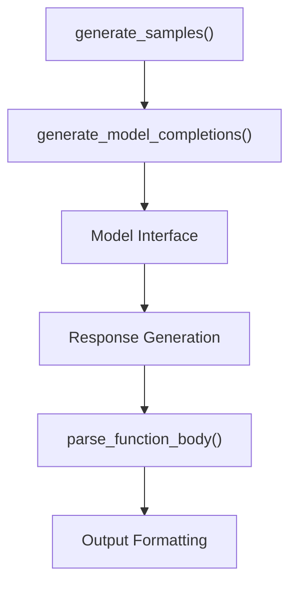
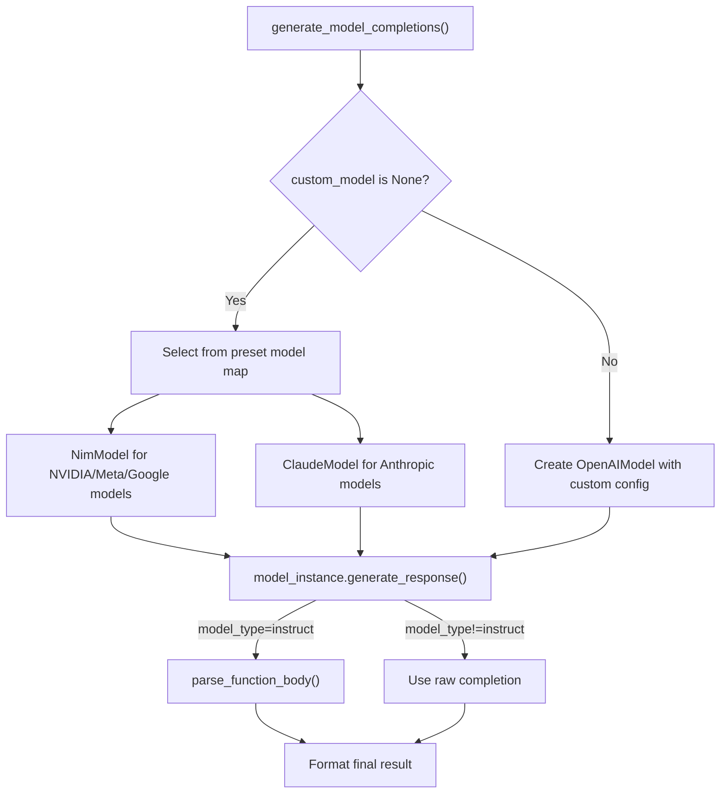
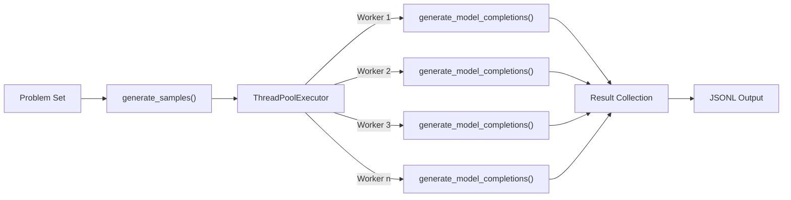
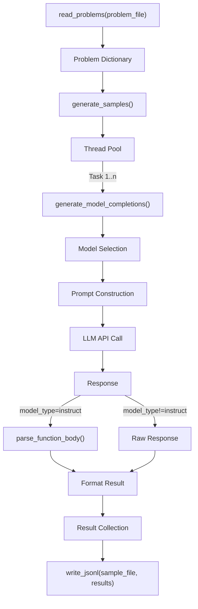
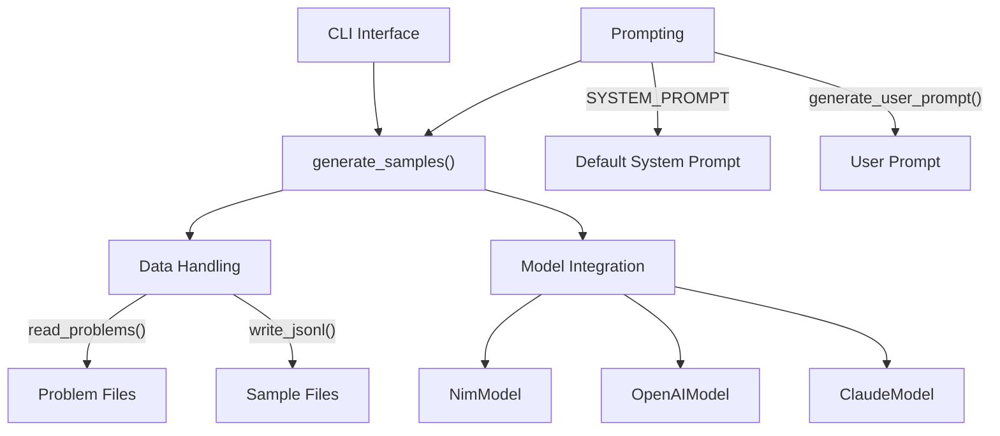

<!-- source: DeepWiki mcp.deepwiki.com · repo NVIDIA/compute-eval · page 6.2 Generation API · fetched 2026-10-26 -->

# Generation API

<details>
<summary>Relevant source files</summary>

The following files were used as context for generating this wiki page:

- [compute_eval/generate_completions.py](compute_eval/generate_completions.py)

</details>


The Generation API is the core component of the compute-eval framework responsible for generating CUDA code samples using various Large Language Models (LLMs). This document details the API functions, parameters, and execution flow for generating code samples from problem definitions. For information about evaluating these generated samples, see [Evaluation API](#6.3).

## Core Functions Overview

The Generation API provides a set of functions that work together to generate code completions for CUDA programming tasks:



Sources: [compute_eval/generate_completions.py:184-245](), [compute_eval/generate_completions.py:29-127](), [compute_eval/generate_completions.py:130-181]()

## Main Generation Function

The primary entry point for code generation is the `generate_samples()` function, which:

1. Reads problems from a specified problem file
2. Creates a thread pool for parallel execution
3. Submits generation tasks to the thread pool
4. Collects and formats results
5. Writes the generated samples to a JSONL file

### Function Signature and Parameters

```
generate_samples(
    problem_file: str,
    sample_file: str = "generated_samples.jsonl",
    num_samples_per_problem: int = 100,
    n_workers: int = 20,
    system_prompt: Optional[str] = SYSTEM_PROMPT,
    print_completions: bool = False,
    include_header_files: bool = False,
    model: Optional[str] = "llama-3.1-70b-instruct",
    model_type: Optional[str] = "instruct",
    custom_model: Optional[dict] = None,
    params: Optional[dict] = None,
)
```

| Parameter | Type | Default | Description |
|-----------|------|---------|-------------|
| `problem_file` | str | (Required) | Path to the JSONL file containing problem definitions |
| `sample_file` | str | "generated_samples.jsonl" | Path to output JSONL file for generated samples |
| `num_samples_per_problem` | int | 100 | Number of code samples to generate per problem |
| `n_workers` | int | 20 | Number of concurrent worker threads for generation |
| `system_prompt` | str | SYSTEM_PROMPT | System prompt to use for instructing the model |
| `print_completions` | bool | False | Whether to print generated completions |
| `include_header_files` | bool | False | Whether to include header files in the prompt |
| `model` | str | "llama-3.1-70b-instruct" | Preset model name to use |
| `model_type` | str | "instruct" | Type of model ("instruct" or "base") |
| `custom_model` | dict | None | Custom model configuration (requires "api_endpoint" and "model_id") |
| `params` | dict | None | Additional parameters to pass to the model |

Sources: [compute_eval/generate_completions.py:184-245]()

## Model Completion Generation

The `generate_model_completions()` function handles the actual interaction with the LLM to generate code. It selects and initializes the appropriate model, constructs the prompt, and processes the model's response.

```mermaid
classDiagram
    class "generate_model_completions" {
        +task_id: str
        +system_prompt: str
        +problem: dict
        +print_completions: bool
        +include_header_files: bool
        +model: str
        +model_type: str
        +custom_model: dict
        +params: dict
        +return: tuple(task_id, result, completion, prompt)
    }
    
    class "Model Selection" {
        +OpenAIModel
        +NimModel
        +ClaudeModel
    }
    
    class "Prompt Generation" {
        +generate_user_prompt()
    }
    
    class "Response Processing" {
        +parse_function_body()
    }
    
    "generate_model_completions" --> "Model Selection": Uses
    "generate_model_completions" --> "Prompt Generation": Calls
    "generate_model_completions" --> "Response Processing": Calls for instruct models
```

Sources: [compute_eval/generate_completions.py:29-127]()

### Model Selection Logic

The function supports two paths for model selection:

1. **Custom Model**: Uses OpenAI-compatible API with custom endpoint and model ID
2. **Preset Models**: Maps model name to an appropriate model instance



Sources: [compute_eval/generate_completions.py:59-126]()

## Function Body Parsing

For instruction-tuned models, the API provides the `parse_function_body()` function to extract the actual code implementation from the model's response, which may include explanations and code blocks.

### Algorithm Steps:

1. Find code block markers (triple backticks)
2. Extract content between markers
3. If `drop_signature` is True, remove the function signature and opening brace
4. Return the function body lines joined with newlines

Sources: [compute_eval/generate_completions.py:130-181]()

## Parallel Execution Model

The Generation API uses Python's ThreadPoolExecutor to generate multiple code samples concurrently:



Sources: [compute_eval/generate_completions.py:205-237]()

## Supported Models

The Generation API provides built-in support for multiple LLMs through a model mapping system:

| Model Name | Provider | Implementation Class |
|------------|----------|---------------------|
| mixtral-8x22b-v0.1 | Mistral AI | NimModel |
| gemma-2-2b-it | Google | NimModel |
| llama-3.1-8b-instruct | Meta | NimModel |
| llama-3.1-70b-instruct | Meta | NimModel |
| llama-3.1-405b-instruct | Meta | NimModel |
| llama-3.2-1b-instruct | Meta | NimModel |
| llama-3.2-3b-instruct | Meta | NimModel |
| llama-3.1-nemotron-70b-instruct | NVIDIA | NimModel |
| nemotron-mini-4b-instruct | NVIDIA | NimModel |
| starcoder2-7b | BigCode | NimModel |
| mistral-nemo-12b-instruct | NVIDIA+Mistral | NimModel |
| claude-sonnet-3.5 | Anthropic | ClaudeModel |

Sources: [compute_eval/generate_completions.py:64-85]()

## Data Flow Through the API

The following diagram illustrates the complete data flow through the Generation API:



Sources: [compute_eval/generate_completions.py:184-245]()

## Output Format

The Generation API produces a JSONL file containing the following fields for each generated sample:

| Field | Description |
|-------|-------------|
| `task_id` | Identifier of the problem |
| `compilable_code` | Complete code including declaration, generated body, and test code |
| `generated_completion` | Only the generated function body |
| `prompt` | The prompt provided to the model |

Sources: [compute_eval/generate_completions.py:230-236]()

## Integration with Other System Components

The Generation API interfaces with other components of the compute-eval framework:



Sources: [compute_eval/generate_completions.py:16-27](), [compute_eval/generate_completions.py:184-245]()

---

