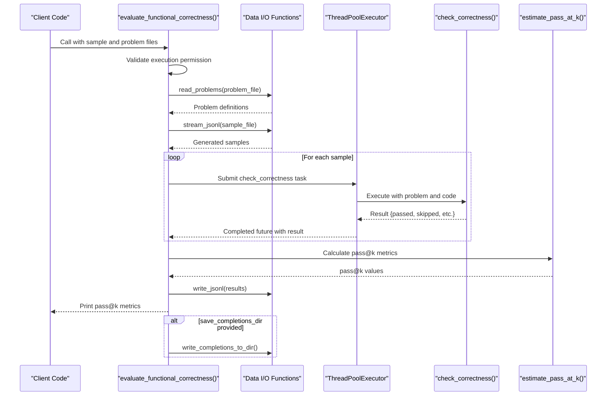
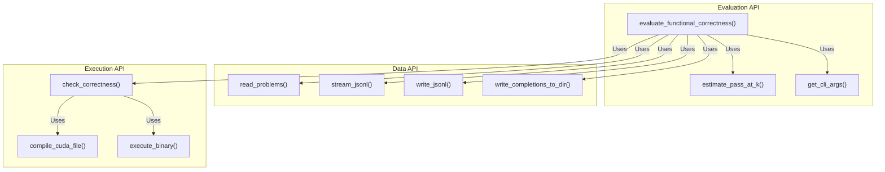

<!-- source: DeepWiki mcp.deepwiki.com · repo NVIDIA/compute-eval · page 6.3 Evaluation API · fetched 2026-10-26 -->

# Evaluation API

<details>
<summary>Relevant source files</summary>

The following files were used as context for generating this wiki page:

- [compute_eval/evaluation.py](compute_eval/evaluation.py)

</details>


This document details the Evaluation API within the compute-eval framework, which is responsible for assessing the functional correctness of CUDA code generated by Large Language Models (LLMs). The API provides mechanisms to compile, execute, and test generated code against reference problems, producing pass@k metrics that indicate model performance.

For information about generating code samples, see [Generation API](#6.2). For details on the secure execution environment, see [Execution API](#6.4).

## Overview

The Evaluation API serves as the component responsible for testing whether generated CUDA code functions correctly. It processes generated samples, executes them in a controlled environment, and evaluates their correctness based on predefined test cases.

```mermaid
flowchart LR
    ProblemFile[/"Problem File
    (JSONL)"/] --> ReadProblems["read_problems()"]
    SampleFile[/"Sample File
    (JSONL)"/] --> ReadSamples["stream_jsonl()"]
    
    ReadProblems --> Problems["Problem Dictionary"]
    ReadSamples --> Samples["Generated Samples"]
    
    Problems --> EvalFunction["evaluate_functional_correctness()"]
    Samples --> EvalFunction
    
    EvalFunction --> ThreadPool["ThreadPoolExecutor"]
    ThreadPool --> |"Multiple threads"| CheckCorrectness["check_correctness()"]
    
    CheckCorrectness --> Results["Results Dictionary"]
    Results --> PassAtK["estimate_pass@k()"]
    
    PassAtK --> FinalResults["Performance Metrics"]
    Results --> OutputFile[/"Results File
    (JSONL)"/]
    
    subgraph "Optional"
        OutputFile --> SaveCompletions["write_completions_to_dir()"]
        SaveCompletions --> CompletionsDir[/"Saved Completions"/]
    end
```



Sources: [compute_eval/evaluation.py:118-233]()

## Core API Functions

### evaluate_functional_correctness

The primary function of the Evaluation API that orchestrates the entire evaluation process.

```python
def evaluate_functional_correctness(
    sample_file: str,
    problem_file: str,
    allow_execution: bool = False,
    k: Tuple[int] = (1, 10, 100),
    n_workers: int = 4,
    timeout: float = 60.0,
    save_completions_dir: str = "",
)
```

**Parameters:**
- `sample_file`: Path to the JSONL file containing generated code samples
- `problem_file`: Path to the JSONL file containing problem definitions
- `allow_execution`: Flag to explicitly permit execution of untrusted code
- `k`: Tuple of values for which to calculate pass@k metrics (default: 1, 10, 100)
- `n_workers`: Number of parallel worker threads for evaluation
- `timeout`: Maximum time allowed for compilation and execution in seconds
- `save_completions_dir`: Optional directory to save completions with results

**Process Flow:**
1. Validates execution permission (exits if `allow_execution` is False)
2. Reads problem definitions from the problem file
3. Processes each sample using a thread pool to check correctness
4. Calculates pass@k metrics across all problems
5. Writes results to a JSONL file and optionally saves completions

**Output:**
- Creates a file named `{sample_file_basename}_correctness_results.jsonl`
- Returns pass@k metrics in the console

Sources: [compute_eval/evaluation.py:118-233]()

### estimate_pass_at_k

Function that calculates the pass@k metric for evaluating model performance.

```python
def estimate_pass_at_k(
    num_samples: Union[int, List[int], np.ndarray],
    num_correct: Union[List[int], np.ndarray],
    k: int,
) -> np.ndarray
```

**Parameters:**
- `num_samples`: Number of samples per problem (can be a constant or array)
- `num_correct`: Number of correctly solved samples per problem
- `k`: The k value for the pass@k calculation
  
**Returns:**
- An array of pass@k probabilities for each problem

Sources: [compute_eval/evaluation.py:77-103]()

### get_cli_args

Utility function that extracts compilation and linking flags from problem definitions.

```python
def get_cli_args(problem: Dict[str, Dict]) -> str
```

**Parameters:**
- `problem`: Dictionary containing problem definition with optional `cc_flags` and `ld_flags`

**Returns:**
- A string containing the command-line arguments for compilation

Sources: [compute_eval/evaluation.py:105-115]()

## Evaluation Process Details

The evaluation process involves several stages, coordinated by the main evaluation function:



Sources: [compute_eval/evaluation.py:118-187]()

## Understanding pass@k Metric

The pass@k metric is a statistical measure that estimates the probability of solving a problem if the model is allowed k attempts. This is particularly useful for evaluating code generation models that can produce multiple solutions for the same problem.

### Mathematical Definition

For a problem with n samples and c correct solutions, pass@k is calculated as:

1 - (combinations of k incorrect solutions from n-c) / (combinations of k solutions from n)

This is implemented using the formula:
```
pass@k = 1.0 - prod(1.0 - k / range(n-c+1, n+1))
```

This metric provides a robust way to evaluate model performance even when generating multiple samples per problem.

Sources: [compute_eval/evaluation.py:77-103]()

## Data Structures

### Input Format

The Evaluation API expects two key inputs, both in JSONL format:

1. **Problem File**: Contains problem definitions with test cases
   ```json
   {
     "task_id": "unique_problem_identifier",
     "entry_point": "function_name",
     "cc_flags": "optional_compiler_flags",
     "ld_flags": "optional_linker_flags",
     "cuda_version": "optional_cuda_version"
   }
   ```

2. **Sample File**: Contains generated code solutions
   ```json
   {
     "task_id": "unique_problem_identifier",
     "compilable_code": "generated_cuda_code"
   }
   ```

### Output Format

The API produces a JSONL file with detailed results for each sample:
```json
{
  "task_id": "unique_problem_identifier",
  "compilable_code": "generated_cuda_code",
  "result": "execution_result_or_error",
  "skipped": false,
  "passed": true,
  "completion_id": 0
}
```

Sources: [compute_eval/evaluation.py:149-233]()

## Security Warning

The Evaluation API executes untrusted model-generated code, which poses potential security risks. The system displays a prominent warning message:

```
===================
     WARNING
===================

Evaluation of correctness or performance will execute untrusted model-generated
code.

Although it is highly unlikely that model-generated code will do something
overtly malicious in response to this test suite, model-generated code may act
destructively due to a lack of model capability or alignment.

Users are strongly encouraged to sandbox this evaluation suite so that it does
not perform destructive actions on their host or network.

In order to execute this code you must explicitly pass the --allow-execution flag.
```

To enable execution, the `allow_execution` parameter must be explicitly set to `True`. Otherwise, the program will exit with the warning message.

Sources: [compute_eval/evaluation.py:58-74]()

## Integration with Other Components

The Evaluation API interfaces with several other components in the compute-eval system:



Sources: [compute_eval/evaluation.py:51-58](), [compute_eval/evaluation.py:118-233]()

## Usage Example

Here's a minimal example of using the Evaluation API:

```python
from compute_eval.evaluation import evaluate_functional_correctness

# Evaluate generated samples against problem definitions
evaluate_functional_correctness(
    sample_file="generated_samples.jsonl",
    problem_file="cuda_problems.jsonl",
    allow_execution=True,  # Explicitly allow code execution
    k=(1, 10, 100),        # Calculate pass@1, pass@10, and pass@100
    n_workers=4,           # Use 4 parallel workers
    timeout=60.0,          # 60-second timeout
)
```

The function will produce a results file named `generated_samples_correctness_results.jsonl` and print the pass@k metrics to the console.

## Error Handling

The Evaluation API handles several error conditions:

1. **Execution Safety**: Exits if `allow_execution=False` to prevent accidental execution of untrusted code
2. **Skipped Problems**: If a problem's samples are all skipped (e.g., due to incompatible GPU architecture), the problem is excluded from pass@k calculations
3. **Missing Problems**: Verifies that all problems defined in the problem file have corresponding samples
4. **Invalid Directories**: When `save_completions_dir` is specified, ensures the directory exists

Sources: [compute_eval/evaluation.py:132-147](), [compute_eval/evaluation.py:183-200]()

## Performance Considerations

The Evaluation API is designed for efficiency when evaluating large numbers of generated code samples:

1. **Parallel Execution**: Uses a thread pool to check correctness of multiple samples simultaneously
2. **Progress Reporting**: Employs tqdm progress bars to provide feedback during long-running evaluations
3. **Timeouts**: Each compilation and execution has a configurable timeout to prevent hanging on problematic samples
4. **Batch Processing**: Streams samples from disk rather than loading them all into memory

Sources: [compute_eval/evaluation.py:152-180](), [compute_eval/evaluation.py:185-187]()

---

