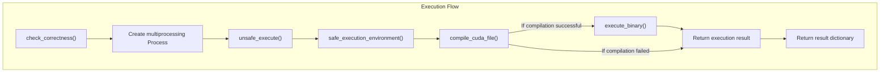
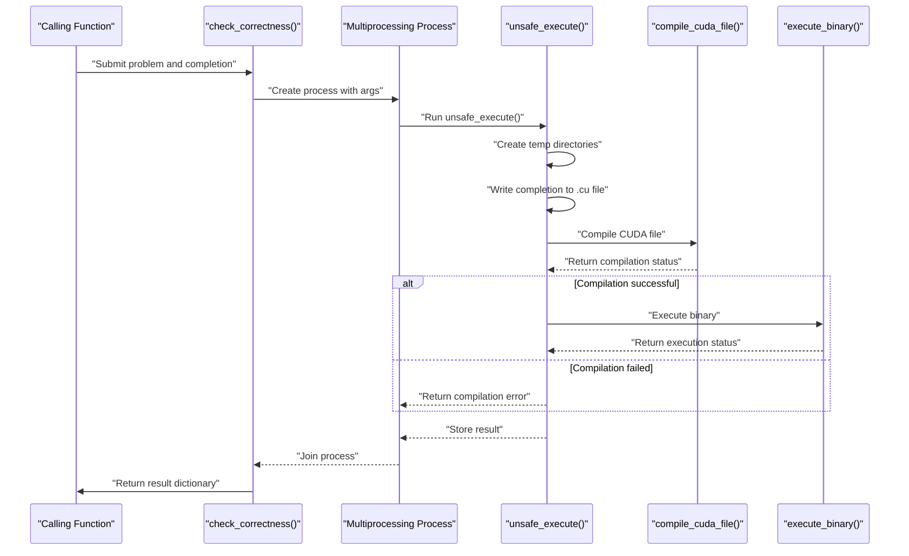
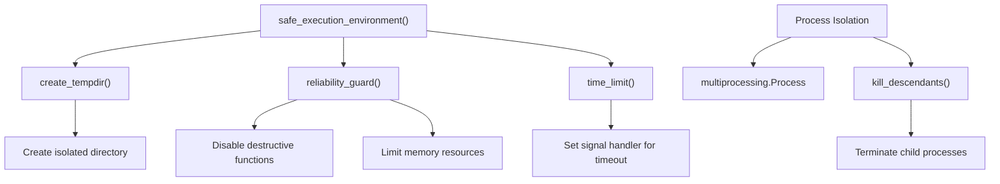
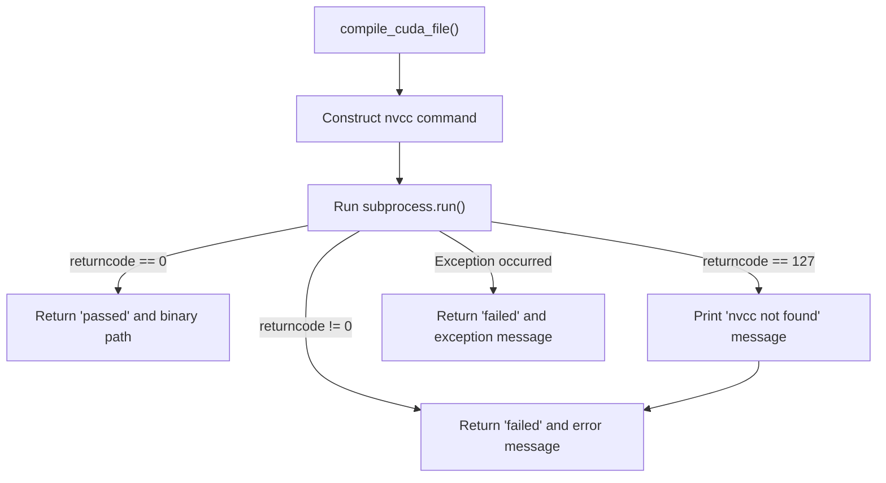
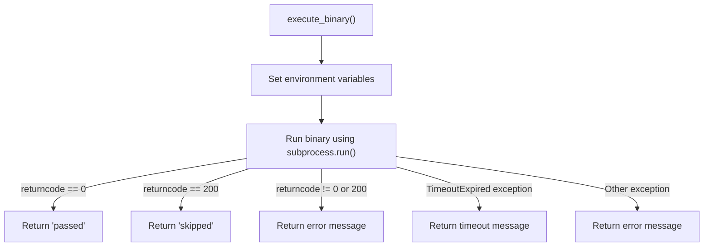
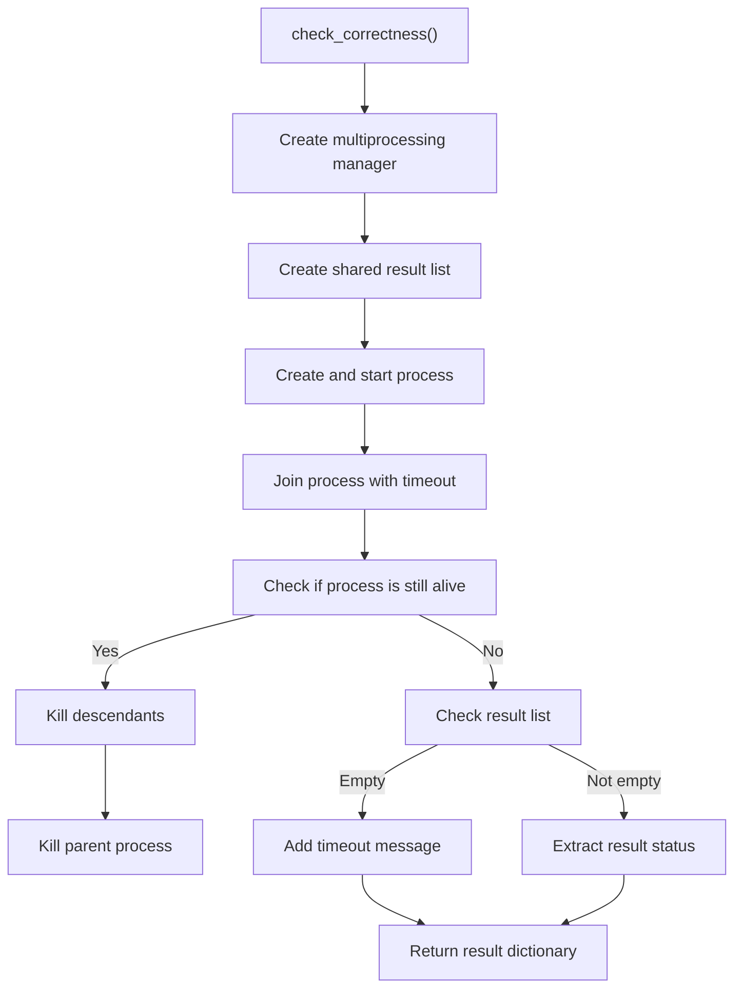

<!-- source: DeepWiki mcp.deepwiki.com · repo NVIDIA/compute-eval · page 6.4 Execution API · fetched 2026-10-26 -->

# Execution API

Relevant source files

The following files were used as context for generating this wiki page:

- [compute_eval/execution.py](compute_eval/execution.py)

The Execution API is responsible for securely compiling and executing CUDA code within the Compute-Eval framework. This API provides a controlled environment for testing generated CUDA code, ensuring reliable evaluation of model-generated samples. For information about evaluation metrics and processes, see [Evaluation API](#6.3).

## Overview

The Execution API handles the compilation and execution of CUDA code samples with safety mechanisms to prevent harmful operations. It enables the functional correctness testing of LLM-generated CUDA code by compiling the code, running it, and determining whether it produces the expected results.

Sources: [compute_eval/execution.py:206-247]()

## Key Functions

The Execution API provides several core functions for working with CUDA code:

| Function | Purpose | Key Parameters | Return Value |
|----------|---------|----------------|--------------|
| `check_correctness()` | Evaluates functional correctness of completions | problem, completion, timeout | Result dictionary |
| `compile_cuda_file()` | Compiles CUDA file into binary | cuda_file_path, output_binary_path, timeout | Tuple (status, message) |
| `execute_binary()` | Runs compiled binary | binary_file_path, cuda_file_path, timeout | Status string |
| `unsafe_execute()` | Coordinates compilation and execution | timeout, result, completion, problem | None (updates result list) |
| `safe_execution_environment()` | Creates safe execution context | timeout | Context manager |
| `reliability_guard()` | Disables destructive functions | maximum_memory_bytes | None |

Sources: [compute_eval/execution.py:57-433]()

### Compilation and Execution Pipeline

Sources: [compute_eval/execution.py:156-196](), [compute_eval/execution.py:206-247]()

## Safety Mechanisms

The Execution API implements several safety mechanisms to prevent harmful code execution:

### Secure Execution Environment

Sources: [compute_eval/execution.py:130-152](), [compute_eval/execution.py:332-416](), [compute_eval/execution.py:251-273](), [compute_eval/execution.py:418-433]()

The execution environment includes:

1. **Temporary Directories**: All code is executed within isolated temporary directories
2. **Process Isolation**: Each execution runs in a separate process
3. **Timeout Handling**: Executions are limited by configurable timeouts
4. **Resource Limits**: Memory usage can be restricted
5. **Function Disabling**: Potentially destructive system functions are disabled

Sources: [compute_eval/execution.py:332-416]()

## Code Compilation Function

The `compile_cuda_file` function handles the compilation of CUDA source code:

Sources: [compute_eval/execution.py:57-92]()

### Key Parameters:
- `cuda_file_path`: Path to the CUDA source file
- `output_binary_path`: Destination path for compiled binary
- `timeout`: Maximum time (in seconds) for compilation
- `cli_args`: Optional NVCC command-line arguments

Sources: [compute_eval/execution.py:57-69]()

## Binary Execution Function

The `execute_binary` function runs compiled binaries with proper isolation:

Sources: [compute_eval/execution.py:95-127]()

### Key Parameters:
- `binary_file_path`: Path to the compiled binary
- `cuda_file_path`: Path to the source CUDA file (for reference)
- `timeout`: Maximum execution time in seconds

Sources: [compute_eval/execution.py:95-102]()

## Correctness Checking Workflow

The `check_correctness` function coordinates the overall execution process:

Sources: [compute_eval/execution.py:206-247]()

The result dictionary contains:
- `task_id`: Problem identifier
- `passed`: Boolean indicating success
- `skipped`: Boolean indicating if execution was skipped
- `result`: Detailed result message
- `completion_id`: Optional identifier for the completion

Sources: [compute_eval/execution.py:241-247]()

## Context Managers and Utilities

The API provides several context managers to support the execution environment:

| Context Manager | Purpose |
|-----------------|---------|
| `safe_execution_environment()` | Creates an isolated execution environment |
| `time_limit()` | Sets a time limit for execution |
| `create_tempdir()` | Creates a temporary directory |
| `swallow_io()` | Captures and redirects stdout/stderr |
| `chdir()` | Changes directory with cleanup |

Sources: [compute_eval/execution.py:130-152](), [compute_eval/execution.py:251-273](), [compute_eval/execution.py:286-290](), [compute_eval/execution.py:277-282](), [compute_eval/execution.py:317-330]()

## Usage Example

The Execution API is primarily used internally by the Evaluation API ([Evaluation API](#6.3)) to check the correctness of generated CUDA code samples. A typical usage flow is:

1. The Evaluation API processes a set of generated code samples
2. For each sample, `check_correctness()` is called with the problem and completion
3. The function handles compilation and execution safely
4. Results are gathered and analyzed to calculate pass@k metrics

Sources: [compute_eval/execution.py:206-247]()

## Error Handling

The Execution API implements robust error handling to ensure graceful failure in case of:

1. Compilation errors (invalid CUDA code)
2. Runtime errors (segmentation faults, invalid operations)
3. Timeouts (infinite loops, excessive computation)
4. Resource exhaustion (memory limits)
5. Missing CUDA compiler or incompatible architecture

All errors are captured and reported in a consistent format to facilitate analysis.

Sources: [compute_eval/execution.py:90-92](), [compute_eval/execution.py:123-127](), [compute_eval/execution.py:193-196]()

---

