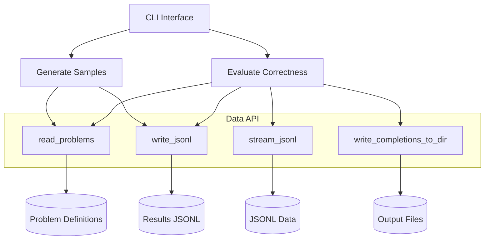
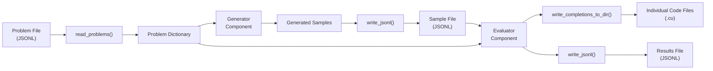
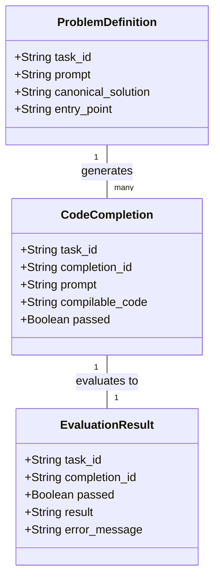

<!-- source: DeepWiki mcp.deepwiki.com · repo NVIDIA/compute-eval · page 6.5 Data API · fetched 2026-10-26 -->

# Data API

<details>
<summary>Relevant source files</summary>

The following files were used as context for generating this wiki page:

- [compute_eval/data.py](compute_eval/data.py)

</details>


The Data API provides functionality for handling data input/output operations in the compute-eval framework. It is responsible for reading problem definitions, parsing JSONL files, and writing evaluation results to various output formats. For information about generating code samples, see [Generation API](#6.2), and for evaluating those samples, see [Evaluation API](#6.3).

## Overview

The Data API serves as the data handling layer in the compute-eval system, facilitating the flow of information between different components of the framework. Its primary responsibilities include:

- Reading problem definitions from JSONL files
- Streaming and parsing JSONL data
- Writing code completions to files with metadata
- Writing results to JSONL files



Sources: [compute_eval/data.py:48-111]()

## Core Functions

The Data API consists of four main functions that handle different aspects of data processing:

| Function | Purpose | Parameters | Return Value |
|----------|---------|------------|--------------|
| `read_problems` | Reads problem definitions from a JSONL file | `evalset_file`: Path to JSONL file | Dictionary mapping task IDs to problem definitions |
| `stream_jsonl` | Parses JSONL files line by line | `filename`: Path to JSONL file | Iterable of dictionaries |
| `write_completions_to_dir` | Writes code completions to individual files | `dir_path`: Output directory<br>`data`: Completion data | None |
| `write_jsonl` | Writes data to a JSONL file | `filename`: Output file path<br>`data`: Data to write<br>`append`: Whether to append | None |

Sources: [compute_eval/data.py:48-111]()

### read_problems

```python
def read_problems(evalset_file: str) -> Dict[str, Dict]:
    return {task["task_id"]: task for task in stream_jsonl(evalset_file)}
```

This function reads problem definitions from a JSONL file and returns them as a dictionary indexed by task ID. It utilizes the `stream_jsonl` function to parse the file.

Sources: [compute_eval/data.py:48-49]()

### stream_jsonl

```python
def stream_jsonl(filename: str) -> Iterable[Dict]:
    """
    Parses each jsonl line and yields it as a dictionary
    """
```

This function parses JSONL files (with optional gzip compression) and yields each line as a Python dictionary. It handles both compressed (.gz) and uncompressed files, skipping blank lines.

Sources: [compute_eval/data.py:52-66]()

### write_completions_to_dir

```python
def write_completions_to_dir(dir_path: str, data: Iterable[Dict]):
    """
    Writes the prompt, pass / fail and the completion of each provided sample
    to a specific directory.
    """
```

This function writes code completions to individual files in a specified directory, including metadata about whether they passed or failed evaluation. Each file is named using the task ID and completion ID pattern.

Sources: [compute_eval/data.py:69-90]()

### write_jsonl

```python
def write_jsonl(filename: str, data: Iterable[Dict], append: bool = False):
    """
    Writes an iterable of dictionaries to jsonl
    """
```

This function writes an iterable of dictionaries to a JSONL file, with optional gzip compression and appending capabilities.

Sources: [compute_eval/data.py:92-111]()

## Data Flow

The following diagram illustrates how data flows through the Data API functions within the compute-eval system:



Sources: [compute_eval/data.py:48-111]()

## Data Formats

### Problem Definition Format

Problem definitions are stored in JSONL format, with each line containing a JSON object representing a single problem:

```json
{
  "task_id": "unique_identifier",
  "prompt": "Problem description and code stub",
  "canonical_solution": "Reference solution",
  "entry_point": "Function name to be tested"
}
```

Sources: [compute_eval/data.py:48-49]()

### Completion Format

Completions generated by models are stored with the following structure:

```json
{
  "task_id": "unique_identifier",
  "completion_id": "unique_completion_identifier",
  "prompt": "Original prompt given to the model",
  "compilable_code": "Generated code solution",
  "passed": true/false
}
```

Sources: [compute_eval/data.py:69-90]()

### Data Structure Relationships

The following diagram shows the relationships between the different data structures handled by the Data API:



Sources: [compute_eval/data.py:48-111]()

## Usage Examples

### Reading Problems

```python
# Read problems from a JSONL file
problems = read_problems("problems.jsonl")
for task_id, problem in problems.items():
    print(f"Task ID: {task_id}")
    print(f"Prompt: {problem['prompt'][:100]}...")
```

Sources: [compute_eval/data.py:48-49]()

### Streaming JSONL

```python
# Stream and process JSONL data
for item in stream_jsonl("results.jsonl"):
    print(f"Task ID: {item['task_id']}")
    print(f"Passed: {item['passed']}")
```

Sources: [compute_eval/data.py:52-66]()

### Writing Completions

```python
# Write completions to a directory
completions = [
    {
        "task_id": "cuda_001",
        "completion_id": "completion_1",
        "prompt": "Write a CUDA kernel to add two vectors",
        "compilable_code": "// CUDA code here",
        "passed": True
    }
]
write_completions_to_dir("output_dir", completions)
```

Sources: [compute_eval/data.py:69-90]()

### Writing JSONL

```python
# Write data to a JSONL file
results = [
    {
        "task_id": "cuda_001",
        "completion_id": "completion_1",
        "passed": True,
        "result": "passed",
        "error_message": None
    }
]
write_jsonl("results.jsonl", results)
```

Sources: [compute_eval/data.py:92-111]()

## JSONL Format

JSONL (JSON Lines) is a text format where each line is a valid JSON object. This format is particularly suitable for streaming and processing large datasets line by line. In the compute-eval system, JSONL is used for:

- Problem definitions (input)
- Generated code completions (intermediate data)
- Evaluation results (output)

The Data API provides functions to read from and write to JSONL files, with support for gzip compression.

Sources: [compute_eval/data.py:52-66](), [compute_eval/data.py:92-111]()