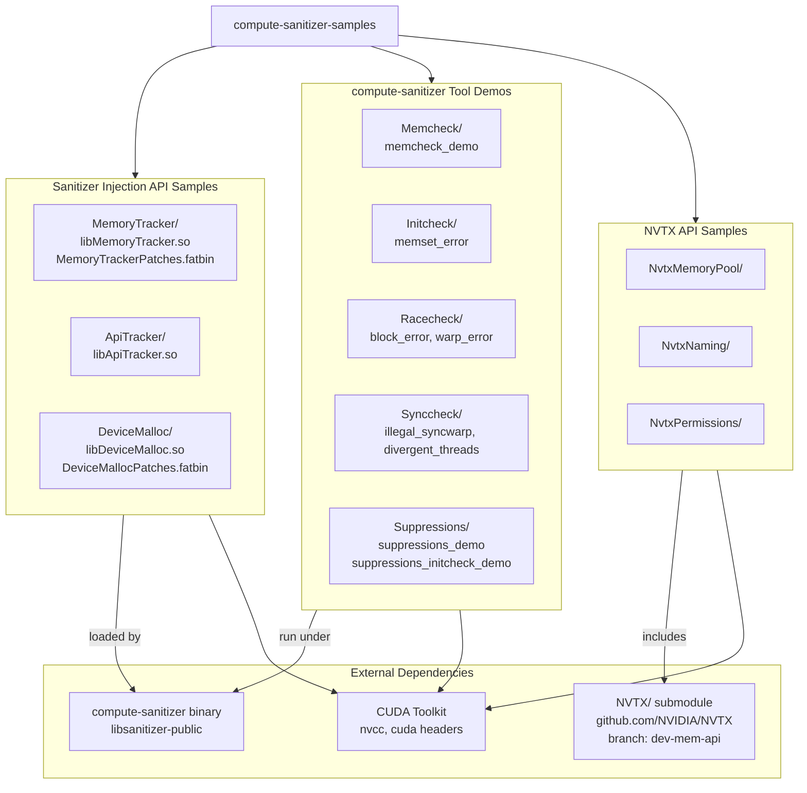
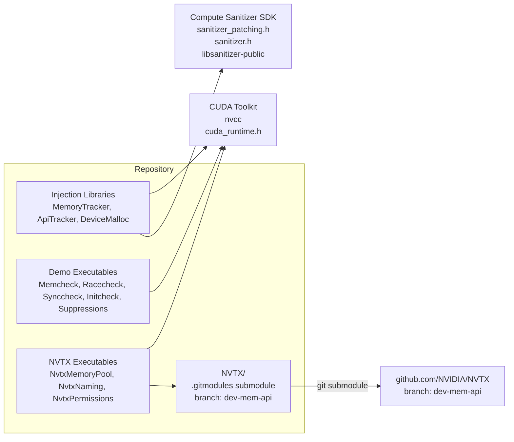

<!-- source: DeepWiki mcp.deepwiki.com · repo NVIDIA/compute-sanitizer-samples · page 1 Overview · fetched 2026-10-26 -->

# Overview

Relevant source files

The following files were used as context for generating this wiki page:

- [.gitignore](.gitignore)
- [.gitmodules](.gitmodules)
- [README.md](README.md)

This page describes the purpose, structure, and contents of the `compute-sanitizer-samples` repository. It serves as a navigational entry point to the three distinct categories of samples contained within. For implementation details of any specific category, follow the links to their dedicated pages.

## Purpose

The repository provides working reference implementations that demonstrate three distinct APIs related to NVIDIA Compute Sanitizer:

1. **Sanitizer Injection API** — shared libraries loaded by `compute-sanitizer` at runtime to perform custom instrumentation.
2. **compute-sanitizer Tool Demos** — standalone CUDA programs that exercise the built-in `memcheck`, `racecheck`, `synccheck`, and `initcheck` tools.
3. **NVTX Memory API Samples** — CUDA programs that annotate memory using the NVTX library so that `compute-sanitizer` can provide richer diagnostics.

Sources: [README.md:1-7]()

---

## Repository Structure

The top-level layout of the repository groups samples by API category. The NVTX samples carry an external dependency via a Git submodule.

**Diagram: Top-Level Directory and Artifact Mapping**

Sources: [README.md:1-7](), [.gitmodules:1-4]()

---

## Sample Categories

### 1. Sanitizer Injection API Samples

These samples produce shared libraries (`.so` files) that are loaded into a target process by `compute-sanitizer` using the `--injection` flag. They use `sanitizerSubscribe` to register callbacks on CUDA runtime events and, in some cases, patch device-side instructions by compiling a `.fatbin` with `--compile-as-tools-patch`.

| Sample | Primary Build Artifact(s) | What It Tracks |
|---|---|---|
| `MemoryTracker` | `libMemoryTracker.so`, `MemoryTrackerPatches.fatbin` | Every global, shared, and local memory access per kernel |
| `ApiTracker` | `libApiTracker.so` | CUDA Runtime API calls and their return codes |
| `DeviceMalloc` | `libDeviceMalloc.so`, `DeviceMallocPatches.fatbin` | Device-side `malloc`, `free`, and `__nv_aligned_device_malloc` calls |

For the shared architecture of these libraries (callback subscription, module patching, lifecycle), see [Sanitizer Injection API Samples](#2). For individual samples, see [MemoryTracker](#2.1), [ApiTracker](#2.2), and [DeviceMalloc](#2.3).

---

### 2. compute-sanitizer Tool Demos

These are standalone CUDA executables that contain intentional errors. They are meant to be run under `compute-sanitizer` to illustrate what each built-in tool detects and how to interpret its output.

| Demo Program | Tool | Error Demonstrated |
|---|---|---|
| `memcheck_demo` | `memcheck` | Misaligned write, out-of-bounds write, memory leak |
| `memset_error` | `initcheck` | Under-sized `cudaMemset` leaves bytes uninitialized |
| `block_error` | `racecheck` | Block-level race condition across unsynchronized threads |
| `warp_error` | `racecheck` | Warp-level race due to missing warp synchronization |
| `illegal_syncwarp` | `synccheck` | `__syncwarp` mask that excludes an active thread |
| `divergent_threads` | `synccheck` | `__syncthreads` inside a divergent conditional |
| `suppressions_demo` | `memcheck` + suppressions | Suppression file workflow with `--save`/`--suppressions` |
| `suppressions_initcheck_demo` | `initcheck` + suppressions | Same suppression workflow for initcheck errors |

For details, see [compute-sanitizer Tool Demos](#3).

---

### 3. NVTX API Samples

These samples demonstrate the NVTX Memory Extension API, which allows a CUDA application to annotate memory regions so that `compute-sanitizer` can attribute diagnostics to user-defined labels, pools, and access permissions.

| Sample | Key API Usage | What It Shows |
|---|---|---|
| `NvtxMemoryPool` | `nvtxMemHeapRegister` | Suballocator heap registration and bounds checking |
| `NvtxNaming` | `nvtxMemRegionsName` | Named allocations in leak-check and initcheck reports |
| `NvtxPermissions` | `nvtxMemRegionsSetPermissions` | Per-region read/write/atomic permission enforcement |

For details, see [NVTX API Samples](#4).

---

## External Dependencies

**Diagram: Dependency Resolution**

| Dependency | How It Is Consumed | Used By |
|---|---|---|
| CUDA Toolkit (`nvcc`, `cuda_runtime.h`) | System installation, referenced by all Makefiles | All samples |
| Compute Sanitizer SDK (`sanitizer.h`, `sanitizer_patching.h`, `libsanitizer-public`) | Include/link paths in injection library Makefiles | Injection API samples |
| NVTX submodule (`NVTX/`, branch `dev-mem-api`) | Git submodule at repo root, header-only include | NVTX API samples |

The NVTX submodule is declared in [.gitmodules:1-4]() and must be initialized (`git submodule update --init`) before building the NVTX samples.

Sources: [.gitmodules:1-4](), [README.md:1-7]()

---

