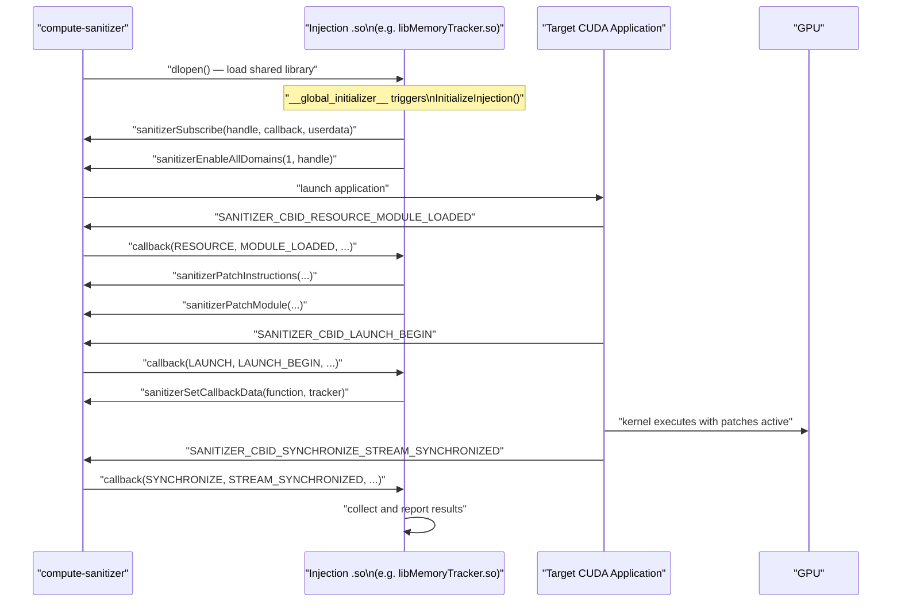
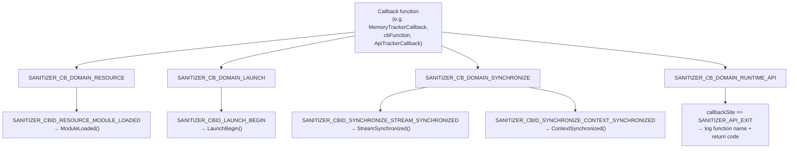
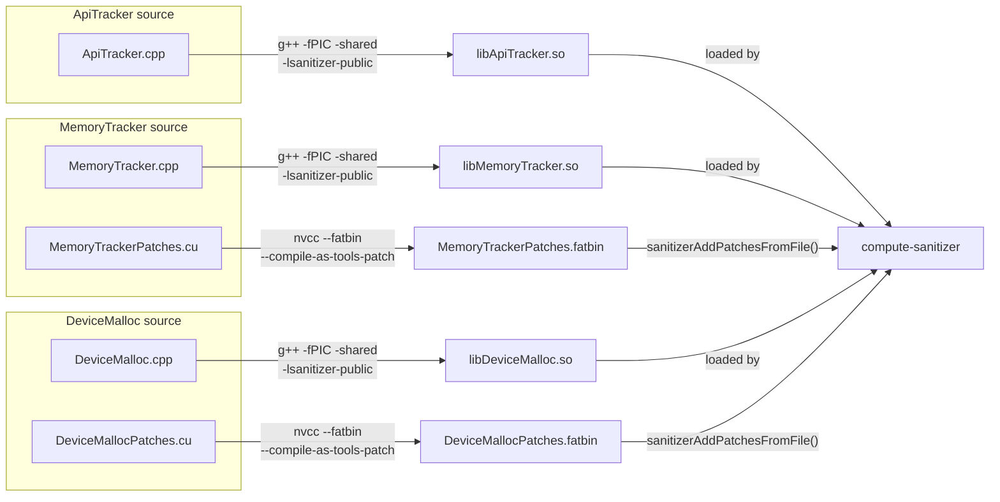

<!-- source: DeepWiki mcp.deepwiki.com · repo NVIDIA/compute-sanitizer-samples · page 2 Sanitizer Injection API Samples · fetched 2026-10-26 -->

# Sanitizer Injection API Samples

<details>
<summary>Relevant source files</summary>

The following files were used as context for generating this wiki page:

- [ApiTracker/ApiTracker.cpp](ApiTracker/ApiTracker.cpp)
- [DeviceMalloc/DeviceMalloc.cpp](DeviceMalloc/DeviceMalloc.cpp)
- [DeviceMalloc/DeviceMalloc.h](DeviceMalloc/DeviceMalloc.h)
- [DeviceMalloc/DeviceMallocPatches.cu](DeviceMalloc/DeviceMallocPatches.cu)
- [DeviceMalloc/Makefile](DeviceMalloc/Makefile)
- [MemoryTracker/MemoryTracker.cpp](MemoryTracker/MemoryTracker.cpp)

</details>


This page describes the architecture and conventions shared by all three injection-library samples in the repository: **MemoryTracker**, **ApiTracker**, and **DeviceMalloc**. These samples are built as shared libraries (`.so` files) that are loaded into the target process at runtime by `compute-sanitizer`. The page focuses on the structural patterns common to all three. For the specifics of each sample, see:

- [MemoryTracker](#2.1) — global/shared/local memory access recording
- [ApiTracker](#2.2) — CUDA runtime API call logging
- [DeviceMalloc](#2.3) — device-side `malloc`/`free` monitoring

---

## What an Injection Library Does

When `compute-sanitizer` is invoked with `--injection-path` or using a built-in tool, it loads a shared library into the target process before the application runs. The library registers a callback function with the Sanitizer API. From that point on, `compute-sanitizer` calls that function whenever notable events occur — module loads, kernel launches, and synchronization points — giving the library a chance to instrument GPU code or collect data.

**Diagram: Runtime loading and callback flow**



Sources: [MemoryTracker/MemoryTracker.cpp:286-297](), [ApiTracker/ApiTracker.cpp:56-66](), [DeviceMalloc/DeviceMalloc.cpp:196-206]()

---

## The Bootstrap Pattern

Every injection library must register itself with the Sanitizer before the application code runs. All three samples use the same idiom: a file-scope integer variable initialized by calling `InitializeInjection()`.

```
// All three files end with this pattern:
int InitializeInjection()  { ... }
int __global_initializer__ = InitializeInjection();
```

Because C++ initializes file-scope variables with dynamic initializers before `main()` is entered, `InitializeInjection()` runs automatically as soon as the shared library is loaded into the process. The return value is discarded; the variable `__global_initializer__` exists only to trigger the call.

Inside `InitializeInjection()`, each sample calls:

1. `sanitizerSubscribe(&handle, callbackFn, userdata)` — registers the callback and stores a `Sanitizer_SubscriberHandle`
2. Either `sanitizerEnableAllDomains(1, handle)` or `sanitizerEnableDomain(1, handle, domain)` — selects which callback domains to receive

| Sample | Subscribe call | Domain activation |
|---|---|---|
| MemoryTracker | `MemoryTrackerCallback`, `&tracker` | `sanitizerEnableAllDomains` |
| ApiTracker | `ApiTrackerCallback`, `nullptr` | `sanitizerEnableDomain(..., SANITIZER_CB_DOMAIN_RUNTIME_API)` |
| DeviceMalloc | `cbFunction`, `nullptr` | `sanitizerEnableAllDomains` |

Sources: [MemoryTracker/MemoryTracker.cpp:286-297](), [ApiTracker/ApiTracker.cpp:56-66](), [DeviceMalloc/DeviceMalloc.cpp:196-206]()

---

## Callback Domains

The Sanitizer API dispatches events grouped into *domains*. Each callback receives a `Sanitizer_CallbackDomain` enum value and a `Sanitizer_CallbackId` enum value identifying the precise event.

**Diagram: Callback domain and event mapping to handler functions**



The `SANITIZER_CB_DOMAIN_RUNTIME_API` domain is used exclusively by ApiTracker. The `RESOURCE`, `LAUNCH`, and `SYNCHRONIZE` domains form the core lifecycle used by MemoryTracker and DeviceMalloc.

Sources: [MemoryTracker/MemoryTracker.cpp:226-284](), [ApiTracker/ApiTracker.cpp:35-54](), [DeviceMalloc/DeviceMalloc.cpp:146-194]()

---

## The Module-Patch-Launch-Synchronize Lifecycle

The two samples that instrument device code (MemoryTracker and DeviceMalloc) follow a four-stage lifecycle:

### Stage 1 — Module Loaded

When the Sanitizer reports `SANITIZER_CBID_RESOURCE_MODULE_LOADED`, the library receives a `Sanitizer_ResourceModuleData*` containing the loaded CUDA module. The handler:

1. Calls `sanitizerAddPatchesFromFile("*.fatbin", 0)` to load the pre-compiled patch functions into the runtime
2. Calls `sanitizerPatchInstructions(SANITIZER_INSTRUCTION_*, module, "PatchFunctionName")` once per instruction class to be intercepted
3. Calls `sanitizerPatchModule(module)` to apply all registered patches to the module's PTX/SASS

| Sample | Instruction types patched |
|---|---|
| MemoryTracker | `GLOBAL_MEMORY_ACCESS`, `SHARED_MEMORY_ACCESS`, `LOCAL_MEMORY_ACCESS`, `MEMCPY_ASYNC` |
| DeviceMalloc | `DEVICE_SIDE_MALLOC`, `DEVICE_SIDE_FREE`, `DEVICE_ALIGNED_MALLOC` |

Sources: [MemoryTracker/MemoryTracker.cpp:77-90](), [DeviceMalloc/DeviceMalloc.cpp:116-128]()

### Stage 2 — Launch Begin

When `SANITIZER_CBID_LAUNCH_BEGIN` fires, a `Sanitizer_LaunchData*` provides the `CUcontext`, `CUfunction`, stream handle, and function name. The handler:

1. Allocates a per-launch tracking buffer in device-accessible memory using `sanitizerAlloc` (MemoryTracker) or `sanitizerAllocHost` (DeviceMalloc)
2. Initializes the buffer and copies it to the device
3. Calls `sanitizerSetCallbackData(function, tracker)` (MemoryTracker) or `sanitizerSetLaunchCallbackData(hLaunch, function, stream, tracker)` (DeviceMalloc) — this makes the tracker pointer available to device-side patch functions as their `userdata` argument

Sources: [MemoryTracker/MemoryTracker.cpp:105-133](), [DeviceMalloc/DeviceMalloc.cpp:130-144]()

### Stage 3 — Kernel Execution

While the kernel runs, every patched instruction calls the corresponding device-side patch function (compiled into the `.fatbin`). The patch function receives `userdata` (the tracker pointer), records data atomically, and returns `SANITIZER_PATCH_SUCCESS`.

### Stage 4 — Synchronization

On `SANITIZER_CBID_SYNCHRONIZE_STREAM_SYNCHRONIZED` or `SANITIZER_CBID_SYNCHRONIZE_CONTEXT_SYNCHRONIZED`, the host copies the accumulated device data back and reports or processes it.

Sources: [MemoryTracker/MemoryTracker.cpp:174-224](), [DeviceMalloc/DeviceMalloc.cpp:60-92]()

---

## Build Artifacts

Each injection sample produces either one or two build artifacts:

| Sample | Host artifact | Device artifact |
|---|---|---|
| MemoryTracker | `libMemoryTracker.so` | `MemoryTrackerPatches.fatbin` |
| ApiTracker | `libApiTracker.so` | *(none — no device patching)* |
| DeviceMalloc | `libDeviceMalloc.so` | `DeviceMallocPatches.fatbin` |

The host library is compiled with `g++` using `-fPIC -shared` and links against `-lsanitizer-public` from `$(SANITIZER_PATH)`. The device fatbin is compiled with `nvcc --fatbin --compile-as-tools-patch` and targets all architectures listed in `GENCODE_FLAGS`. Both artifacts must be present in the same directory at runtime for module patching to succeed.

**Diagram: Build artifact relationships**



Sources: [DeviceMalloc/Makefile:38-81]()

---

## Summary of Sanitizer API Calls Used

The following table lists every Sanitizer API function used across the injection samples and where each appears:

| API Function | Purpose | Used In |
|---|---|---|
| `sanitizerSubscribe` | Register callback | All three |
| `sanitizerEnableAllDomains` | Enable all callback domains | MemoryTracker, DeviceMalloc |
| `sanitizerEnableDomain` | Enable a single domain | ApiTracker |
| `sanitizerAddPatchesFromFile` | Load `.fatbin` patch functions | MemoryTracker, DeviceMalloc |
| `sanitizerPatchInstructions` | Bind patch function to instruction class | MemoryTracker, DeviceMalloc |
| `sanitizerPatchModule` | Apply all patches to module | MemoryTracker, DeviceMalloc |
| `sanitizerAlloc` | Allocate device-accessible memory | MemoryTracker |
| `sanitizerAllocHost` | Allocate host memory accessible from device | DeviceMalloc |
| `sanitizerMemset` | Zero device memory | MemoryTracker |
| `sanitizerMemcpyHostToDeviceAsync` | Copy tracker to device | MemoryTracker |
| `sanitizerMemcpyDeviceToHost` | Copy results back to host | MemoryTracker |
| `sanitizerSetCallbackData` | Bind userdata to a kernel function | MemoryTracker |
| `sanitizerSetLaunchCallbackData` | Bind userdata to a specific launch | DeviceMalloc |
| `sanitizerFree` | Free sanitizer-managed memory | MemoryTracker |

Sources: [MemoryTracker/MemoryTracker.cpp:77-133](), [MemoryTracker/MemoryTracker.cpp:174-224](), [MemoryTracker/MemoryTracker.cpp:286-297](), [ApiTracker/ApiTracker.cpp:56-66](), [DeviceMalloc/DeviceMalloc.cpp:116-206]()

---

