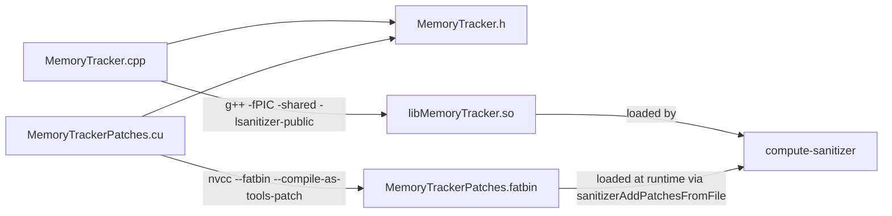
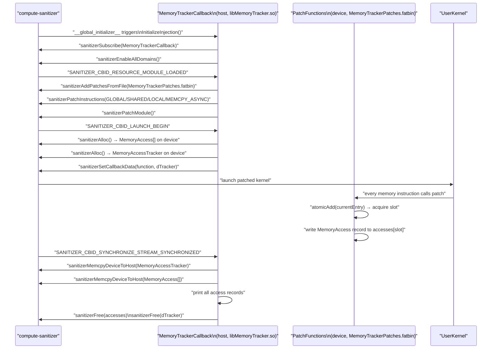
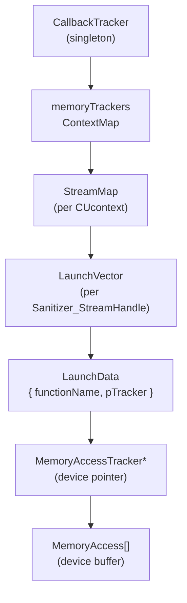

<!-- source: DeepWiki mcp.deepwiki.com · repo NVIDIA/compute-sanitizer-samples · page 2.1 MemoryTracker · fetched 2026-10-26 -->

# MemoryTracker

<details>
<summary>Relevant source files</summary>

The following files were used as context for generating this wiki page:

- [MemoryTracker/Makefile](MemoryTracker/Makefile)
- [MemoryTracker/MemoryTracker.cpp](MemoryTracker/MemoryTracker.cpp)
- [MemoryTracker/MemoryTracker.h](MemoryTracker/MemoryTracker.h)
- [MemoryTracker/MemoryTrackerPatches.cu](MemoryTracker/MemoryTrackerPatches.cu)

</details>


## Purpose and Scope

This page provides an end-to-end overview of the **MemoryTracker** sample: what it does, its two build artifacts, the shared data structures, and the complete flow from module instrumentation through kernel execution to host-side memory access reporting.

- For the common injection library bootstrap pattern shared across all samples, see [Sanitizer Injection API Samples](#2).
- For the host-side implementation in detail, see [Host-Side Implementation](#2.1.1).
- For the device-side patch functions in detail, see [Device-Side Patch Functions](#2.1.2).
- For the build system, see [Build System](#2.1.3).

---

## What MemoryTracker Does

MemoryTracker is a Compute Sanitizer injection library that intercepts every memory access — global, shared, local, and `memcpy.async` — made by any GPU kernel running under `compute-sanitizer`. For each access it records:

| Field | Meaning |
|---|---|
| `address` | Memory address accessed |
| `accessSize` | Access width in bytes |
| `flags` | Read / Write / Atomic (via `SANITIZER_MEMORY_DEVICE_FLAG_*`) |
| `threadId` | `threadIdx` of the accessing thread |
| `type` | `Global`, `Shared`, or `Local` |

After each stream or context synchronization, the data is copied back to the host and printed to `stdout` (or a file named by `OUT_FILE_NAME`). The maximum number of recorded accesses per kernel launch defaults to 1024 and can be overridden via `MEM_ACCESS_SIZE`.

---

## Build Artifacts

The sample produces two independent files:

| Artifact | Source | Compiler | Role |
|---|---|---|---|
| `libMemoryTracker.so` | `MemoryTracker.cpp` | `g++` | Host injection library loaded by `compute-sanitizer` |
| `MemoryTrackerPatches.fatbin` | `MemoryTrackerPatches.cu` | `nvcc` | Device patch functions injected into user kernels at runtime |

Both are built by [MemoryTracker/Makefile]().

**Diagram: Build Artifacts and Their Sources**



Sources: [MemoryTracker/Makefile:72-81]()

---

## Shared Data Structures

Both the host and device sides share types defined in [MemoryTracker/MemoryTracker.h]().

**`MemoryAccessType`** — an enum classifying which memory space was accessed:

```
Global | Shared | Local
```

**`MemoryAccess`** — one record per intercepted instruction:

| Field | Type | Description |
|---|---|---|
| `address` | `uint64_t` | Target address |
| `accessSize` | `uint32_t` | Bytes accessed |
| `flags` | `uint32_t` | Read/Write/Atomic bitmask |
| `threadId` | `dim3` | `threadIdx` at access time |
| `type` | `MemoryAccessType` | Memory space |

**`MemoryAccessTracker`** — the per-launch control structure written by device code and read back by host code:

| Field | Type | Description |
|---|---|---|
| `currentEntry` | `uint32_t` | Atomic slot counter (incremented by device) |
| `maxEntry` | `uint32_t` | Buffer capacity (overflow guard) |
| `accesses` | `MemoryAccess*` | Device pointer to the record array |

Sources: [MemoryTracker/MemoryTracker.h:34-57]()

---

## End-to-End Flow

**Diagram: MemoryTracker Lifecycle**



Sources: [MemoryTracker/MemoryTracker.cpp:77-224](), [MemoryTracker/MemoryTrackerPatches.cu:32-101]()

---

## Host-Side Structure Map

The host side organizes per-launch tracker pointers in a two-level map so that data can be recovered on either a stream-level or context-level synchronization event.

**Diagram: CallbackTracker Internal Structure**



Sources: [MemoryTracker/MemoryTracker.cpp:38-75]()

---

## Patch Function Dispatch

Each patched instruction type calls a named `extern "C"` device function. The sanitizer runtime routes the call to the appropriate function by name, as registered via `sanitizerPatchInstructions`.

| Instruction Type | Sanitizer Constant | Patch Function | Memory Type Recorded |
|---|---|---|---|
| Global load/store | `SANITIZER_INSTRUCTION_GLOBAL_MEMORY_ACCESS` | `MemoryGlobalAccessCallback` | `Global` |
| Shared load/store | `SANITIZER_INSTRUCTION_SHARED_MEMORY_ACCESS` | `MemorySharedAccessCallback` | `Shared` |
| Local load/store | `SANITIZER_INSTRUCTION_LOCAL_MEMORY_ACCESS` | `MemoryLocalAccessCallback` | `Local` |
| `memcpy.async` | `SANITIZER_INSTRUCTION_MEMCPY_ASYNC` | `MemcpyAsyncCallback` | `Global` (src) + `Shared` (dst) |

`MemcpyAsyncCallback` is distinct: it records two accesses per instruction — a read from the global source (`src`) and a write to the shared destination (`dst`). The other three callbacks each delegate directly to `CommonCallback` with their respective `MemoryAccessType`.

Sources: [MemoryTracker/MemoryTracker.cpp:85-89](), [MemoryTracker/MemoryTrackerPatches.cu:59-101]()

---

## Environment Variables

| Variable | Default | Effect |
|---|---|---|
| `MEM_ACCESS_SIZE` | `1024` | Maximum `MemoryAccess` records per kernel launch |
| `OUT_FILE_NAME` | _(none)_ | If set, output is written to this file instead of `stdout` |

Sources: [MemoryTracker/MemoryTracker.cpp:92-103](), [MemoryTracker/MemoryTracker.cpp:55-67]()

---

## Output Format

After synchronization, for each kernel launch the host prints a block of the form:

```
Kernel Launch: <functionName>
  Memory accesses: <count>
  [0] Read access of global memory by thread (tx,ty,tz) at address 0x<addr> (size is N bytes)
  [1] Write access of shared memory by thread (tx,ty,tz) at address 0x<addr> (size is N bytes)
  ...
```

Access type strings (`Read`, `Write`, `Atomic`, `Unknown`) are derived from the `flags` field by `GetMemoryRWString`. Memory space strings (`global`, `shared`, `local`) are derived from `MemoryAccessType` by `GetMemoryTypeString`.

If `currentEntry` exceeds `maxEntry` at readback time, only `maxEntry` records are reported; excess accesses are silently dropped on the device side.

Sources: [MemoryTracker/MemoryTracker.cpp:135-213]()

---

