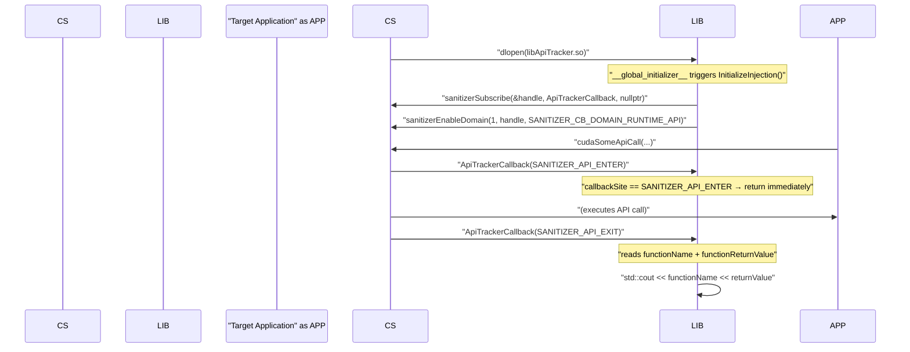
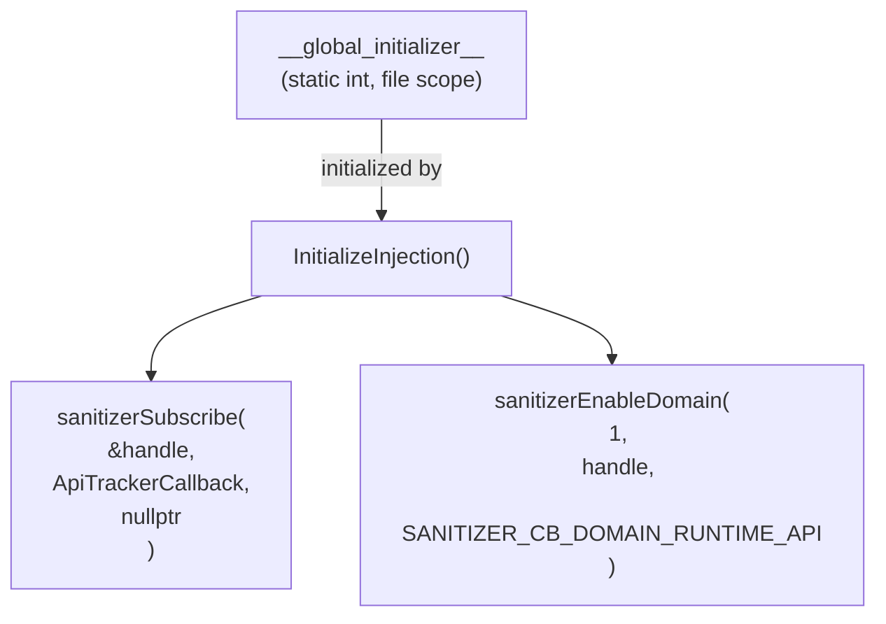
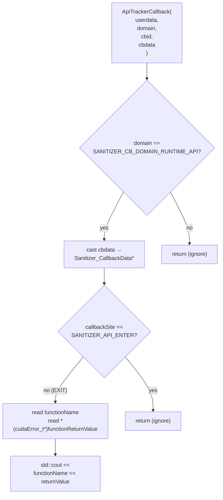
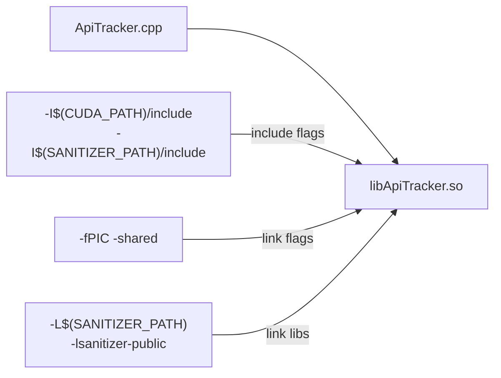

<!-- source: DeepWiki mcp.deepwiki.com · repo NVIDIA/compute-sanitizer-samples · page 2.2 ApiTracker · fetched 2026-10-26 -->

# ApiTracker

<details>
<summary>Relevant source files</summary>

The following files were used as context for generating this wiki page:

- [ApiTracker/ApiTracker.cpp](ApiTracker/ApiTracker.cpp)
- [ApiTracker/Makefile](ApiTracker/Makefile)

</details>


This page describes the **ApiTracker** injection library sample: its purpose, runtime behavior, callback logic, and build system. ApiTracker is the simplest of the three injection library samples — it has no device-side code and produces a single build artifact. For the broader injection API architecture common to all three samples, see [Sanitizer Injection API Samples](#2). For a sample that adds device-side patching on top of the same callback foundation, see [MemoryTracker](#2.1).

---

## Purpose

ApiTracker demonstrates the minimum viable use of the Sanitizer Injection API. When loaded by `compute-sanitizer`, it intercepts every CUDA Runtime API call made by the target application and prints the function name and `cudaError_t` return code to stdout on each API exit.

---

## Runtime Behavior

**Callback flow diagram:**



Sources: [ApiTracker/ApiTracker.cpp:35-66]()

---

## Code Structure

ApiTracker consists of a single source file.

| File | Role |
|---|---|
| `ApiTracker/ApiTracker.cpp` | All host-side logic: callback, subscription, self-registration |
| `ApiTracker/Makefile` | Build rules producing `libApiTracker.so` |

There is no device-side code and no `.fatbin` artifact, unlike [MemoryTracker](#2.1) or [DeviceMalloc](#2.3).

---

## Self-Registration Pattern

**Global initializer diagram:**



[ApiTracker/ApiTracker.cpp:56-66]()

The line:

```
int __global_initializer__ = InitializeInjection();
```

is a file-scope variable whose initializer runs automatically when the shared library is loaded. No explicit `main()` or external call is needed. This is the same bootstrap pattern used by all three injection library samples (see [Sanitizer Injection API Samples](#2)).

`InitializeInjection` allocates a `Sanitizer_SubscriberHandle`, passes `ApiTrackerCallback` as the callback function with `nullptr` as userdata, then enables exactly one domain: `SANITIZER_CB_DOMAIN_RUNTIME_API`.

Sources: [ApiTracker/ApiTracker.cpp:56-66]()

---

## Callback Implementation

**Callback logic diagram:**



Sources: [ApiTracker/ApiTracker.cpp:35-54]()

### Key fields of `Sanitizer_CallbackData`

| Field | Type | Usage in ApiTracker |
|---|---|---|
| `callbackSite` | `Sanitizer_ApiCallbackSite` | Guards against `SANITIZER_API_ENTER`; only `SANITIZER_API_EXIT` proceeds |
| `functionName` | `const char*` | Printed as the API name |
| `functionReturnValue` | `const void*` | Cast to `cudaError_t*` and dereferenced for the return code |

The `cbid` argument (identifying the specific API being called) and the `userdata` pointer (passed as `nullptr` at subscription time) are both unused.

Sources: [ApiTracker/ApiTracker.cpp:35-54]()

---

## Build System

ApiTracker is a pure host-side library compiled entirely by `g++`.



Sources: [ApiTracker/Makefile:37-48]()

### Build variables

| Variable | Default | Purpose |
|---|---|---|
| `CUDA_PATH` | `/usr/local/cuda` | Root of the CUDA Toolkit |
| `SANITIZER_PATH` | `$(CUDA_PATH)/compute-sanitizer` | Headers and `libsanitizer-public` |
| `HOST_COMPILER` | `g++` | The only compiler used — no `nvcc` |

### Build commands

| Target | Command |
|---|---|
| `build` / `all` | Compiles `ApiTracker.cpp` → `libApiTracker.so` |
| `clean` / `clobber` | Removes `libApiTracker.so` |

Unlike MemoryTracker, there is no `GENCODE_FLAGS`, no `--compile-as-tools-patch`, and no `.fatbin` target, because ApiTracker has no device-side instrumentation.

Sources: [ApiTracker/Makefile:30-53]()

---

## Usage

Load the library via `compute-sanitizer`:

```
compute-sanitizer --injection-path libApiTracker.so <target_application>
```

Each CUDA Runtime API call made by `<target_application>` will produce a line on stdout of the form:

```
API call to cudaMalloc (return code 0)
API call to cudaLaunchKernel (return code 0)
...
```

The return code `0` corresponds to `cudaSuccess`. Non-zero codes indicate a CUDA error returned by that specific API call.

---

