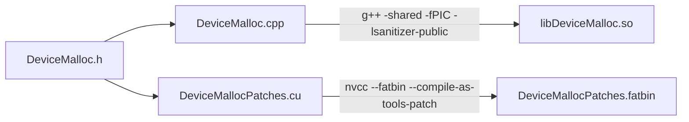
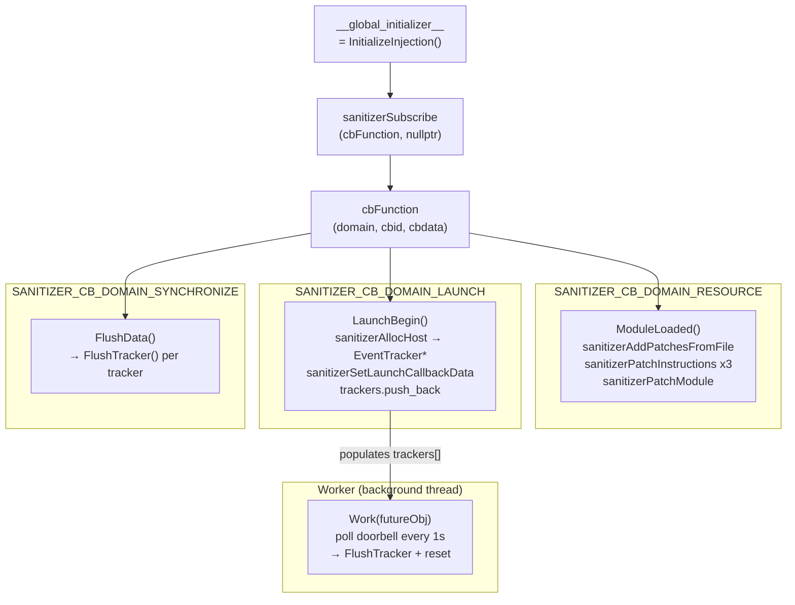

<!-- source: DeepWiki mcp.deepwiki.com · repo NVIDIA/compute-sanitizer-samples · page 2.3 DeviceMalloc · fetched 2026-10-26 -->

# DeviceMalloc

<details>
<summary>Relevant source files</summary>

The following files were used as context for generating this wiki page:

- [DeviceMalloc/DeviceMalloc.cpp](DeviceMalloc/DeviceMalloc.cpp)
- [DeviceMalloc/DeviceMalloc.h](DeviceMalloc/DeviceMalloc.h)
- [DeviceMalloc/DeviceMallocPatches.cu](DeviceMalloc/DeviceMallocPatches.cu)
- [DeviceMalloc/Makefile](DeviceMalloc/Makefile)

</details>


## Purpose and Scope

This page covers the **DeviceMalloc** injection library sample, which demonstrates how to intercept device-side heap allocation instructions (`malloc`, `free`, `__nv_aligned_device_malloc`) using the Sanitizer Injection API. The library patches those instructions in loaded modules, collects per-call data on the device, and streams it to the host via a volatile doorbell flag and a background polling thread.

For background on the shared injection library architecture (subscription, callback domains, module patching), see the [Sanitizer Injection API Samples overview](#2). For a simpler patching example that does not use a background thread, see [MemoryTracker](#2.1).

---

## Build Artifacts

The sample produces two files:

| Artifact | Compiler | Purpose |
|---|---|---|
| `libDeviceMalloc.so` | `g++` | Host-side injection library loaded by `compute-sanitizer` |
| `DeviceMallocPatches.fatbin` | `nvcc --fatbin --compile-as-tools-patch` | Device-side patch functions embedded as a fatbinary |

Both are declared as the `build` target in [DeviceMalloc/Makefile:72]().

**Build diagram: artifacts and source files**



Sources: [DeviceMalloc/Makefile:72-78]()

---

## Data Structures

Both host and device code share the structures defined in [DeviceMalloc/DeviceMalloc.h]().

**`EventData`** — one record per intercepted allocation or free call [DeviceMalloc/DeviceMalloc.h:39-45]():

| Field | Type | Populated by |
|---|---|---|
| `instructionId` | `Sanitizer_InstructionId` | Patch function (identifies malloc / free / aligned_malloc) |
| `address` | `uint64_t` | Pointer returned (malloc/aligned_malloc) or pointer passed (free) |
| `size` | `uint64_t` | Allocation size; **not filled** for `DeviceFree` |

**`EventTracker`** — per-launch shared buffer [DeviceMalloc/DeviceMalloc.h:48-55]():

| Field | Type | Role |
|---|---|---|
| `events[kMaxEvents]` | `EventData[256]` | Ring of event slots |
| `currentIndex` | `uint32_t` | Atomic slot counter (device writes) |
| `numEvents` | `uint32_t` | Count of committed events (device writes) |
| `doorbell` | `volatile bool` | Synchronization flag between device and host |

`kMaxEvents` is 256 [DeviceMalloc/DeviceMalloc.h:37]().

---

## Device-Side Patch Functions

[DeviceMalloc/DeviceMallocPatches.cu]() implements three `extern "C"` patch entry points, each following the same pattern: acquire a slot → fill `EventData` → commit.

**Patch functions registered on the three instruction types:**

| Patch function | Instruction type constant | Records `size`? |
|---|---|---|
| `DeviceMalloc` | `SANITIZER_INSTRUCTION_DEVICE_SIDE_MALLOC` | Yes |
| `DeviceFree` | `SANITIZER_INSTRUCTION_DEVICE_SIDE_FREE` | No |
| `AlignedMalloc` | `SANITIZER_INSTRUCTION_DEVICE_ALIGNED_MALLOC` | Yes |

### Atomic Slot Acquisition — `GetEventIndex`

[DeviceMalloc/DeviceMallocPatches.cu:47-67]()

Each thread calls `atomicAdd(&tracker.currentIndex, 1)` to claim an exclusive slot index. If the returned index is `>= kMaxEvents`, the buffer is full; the thread spins on `*(volatile uint32_t*)&tracker.currentIndex` until the host resets `currentIndex` below `kMaxEvents`.

### Committing an Event — `IncrementNumEvents`

[DeviceMalloc/DeviceMallocPatches.cu:69-80]()

After writing to `tracker.events[idx]`, the thread calls `__threadfence()` to order the write before the counter increment, then does `atomicAdd(&tracker.numEvents, 1)`. When `numEvents` reaches `kMaxEvents - 1`, the last writing thread becomes responsible for flushing the buffer.

### Device-Side Buffer Flush — `FlushData`

[DeviceMalloc/DeviceMallocPatches.cu:31-45]()

```
__threadfence_system()    // flush all prior writes to host-visible memory
tracker.doorbell = true   // signal the host
while (tracker.doorbell)  // spin until host clears the flag
tracker.numEvents = 0
__threadfence()
tracker.currentIndex = 0  // allow other threads to proceed
```

The `__threadfence_system()` is required to ensure `events[]` writes are visible to host CPU before the doorbell is raised.

**Diagram: device-side event recording flow**

```mermaid
sequenceDiagram
    participant T as "Device Thread"
    participant ET as "EventTracker (pinned memory)"
    participant BG as "Worker Thread (host)"

    T->>ET: "atomicAdd(&currentIndex, 1) → idx"
    T->>ET: "write events[idx].{instructionId, address, size}"
    T->>ET: "__threadfence()"
    T->>ET: "atomicAdd(&numEvents, 1) → old"
    alt "old == kMaxEvents - 1 (buffer full)"
        T->>ET: "__threadfence_system()"
        T->>ET: "doorbell = true"
        T-->>BG: "(volatile flag visible to host)"
        BG->>ET: "FlushTracker() — print events"
        BG->>ET: "currentIndex = 0; numEvents = 0; doorbell = false"
        T->>ET: "(spin exits) numEvents = 0; currentIndex = 0"
    end
```

Sources: [DeviceMalloc/DeviceMallocPatches.cu:31-80]()

---

## Host-Side Implementation

[DeviceMalloc/DeviceMalloc.cpp]() handles subscription, per-launch buffer allocation, doorbell polling, and output.

### Initialization — `InitializeInjection`

[DeviceMalloc/DeviceMalloc.cpp:196-206]()

`sanitizerSubscribe` registers `cbFunction` as the callback handler, and `sanitizerEnableAllDomains` activates all three domains (RESOURCE, LAUNCH, SYNCHRONIZE). The function is called via:

```cpp
int __global_initializer__ = InitializeInjection();
```

This is a global-scope C++ initializer that runs when the shared library is loaded by `compute-sanitizer`, before any CUDA context exists.

### Module Instrumentation — `ModuleLoaded`

[DeviceMalloc/DeviceMalloc.cpp:116-128]()

Triggered by `SANITIZER_CBID_RESOURCE_MODULE_LOADED`. Registers patches from `DeviceMallocPatches.fatbin` and calls `sanitizerPatchInstructions` once per instruction type, mapping each type to its corresponding device patch function name:

| `sanitizerPatchInstructions` call | Patch name string |
|---|---|
| `SANITIZER_INSTRUCTION_DEVICE_SIDE_MALLOC` | `"DeviceMalloc"` |
| `SANITIZER_INSTRUCTION_DEVICE_SIDE_FREE` | `"DeviceFree"` |
| `SANITIZER_INSTRUCTION_DEVICE_ALIGNED_MALLOC` | `"AlignedMalloc"` |

`sanitizerPatchModule` finalizes the instrumentation.

### Per-Launch Buffer Allocation — `LaunchBegin`

[DeviceMalloc/DeviceMalloc.cpp:130-143]()

On `SANITIZER_CBID_LAUNCH_BEGIN`, the host allocates a zero-initialized `EventTracker` in pinned host memory via `sanitizerAllocHost`. The pointer is passed to `sanitizerSetLaunchCallbackData`, making it the `userdata` pointer that device patch functions receive. It is also appended to the global `trackers` vector.

> **Note:** The comment in the source marks the `trackers.push_back` call as not thread-safe [DeviceMalloc/DeviceMalloc.cpp:142]().

### Synchronization Flush — `FlushData`

[DeviceMalloc/DeviceMalloc.cpp:86-92]()

On `SANITIZER_CBID_SYNCHRONIZE_STREAM_SYNCHRONIZED` or `SANITIZER_CBID_SYNCHRONIZE_CONTEXT_SYNCHRONIZED`, `FlushData` iterates all trackers and calls `FlushTracker` on each. This handles the case where the kernel completed without filling the buffer to capacity (so the device-side flush path was never triggered).

### Output — `FlushTracker`

[DeviceMalloc/DeviceMalloc.cpp:60-84]()

Iterates `tracker.events[0..numEvents-1]` and prints one line per event, formatting differs by `instructionId`:

| Instruction | Output format |
|---|---|
| `SANITIZER_INSTRUCTION_DEVICE_SIDE_MALLOC` | `malloc(<size>) = 0x<address>` |
| `SANITIZER_INSTRUCTION_DEVICE_SIDE_FREE` | `free(0x<address>)` |
| `SANITIZER_INSTRUCTION_DEVICE_ALIGNED_MALLOC` | `__nv_aligned_device_malloc(<size>) = 0x<address>` |

### Background Thread — `Worker` and `Work`

[DeviceMalloc/DeviceMalloc.cpp:39-114]()

A global `Worker` instance owns a `std::thread` running `Work`. The thread loops every second, polling each tracker's `doorbell` flag. When `doorbell` is `true`, it calls `FlushTracker`, then resets `currentIndex`, `numEvents`, and `doorbell` to zero/false, unblocking the spinning device threads.

The thread is stopped cleanly when the `Worker` destructor calls `exitSignal.set_value()`, which causes `futureObj.wait_for(...)` to return a non-timeout status, exiting the loop.

**Diagram: host-side component relationships**



Sources: [DeviceMalloc/DeviceMalloc.cpp:39-206]()

---

## End-to-End Lifecycle

**Diagram: full lifecycle from library load to event output**

```mermaid
sequenceDiagram
    participant CS as "compute-sanitizer"
    participant H as "libDeviceMalloc.so (host)"
    participant FAT as "DeviceMallocPatches.fatbin"
    participant D as "GPU kernel"

    CS->>H: "dlopen → __global_initializer__ runs"
    H->>CS: "sanitizerSubscribe(cbFunction)"
    CS->>H: "RESOURCE_MODULE_LOADED"
    H->>FAT: "sanitizerAddPatchesFromFile"
    H->>CS: "sanitizerPatchInstructions x3 + sanitizerPatchModule"
    CS->>H: "LAUNCH_BEGIN"
    H->>CS: "sanitizerAllocHost → EventTracker*"
    H->>CS: "sanitizerSetLaunchCallbackData(pTracker)"
    CS->>D: "launch patched kernel"
    D->>D: "DeviceMalloc/DeviceFree/AlignedMalloc patch fires"
    D->>D: "GetEventIndex (atomicAdd)"
    D->>D: "write EventData to events[idx]"
    D->>D: "IncrementNumEvents"
    alt "buffer full"
        D->>H: "doorbell = true (volatile, via __threadfence_system)"
        H->>H: "Worker polls doorbell → FlushTracker → print"
        H->>D: "doorbell = false; reset counters"
    end
    CS->>H: "SYNCHRONIZE_STREAM_SYNCHRONIZED"
    H->>H: "FlushData() → FlushTracker for remaining events"
```

Sources: [DeviceMalloc/DeviceMalloc.cpp](), [DeviceMalloc/DeviceMallocPatches.cu]()

---

## Build System Details

[DeviceMalloc/Makefile]() follows the same two-track pattern used by MemoryTracker (see [2.1.3](#2.1.3)).

| Variable | Value | Purpose |
|---|---|---|
| `LINK_FLAGS` | `-L$(SANITIZER_PATH) -fPIC -shared` | Produces a shared library |
| `LINK_LIBS` | `-lsanitizer-public` | Links against the Sanitizer API |
| `NVCC_FLAGS` | `--fatbin --compile-as-tools-patch` | Produces a fatbinary for patch use |
| `GENCODE_FLAGS` | Per-`SMS` arch list | Multi-architecture SASS + PTX forward-compat |

The `dbg=1` make variable adds `-g -G` to `NVCC_FLAGS` for device debug symbols [DeviceMalloc/Makefile:45-47]().

**Running the sample:**

```
compute-sanitizer --injection-library-path ./libDeviceMalloc.so <target_executable>
```

`DeviceMallocPatches.fatbin` must reside in the working directory at runtime, as it is loaded by filename via `sanitizerAddPatchesFromFile("DeviceMallocPatches.fatbin", 0)` [DeviceMalloc/DeviceMalloc.cpp:119]().

Sources: [DeviceMalloc/Makefile:30-83](), [DeviceMalloc/DeviceMalloc.cpp:119]()

---

