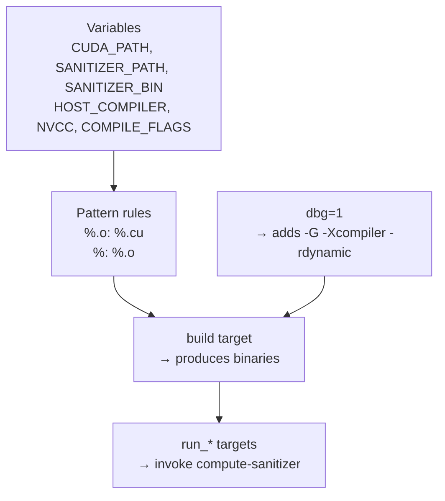
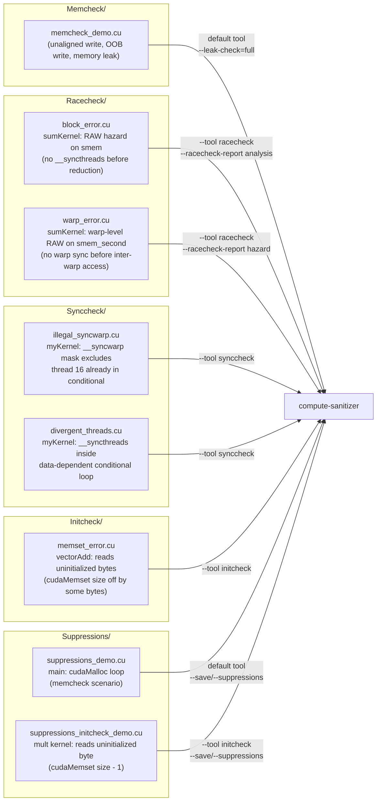

<!-- source: DeepWiki mcp.deepwiki.com · repo NVIDIA/compute-sanitizer-samples · page 3 compute-sanitizer Tool Demos · fetched 2026-10-26 -->

# compute-sanitizer Tool Demos

Relevant source files

The following files were used as context for generating this wiki page:

- [Initcheck/Makefile](Initcheck/Makefile)
- [Memcheck/Makefile](Memcheck/Makefile)
- [Racecheck/Makefile](Racecheck/Makefile)
- [Racecheck/block_error.cu](Racecheck/block_error.cu)
- [Racecheck/warp_error.cu](Racecheck/warp_error.cu)
- [Suppressions/Makefile](Suppressions/Makefile)
- [Suppressions/suppressions_demo.cu](Suppressions/suppressions_demo.cu)
- [Suppressions/suppressions_initcheck_demo.cu](Suppressions/suppressions_initcheck_demo.cu)
- [Synccheck/Makefile](Synccheck/Makefile)
- [Synccheck/divergent_threads.cu](Synccheck/divergent_threads.cu)
- [Synccheck/illegal_syncwarp.cu](Synccheck/illegal_syncwarp.cu)

## Purpose and Scope

This section covers the collection of standalone CUDA programs that demonstrate the **built-in tools** of the `compute-sanitizer` binary. Each program is a deliberately flawed CUDA application, written to trigger a specific class of error that one of the four built-in tools (memcheck, racecheck, synccheck, initcheck) is designed to detect. The Suppressions subdirectory adds a cross-cutting workflow for filtering known errors.

These programs differ fundamentally from the Sanitizer Injection API samples (see [Sanitizer Injection API Samples](#2)): they are ordinary CUDA executables that require no changes to build or link against sanitizer libraries. The sanitizer observes them entirely at runtime by running `compute-sanitizer <binary>`.

---

## Directory Structure and Binaries

Each tool has its own subdirectory containing one or more `.cu` source files and a `Makefile`.

| Directory | Binary / Binaries | Tool Demonstrated |
|---|---|---|
| `Memcheck/` | `memcheck_demo` | `memcheck` (default tool) |
| `Racecheck/` | `block_error`, `warp_error` | `--tool racecheck` |
| `Synccheck/` | `illegal_syncwarp`, `divergent_threads` | `--tool synccheck` |
| `Initcheck/` | `memset_error` | `--tool initcheck` |
| `Suppressions/` | `suppressions_demo`, `suppressions_initcheck_demo` | suppression workflow |

Sources: [Memcheck/Makefile:52-52](), [Racecheck/Makefile:54-54](), [Synccheck/Makefile:54-54](), [Initcheck/Makefile:54-54](), [Suppressions/Makefile:52-54]()

---

## Tool Summary

The following table describes what each built-in tool detects, mapped to the demo program(s) that exercise it.

| Tool | `--tool` flag | What it detects | Demo program(s) |
|---|---|---|---|
| **memcheck** | *(default)* | Out-of-bounds accesses, misaligned accesses, memory leaks | `memcheck_demo` |
| **racecheck** | `--tool racecheck` | Shared memory hazards (RAW, WAW, WAR) between threads | `block_error`, `warp_error` |
| **synccheck** | `--tool synccheck` | Invalid or divergent synchronization barriers | `illegal_syncwarp`, `divergent_threads` |
| **initcheck** | `--tool initcheck` | Reads from uninitialized device memory | `memset_error`, `suppressions_initcheck_demo` |

---

## Common Build Structure

All five Makefiles follow the same pattern. They use `nvcc` backed by `g++` and include a shared set of variables and targets.

**Diagram: Common Makefile layout across all demo directories**

The `SANITIZER_BIN` variable resolves to `$(CUDA_PATH)/compute-sanitizer/compute-sanitizer`, making the run targets self-contained.

Sources: [Memcheck/Makefile:31-68](), [Racecheck/Makefile:31-70](), [Synccheck/Makefile:31-70](), [Initcheck/Makefile:31-67](), [Suppressions/Makefile:31-82]()

---

## How the Demos Are Run

Each Makefile exposes one or more `run_*` targets that call `compute-sanitizer` with tool-specific flags. The table below maps each run target to its invocation.

| Makefile | `make` target | Command invoked |
|---|---|---|
| `Memcheck/Makefile` | `run_memcheck` | `compute-sanitizer --destroy-on-device-error kernel memcheck_demo` |
| `Memcheck/Makefile` | `run_leakcheck` | `compute-sanitizer --destroy-on-device-error kernel --leak-check=full memcheck_demo` |
| `Racecheck/Makefile` | `run_block_error` | `compute-sanitizer --tool racecheck --racecheck-report analysis block_error` |
| `Racecheck/Makefile` | `run_warp_error` | `compute-sanitizer --tool racecheck --racecheck-report hazard warp_error` |
| `Synccheck/Makefile` | `run_divergent_threads` | `compute-sanitizer --tool synccheck divergent_threads` |
| `Synccheck/Makefile` | `run_illegal_syncwarp` | `compute-sanitizer --tool synccheck illegal_syncwarp` |
| `Initcheck/Makefile` | `run_initcheck` | `compute-sanitizer --tool initcheck memset_error` |
| `Suppressions/Makefile` | `gen_supp` | `compute-sanitizer --save supp.xml --xml suppressions_demo` |
| `Suppressions/Makefile` | `run_memcheck_with_supp` | `compute-sanitizer --suppressions supp.xml suppressions_demo` |
| `Suppressions/Makefile` | `initcheck_gen_supp` | `compute-sanitizer --tool initcheck --save supp.xml --xml suppressions_initcheck_demo` |
| `Suppressions/Makefile` | `run_initcheck_with_supp` | `compute-sanitizer --tool initcheck --suppressions supp.xml suppressions_initcheck_demo` |

Sources: [Memcheck/Makefile:64-68](), [Racecheck/Makefile:66-70](), [Synccheck/Makefile:66-70](), [Initcheck/Makefile:66-67](), [Suppressions/Makefile:66-82]()

---

## Demo-to-Error-Class Mapping

The diagram below maps each source file to the specific error class it demonstrates, and to the sanitizer flag used to detect it.

**Diagram: Source files, error types, and sanitizer flags**

Sources: [Racecheck/block_error.cu:37-53](), [Racecheck/warp_error.cu:41-69](), [Synccheck/illegal_syncwarp.cu:37-61](), [Synccheck/divergent_threads.cu:40-66](), [Suppressions/suppressions_demo.cu:28-37](), [Suppressions/suppressions_initcheck_demo.cu:28-45]()

---

## Suppression Workflow Overview

The `Suppressions/` directory demonstrates a two-phase workflow that is tool-agnostic:

1. **Generate** a suppression file by running the program with `--save supp.xml --xml`. The sanitizer writes an XML description of every error it observed.
2. **Apply** the suppression file on subsequent runs with `--suppressions supp.xml`. Errors matching entries in the file are silently filtered from output.

This workflow is demonstrated for both `memcheck` (using `suppressions_demo`) and `initcheck` (using `suppressions_initcheck_demo`), showing that the suppression mechanism is consistent across tools.

Sources: [Suppressions/Makefile:66-82](), [Suppressions/suppressions_demo.cu:28-37](), [Suppressions/suppressions_initcheck_demo.cu:28-45]()

---

## Child Pages

Detailed descriptions of each demo are in the following sub-pages:

- [Memcheck Demo](#3.1) — `memcheck_demo`: misaligned writes, out-of-bounds accesses, memory leaks
- [Racecheck Demo](#3.2) — `block_error`, `warp_error`: shared memory read-after-write hazards
- [Synccheck Demo](#3.3) — `illegal_syncwarp`, `divergent_threads`: barrier misuse
- [Initcheck Demo](#3.4) — `memset_error`: uninitialized memory reads
- [Suppressions Demo](#3.5) — `suppressions_demo`, `suppressions_initcheck_demo`: generating and applying suppression files

---

